<!-- FreeForGem — see LICENSE -->
# FreeForGem — Manual

* [English](#english)
* [Русский](#русский)
* [中文](#中文)

---

## English

### 1. What it is

FreeForGem is a GPU miner for **Pearl (PRL)** (pearlhash proof-of-useful-work) on NVIDIA GPUs (and, since 1.6.0, AMD Radeon
on Windows), with a **1% developer fee**. Since 1.6.0 it also mines Common Foundry (CMFD, section 13), since 1.7.0 **NOID**
(Parano1d, section 15), since 1.7.8 **Proxima (PROX)** (section 21), since 1.8.0 **NEB** (nebhash v2, section 24) and
**Ting / Daler (DLR)** (section 26). Since 1.8.0 one rig can also mine **different coins on different cards** (`--split`,
section 27). What is new in 1.8.0, in short: section 25.

**Name.** Since 1.7.0 the multi-coin miner (Pearl + CMFD + NOID) is called **FreeForGem** (binary `freeforgem`, HiveOS custom
miner `freeforgem`, repository `pepsykolya/FreeForGem`). **FreeForGemPear** continues as the Pearl miner under its own name.
Moving from FreeForGemPear: on HiveOS create a **new flight sheet** (Miner name `freeforgem` + the new Installation URL); the
saved undervolt results (`uv.json` of `/hive-config/freeforgempear` or of a `freeforgempear` folder next to the new one) are
imported automatically on the first start (the log says `imported the saved undervolt results of FreeForGemPear`).
It has its own tuned CUDA kernels. Every share proof is checked on the CPU with the official `zk-pow` verifier before it is submitted.

| GPU series | Status |
|---|---|
| RTX 30xx (Ampere, sm_86): 3060 / 3060 Ti / 3070 / 3070 Ti / 3080 / 3090 | **main target, tuned: ~70 TH/s on an RTX 3070 at ~107 W** |
| RTX 40xx (Ada, sm_89) | own kernel since 1.5.4 (RTX 4070 Ti: same hashrate, ~10 W less than the RTX 30xx kernel) |
| RTX 50xx (Blackwell, sm_120) | supported since 1.5.0 with a compiled kernel (untuned); needs driver 570+ |
| CMP 50HX (TU102) | runs: **on driver 610.43.03 about 67 TH/s per card at lock 1300 and about 77 TH/s at lock 1500** (166–176 W per card, 4× CMP 50HX rig, 1.7.8). On the older drivers 550.78 and 595.91.07 only ~2.6 TH/s (int8 tensor cores cut ~17×): update the driver |
| RTX 20xx / GTX 16xx / CMP 30HX–50HX (Turing, sm_75) | supported since 1.5.3 with an own kernel: ~49.9 TH/s on an RTX 2060 SUPER @1605 MHz; **memory must be locked at 5001, not 810** |
| AMD Radeon RX 6000 (RDNA2), Windows | **new in 1.6.0**, own OpenCL kernel: 34.4 TH/s on an RX 6800 XT (section 14) |
| Older GPUs, A100 (sm_80), AMD on Linux / HiveOS | not supported |

### 2. Requirements

* NVIDIA GPU: RTX 30 / RTX 40 (own kernels), RTX 20 / GTX 16 / CMP, RTX 50 (since 1.5.0); NVIDIA driver **525 or newer** (RTX 50xx: **570+**).
* Or, on **Windows only**, an **AMD Radeon RX 6000** (RDNA2) card with the AMD Adrenalin driver (since 1.6.0, section 14).
* HiveOS, Linux x86_64 (glibc 2.31+, Ubuntu 20.04+), or Windows 10/11 x64. No CUDA toolkit, no Python, no WSL.
* A PRL wallet address (`prl1...`) and an internet connection to a Pearl stratum pool.
* NEB and Ting (1.8.0): NVIDIA GTX 10 or newer (Ting also AMD through OpenCL); the engines and the NEB dataset are in the
  packages (sections 24 and 26).
* Video memory: the miner needs little VRAM.

### 3. HiveOS setup (step by step)

FreeForGem runs on HiveOS as a **Custom miner**: no SSH and no manual installation.

**Installation URL (1.8.0):**

```
https://github.com/pepsykolya/FreeForGem/releases/download/v1.8.3/freeforgem-1.8.3_hiveos.tar.gz
```

1. **Wallet.** In *Wallets*, add your PRL wallet: coin `PRL`, your `prl1...` address.
2. **New flight sheet.**
   * **Coin:** `PRL`.
   * **Wallet:** the wallet from step 1.
   * **Pool:** *Configure in miner*.
   * **Miner:** *Custom*, then press *Setup Miner Config*.
3. **Miner config:**

   | Field | Value |
   |---|---|
   | Miner name | `freeforgem` (filled in automatically after you paste the URL) |
   | Installation URL | the link above |
   | Hash algorithm | `pearlhash` (or leave `----`) |
   | Wallet and worker template | `%WAL%.%WORKER_NAME%` |
   | Pool URL | `pearl-eu2.luckypool.io:3360`, or Kryptex `prl-eu.kryptex.network:7048` (any pool from section 6) |
   | Pass | leave empty |
   | Extra config arguments | optional, for example `--devices 0,1` |

4. **Apply.** *Apply changes*, *Create flight sheet*, then apply it to the rig.

The miner log is at `/var/log/miner/freeforgem/freeforgem.log` and in the HiveOS miner console.
The dashboard shows the hashrate per GPU and in total, temperatures, fans, and accepted and rejected shares; since 1.7.2 the rig efficiency (TH/W for Pearl, MH/W for NOID) next to the miner version; since 1.7.5 a newer release too (`1.7.8 0.652 TH/W, need update!!`: the miner looks for one on GitHub ~1 min after the start and every ~12 h, nothing is installed by itself; `--no-update-check` turns it off).
To update, change the Installation URL to the new version. The same guide with more details: [HIVEOS.md](HIVEOS.md).
HiveOS caches the downloaded archive by its file name: every version has a new file name, so always paste the link of the new release.
NEB, Ting and a rig with different coins on different cards: sections 24, 26 and 27, and [HIVEOS.md](HIVEOS.md).

### 4. Linux without HiveOS

```
tar xzf freeforgem-1.8.3-linux-x86_64.tar.gz
cd freeforgem-1.8.1
./freeforgem --self-test        # optional: checks the GPU kernel against the CPU reference
./freeforgem --pool pearl-eu2.luckypool.io:3360 --wallet YOUR_PRL_ADDRESS --worker rig1     # LuckyPool
./freeforgem --pool prl-eu.kryptex.network:7048 --wallet YOUR_PRL_ADDRESS --worker rig1       # Kryptex
```

| Option | Meaning |
|---|---|
| `--pool HOST:PORT` | stratum pool (default `pearl-eu2.luckypool.io:3360`); a `stratum+tcp://` prefix is accepted, SSL is not supported (use the plain TCP port) |
| `--wallet ADDRESS` | your PRL address (required) |
| `--worker NAME` | worker name (default `worker1`) |
| `--devices 0,1,...` | GPUs to use (default: all visible; honours `CUDA_VISIBLE_DEVICES`) |
| `--minutes N` | stop after N minutes (default: run until Ctrl-C / SIGTERM) |
| `--self-test` | verify the kernel and exit |

One process drives all GPUs and reconnects to the pool on its own. For a permanent setup run it under `systemd`, `screen` or `tmux`.

### 5. Windows 10/11

Native Windows build: no WSL, no CUDA installation, no Python. Only the NVIDIA driver is needed.

1. Download **`freeforgem-1.8.3-windows-x64.zip`** from the release page:
   `https://github.com/pepsykolya/FreeForGem/releases/download/v1.8.3/freeforgem-1.8.3-windows-x64.zip`
   and check its SHA-256 (section 9).
2. Unpack it to a folder **without spaces or non-English letters**, e.g. `C:\FreeForGem`.
3. Pick the start file for your pool — every one is ready to run, only the wallet has to be changed:

   | File | Pool |
   |---|---|
   | `start.bat`, `start-luckypool-eu.bat` | LuckyPool Europe `pearl-eu2.luckypool.io:3360` |
   | `start-luckypool-ru.bat` / `-us.bat` / `-asia.bat` | LuckyPool Russia / US East / Singapore |
   | `start-kryptex-eu.bat` | Kryptex Europe `prl-eu.kryptex.network:7048` |
   | `start-kryptex-ru.bat` / `-us.bat` / `-asia.bat` | Kryptex Russia / North America / Singapore |

   **Important:** in every file `WALLET` is preset to the **developer's example address**. Replace it with yours, or you mine for
   the developer (the miner warns about this at start). Right-click the file → *Edit* and set:

| Setting | Value |
|---|---|
| `WALLET` | your PRL address (`prl1...`) |
| `POOL` | `HOST:PORT`, default `pearl-eu2.luckypool.io:3360` (section 6) |
| `WORKER` | rig name, default = computer name |
| `DEVICES` | empty = all NVIDIA GPUs, or a list like `0,1` (indexes from `nvidia-smi`) |

4. Double-click the chosen **`.bat`** file. One miner process drives all GPUs; its output is shown in the window and saved to
   `logs\miner-<date>.log` (the last 10 logs are kept). If the miner exits or crashes, it is restarted after 15 s.
   `Ctrl+C` stops it.

* **Autostart:** put a shortcut to `start.bat` into `shell:startup` (Win+R, `shell:startup`), or create a Task Scheduler
  task "At log on" that runs `start.bat`.
* **Overclocking:** MSI Afterburner (core lock in the curve editor, memory down) with the values from section 7, **or**
  the miner's built-in clock control (next bullet). Laptops: plug in the charger and choose the maximum performance mode.
* **Built-in clock control (new in 1.4.9):** set `LOCK_CCLOCK`, `LOCK_MCLOCK` and/or `MOFFSET` in the `.bat` file (section 12),
  e.g. `set "LOCK_CCLOCK=1560"` and `set "LOCK_MCLOCK=810"`. The miner locks the clocks at start and restores them on exit.
* **Undervolt (optional):** remove `rem` before `set "AUTO_UV=1"` in `start.bat` and run it as Administrator; see section 12, *Windows: step by step*.
* **Run as Administrator for any GPU tuning.** `AUTO_UV`, `LOCK_CCLOCK`, `LOCK_MCLOCK` and `MOFFSET` change the GPU through the
  driver, which needs admin rights: right-click the `.bat` → **Run as administrator** (for autostart, tick *Run with highest
  privileges* in the Task Scheduler task). Without it the miner keeps running but mines at the current clocks and prints a
  warning. Plain mining (wallet / pool only) does **not** need Administrator.
* Defender / SmartScreen may flag a new unsigned `.exe`: *More info → Run anyway*, or add the folder to the exclusions.
* Without `start.bat`: `freeforgem.exe --pool pearl-eu2.luckypool.io:3360 --wallet YOUR_PRL_ADDRESS --worker rig1`

**Advanced: your own `.bat` with `nvidia-smi` clock lock + power limit.** If you also want a **power limit** (the built-in
clock control does not set one), or prefer your own restart loop and log file, write a `.bat` like the one below and start it
**as Administrator** (right-click → *Run as administrator*; `nvidia-smi -lgc/-lmc/-pl` and `--auto-uv` all need admin):

```bat
@echo off
rem Lock clocks and power limit through the driver (Administrator; reset on reboot). See section 7 for values.
nvidia-smi -lgc 1665
nvidia-smi -lmc 810
nvidia-smi -pl 165
cd /d C:\Mining\freeforgem-1.8.3-windows-x64
:loop
powershell -NoProfile -Command "& { .\freeforgem.exe --pool pearl-eu2.luckypool.io:3360 --wallet YOUR_PRL_ADDRESS --worker rig1 --auto-uv --uv-min 135 --uv-max 360 | Tee-Object -Append -FilePath C:\Mining\ffgp.log }"
timeout /t 10
goto loop
```

Replace `YOUR_PRL_ADDRESS` with your `prl1...` address (for LuckyPool PRL+NOCK merge mining append `+YOUR_NOCK_ADDRESS`).
`-lgc` locks the core clock, `-lmc` the memory clock, `-pl` the power limit in watts; `timeout /t 10` + `goto loop` restart the
miner 10 s after any exit, and `Tee-Object` writes a log while still showing the output. To release the locks without a reboot:
`nvidia-smi -rgc` and `nvidia-smi -rmc`. (The shipped `start.bat` does the clock lock and restart loop for you via `LOCK_CCLOCK` /
`LOCK_MCLOCK` and `MOFFSET`; use a custom `.bat` like this only when you need `-pl` or your own logging.)
Since 1.5.1 the Windows archive ships this file ready to edit: **`start-nvidia-smi.bat`** (clock lock, power limit, undervolt
range, restart loop and `logsfgp.log` in the miner folder; the shipped values are for an RTX 3070, change them for your card).

### 6. Pools

Default: **LuckyPool**, `pearl-eu2.luckypool.io:3360` (plain TCP stratum). The hosts and ports below are taken from the pool's own
configuration (`https://pearl.luckypool.io/api/stats`, `config.stratum` and `config.ports`); pick the region closest to you:

| Region | Host |
|---|---|
| Europe | `pearl-eu2.luckypool.io` (default), `pearl-eu1.luckypool.io`, `pearl-pl.luckypool.io` (Poland), `pearl-tr.luckypool.io` (Turkey) |
| Russia | `pearl-ru.luckypool.io` |
| US | `pearl-us-east.luckypool.io`, `pearl-us-west.luckypool.io`, `pearl-us-central.luckypool.io`, `pearl-us-ord.luckypool.io` |
| South America | `pearl-br.luckypool.io` (Brazil) |
| Canada | `pearl-ca1.luckypool.io`, `pearl-ca2.luckypool.io` |
| Asia | `pearl-sg1.luckypool.io`, `pearl-sg2.luckypool.io` (Singapore), `pearl-id.luckypool.io` (Indonesia), `pearl-hk.luckypool.io` (Hong Kong), `pearl-in.luckypool.io` (India), `pearl-jp.luckypool.io` (Japan), `pearl-au.luckypool.io` (Australia) |

| Port | Share difficulty (vardiff) |
|---|---|
| `3360` | 2 000 000 (default) |
| `3361` | 4 000 000 |
| `3362` | 8 000 000 |

Example: `--pool pearl-pl.luckypool.io:3360`. Use your plain `prl1...` address as the wallet; the worker name is sent separately.
Any other Pearl stratum pool that speaks the same JSON-RPC stratum can be used; the dev fee (section 10) is then mined on that pool.
Backup pools: `--pool A,B` (the first is the primary; the miner fails over and returns to the primary when it works again), see section 22.

**NOCK merge mining (LuckyPool only).** LuckyPool pays Nockchain (NOCK) for the same Pearl work, with no
hashrate loss: write the wallet as `PRL_ADDRESS+NOCK_ADDRESS`, for example
`--wallet prl1...+YOUR_NOCK_ADDRESS`. NOCK stats are at `https://nock.luckypool.io` under your NOCK address. In the Windows
`.bat` files put the same `prl1...+NOCK...` into `WALLET`; on HiveOS put it into the PRL wallet address. Other pools
(Kryptex) do not support it: since 1.4.3 the miner drops the `+...` part there by itself (log: `merge mining (+NOCK/+NACR) works on
LuckyPool, HimPool and AlphaPool only`) and mines PRL to the `prl1...` part.

**NACRE (NACR) merge mining (HimPool, AlphaPool; since 1.7.3).** These pools pay NACR for the same Pearl work: write the
wallet as `PRL_ADDRESS+NACR_ADDRESS` (`--wallet prl1...+nacr1p...`; on HimPool `prl1...+nacr1p...+NOCK_ADDRESS` adds NOCK too).
The miner keeps the `+` parts there and appends the worker after them (`prl1...+nacr1p....rig1`); the log shows
`merge mining: PRL to prl1..., +nacr1p... on this pool`. Without a NACR address HimPool keeps the NACR share. Ports:
AlphaPool `eu1.alphapool.tech:5571` (also `us1`, `us2`, `ru1`, `sg1`), HimPool `eu.himpool.com:1480` (also `in`, `ca`).

**Kryptex** (checked in 1.4.1): `--pool prl-eu.kryptex.network:7048` (also `prl`, `prl-us`, `prl-br`, `prl-sg`, `prl-hk`, `prl-ru`,
`prl-ae` `.kryptex.network`; port 7048 is plain TCP). Wallet: your `prl1...` address. Kryptex reads the worker name from the login,
so since 1.4.3 the miner sends `prl1....WORKER` there (before 1.4.3 Kryptex showed every rig as `worker`).
**Kryptex username** (since 1.7.4): instead of the `prl1...` address the wallet can be your Kryptex account username (payouts in
BTC/USDT with auto-conversion, statistics in the Kryptex dashboard); the miner logs in as `username/WORKER`. Windows: put the
username into `WALLET` of a `start-kryptex-*.bat`; HiveOS: the username as the wallet, template `%WAL%.%WORKER_NAME%` as usual.
Before 1.7.4 the Windows start file refused it ("WALLET does not look like a PRL address").
Big rigs on Kryptex (more than ~0.5 PH/s per worker) can set a custom share difficulty since 1.4.5: `--password d=VALUE`
(HiveOS: Extra config arguments; Windows: `PASSWORD` in the `.bat`), `VALUE = hashrate (H/s) × seconds per share / 4294967296`;
the default is 2097152 (a 100 TH/s worker finds a share every ~90 s).

**Proof compression.** Proofs are sent gzip-compressed (about 5 KB instead of about 270 KB: much less traffic, faster submits,
fewer stale shares) when the pool agrees to it at login: since 1.4.4 the miner follows the Pearl stratum gzip protocol (sends
`"type":"v2"` in `mining.authorize`; Kryptex and LuckyPool answer `"type":"v2"`, log: `pool confirmed gzip proofs`). A pool that does
not confirm it gets uncompressed proofs. Since 1.4.5 the proof is compressed at the standard gzip level (~3 KB) and jobs that
arrive before the login reply wait for it, so every proof follows the agreed format. `FFGP_PROOF_GZIP=on` / `off` forces the choice.
**Kryptex users of 1.4.1–1.4.3:** those versions sent compressed proofs without this handshake; Kryptex answered "accepted" but did
not credit the shares. Update to 1.4.4 or newer.

### 7. Overclocking (core lock, memory, V/F offset)

The miner needs almost no VRAM bandwidth, so the memory clock can go down to the lowest value.
The three settings that matter: a **locked core clock**, a **low memory clock**, and a **V/F offset** (undervolt: the same
clock at a lower voltage; `--auto-uv` finds it for you, section 12).

**Measured with FreeForGem, RTX 3070:** core `1560` MHz locked, memory `810` MHz, power limit `120` W →
**~70 TH/s at ~105–107 W**; `--auto-uv` then finds +195..240 (≈ 86–107 W).

**Starting values per card.** *Reference* rows are published tuning results for that card; *estimate* rows are derived from
cards of the same generation and are not measured. Every card differs: let `--auto-uv` find your own offset.

| GPU | Core lock, MHz | Memory | V/F offset, MHz | Source |
|---|---|---|---|---|
| RTX 3060 Ti, RTX 3070, RTX 3070 Laptop, RTX 3080 Ti | 1560–1650 | lock `810` | +200..255 | reference (3070: measured) |
| RTX 3060, RTX 3070 Ti, RTX 3080, RTX 3090 | 1560–1650 | lock `810` | +200..255 | estimate |
| CMP 70HX, CMP 90HX (Ampere) | 1650 | offset `-2000` (`--moffset`) | +255..300 | reference, not checked with FreeForGem |
| RTX 4070 Ti, RTX 4090 | 2445 | lock `810` | +315..345 | reference |
| RTX 4060, 4060 Ti, 4070, 4070 Super, 4070 Ti Super, 4080, 4080 Super | 1900–2445 | lock `810` | +300..345 | estimate |
| RTX 5070 Ti | 2445 | lock `810` | +480 | reference |
| RTX 5070 | 2400 | lock `810` | checks pass up to +390, crash above | user report, FreeForGemPear 1.5.1, Windows, driver 617.14 |
| RTX 5060, 5060 Ti, 5080, 5090 | 1900–2500 | lock `810` | +390..480 | estimate |
| RTX 2060 SUPER, RTX 2070/2080 (incl. SUPER), GTX 1660/1650 | 1500–1650 | lock `5001` (**not 810**: Turing loses ~25% at 810) | +200..260; auto-uv limit +225 by default (since 1.6.2) | reference (2060 SUPER: measured) |
| CMP 40HX | 1400 | lock `5001` | +150; auto-uv limit +150 by default (since 1.6.2) | user rigs; a CMP 40HX hit Xid at +255 |
| CMP 50HX (TU102) | — | lock `5001` | +220 and more; auto-uv limit +330 by default (`--uv-max 330`) | user rigs. Lock **1300–1500** (default top of `--auto-lock` for CMP cards is 1500). **Pearl on driver 610.43.03: ~67 TH/s per card at 1300, ~77 TH/s at 1500** (166–176 W per card, 4× CMP 50HX rig); on the older drivers 550.78 / 595.91.07 only ~2.6 TH/s (int8 tensor cores cut ~17×) |

RTX 40 and 50 run at a much higher locked core clock (**1900–2500 MHz**) and hold a higher offset than RTX 30.

**Mixed rig:** `--auto-uv` is enough. Since 1.8.1 the miner has no offset ceiling of its own: every card climbs, as long as each
step lowers the power, at most to the range its driver allows (before 1.8.1 there were built-in limits per card type); the log
shows the range of every GPU at start (`auto-uv: GPU5 (bus 0b, CMP 40HX): range +60..+1000 (max: the driver's +1000; ...)`). To
limit a card yourself give one value per GPU in `--devices` order: `--uv-max 225,-,150` (`-` = no limit of yours for that GPU). Turing (RTX 20 / GTX 16 / CMP 30HX–50HX, sm_75) is supported since 1.5.3: unlike RTX 30 it needs the memory locked at 5001 (see the table); CMP 170HX / A100 (sm_80) are not supported.

**CMP cards (CMP 30HX / 40HX / 50HX).** CMP 30HX/40HX mine Pearl with the Turing kernel (memory locked at 5001, auto-uv
limit +150). **CMP 50HX and Pearl:** on driver 610.43.03 it mines about 67 TH/s per card at core lock 1300 and about 77 TH/s at 1500
(166–176 W per card; 4× CMP 50HX rig, FreeForGem 1.7.8); on the older drivers 550.78 and 595.91.07 it gives only ~2.6 TH/s
(its int8 tensor cores are cut ~17x there), so update the driver first. **For Common Foundry (CMFD) the CMP 50HX works well:** ~13 FW/s per card at ~220 W (power limit
225 W, core lock 1410 MHz, memory not locked; 4x CMP 50HX rig on the Aria pool), with `--auto-uv` (CMFD tuner, +225) about
13.2 FW/s at 196–203 W (+8–11 % FW/W); see section 13. CMFD needs ~7 GB of free GPU memory, so 6 GB cards (CMP 30HX) cannot
run it. **Unlocking CMP cards is not part of FreeForGem:** we do not provide or support drivers or tools that lift the
limits of CMP cards; all numbers here are for the cards as they are.

* HiveOS: Overclock tab → core clock (absolute), memory clock (absolute), power limit; the V/F offset via `--auto-uv`.
* Linux: `nvidia-smi -lgc 1560,1560`, `nvidia-smi -lmc 810,810`, `nvidia-smi -pl 120` (root), or `--lock-cclock` / `--lock-mclock`.
* Windows: `LOCK_CCLOCK` / `LOCK_MCLOCK` / `MOFFSET` in `start.bat` (as Administrator), `start-nvidia-smi.bat` for a power
  limit, or MSI Afterburner. Ready combinations per card: section 12, *Windows: ready combinations*.

If shares get rejected or the log shows `bad` hits, lower the core clock or the offset.

### 8. Reading the log

| Line | Meaning |
|---|---|
| `FreeForGem 1.7.2 \| pool ... \| worker ... \| N GPU(s)` | start banner |
| `[pearlgpu] search kernel: ...` | the tuned kernel is loaded. `embedded search kernel could not be loaded (reason)` = the miner stops with an error (driver older than 525 or an unsupported GPU) |
| `new job ... prepared in ...` | a new pool job is ready |
| `[ 120s] GPU0 ... \| total X TH/s \| hits ... \| user sub S acc A rej R \| fee sub ... acc ... rej ...` | every 10 s: hashrate per GPU and in total; shares submitted / accepted / rejected for you and for the dev fee; `[DEVFEE]` while a fee slot runs Since 1.5.3 each GPU also shows its board power and efficiency, e.g. `GPU0 49.906 (151 W, 0.330 TH/W)`, and the total `\| 151 W, 0.330 TH/W` (when NVML is available) |
| `[DISCONNECTED]` | the pool connection is down; the miner reconnects by itself |
| `devfee: ...` | the dev fee slots (section 10) |
| `!! ...` | a warning or error (a GPU worker stopped, a hit was not submitted) |
| `auto-uv: GPU3 (...) RESULT: offset +285 at 1815 MHz ...` | the end of one GPU's tuning / check (1.7.2) |
| `faults: GPU3 (bus 04, RTX 3070) FAILED: Xid 13 ...` | the GPU that crashed; the miner steps it down and restarts itself (section 17) |
| yellow `auto-uv: ...` / `auto-lock: ...` lines, orange failures and roll-backs | the automatic tuning (1.8.0, every coin; `--no-color` turns colours off) |
| `[LOCK NOT HELD: GPU2]` on the stats line | the core clock lock of that GPU does not hold under load; auto-uv and auto-lock leave that GPU (section 25) |
| `[neb] [  60s] GPU0 ...` | `--split` (section 27): a line of one group; the group name in front, in light blue |
| `WARNING GPU1 (bus 05): FAULTY: ...` | NEB / Ting: 3 faults within 10 min at the card's safe offset: it pauses 10 min, then gets a new engine (section 29) |
| `WARNING: the pool answers late: ...` | the pool's answers come seconds after the submit (lost packets on the rig's network); such shares come back stale (section 29) |

### 9. Verifying the download (SHA-256)

Compare the result with the hash on the release page.

* Linux: `sha256sum freeforgem-1.8.3-linux-x86_64.tar.gz freeforgem-1.8.3_hiveos.tar.gz`
* Windows: `certutil -hashfile freeforgem-1.8.3-windows-x64.zip SHA256` or
  `Get-FileHash freeforgem-1.8.3-windows-x64.zip -Algorithm SHA256`

### 10. Dev fee — 1%

One 60-second slot in every 100 minutes, at a random moment of the cycle, on **the same pool you configured**, under a
separate login (worker `ffgp-devfee`). The log shows `devfee: next slot in N min`,
`devfee: mining 60s for FreeForGem dev (1%)` and `devfee: back to user`. The first slot comes at a random moment within
the first 100 minutes. If the fee login cannot be served, the slot is skipped; your mining is never blocked.
On LuckyPool the fee login also merge-mines NOCK for the developer (`prl1...+NOCK`, since 1.4.2); if the pool refuses that login,
the miner falls back to the plain PRL fee wallet. The fee time stays 1%.
With a pool list (section 22) the fee connection follows you: it always goes to the pool you are on at the moment its slot starts.
The fee is a condition of the license: removing, reducing or redirecting it is not permitted (see [LICENSE](LICENSE), clause 3).

**Every coin (1.8.0).** The fee is 1 % for every coin and always runs on a connection of its own, never inside your session:
Pearl and NOID: a second login on your pool (above); PROX: also a second login on your pool, proximamine only as the fallback (solo, suprnova, a refused fee login; section 21); CMFD: inside the engine, 36 s per hour per
GPU (section 13); NEB: 60 s in every 100 minutes on your pool list, or on the public NEB pools when you mine solo or through a gate
(worker `ffg`, section 24); Ting: 60 s in every 100 minutes on crypto-connection.net (worker `ffg`; solo without that pool, the
node's blocks pay the developer during the slot, section 26). A slot whose fee connection was not ready is tried again up to 3 times,
5 minutes apart, in the same cycle. With `--split` every group pays 1 % of its own cards' time (section 27).

### 11. Troubleshooting

| Symptom | Fix |
|---|---|
| Check that everything works | `freeforgem --self-test` (Windows: `freeforgem.exe --self-test`) must end with `== self-test PASSED ==` |
| `embedded search kernel could not be loaded` at start | update the NVIDIA driver (525+; **RTX 50xx needs 570+**) and check that the GPU is Ampere (RTX 30xx) or newer |
| High CPU load | by default GPU waits sleep (well under 10% of a core per GPU). `PEARL_SPIN=1` makes them spin (a full core per GPU): make sure it is not set |
| GPU initialization or out-of-memory errors | another program holds the GPU (games, local AI models). Close it or choose GPUs with `--devices` |
| `[DISCONNECTED]` for a long time | check the pool host/port and the firewall (outgoing TCP); try another region from section 6 |
| Many rejected shares | lower the core clock (section 7), check cooling |
| Hashrate drops after a few minutes, Task Manager shows *Video Encode* load | screen sharing, recording or streaming (Discord screen share, OBS, NVIDIA App / Instant Replay) runs on the same GPU and takes its share; stop it or turn off hardware acceleration in that program |
| HiveOS says `Already installed` and nothing changes | the Installation URL must point to a new version |
| HiveOS reboots the rig while several GPUs tune (`sreboot fast`, load average ≥ max_la, 28 on a 4C/8T CPU) | update to 1.7.2: much lower CPU load while tuning (load average ~2–3 on 8 GPUs instead of 24+); the tuning summary warns above 2 × the CPU threads |
| Windows: the window closes at once | run `start.bat` from `cmd` to see the message; the path must not contain spaces or non-English letters |
| Windows: `.exe` blocked by Defender / SmartScreen | *More info → Run anyway*, or add the folder to the exclusions; check the SHA-256 |
| `WARNING GPU 0: no CUDA context yet (...)` at the start (Pearl) | the previous miner is still leaving that GPU; since 1.8.0 the miner waits for it (up to 60 s) instead of stopping |
| Many stale shares, `WARNING: the pool answers late` | the rig's network loses packets (network card, cable, switch); the miner cannot repair that. NEB: `--debug-timing` logs the times of every share (section 29) |
| `FAULTY`, `DEAD`, `GPU LOST`, `REBOOT NEEDED` in the log or in HiveOS | section 29 |
| `--split`: one group ends again and again | the lines of that group start with `[group]`; it restarts on its own (10 s; after 3 ends in 10 min: a 10 min pause) while the other groups mine on (section 27) |
| `--lock-cclock` list shorter than the number of GPUs | fine since 1.8.0: the last value goes to the remaining GPUs (section 28) |

Environment variables (set before starting the miner): `PEARL_SPIN=1` (spin-wait instead of sleeping).
On Windows: `set PEARL_SPIN=1` in a `cmd` window, then run `start.bat` from that window.

### 12. Undervolt / `--auto-uv` (optional, new in 1.4.0)

**Video tutorials.** Step-by-step videos on setting up the undervolt are attached to the GitHub release as separate files (Releases page → the release → *Assets*): in English `FreeForGemPear-1.5.3-undervolt-EN.mp4` and in Russian `FreeForGemPear-1.5.2-undervolt-RU.mp4`.

**Off by default.** With `--auto-uv` the miner finds, once per GPU, a lower core voltage (the GPU's *V/F offset*) at which the
card still computes everything correctly, uses it while mining, and puts your own settings back when it exits. Lower voltage
means fewer watts at the same hashrate: the clock stays where you locked it (section 7).

**What it does**
1. Reads the V/F offset the card has now (HiveOS OC, your own script, ...) and writes it to a restore file *before* changing anything.
2. Warms the GPU up (since 1.8.1 the card mines while it warms up), then raises the offset step by step and checks every step bit-exactly under full load, on the GPU and
   on the CPU with the official verifier. Wrong results without any driver error do happen near the limit, which is why every
   step is checked this way (since 1.7.6 the tuning of Pearl, NOID and CMFD takes about half as long, with the same result).
3. A wrong result, CUDA error, Xid error or hang ends the climb. The result keeps a **safety margin** below the last good
   step and is confirmed by a longer check; if the confirmation fails it goes lower. Since 1.8.1
   there is no built-in highest value: the climb stops where the power no longer falls or at the first failing check, at the
   latest at the top of the driver's range; `--uv-max N` sets your own limit (before 1.8.1 the miner had built-in limits per card
   type, and a saved result that stopped at such a limit climbs on from it). RTX 40/50 cards often hold +450 and more.
   A saved result above a lowered limit is not used as is: the card runs at the limit (after a quick check) and the saved
   result is kept for when the limit goes up again; a saved result that *is* the old limit is tuned again when the limit rises.
4. The result is saved in `uv.json`, keyed by GPU UUID, driver version, kernel build and core clock lock (one profile per lock,
   section 17). Later starts apply it after a quick check (about 30 s). If the driver or the kernel build changed, the GPU is
   tuned again; a new lock is tuned once, a known lock reuses its profile.
   Each check needs about 1.8 GB of RAM: on a rig with little RAM the checks of several GPUs wait their turn
   (`waits its turn for a check` in the log), and the other GPUs mine meanwhile (since 1.7.2 mining starts at once; since
   1.7.1 a GPU that waits its turn for a re-check keeps mining).
5. While mining: every 6 hours (`--uv-reval-hours`) the setting is re-checked (since 1.8.1 the card keeps mining during the check, at a lower hashrate for about 30 s).
   If a found result fails the CPU check, or a burst of rejected shares appears, the offset goes one step down (never
   below your own value) and is saved. **OC applies (since 1.7.1):** HiveOS `nvidia-oc` writes the *Core Clock* value of the
   OC profile at every miner start and every OC change, **0 when that field is empty** — before 1.7.1 this switched the
   undervolt off until the next restart (a 4x RTX 3070 rig ran at 604 W instead of ~440 W). Now an offset that is read back as
   0, as the HiveOS profile value or as your own starting offset counts as an OC apply: auto-uv sets the verified offset again
   after a quick check (the card keeps mining, at a lower hashrate for ~30 s; a failure steps back as in the re-check; at most 4 times an hour),
   log `the offset was reset to +0 by an OC apply (...); re-applying the verified +285 after a quick check`. A check during
   which an OC apply reset the offset is repeated. Any other value is your own choice: auto-uv stands down on that GPU and
   does not fight.
6. On exit (Ctrl+C, SIGTERM, HiveOS `miner stop`, closing the Windows console, normal end) your offset is restored on every
   GPU (before 1.6.1 a `miner stop` on HiveOS could restore only GPU0). If the miner was killed (`kill -9`, crash), the next start
   restores your offset first, from the restore file `uv-restore.json`. A reboot resets the offset in the driver anyway.
   A stop while a check runs (HiveOS `miner stop` / `miner restart` sends Ctrl+C and then closes the screen session) is not a
   failure (since 1.7.1, also for CMFD and NOID): the offset under check is neither taken for a crash point nor paused for 24 h;
   the next start goes on as before.

Only the V/F offset is changed: locked clocks, power limit and memory are not touched. Only the GPUs the miner mines on are
touched. Every GPU is matched by its PCI bus id (and UUID); the log shows the bus id of each change.

**Requirements.** NVIDIA driver (NVML is loaded at run time, nothing to install) and **root** on Linux / HiveOS (the miner
runs as root there) or **Administrator** on Windows. Without NVML or permission the miner logs the reason and mines normally.
**Time:** since 1.8.1 all GPUs are tuned at once and the first tuning takes **a few minutes** (4x RTX 3070: NEB 1.5-2 min, PROX about 5,
Ting 6-8.5, NOID about 9, CMFD 10-18; before 1.8.1 about 15 minutes per GPU). Later starts add about 30 s. **Since 1.8.1 the card mines the whole
time, on every coin:** while it is tuned it keeps mining and its shares go to the pool; its hashrate is somewhat lower only while a step is checked. Before 1.8.1 the card stopped
mining at every step (Pearl: up to about 14 minutes without hashrate, the pool did not see the worker). The guards against an endless tuning and
the flags `--uv-parallel` / `--uv-unpause`: section 30.

**Windows: step by step.** Checked on Windows 11 with a GeForce RTX 3070 and driver 581.80: the driver lets the miner read
and change the offset (the log shows `allowed -1000..1000`), the tuner found +240 instead of +225 (98.4 W → 86.5 W at the
same clock), and the safety net worked too (a found result failed the CPU check → back to +225, auto-uv paused for 24 h).
1. **Administrator.** Right-click the `.bat` → *Run as administrator*. For autostart create a Task Scheduler task with
   *Run with highest privileges*. Without it the log says that the offset cannot be changed, and the miner just mines.
2. **Lock the core clock** (section 7): `set "LOCK_CCLOCK=1560"` in `start.bat` (one value, or a comma list per GPU), or
   `nvidia-smi -lgc` in `start-nvidia-smi.bat`. With a locked clock a higher offset means a lower voltage at the same clock;
   without the lock the card may boost higher instead and the saving is smaller.
3. **Turn it on**, one of:
   * `start.bat` (or any `start-luckypool-*` / `start-kryptex-*`): remove `rem` before `set "AUTO_UV=1"`. The upper limit is
     `set "UV_MAX="` (empty = no limit of yours, since 1.8.1 the driver's range; RTX 40/50 often hold +450 and more, RTX 30
     usually +200..360). A comma list sets one value per GPU in `DEVICES` order, e.g. `set "UV_MAX=225,-,150"`.
   * `start-nvidia-smi.bat`: `AUTO_UV=1`, the range in `UV_MIN` / `UV_MAX`, plus power limit and clock lock through `nvidia-smi`.
   * your own command line: `freeforgem.exe --pool ... --wallet ... --auto-uv --uv-max 480`.
4. **Starting point.** The tuner starts from the offset the card has now (RTX 3070 / 3060 Ti since 1.7.2: from a default by the core lock, section 17); a start that fails at these clocks steps down by itself. The *Core Clock* offset of
   MSI Afterburner (or a similar tool) is this same offset, so a value you set there is your starting point and is put back
   on exit. If Afterburner re-applies a profile while mining (the offset goes back to your value or to 0), auto-uv puts the
   verified offset back after a quick check (since 1.7.1); any other value makes it stand down on that GPU. With no offset set the tuner starts at +120, on RTX 40 at +200, on RTX 50 at +300, on RTX 3070 / 3060 Ti by the lock, on RTX 3080/3090 at +180 (or `--uv-min` / `UV_MIN`).
5. **Wait.** The first start tunes all GPUs at once, as many as the free RAM allows, for a few minutes (section 30); since 1.8.1 every GPU mines meanwhile, also the one under check. Later
   starts apply the saved value after a ~30 s check.
6. **Files** are in the miner folder: `uv.json` (results) and `uv-restore.json` (your original offset). The folder must be
   writable, so do not put the miner into `C:\Program Files`. To tune again: `--uv-reset` for one start (in `EXTRA` of the `.bat`;
   forgets the profile of the current lock), or `--uv-reset-all` / delete `uv.json` (all locks). A new driver or a new miner kernel triggers a new tuning by itself.
7. **Read the result:** `findstr auto-uv logs\*.log` (`start-nvidia-smi.bat`: `logs\ffgp.log`). Example from that RTX 3070:
```
auto-uv: GPU0 (bus 04, RTX 3070): CUDA device 0 -> NVML index 0, PCI 0000:04:00.0, ..., current offset +225 (allowed -1000..1000)
auto-uv: GPU0 (bus 04, RTX 3070) step +255: ok (...), 94.0 W, 1560 MHz, 58 C
auto-uv: GPU0 (bus 04, RTX 3070) step +270: FAILED (...)
auto-uv: GPU0 (bus 04, RTX 3070) offset +225 -> +240, 98.4 W -> 86.5 W, saved
```
   * `auto-uv paused for this GPU for 24 h`: the card had an error at the found offset; it mines at your own offset and
     the tuner tries again after 24 h (or after `--uv-reset`).
   * `start offset ... leaves no room below the cap`: your offset is already at `UV_MAX` (or the card's default limit, shown
     in brackets) or higher; raise `UV_MAX` if you are sure the card takes more.
   * `no safe offset above ... was found`: the card does not take more than your own value; nothing is changed.
8. **If the PC hangs or the driver resets** (black screen, "display driver stopped responding"): reboot and start the miner
   again; it first restores your offset from `uv-restore.json`. If the miner itself crashed during a tuning step (window shows
   `Miner exited (code -1073741819)`), the next start counts that step as failed and does not try it again (since 1.5.2; before,
   it crashed at the same step again). Since 1.5.3 it also does not repeat the work already done, so it finishes in a few
   minutes instead of a full tuning. If a card keeps failing, lower `UV_MAX` or leave `AUTO_UV` off.

**Windows: ready combinations.** Right-click `start.bat` → *Edit*, remove `rem` before `set "AUTO_UV=1"`, fill in the
fields below, save, and start it **as Administrator**. Empty fields keep their defaults. Values are starting points from
the table in section 7.
```bat
rem --- RTX 30 (3060 Ti / 3070 / 3080 ...) ---
set "AUTO_UV=1"
set "LOCK_CCLOCK=1560"
set "LOCK_MCLOCK=810"
set "UV_MIN=150"
set "UV_MAX=360"

rem --- RTX 40 (4060 ... 4090) ---
set "AUTO_UV=1"
set "LOCK_CCLOCK=2445"
set "LOCK_MCLOCK=810"
set "UV_MIN=200"
set "UV_MAX=450"

rem --- RTX 50 (5060 ... 5090): start higher, the search is shorter ---
set "AUTO_UV=1"
set "LOCK_CCLOCK=2445"
set "LOCK_MCLOCK=810"
set "UV_MIN=300"
set "UV_MAX="
```
* **Mixed rig:** `LOCK_CCLOCK` / `LOCK_MCLOCK` take one value per GPU in `DEVICES` order, e.g. `set "LOCK_CCLOCK=1560,2445"`.
  For the undervolt `AUTO_UV=1` alone is enough: since 1.8.1 every card climbs up to its driver's range (no built-in limit;
  RTX 40/50 start at +200/+300 by themselves). For manual control `UV_MIN` / `UV_MAX` / `UV_OFFSET` take a list in the same order,
  e.g. `set "UV_MAX=225,-,150"` (`-` = that GPU's default). A list must have exactly one value per GPU.
* **Faster tuning:** `set "UV_STEP=30"` halves the number of steps (coarser result). On RTX 50 a higher start (about +300)
  saves the most time: the card holds it anyway, and the search starts there (since 1.6.2 this is the default on RTX 50). Do not set it too high: if the card fails
  the check already at `UV_MIN`, it is not tuned and stays at your own offset (the log says so; lower `UV_MIN` then).
* **Already know your offset:** `set "UV_OFFSET=480"` (and `AUTO_UV` left off) applies it after one quick check, no search.
* **Power limit as well:** use `start-nvidia-smi.bat` (`CCLOCK` / `MCLOCK` / `PLIMIT`, `UV_MIN` / `UV_MAX` / `UV_STEP`).
* **Search again after changing the range:** add `set "EXTRA=--uv-reset"` for one start, then empty it again.

**Risk.** Undervolting beyond what a card can take makes a driver reset or a hang possible (the tuner only goes where it
has just checked, with a margin, but silicon, temperature and driver differ). After a hang, reboot: the next start restores your
offset first. Use it at your own risk, as with any overclocking.

**Enable**
* HiveOS: put `--auto-uv` into *Extra config arguments* of the flight sheet (details in HIVEOS.md).
* Linux: `sudo ./freeforgem --pool ... --wallet ... --auto-uv`
* Windows: right-click `start.bat` → *Edit* and remove `rem` before `set "AUTO_UV=1"`; start `start.bat` **as Administrator**.

| Option | Meaning |
|---|---|
| `--auto-uv` | find, apply and supervise the undervolt (as described above) |
| `--uv-offset N` | apply the fixed offset N MHz after a quick check, no tuning (if the check fails, your offset stays) |
| `--uv-reset` | forget the saved profile of the current lock (and coin / mode); with `--auto-uv` that lock is tuned again; without a wallet the miner just exits |
| `--uv-reset-all` | forget every saved result (all locks, coins, modes) |
| `--no-color` | no colours in the log (also `NO_COLOR=1` or `FFG_COLOR=0`; `FFG_COLOR=1` forces them) |
| `--uv-max N` | highest offset the tuner tries (default since 1.8.1: no limit of the miner's own, the driver's range; before 1.8.1 built-in limits per card type; on Windows: `set "UV_MAX=480"` in `start.bat`) |
| `--uv-min N` | offset the tuner starts from; a start that fails steps down (default: RTX 3070 / 3060 Ti by the core lock, RTX 3080/3090 +180 (section 17); else the HiveOS/driver offset or 120; RTX 40: at least 200, RTX 50: at least 300; Windows: `UV_MIN`) |
| `--uv-step N` | tuning step in MHz (default 15; a larger step tunes faster, the result is coarser; Windows: `UV_STEP`) |
| `--uv-coarse N` | larger first steps in MHz for a faster tuning (default 30; since 1.7.6 for Pearl, NOID and CMFD); `0` = one step size, as before 1.7.6 |
| `--uv-keep-last` | keep the last good step without the safety margin (default: with the margin) |
| `--temp-limit C[,C]` / `--temp-stop C2[,C2]` | temperature limit, section 19 (since 1.7.6) |
| `--uv-reval-hours H` | re-validation interval while mining (default 6, `0` = never) |
| `--uv-dir DIR` | where `uv.json` and `uv-restore.json` are kept (also `FFGP_STATE_DIR`) |
| `--auto-uv-dry-run` | only logs which GPUs would be changed (CUDA device → NVML device, bus id) and their ranges; changes nothing |
| `--uv-parallel N\|auto` | how many GPUs are tuned at the same time (default `auto`; every coin since 1.8.1, section 30) |
| `--uv-unpause` | forget the rig's auto-uv caution and pause (also `--uv-parallel-reset`; every coin since 1.8.1, section 30) |

`--uv-max`, `--uv-min` and `--uv-offset` take one value for all GPUs, or a comma list with exactly one value per GPU in
`--devices` order (without `--devices`: GPU0, GPU1, ... as in the log; on HiveOS that is the PCI bus order of the dashboard).
`-` in a list = that GPU's default (`--uv-offset`: the GPU is left alone). A list of the wrong length is an error, it is never
extended. An explicit `--uv-max` is used as given. Example for 2× RTX 2060 SUPER, 3× RTX 3070 Laptop and a CMP 40HX
with your own limits on the Turing cards only: `--auto-uv --uv-max 225,225,-,-,-,150`.

**Per-GPU lists (1.7.8, every coin):** every option that takes one value per GPU (`--devices`, `--lock-cclock`, `--lock-mclock`,
`--moffset`, `--uv-offset`, `--uv-max`, `--uv-min`, `--temp-limit`, `--temp-stop`) accepts commas, semicolons or spaces, also mixed:
`--lock-cclock 1500,1650`, `1500;1650`, `"1500 1650"`, `1500, 1650 1800`, and without quotes `--lock-cclock 1500 1650 1800` (the numbers
after the option are its values up to the next option; negative values count: `--uv-offset -100 50`). The same in HiveOS *Extra config*
and in the `.bat` files. An empty field between commas / semicolons (or `-`) = that GPU's default. Since 1.8.0 a list of any length works (a shorter
list gives its last value to the other GPUs, section 28); before, a wrong number of values was an error.

**GPU clock control (optional, NVML; needs root / Administrator, works on Windows — new in 1.4.9).** `--lock-cclock N` locks the core clock to N MHz (like `nvidia-smi -lgc N,N`), `--lock-mclock N` locks the memory clock to N MHz (like `-lmc`), and `--moffset N` sets a memory-clock offset in MHz, which may be negative (needs driver 555+). Each takes one value for all GPUs, or a comma-separated list in `--devices` order (one value per device). The settings are applied at start and undone on exit (Ctrl-C / SIGTERM / crash). **Since 1.7.1 a lock that was there before is put back instead of removed:** on HiveOS the lock of the OC profile (*Lock Core Clock* / *Lock Memory Clock*, read from `/hive-config/nvidia-oc.conf`; before 1.7.1 a test run with `--lock-cclock` left a rig without its HiveOS lock); elsewhere NVML cannot read a lock back, so name it in `FFG_RESTORE_CCLOCK` / `FFG_RESTORE_MCLOCK` (the FreeForGemPear names `FFGP_RESTORE_*` work too; one value or a list per GPU, 0 = none), otherwise the clock is reset to default as before. The log says what happens: `core clock locked to 1500 MHz; lock before: 1470 MHz (HiveOS OC profile), put back on exit`, at exit `core clock lock 1470 MHz put back`. After a crash or `kill -9` the next start does the same. On Windows set `LOCK_CCLOCK`, `LOCK_MCLOCK`, `MOFFSET` in the `.bat` file. Example: `--lock-cclock 1500 --lock-mclock 810 --moffset -200`. **RTX 30 hint (1.7.7):** for Pearl on RTX 30 (Ampere) the best efficiency per watt is at a core lock of about 1530 MHz (+3.6% per watt for -1.9% speed against 1560, measured on an RTX 3070; 1515 and below is a plateau). The miner only says so: when an RTX 30 runs without a core lock or above 1530, the start log has one `clocks: hint: ... try --lock-cclock 1530` line; nothing is set for you. With `--auto-uv`, a new lock means a tuning of its own (profiles are kept per core lock). After the first minute of mining the miner checks the real memory clock of each locked card under load and prints one yellow warning if it is not the locked one (e.g. `--lock-mclock 405` on an RTX 3070: the card computes at 810 MHz, the lowest it allows under load); the lock itself is left as it is.

Default location of the files: next to the binary (Windows: the miner folder), on HiveOS `/hive-config/freeforgem`
(survives miner updates and reboots). **Reset:** `freeforgem --uv-reset` (or delete `uv.json`).

**Log lines** (all start with `auto-uv:`, so `grep auto-uv` shows the story):
```
auto-uv: GPU0 (bus 0d, RTX 3070): CUDA device 0 -> NVML index 1, PCI 0000:0D:00.0, GPU-0d06..., current offset +150
auto-uv: GPU0 (bus 0d, RTX 3070): range +150..+1000 (max: the driver's +1000; start: current offset)
auto-uv: GPU0 (bus 0d, RTX 3070) step +195: ok (...), 110.4 W, 1560 MHz, 53 C
auto-uv: GPU0 (bus 0d, RTX 3070) step +225: FAILED (...)
auto-uv: GPU0 (bus 0d, RTX 3070) offset +150 -> +195, 116.6 W -> 106.6 W, saved
auto-uv: GPU0 (bus 0d, RTX 3070) offset +195 -> +150 restored
```

**Reference values, RTX 3070 locked at 1560 MHz / 810 MHz memory** (~70 TH/s at every offset, the hashrate does not change):
about 116 W at +150, 113 W at +180, 110 W at +195 and 107–108 W at +210. On our test card the built-in check found silent
calculation errors from +225 upward, although a shorter manual test had passed even +255, so the tuner settled at +195...+210.
Silent errors show no Xid and no rejected shares, but they lose valid shares, so a higher offset that "looks stable" can earn less.
The edge differs from chip to chip and with temperature: expect roughly 5–10 W per card compared with a stock offset, verify your
value with `--uv-offset N` and do not copy another card's number.

**Manual tuning (without `--auto-uv`)**, for those who prefer the HiveOS OC tab or Afterburner:
1. Lock the core clock and lower the memory clock as in section 7, and let the card warm up for a few minutes.
2. Raise the core clock **offset** (the V/F offset: HiveOS Overclock tab, Afterburner, or `--uv-offset N`) by 15 MHz.
3. Run at least 30 minutes and watch: `bad` must stay 0, `rej` must not grow, the log must not show `DEAD`, and `dmesg` / the
   HiveOS messages must show no `Xid` (13, 31, 43, 79 ...). `freeforgem --uv-offset N` applies N, runs the same check as
   `--auto-uv` and mines with it, which is a quick way to test a candidate value.
4. Repeat from step 2 until the first problem, then go back **two steps (30 MHz)** from the offset where it appeared and keep that.
5. Test again after a driver update, a new cooler or hot weather.

### 13. Common Foundry (CMFD), new in 1.6.0

The same binary also mines **Common Foundry (CMFD, ForgeMatrix V4)**. The CMFD work is done by the
**FreeForgeMiner** engine (MIT, <https://github.com/pepsykolya/freeforgeminer>, release 1.2.5), in the `cmfd/` folder of the
package; the Linux/HiveOS build runs on every HiveOS (Ubuntu 20.04 and 22.04 images). FreeForGem prepares the model, runs one engine process per GPU, applies your clock
settings, prints its usual stats line and restarts an engine that exits.

**The coin follows the pool URL**: a `cmfd+tls://` URL means CMFD (`--algo cmfd|pearl` forces it). The wallet is your
CMFD address in either form: `cmfd1...` (63 characters with a checksum, as the Common Foundry wallet
1.0.16+ shows it) or the older 64 hexadecimal characters; both are the same key. A `cmfd1...` address is checked
(a typo is refused before mining starts) and sent to the pool as hex. Test-network `tcmfd1...` addresses are refused.

**Requirements.** NVIDIA RTX 20xx or newer (tuned for RTX 30/40), about **7 GB of free GPU memory per card** (the model alone
is 6.4 GB), NVIDIA driver R575+ on Linux/HiveOS, 7 GB of disk for the model. Linux/HiveOS: glibc 2.30+ (Ubuntu 20.04 or newer, every
HiveOS image).

**The model** (6.4 GB) is downloaded once from the official Common Foundry servers in authenticated parts and then only
verified at each start (takes 10–40 s). Location: `--cmfd-model DIR`; default `/hive/miners/custom/cmfd-model` on HiveOS
(shared with FreeForgeMiner, so a rig that already ran it does not download again), otherwise `cmfd-model` next to the binary.

**Pools** (URL with the certificate pin, exactly as below; operator fee in brackets):

| Pool | URL |
|---|---|
| **Aria / AriaBrain** (default, pool.ariabrain.com/cmfd.html, 3 %) | `cmfd+tls://159.69.194.46:29445?pin=9dfb51083f287726117f689f87bc7a878792efcca58ca8b6f6e7c05ac5d152e9` |
| **Midas Mining** (midasmining.net, 1 %) | `cmfd+tls://24.107.152.151:29745?pin=2ee4e6a028b07b300753dff3c260b79763c5e748d4e78b86cf3855e97eb2e80e` |
| cmfd-pool.online (3 %) | `cmfd+tls://109.199.124.187:29465?pin=ebe88f5e05f3a222208d551d05b6d39057b64ce8239ba7a708d487e15ac711be` |

A pool publishes its URL and pin itself (Midas: `https://midasmining.net/api/v1/pool`, field `public_pool_url`); a changed pin
means a changed certificate: take the new line from the pool, never disable the pin. Some pools (cmfd-pool.online) ban the
**IP address** for about an hour after a flood of rejected shares or reconnects: do not test unstable clocks on them.

**Linux:**
```
./freeforgem --pool 'cmfd+tls://159.69.194.46:29445?pin=9dfb51083f287726117f689f87bc7a878792efcca58ca8b6f6e7c05ac5d152e9' \
    --wallet cmfd1YOUR_ADDRESS --worker rig1
# Midas Mining:
./freeforgem --pool 'cmfd+tls://24.107.152.151:29745?pin=2ee4e6a028b07b300753dff3c260b79763c5e748d4e78b86cf3855e97eb2e80e' \
    --wallet cmfd1YOUR_ADDRESS --worker rig1
./freeforgem --algo cmfd --self-test        # GPU check, no pool; with the model also the official
                                                # Common Foundry 1.0.16 test vector
```
Quote the URL in a shell (`?` is a wildcard). Run as root if the miner should reset an undervolt offset (see below).

**HiveOS** (flight sheet, Miner *Custom*, same package as for Pearl): *Hash algorithm* `forgematrix_v4`, *Wallet and worker
template* `%WAL%.%WORKER_NAME%` with your CMFD address as the wallet, *Pool URL* one line from the table, e.g.
`cmfd+tls://159.69.194.46:29445?pin=9dfb51083f287726117f689f87bc7a878792efcca58ca8b6f6e7c05ac5d152e9`
(Midas: `cmfd+tls://24.107.152.151:29745?pin=2ee4e6a028b07b300753dff3c260b79763c5e748d4e78b86cf3855e97eb2e80e`).
*Extra config* (optional): `--cmfd-mode eco`, `--devices 0,1`, `--per-gpu-workers`, `--lock-cclock 1560`.
HiveOS shows FW/s per card; the first start of a rig downloads the model (watch the miner log).
Give the CMFD flight sheet **its own OC profile without the memory lock** (see *Memory clock* below): the Pearl OC
cuts CMFD about 6×.

**Windows:** `start-cmfd.bat` — set `WALLET`, keep `POOL` (Aria) or remove `rem` from the Midas line (or another one),
optionally `DEVICES`, `MODE`, clock locks. Run it as Administrator if the card has an undervolt offset.

**Options:** `--cmfd-mode speed|eco` (speed default; eco: RTX 30 about 13 % fewer watts for 2 % less hashrate, RTX 40/50 the
same in both), `--cmfd-batch N` (1–64, default by GPU memory: 64 on 11 GB+, else 32), `--cmfd-model DIR`, `--cmfd-dir DIR`
(engine folder), `--per-gpu-workers` (`WORKER.gpuN` on the pool instead of one worker per rig), `--lock-cclock/--lock-mclock/
--moffset` as in section 7, `--devices`, `--minutes`.

**Clocks and undervolt.** CMFD loads the tensor cores much harder than Pearl. A core V/F **offset** that is fine for Pearl
(+200 on an RTX 3070, +330 on an RTX 4070 Ti) makes CMFD fail at once ("illegal memory access", "misaligned address") or
return wrong results. Therefore in CMFD mode the miner **sets a positive core offset to 0** before the engine starts and puts
the old value back on exit (log: `cmfd offset: GPU0: core offset +345 -> 0 MHz ...`; after a crash the next start puts it
back first). This needs root/Administrator; without it the log says so and you must remove the offset yourself (HiveOS:
the OC profile of the CMFD flight sheet). `--uv-offset N` sets N instead — **at your own risk**. On **AMD Radeon** `--auto-uv` tunes an undervolt
for CMFD with amduv (section 14, since 1.7.1); on NVIDIA see below.
Safe settings: stock clocks, a power limit, or a core lock (`--lock-cclock`).

**`--auto-uv` for CMFD (NVIDIA).** With `--auto-uv` (HiveOS: *Extra config arguments*; Windows: `AUTO_UV=1` in
`start-cmfd.bat`, run as Administrator) the miner finds an undervolt **for CMFD itself**, separate from the Pearl result.
After the model is prepared and before the engine starts, every card is tuned on the real CMFD model: the core offset goes
up from `--uv-min` (default since 1.8.1: close to the expected result; before: one step above 0) to `--uv-max` (default since 1.8.1:
the driver's range, no limit of the miner's own; section 12), every step is checked **bit-exactly** against stock, together with the
official Common Foundry 1.0.16 test vector, and the result keeps a safety margin (`--uv-keep-last` keeps the last good
step) and is confirmed by a longer check. It is saved in `uv.json` (section `cmfd`, per card UUID, with the driver and the
engine version) and later starts apply it at once (or after a quick check when it was verified more than
`--uv-reval-hours` ago).
While mining, an engine `INTEGRITY | ERROR` or a CUDA fault on a tuned card steps its offset back one step (saved) and
restarts the engine. An OC apply that resets the tuned offset while mining (HiveOS `nvidia-oc` at a miner start or after an
OC change: the *Core Clock* value of the profile, 0 when the field is empty) gets it back (since 1.7.1): the GPU keeps mining
(since 1.8.1), the saved offset gets a quick check (a failure steps back);
at most 4 times an hour, any other value makes the tuner stand down on that GPU. A check during which an OC
apply reset the offset is repeated. Your own offset comes back on exit (and after a crash at the next start), as without
`--auto-uv`.
If the check cannot run (no model, engine files missing, failure at stock) the card mines at 0 with a WARNING.
All cards are tuned at once. Log: `grep "auto-uv (cmfd)"`, e.g.
`auto-uv (cmfd): GPU0 (bus 0d, RTX 3070) CMFD offset +0 -> +135: 19.53 -> 20.94 FW/s, 210.7 -> 215.8 W, ... saved`.
Measured (Aria, averages of the stats line): RTX 3070 with a 135 W power limit is power-bound at ~1050 MHz, where the voltage
is already at the bottom of the curve: result +195, no gain (13.84 → 13.97 FW/s at 135 W). The same card at 220 W:
stock 19.5 FW/s at 214 W (0.0911 FW/W) → +135: 20.4–20.5 FW/s at 213–216 W (0.095–0.096 FW/W, **+4–5 %**).
CMP 50HX (power limit 225 W, core locked at 1410 MHz): stable up to its +225 limit; 13.10 FW/s at 216 W → 13.21 at 196 W
(**+11 %**), 13.01 at 217 W → 13.17 at 203 W (**+8 %**). **The result depends on the operating point**: it is tuned again
when the power limit changes by more than 3 %; since 1.7.2 each core clock lock (`--lock-cclock`, or the lock of the OC profile
seen under load) has its own CMFD profile, tuned once (section 17).

**Memory clock: no memory lock for CMFD.** Pearl hardly needs the memory, CMFD does. The usual Pearl OC with the memory
clock locked low (HiveOS OC *Mem lock* 810, `nvidia-smi -lmc 810`, `--lock-mclock 810`) cuts CMFD about **6×**: on a HiveOS
rig with 4× RTX 3070 one card gave **3.7 FW/s** with the memory locked at 810 MHz and **21.8 FW/s** (~237 W, power limit
240 W) with the memory free. Use a **separate OC profile for CMFD**: no memory lock, core offset 0, a power limit as you
like. Since 1.6.1 the miner checks this once per GPU after 30 s of mining and warns
(`[GPU0] WARNING: memory clock 810 MHz of 7001 MHz while mining CMFD ...`); it never changes your OC itself.

**Since 1.7.6** CMFD does **not apply** the memory lock of the HiveOS OC profile (e.g. the 810 MHz that Pearl wants) and says so in the log (`CMFD: the HiveOS profile's memory lock 810 MHz is not applied`); a lock that `nvidia-oc` has already set on the card is not removed, so a separate profile without the memory lock is still advised. The core lock from the profile is applied as before. An explicit `--lock-mclock` still applies.

**Log.** The engine's lines are shown with a `[GPUn]` prefix (`MINER STATS`, `INTEGRITY | ok`, `SHARE STALE` = harmless, a new
block arrived in flight; `SHARE REJECTED` = wrong result, lower clocks). Every 10 s FreeForGem prints
`[ 290s] GPU0 37.04 (190 W, 0.1949 FW/W) | total 37.04 FW/s | ... | user sub 84 acc 80 rej 0 | stale 4 | height 25089`
(`[DEVFEE]` during the fee slice; `STARTING` while the engine loads the model; `RESTARTING`, `DISABLED`).
An engine that exits is restarted after 15/30/60/120/300 s; after 5 failed starts in a row (each under 2 minutes) that GPU
is left alone and the log says why (no endless reconnects that could get the IP banned).

**Dev fee for CMFD: 1 %**, inside the engine: 36 seconds per hour per GPU, random slot, on the pool you selected, worker
`ffm-fee`, log lines `DEV FEE | ...`. The Pearl fee of section 10 is not run in CMFD mode (total 1 %).

**Hashrate** (measured on the Aria pool, 5–30-minute runs, offset 0, auto batch): RTX 4070 Ti (power limit 190 W)
36.8 FW/s at 187 W; RTX 3070 (power limit 135 W) 14.1 FW/s at 135 W; same as FreeForgeMiner 1.2.3 on the same cards
(36.8 / 14.2 FW/s). With the default power limit an RTX 3070 does about 20 FW/s (HiveOS, power limit 240 W, memory not
locked: 21.8 FW/s at ~237 W).

**Troubleshooting:** `out of memory` — close programs using the GPU, CMFD needs ~7 GB free; `illegal memory access` /
`misaligned address` / `INTEGRITY | ERROR` — remove the core offset, lower clocks; `model preparation ... failed` — check
internet access to downloads.commonfoundry.ai and github.com, free disk space; a pool refusing the URL — take its current
line (pin) from the pool's site.


### 14. AMD Radeon (Windows), new in 1.6.0

The Windows package also mines on **AMD Radeon** cards with its own OpenCL kernel (`pearlgpu_amd.dll`, closed source like
the CUDA one). Same binary, same start files, same log; the miner picks the GPU library by itself:

* `--backend auto` (default): the CUDA library if it sees an NVIDIA GPU, otherwise the AMD library. `--backend amd` /
  `--backend cuda` (or `FFGP_BACKEND`) force it. The log shows the choice: `1 GPU(s) [amd]` and
  `[pearlgpu-amd] gfx1030: ...`.
* Only **discrete** Radeon cards are used; the integrated "AMD Radeon(TM) Graphics" of Ryzen CPUs is skipped.
* One process drives one vendor: on a PC with NVIDIA and AMD cards run two miners (`--backend cuda` and `--backend amd`).

| AMD GPU | Status |
|---|---|
| RX 6000 (RDNA2, e.g. RX 6800 XT) | **tested**: Pearl 34.4 TH/s at ~260 W (stock), self-test, pool shares; CMFD ~10 FW/s |
| RX 7000 (RDNA3), RX 9000 (RDNA4) | should run the same kernel, **not tested** |
| RX 5000 (RDNA1), Vega and older, integrated graphics | not supported |
| Linux / HiveOS with AMD | **not available yet** (the Linux and HiveOS packages are NVIDIA-only) |

**Needs:** Windows 10/11 x64 and the AMD Adrenalin driver (it brings OpenCL); no NVIDIA driver. Run any `start*.bat` as
for NVIDIA. Self-test: `freeforgem.exe --self-test` (checks the AMD kernel against the CPU reference, `== self-test PASSED ==`).

**Busy CPU:** with AMD the miner runs at Above Normal priority, so a CPU miner or other load
on all cores does not starve the GPU (33.7–33.9 instead of 32.6 TH/s next to a CPU miner on all cores). This keeps one CPU
thread busy; `PEARL_AMD_SPIN=0` / `FFGP_PROC_PRIO=0` turn it off.

**Watts** in the stats line come from the driver (ADLX, chip power, read-only). On a rig with several AMD cards the per-card
watts may be swapped between cards (the rig total is right).

**Undervolt (`--auto-uv`) on AMD** works differently from NVIDIA: the miner starts the `amduv.exe` tool next to it, which
tunes the clock and voltage of the card (every point is checked bit-exactly), once per
card / driver / AMD library version (~10–15 min), and then applies the result at each start. A guard process puts **your own
clock / voltage / power-limit settings back** when the miner exits, also after a crash or a kill. Run as Administrator.
Result on our RX 6800 XT: about 30–32 TH/s at 160–172 W instead of 34 TH/s at ~260 W (+40 % TH/W). `$FFGP_AMD_UV_GOAL=max`
keeps more speed; `--uv-reset` forgets the result. `--uv-offset`, `--lock-cclock`, `--lock-mclock` and `--moffset` are
NVIDIA-only (the miner refuses them with AMD).

**CMFD on AMD:** `start-cmfd.bat` / `--pool cmfd+tls://…` works the same way; the package runs its OpenCL worker
`cmfd\cmfd-v4-replay-ocl.exe` and the pool client `cmfd\cmfd-miner-ffgp.exe` (FreeForgeMiner with a small patch, so it
runs without nvidia-smi). Needs ~7 GB of free GPU memory. RX 6800 XT: ~10 FW/s at ~275 W (an RTX 3070
does ~20 FW/s): CMFD is much better on NVIDIA tensor cores.

**Undervolt for CMFD on AMD (since 1.7.1):** remove `rem` before `set "AUTO_UV=1"` in `start-cmfd.bat` (run it as
Administrator), or add `--auto-uv` to a CMFD command line. `amduv.exe` keeps a **separate CMFD result**: CMFD computes wrongly
at clocks where Pearl is still fine (RX 6800 XT at the lowest voltage: Pearl passes up to 2250 MHz, CMFD fails from 2200–2250),
so the Pearl point is never used for CMFD. Every point is checked bit-exactly against stock on the real model. The first
start tunes (~15–20 min, once per card / driver / engine / model), later starts apply the saved point (after a quick check
from time to time). The guard puts **your own clock / voltage /
power-limit settings back** when the miner exits, also after a crash or a kill. `UV_GOAL` in `start-cmfd.bat`
(`$FFGP_AMD_UV_GOAL`) picks one of the tuned profiles:

| Profile | What it aims for | RX 6800 XT (ASIC watts, ADLX) |
|---|---|---|
| — (stock) | | 10.0 FW/s at 280 W (36 FW/kJ) |
| `eff` | the most FW per watt, at some loss of speed | 2100 MHz / 881 mV: 9.1 FW/s at 193 W (47 FW/kJ, **+32 %**; −9 % FW/s) |
| `bal` (default) | the most FW per watt that keeps ≥ 90 % of the stock FW/s | = `eff` on this card |
| `max` | your max clock kept, at a lower voltage | 2324 MHz / 1075 mV: 10.1 FW/s at 248 W (41 FW/kJ, +14 %; same speed) |

On the Aria pool through the miner (10–15 min each, average of the stats line): stock 9.9 FW/s at 277 W, `bal` 9.1 FW/s at
191 W (+33 % FW/W), `max` 10.0 FW/s at 247 W (+14 %); no rejected shares, engine `INTEGRITY | ok`. The limit moves a little from
run to run (2200 MHz at 881 mV passed twice and failed once), so the tuner always keeps a safety margin.

Not useful on Windows: the power limit goes down only to −6 % (264 W, +4 % FW/W); the memory clock can only be raised
(2000–2150 MHz: no gain, and wrong results at 2150), the fast memory timing changes nothing. `--uv-reset` forgets the Pearl
and CMFD results (the next `--auto-uv` start tunes again).

### 15. NOID (Parano1d), new in 1.7.0

FreeForGem mines **NOID** (Parano1d: Poseidon2b over GF(2^128), proof of work) on NVIDIA GPUs with its own GPU code
(`libnoidgpu.so` / `noidgpu.dll` in the package, separate from the Pearl library). The dev fee is **1%** (one 60 s slot in every
100 minutes, on your pool), like Pearl. Every candidate the GPU reports is checked again on the CPU before it is submitted.

**Requirements**

* NVIDIA **RTX 30 / RTX 40 / RTX 50** or A100/H100 (compute capability 8.0+). RTX 20 / GTX 16 / CMP (Turing) and AMD are
  **not** supported for NOID.
* NVIDIA driver **580 or newer**. With an older driver the miner stops with
  `NOID needs an NVIDIA driver R580 or newer`. HiveOS: `nvidia-driver-update 580` (or newer).
* A NOID wallet address (`o1...`) and a NOID pool. NOID pools speak `parano1d-stratum-v1` over **TLS**:

| Pool | URL | Note |
|---|---|---|
| InnovLab (EU) | `stratum+ssl://eu2.innovlab.cc:19601` | tested with FreeForGem (shares accepted) |
| Suprnova | `stratum+ssl://noid.suprnova.cc:3340` | TLS handshake checked, not mined |

A bare `HOST:PORT` is taken as TLS; `stratum+tcp://` is plain TCP; `?insecure` at the end of the URL accepts a self-signed
pool certificate. The coin is chosen by `--algo noid` (or automatically when the pool host name contains `noid`, `parano1d`
or `innovlab`). The pool login is `WALLET.WORKER`.

**Two kernels: `--noid-mode eff` (default) and `--noid-mode speed`**

RTX 3070, memory 810 MHz, power limit 135 W, 60 s per point:

| Core clock / offset | eff: MH/s @ W (MH/W) | speed: MH/s @ W (MH/W) |
|---|---|---|
| 1400 MHz / +220 | **34.70 @ 73.2 (0.474)** | — |
| 1560 MHz / +205 | 38.40 @ 92.2 (0.417) (offset +175) | 43.65 @ 105.3 (0.415) |
| 1650 MHz / +220 | — | **46.16 @ 121.1 (0.381)** |

* **eff** (default, best MH per watt): lock the core at **1300 MHz** and use `--auto-uv`.
* **speed** (more MH/s): lock the core at **1500 MHz** and use `--auto-uv`: ~31 % more MH/s than eff 1300 at ~4 % lower
  MH/W; higher locks (1560–1750) give more MH/s at a lower MH/W.
* RTX 40/50: both modes are supported; tune the clock yourself (start at the card's stock clock with `--auto-uv`).

**8x RTX 3070 rig (HiveOS), memory 810 MHz, `--auto-uv`, totals of the rig:**

| Mode / core lock (MHz) | MH/s | W | MH/W |
|---|---|---|---|
| eff 1200 | 236.3 | 498 | 0.474 |
| eff 1300 ¹ | **257.0** | 523 | **0.491** |
| eff 1400 | 277.6 | 606 | 0.458 |
| eff 1500 | 295.3 | 682 | 0.433 |
| speed 1500 ¹ | **336.0** | 710 | **0.473** |
| speed 1560 | 349.1 | 756 | 0.462 |
| speed 1650 | 369.5 | 881 | 0.419 |
| speed 1750 | 393.0 | 1014 | 0.388 |

¹ 1.7.2 final (27.10.2026); the other rows: eff 1.7.2-beta2 (26.10), speed 1.7.2-beta4 (27.10), same rig and settings. The
1.7.2 tuning reaches +150..+240 at eff 1300 (+120..+150 before).

**eff 1300** is recommended for the best MH/W (0.491). eff 1400 adds only +8 % MH/s for +16 % power. **speed 1500** is the
choice for more hashrate: +31 % MH/s over eff 1300 for +36 % power (0.473 MH/W, about 4 % less efficient).

**Command line**

```
./freeforgem --algo noid --pool stratum+ssl://eu2.innovlab.cc:19601 --wallet o1YOUR_ADDRESS --worker rig1 \
             --noid-mode eff --lock-cclock 1300 --lock-mclock 810 --auto-uv
./freeforgem --algo noid --self-test          # checks both modes on every GPU against the CPU
```

**HiveOS flight sheet:** Coin `NOID` (any name), Wallet `o1...`, Pool: Configure in miner; Miner **Custom** → Miner name
`freeforgem`, Installation URL of the release, Hash algorithm `parano1d`, Wallet and worker template `%WAL%.%WORKER_NAME%`,
Pool URL `stratum+ssl://eu2.innovlab.cc:19601`, Extra config `--algo noid --lock-cclock 1300 --auto-uv`. The dashboard shows
the hashrate in kH/s (MH/s × 1000).

**Windows:** edit `start-noid.bat` (WALLET, POOL, MODE, optional AUTO_UV=1 and LOCK_CCLOCK; run as Administrator for
AUTO_UV/clocks) and double-click it.

**Undervolt for NOID.** NOID needs its own offset: a Pearl undervolt is usually too deep for it (RTX 3070: Pearl +250 gave
wrong NOID results; RTX 4070 Ti: the owner's Pearl +300 crashes NOID). So:

* without `--auto-uv`, a **positive core offset is set to 0** for the NOID run and put back on exit;
* with `--auto-uv`, FreeForGem tunes a NOID offset per card **and per mode** (section 16 explains why the checks take time);
  `--uv-min` / `--uv-max` / `--uv-step` limit the search as for Pearl. About 10 minutes on the first start; later starts apply the saved result (a 30 s check when it is older than
  `--uv-reval-hours`). The result is saved in `uv.json` under `noid` (the Pearl and CMFD results are kept), together with the
  driver, the kernel and the power limit, one profile per core clock lock (section 17): a new lock is tuned once, a known one
  reuses its result;
* `--uv-offset N` sets N without checks (at your own risk); `--uv-reset` forgets the NOID profile of the current lock and mode, `--uv-reset-all` all of them;
* while mining, every candidate is re-checked on the CPU and each GPU is also checked regularly; a failure steps that card's
  offset back (saved) and mining goes on;
* an OC apply while mining (HiveOS `nvidia-oc` at a miner start or after an OC change writes the profile's *Core Clock* value,
  0 when the field is empty; a Pearl offset there gives silently wrong NOID results) is noticed: a tuned NOID offset comes back
  after a short check (the card keeps mining meanwhile), the base 0 (without `--auto-uv`) or the `--uv-offset` value is set again
  at once; at most 4 times an hour, then the miner stands down on that GPU (since 1.7.1).
* RTX 3070, our runs: **eff @1400 MHz** — 87.5 W at offset 0 → **72.8 W at +195** (34.3 MH/s), MH/W **+20 %**; on the pool 34.8 MH/s @ 73 W (0.476 MH/W), 41/41 shares
  accepted. **speed @1560 MHz** — 127.8 W → **106.2 W at +195** (43.3 MH/s), edge +225, MH/W **+20 %**; on the pool
  43.8 MH/s @ 107 W (0.410), 24/24 accepted. RTX 4070 Ti at stock clocks and power limit 190 W, offset 0: speed 82.6 MH/s,
  eff ~81 MH/s (both at the power limit; not tuned yet).

**Log (NOID)**

```
FreeForGem 1.7.2 | NOID (parano1d) | pool stratum+ssl://eu2.innovlab.cc:19601 | worker rig1 | 1 GPU(s) [0] | mode eff
[noid-pool:user] subscribed: parano1d-stratum-v1, nonce_bits 64, session namespace 24e67d0000000200
new job 46f6...0000 [user] height 239348 (share target 0000003fffffffff.., expires in 262s)
[  60s] GPU0 34.700 (73 W, 0.474 MH/W) | total 34.700 MH/s, 73 W, 0.474 MH/W | hits 412 (bad 0, stale 0) | user sub 3 acc 3 rej 0 (stale 0, skipped 0) | fee sub 0 acc 0 rej 0
```

`hits` = candidates re-checked on the CPU (more than the shares sent);
`bad` = candidates or watchdog launches that failed the check (wrong GPU results: the offset steps back); `stale` = shares of
a job the pool had already replaced (not sent); `rej N (stale N, skipped N)`: rejected shares, of them stale, and easier
surplus shares not sent while the pool's replies lag (since 1.7.2). `pool pause (canonical-tip-unverified)` is normal: the pool drops the current
job and sends the next one at once.

### 16. The silent edge of undervolt (why `--auto-uv` checks so much)

When the core offset is raised, the GPU gets a lower voltage at the same clock. Far below the limit everything is fine. Close
to the limit the card does **not** crash, the driver reports **no error (no Xid)** and a quick self-test still **passes** —
but some results are already **wrong**. On NOID our measurement on an RTX 3070 at 1560 MHz: at +250, **168 of 5984** full
launches returned a wrong hit set, the first after about 12 s of load, without a single driver error; the 2-minute self-test
passed. One step lower (+235) still failed; +220 was clean.

What it costs: wrong results become **invalid shares** or **shares that are never found**. Neither is visible in a normal
miner log — the hashrate looks the same, only the pool pays less. A miner that only watches for crashes and Xid errors tunes
straight into this zone.

How FreeForGem handles it (Pearl, CMFD and NOID follow the same rule):

1. **Every step is checked bit-exactly under full load, for a long time** — not by a single self-test.
2. **The first failing step marks the edge.** The result keeps a **safety margin** below it (`--uv-keep-last` drops the margin)
   and is **confirmed** by a longer run before it is saved.
3. **While mining, results keep being checked:** every Pearl hit and every NOID candidate is recomputed on the CPU before it
   is submitted, and the offsets are re-validated regularly. A failed check **steps the offset back automatically** (saved)
   and mining goes on.
4. The owner's offset is written to a restore file before the first change and **put back on exit** (and by the next start
   after a crash).

What you see in the log (NOID speed kernel, RTX 3070, `--lock-cclock 1560 --auto-uv`, our run; the last two lines are from a run with a deliberately too deep `--uv-offset 280`):

```
auto-uv (noid): GPU0 (bus 0d, RTX 3070) tuning the NOID offset (speed): base +0, limit +1000 (the driver's) ...
auto-uv (noid): GPU0 (bus 0d, RTX 3070) base +0: ok (... 43.29 MH/s, 127.8 W, 0.339 MH/W, 1560 MHz, 56 C)
...
auto-uv (noid): GPU0 (bus 0d, RTX 3070) +210: ok (... 43.30 MH/s, 103.8 W, 0.417 MH/W, 1560 MHz, 55 C)
auto-uv (noid): GPU0 (bus 0d, RTX 3070) +225: FAILED (WRONG RESULTS ... (no Xid, no crash: the silent edge)): edge found
auto-uv (noid): GPU0 (bus 0d, RTX 3070) confirmation +195: ok (... 43.30 MH/s, 106.2 W, 0.408 MH/W, 1560 MHz, 57 C)
auto-uv (noid): GPU0 (bus 0d, RTX 3070) RESULT speed: offset +195 (edge +225); MH/W 0.339 -> 0.408 (+20.3%); saved to .../uv.json
...
GPU0: WATCHDOG: ... gave WRONG results (silent undervolt edge?)
auto-uv (noid): GPU0: wrong GPU results at offset +280 (CPU check of a hit / watchdog): stepped back to +265 and mining on
```

### 17. Profiles per clock lock, mining during tuning, crashes while mining (new in 1.7.2)

**Why.** The undervolt edge moves with the core clock: an offset verified at 1410 MHz is not safe at 1805 MHz. On an 8x RTX 3070
HiveOS rig another miner left a 1400 MHz lock behind, auto-uv found offsets of +450 and more there, and after the HiveOS 1805 MHz lock came back
these offsets were "applied without a start check": illegal memory access, Xid 13/43, a restart loop. 1.7.2 changes this:

**One profile per lock.** auto-uv keeps one result per GPU, per coin / NOID mode and per core clock lock (`uv.json`, sections
`profiles`, `noid`, `cmfd_profiles`; the memory lock is part of the key when the miner sets it, e.g. `1805/mem810`):

* with `--lock-cclock N` the lock is known and picks its profile; switching 1805 -> 1410 -> 1805 reuses each lock's verified result
  at once (applied without a check when verified within `--uv-reval-hours`, else after the usual quick check); a lock without a
  profile is tuned, and the profiles of the other locks stay as they are;
* without `--lock-cclock` the miner cannot read the lock (NVML has no call for it; HiveOS or another miner may have changed it):
  mining starts at your offset, the clock under mining load (~20 s) picks the profile: `1805`, `~1815` (a lock set outside the
  miner) or `unlocked` (the clock floated during the tuning); none fits: the GPU is tuned for these clocks;
* the start log lists the profiles of each GPU: `profiles: 1400:+210, 1900:+180; using 1400 for the core clock lock 1400 MHz`;
* `--uv-reset` forgets only the profile of the clocks (and coin / mode) of this run, the others stay; `--uv-reset-all` forgets all;
* a result from before 1.7.2 (one per GPU, no lock recorded) becomes the profile of the clock it was found at under load
  (`~1410`) and is used only after a check at the clocks of the run (CMFD: the lock in its engine identity becomes its key);
  NOID results are kept only when they were tuned with `--lock-cclock`;
* while mining, a rise of the load clock at the same offset (a lock raised under the miner) puts your offset back and lets the clock
  pick the profile again; after an OC apply without `--lock-cclock` the clock decides first, too.

**Mining during tuning.** Before 1.7.2 no GPU mined until every GPU was tuned (~25 min on the 8-GPU rig). Now mining starts at
once; each GPU's checks and tuning run in the background while the GPUs mine. Since 1.8.1 this includes the GPU under check or
tuning, on every coin, at a somewhat lower hashrate (section 30); in 1.7.2-1.8.0 only that GPU paused. The RAM
queue of the checks ("waits its turn for a check") lets the waiting GPU mine meanwhile.

**Your offset.** On HiveOS the offset put back on exit is the OC profile's *Core Clock* value of that GPU (`/hive-config/nvidia-oc.conf`),
not whatever the card had at start (seen on a rig: +325 left by another miner whose exit restore was cut short, instead of the profile's +275); at start such a leftover
is replaced by the profile value. A result verified below your offset at these clocks is **used instead of it** (your offset is
past the edge there); it is never kept unchecked. A tuning whose start offset itself fails looks for a lower one that passes
and keeps it as the profile. `WARNING`: a single `--lock-cclock` value for all GPUs replaces per-GPU HiveOS locks.

**Where a tuning starts (1.7.2).** On an RTX 3070 / 3070 Ti / 3060 Ti (and RTX 3080/3090 for NOID) the search starts near the
expected edge for the core lock (`--lock-cclock`, else the HiveOS profile's lock), so the tuning takes fewer steps; it stops at
the first failing step or when a step no longer lowers the power. `--uv-min N` overrides the start.

**Progress and colours.** While a GPU tunes, the stats line shows it after its number (`GPU3 0.000 [tuning +240 (step 3/10)]`) and a
summary line comes at once and about every minute (`auto-uv: tuning 8 GPU(s) (...), ~6 min left; their hashrate shows once they
finish`); every tuning ends with a `RESULT` line. The log is coloured by kind: progress cyan, passed / results / accepted shares
green, step-downs / pauses / warnings yellow, failures / Xid / faults red, pool pauses / reconnects magenta; the stats line never.
On in a terminal and on HiveOS (`FFG_COLOR=1` from h-run.sh); `--no-color` or `NO_COLOR=1` turns it off.

**Which GPU failed.** A CUDA fault on one GPU (Xid 13 "Out Of Range Address", Xid 43, "an illegal memory access") ends CUDA for
the **whole miner process**: every worker stops with the same error, also on GPUs without any Xid. The miner now:

1. tells the failing GPU from the driver's Xid events (NVML): `faults: GPU3 (bus 04, RTX 3070) FAILED: Xid 13 ...; the workers of
   GPU0, GPU1, ... stopped with it: ... they are not at fault`;
2. remembers it in `gpu-faults.json` next to `uv.json` (crashes in a row, Xid, the offset it had);
3. restarts itself (Linux / HiveOS: in the same process, HiveOS does not count a restart; at most 12 times an hour, then it exits
   as before; Windows: start.ps1 restarts it);
4. with `--auto-uv`: a crashed undervolt offset counts as failed: the GPU goes back to the verified offset of its lock (or a
   lower one) after a quick check, no tuning from scratch (only a lock without a profile is tuned); a verified offset
   that fails its quick check steps down from it; a crash at your own / kept offset
   **2 starts in a row** lowers it (`CRASHED while mining at +325 2 starts in a row ...: running it at +275`): the HiveOS profile
   Core Clock value first, then further down to 0; a new offset of yours forgets the lowered one;
5. a GPU that still crashes with nothing left to lower (without `--auto-uv`: after 2 crash starts in a row) is **left out of mining
   for an hour**, the other GPUs mine. 30 min without a fault clear the count; `--uv-reset` does not clear `gpu-faults.json`
   (delete the file to clear it now).

### 18. Windows: mine only while the PC is idle (new in 1.7.5)

**Idle mode** (`IDLE=1` in start.bat, `--idle`) is for PCs people play and work on: the miner mines only while nobody uses
the PC and stops within a second when someone does. "In use" is any of:
- keyboard or mouse input (`IDLE_MINUTES`, default 5: this long without input before mining starts again), a gamepad;
- a fullscreen program (a game, a fullscreen video), presentation mode, "do not disturb";
- other programs at work: more than `--idle-cpu` % of the CPU (default 25 %, for 3 s; the miner, its undervolt checks and other
  common mining programs do not count; add more with `--idle-ignore myminer.exe`), a GPU engine of another program over `--idle-gpu` % (default 10 %), or any video decoding (a film, a
  stream, a video call); `0` turns a signal off;
- a program from `ALWAYS_PAUSE` (`--idle-pause-for cs2.exe,blender.exe`) is running.

A locked screen or the screensaver counts as idle at once. While the PC is in use (`ACTIVE`, `--active`):
- `pause` (default): the GPUs get no work; the owner's core / memory clocks and V/F offsets go back on the cards (a clock lock
  would cap a game), no undervolt check starts (one already running finishes, ≤1 min); everything comes back when idle;
- `light:PCT`: mining goes on PCT % of the time (1-99, `light` = 30): in every 200 ms the GPUs mine PCT % of it, on the verified
  mining clocks and offsets (no new check starts). Some laptop GPUs do not raise their clocks for such bursts and give far less
  than PCT % of the hashrate.

The log says why: `idle: the PC is in use (chrome.exe uses 20 % GPU): mining paused` / `idle: idle for 5 min: full load`, and
the 10 s line ends with `[PAUSED: PC in use]` or `[LIGHT 30 %: PC in use]`. The dev fee counts the mining time only (a pause
stops its clock). Idle mode needs the miner in the user's own session: start.bat, or a scheduled task "at log on" of that
user — not a service or a task "run whether the user is logged on or not" (the miner refuses to start there). Since 1.7.6 it
works with Pearl, NOID and CMFD (1.7.5: Pearl only). NOID: `pause` and `light:PCT` as for Pearl. CMFD: the engine is an external program
without a light load, so `light` pauses too: the engines stop while the PC is in use (the model is loaded again when they start), the owner's
clocks and offsets are back on the cards, the tuned offsets come back with the engines; its dev fee runs on the engine's own mining time.
On Linux / HiveOS `--idle` is ignored.

---

### 19. Temperature limit `--temp-limit` and what 1.7.6 changed in `--auto-uv`

**`--temp-limit C[,C...]` (new in 1.7.6, ported from ffgs).** Meant mainly for **laptops and mobile GPUs**: their cooling is shared with
the CPU, the fans cannot be set, and a long run sits at the GPU's own throttle point (~87 C). Desktop rigs keep their temperatures with
fans (HiveOS autofan) and need none of this. The miner keeps the GPU's core temperature (NVML, no admin rights needed) at or below `C`
(40..100; one value for all GPUs or a list in `--devices` order, `-` or `0` = off) by working only a share of the time, so that the temperature stays 1-2 C
below `C` (a duty cycle like `light` in section 18). Mining starts softly at 30 % and
ramps up; nothing is logged unless the GPU gets near its limit. The hashrate shown and reported is the real one (only finished launches
count), the status line ends with `[temp-limit 72%]`. `--temp-stop C2[,C2]` is the hard stop (default: `C` + 10, at most 90, at least `C` + 3): at
`C2` (3 readings in a row, or one 5 C above) the GPU stops mining until it has cooled to `C` - 6 (or to `C` - 3 after 60 s), then it restarts at
30 %. Pearl, NOID and PROX, NVIDIA; **not for CMFD** (its engine is an external program that cannot be duty-cycled: use a power limit or
`--lock-cclock`). Not supported: memory/hotspot sensors, AMD. A duty cycle keeps
the GPU at its boost clock during the launches, so it costs hashrate and efficiency: a lower `--lock-cclock` is the better cooling where
the clocks can be set.

**What changed in `--auto-uv` in 1.7.6** (one climb, one profile store, Pearl, NOID and CMFD alike):
- *Faster climb* (`--uv-coarse`, section 12): about half the steps for the same edge, now also for Pearl and CMFD; CMFD now also stops
  when a step no longer lowers the power.
- *Start points:* RTX 40 / RTX 50 start NOID and CMFD tuning where Pearl does; a new core lock with a verified profile of a higher
  lock starts near that profile, so it tunes faster (all three; not with `--uv-min`, not after a crash). The CMFD dry run (`--auto-uv-dry-run`) prints the start the tuning would take.
- *After a crash* the search stays below the crashed offset everywhere and does not climb back into it; CMFD steps back from a crash while
  mining as NOID does.
- *NOID and CMFD got what Pearl had:* the periodic re-validation (`--uv-reval-hours`; CMFD: since 1.8.1 the card keeps mining during it), a step back on a burst of
  rejected shares, detection of a leftover tuned offset on the card (a run killed before it put the owner's offset back: the offset from before the
  tuning is put back, not the tuned one), crash records in `gpu-faults.json` for CMFD.
- *Whose Xid:* an Xid that the kernel log (`dmesg`, Linux) pins on another process (another miner on the same rig) is not counted as this
  miner's; a crash that came with another tool's change of the card's clocks / offset (HiveOS `nvidia-oc`) is not counted against the offset.
- *A GPU that cannot be opened* (`busy or unavailable` after a fault of the previous miner) is not a failed offset: the check waits and
  repeats after 1, 5, 15 min, then every 15 min; the other GPUs mine meanwhile.
- The files `uv.json`, `gpu-faults.json` and the restore markers keep their 1.7.5 format: a 1.7.6 file is read by 1.7.5 and the other way round.

### 20. NVIDIA CMP cards: the unlocked driver, `--cmp-driver` (optional, new in 1.7.7)

NVIDIA CMP mining cards (CMP 50HX and the family) compute at a small part of their speed under the stock NVIDIA driver: the same card,
the same engine and the same clock made about 2.4 inf/s with the stock driver and about 27 inf/s with an unlocked driver (the stock driver
limits the arithmetic of the CMP chip, the miner does not change). The unlock is in the driver, so it helps every algorithm of the miner on
these cards. The miner can install such a driver on HiveOS, **only when you ask for it**. **The function is off by default.**

- once, by hand: `sudo ./freeforgem --cmp-driver` in the miner folder; or
- on every start, from the flight sheet: add the word `cmp-unlock-driver` to *Extra config arguments* (the miner itself does not get it).

What it does: checks that this is HiveOS (`/hive/sbin/nvidia-driver-update`), that it runs as root and that a CMP card is on the PCI bus;
if the unlocked build is not installed yet, it downloads the pinned driver file (about 540 MB) to disk, checks its SHA-256 against the value fixed in
the miner (another file is deleted, nothing is installed), installs it with HiveOS's own `nvidia-driver-update --force` and **reboots the rig**;
HiveOS starts the miner again after the boot. A rig that already has the unlocked driver, or has no CMP card, or runs without root, is left
alone and mining goes on. Whether the unlocked build is in place is read from the build tag of the kernel module in
`/proc/driver/nvidia/version` (the stock driver of the same version has another tag). The log lines begin with `--cmp-driver:`.

Environment: `FFG_CMP_DRIVER_DRY_RUN=1` (or `--cmp-driver --dry-run`) runs every check and says what it would do, changing nothing (use it first);
`FFG_CMP_DRIVER_NO_REBOOT=1` installs without the reboot; `FFG_CMP_DRIVER_FORCE=1` installs again even if the driver is in place or no CMP card is found.

Before you use it: **this replaces the NVIDIA kernel driver of the whole rig** (every GPU program uses it afterwards) and needs a **reboot**;
Secure Boot must be off; the build is a third-party modification of the driver, not NVIDIA's, and you use it at your own risk; if the power fails during
the installation the rig can start without a working driver, so do it when you can reach the rig. To go back, install another driver version with
`nvidia-driver-update` and reboot.


### 21. Proxima (PROX), new in 1.7.8

**Connect & install.** HiveOS: *Flight sheet* → Coin `PROX` (add it as a custom coin if it is not in the list), Wallet: your PROX
address (on InnovLab: your holder id, 64 hex), Pool: *Configure in miner*, Miner: *Custom* → *Setup Miner Config*:

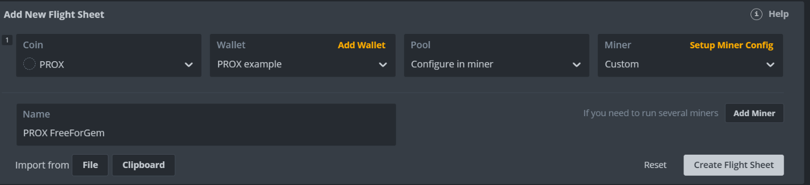

| Field | proximamine | InnovLab | solo (your node) |
|---|---|---|---|
| Miner name | `freeforgem` | `freeforgem` | `freeforgem` |
| Installation URL | `https://github.com/pepsykolya/FreeForGem/releases/download/v1.8.3/freeforgem-1.8.3_hiveos.tar.gz` | same | same |
| Hash algorithm | leave `----` (HiveOS has no `proxima` in its list) | same | same |
| Wallet and worker template | `%WAL%.%WORKER_NAME%` | `%WAL%.%WORKER_NAME%` (WAL = holder id) | `%WORKER_NAME%` |
| Pool URL | `stratum+ssl://pool.proximamine.com:3334` | `innov+tls://eu3.innovlab.cc:19701` (or `global.`, `us3.`, `hk.innovlab.cc:19701`) | `http://NODE_IP:PORT` (the node's `mine.seeker.listen`) |
| Pass | your proximamine secret | `x` | the node's `mine.seeker.token` |
| Extra config arguments | `--auto-uv --lock-cclock 1500` | same | same |

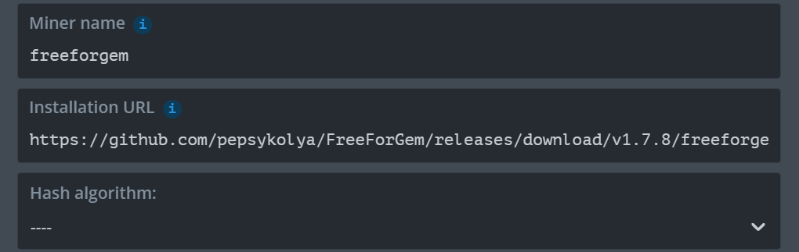
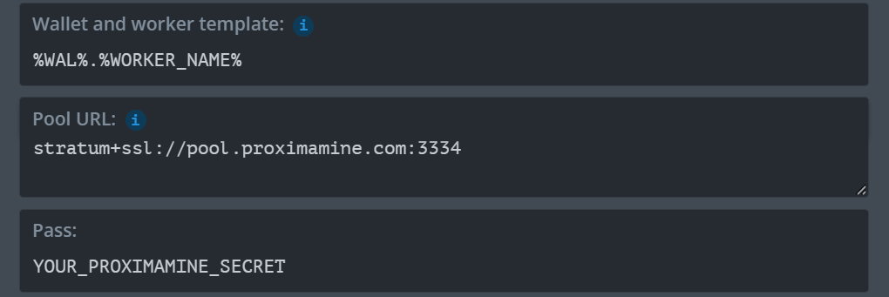
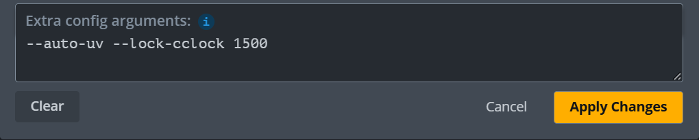

**Recommended Extra config:** `--auto-uv --lock-cclock <MHz>` (one value for all cards, or a comma list per GPU). It locks the core
clock and lets auto-uv find a lower voltage for that clock (every step checked bit-exactly; the first run takes a few minutes per GPU).
You can simply delete the line: the miner then runs at the card's own clocks.

| GPU | `--lock-cclock` | measured (memory at its lowest clock, 0 wrong hashes at every point) |
|---|---|---|
| RTX 3070 | `1500` | 2.66 GH/s, 87 W, 0.031 GH/W (final 1.7.8 build, auto-lock run with `--uv-offset 120`). Higher locks cost efficiency: 1700 3.03 GH/s, 111 W, 0.027 GH/W; 1900 3.37 GH/s, 160 W, 0.021 GH/W |
| RTX 3070 Laptop | `1500` | +270: 2.23 GH/s, 53 W, 0.042 GH/W (1650 +270 0.040, 1800 +270 0.033 GH/W); the watts are what the laptop driver reports (GPU only) |
| RTX 3080 Ti | `1500` | +210: 4.40 GH/s, 147 W, 0.030 GH/W (at 1500 the offset does not lower the power: the voltage is already at its minimum). For speed `1800`, +270: 5.28 GH/s, 201 W, 0.026 GH/W |
| RTX 4070 Ti | `2450` | +270: 5.47 GH/s, 142 W, 0.0385 GH/W: 37 % more hashrate than at 1800 (4.00 GH/s, 102 W, 0.039 GH/W) for almost the same efficiency. On Ada the efficiency hardly depends on the lock (1500 +270 0.038, 1650 0.037, 2200 0.037 GH/W) |
| RTX 4070 Laptop | — | about 3.22 GH/s at stock clocks; not tuned yet |
| CMP 50HX and other cards | — | not measured (on CMP the memory clock cannot be locked, "Not Supported") |

The offsets are what `--auto-uv` looks for on its own; a fixed `--uv-offset` with the same lock gives the figures above. Stock for
comparison: RTX 3070 at a 200 W power limit 3.26 GH/s, 199 W; RTX 4070 Ti 5.90 GH/s (prefix 369).

Windows: `start-prox.bat` (edit `WALLET`, `POOL`, `PASSWORD` or `SOLO` + `TOKEN`; `AUTO_UV=1` and `LOCK_CCLOCK=1500` are the same
recommendation, run it as Administrator for them). Linux:
`sudo ./freeforgem --algo prox --pool stratum+ssl://pool.proximamine.com:3334 --wallet ADDRESS --worker rig1 --password SECRET --auto-uv --lock-cclock 1500`.

**HiveOS applies its own OC.** `nvidia-oc` of HiveOS writes the OC profile of the web UI over the clocks at every miner start and at
every OC change: the core / memory lock and the offset set by the miner are reset. Since 1.7.8 the miner notices this on every GPU on
its own and puts the lock and the verified offset back (`clocks: GPU bus ...: the core clock lock 1500 MHz was reset by an OC apply ... set again`,
all coins). An offset set by another tool is left alone. At most 4 re-applies per GPU per hour, then the miner stands down on it and
says so in the log.

**What it is.** `--algo prox` mines Proxima with its transaction-hash proof of work (library upgrade 6, since slot 196000). NVIDIA only
(GTX 10 / RTX 20/30/40/50, sm_61+). Every share is checked on the CPU before it is sent. A pool host with `prox` in its name, an
`innov+tls://` URL, an InnovLab host on port 19701 or `--solo` select PROX without `--algo`.

**Pools.** proximamine (suprnova-format stratum, login `ADDRESS.WORKER`, password = the secret of your account), InnovLab (its own
protocol, `innov+tls://HOST:19701` or `innov+tcp://`, login `HOLDER_ID.WORKER`, password `x`). proxi.suprnova.cc accepts only its own
miner's user agent; FreeForGem sends its own name (`FreeForGem/<version>`) and does not pretend to be another miner.
**Solo:** `--solo http://127.0.0.1:8100 --token <mine.seeker.token>` (seeker protocol v2 of `proxi node mine`; `--seeker-name NAME`).

**auto-uv for PROX** (`--auto-uv`, off unless given): checks every step bit-exactly and steps back automatically if a result is wrong.
The result is saved in `uv.json` (section `prox`) per GPU, driver, miner version and core lock; re-checked every 6 h (`--uv-reval-hours`),
stepped back on a wrong result while mining, the owner's offset put back on exit. Without a core lock the profile is keyed by the clock
under load (as for Pearl), so a lock is recommended. `--uv-min/--uv-max/--uv-step/--uv-reset/--uv-reset-all/--uv-keep-last` work as for
Pearl; `--uv-offset N` sets a fixed offset instead.

**Clocks.** By default the memory clock is locked at the lowest value that still allows the full core clock range (PROX does not need
memory speed: several W less); `--no-mem-lock`, `--lock-mclock` or `--moffset` leave it to you. `--lock-cclock`, `--temp-limit`,
`--devices`, `--minutes`, `--no-color` as for Pearl.

Log line: `[ 60s] GPU0 2.657 (87 W, 0.0307 GH/W) | total 2.657 GH/s, 87 W, 0.0307 GH/W | user sub N acc N rej 0 (stale 0, low-diff 0)`.
Tests: `--self-test --algo prox`, `--algo prox --hash-bench 10 --hash-prefix-len 369`.

**Dev fee 1%** (60 s every 100 min), as for Pearl/NOID a second login on the pool you mine on (proximamine, InnovLab, any other stratum
pool); the developer's account on proximamine is used when you mine solo or on suprnova, and when the fee login on your pool is refused,
gets no job or its shares are rejected. The log names the pool of every fee slot.

### 22. Pool lists: failover and failback, new in 1.7.8

**Backup pools.** Give `--pool` several entries of **one coin** — a comma separated list or `--pool` repeated; the first entry is
the **primary**, the others are backups:

    freeforgem --pool pearl-eu2.luckypool.io:3360,prl-eu.kryptex.network:7048 --wallet prl1...
    freeforgem --algo noid --pool stratum+ssl://eu2.innovlab.cc:19601 --pool stratum+ssl://noid.suprnova.cc:3340 --wallet o1...
    freeforgem --algo prox --pool innov+tls://eu3.innovlab.cc:19701,innov+tls://eu2.innovlab.cc:19701 --wallet ...
    freeforgem --pool cmfd+tls://IP1:PORT?pin=HEX1,cmfd+tls://IP2:PORT?pin=HEX2 --wallet cmfd1...

One list, one coin and one protocol: Pearl `HOST:PORT` entries; NOID `stratum+ssl://` / `stratum+tcp://` entries; PROX all stratum or all
InnovLab (the wallet and the password are the same on every entry); CMFD `cmfd+tls://` entries, each with its own `?pin=`. Solo
(`--solo`) is one node: no list. A single `--pool` behaves exactly as before.

**Failover.** A pool that cannot be reached, refuses the login or sends no job moves the miner to the next entry within seconds (the log
says `pool 1 of 2 (host:port) is not usable: failing over to pool 2 of 2`); after the last entry the primary is tried again, with
waits growing to 60 s as for a single pool. A connection that lived for more than a minute is retried on the same entry first.

**A pool that went silent (dead link).** A pool that stops answering without closing the connection (a cable pulled, a route lost, a firewall DROP) is noticed in **about 60 seconds** (it used to take 180-300 s with no work done): then the miner reconnects, and if the entry does not come back, fails over to the next one. A pool that only talks when it has a job is never cut off by mistake. CMFD: the engine keeps its own pool connection (see below).

**Failback (back to the primary).** While the miner is on a backup, the primary is checked every `--failback-minutes` (default **10**,
`0` = off) on a **separate connection** that submits nothing: connect, login (the same wallet and worker) and a usable job. After
**2 good checks in a row** (the second one 60 s after the first, so a pool that flaps is not trusted) the miner goes back to the primary:

    [pool:user] failback: the primary pool (host:port) answers again (check 1 of 2), checking again in 60 s
    [pool:user] the primary pool (host:port) answered 2 checks in a row: switching back to it: now pool 1 of 2 (host:port)

Nothing mining is lost on the way: the GPUs keep working while the connection moves (1-3 s in all), and the shares already sent get
their answers from the old pool. The few shares found in the last second or two before the connection moves belong to a job of the old
pool and are not sent. A primary that was left again within five minutes of a failback is checked less often (x2, up to x16 of
`--failback-minutes`; back to normal after 2 hours on it). A failed check is logged (`the primary pool is still not usable (...)`), the
miner stays on the backup.

**Dev fee.** The 1% fee connection goes to **the pool you are on**: whenever a fee slot starts it connects to your current entry, so the
fee follows a failover and returns with a failback. (PROX: the fee on proximamine / InnovLab uses that pool's entry; a list with a
suprnova entry uses the developer's proximamine account for the whole run, as a single suprnova pool does.)

**CMFD.** The engine (`cmfd-miner`) knows one pool and retries it for ever, so for CMFD the miner does it: when no engine has its pool
for 60 seconds (or the pool refuses the login) the engines are restarted one by one with the next entry's `--pool`; the same restart
goes back to the primary after the failback checks. A restart reloads the 6.4 GB model: expect about a minute without mining per switch;
the engine's own dev fee (36 s per hour, same pool) restarts its schedule with the engine.

**CMFD: a silent connection.** A CMFD link that dies without a reset (a firewall DROP in both directions, a lost route) is not noticed
by the engine for many minutes: it shows its hash rate and "connected" while the block height never changes. So the miner also watches
the **block height the engines report**: when it has not changed for much longer than this coin's normal block time (never less than
**8 minutes**, never more than 30), the connection is taken as dead and the engines restart on the **next `--pool` entry** (with a
single pool: on the same entry, a new connection). Log:
`pool: pool 1 of 2 (...) is not usable (the engines report the same block height for 8.0 min: the pool connection is silent): failing over`.
The threshold is long on purpose, so normal gaps between blocks never trigger it; the time does not count while the engines load, are
paused (idle mode), are in the engine's fee slot or have no pool, and a chain that really stands is not restarted every few minutes.

| Option | Meaning |
|---|---|
| `--pool A,B,C` / `--pool A --pool B` | the list; the first entry is the primary |
| `--failback-minutes N` | on a backup, check the primary every N minutes and return after 2 good checks (default 10, 0 = off; fractions are fine) |
| `--noshare-minutes M` | no accepted share for M minutes (and at least 10 expected): reconnect, then the next pool (default 15, 0 = off) |
| `--reject-minutes K` | only rejected shares for K minutes: the same (default 5, 0 = off) |
| `--pool-check` | log in to every `--pool` entry (connect, login, a job), print one verdict per entry, exit 0 / 1; no GPU needed, handy before a flight sheet |

**A pool that credits nothing (accepted-shares watchdog).** A pool can take the connection and the login, send jobs and still not credit
shares. While the GPUs hash for you, the miner reconnects when there is **no accepted share of yours for `--noshare-minutes`** (default
**15**, `0` = off) **and at least 10 shares were expected** in that time at your measured hash rate and the pool's share difficulty (so rare
big-difficulty shares never trigger it), or when there are **only rejected shares for `--reject-minutes`** (default **5**; at least 5
rejects, none accepted). If the same happens again on the new connection, the miner moves to the **next entry** of the list (the primary
that was left this way is checked for failback less often, as for a flapping primary); with a single pool it reconnects again with a
warning in the log and never exits. Log: `[pool:user] watchdog: no accepted share for 15.0 min while ~60 were
expected (12 sent, 0 rejected): reconnecting`. It does not act: during the dev fee minute (the fee has its own connection; its shares are
never counted as yours), while the GPUs do not hash for you (paused, tuning, disconnected), when the GPUs found **no share at all**
although shares were expected (a GPU problem, hardware errors or clocks: only a warning, the pool is kept), and in solo mode. CMFD: the
engine does not tell the share difficulty, so shares are expected at the rate seen so far on that pool: with no share at all a CMFD pool
is left after about an hour. A failback check does not submit shares; a primary that credits nothing again after a failback is left
again and checked less often.

Names and defaults are those of ffgs 0.5.4 (`--failback-minutes`, 10 minutes, 2 good checks, 60 s between them). **HiveOS:** the flight
sheet's *Pool URL* field takes several URLs separated by spaces or commas; **Windows:** `POOL` in the `start*.bat` files takes the
comma separated list (the same coin in one list).

Limits: the check logs in with your own wallet and worker name (a pool that refuses two connections of one worker would fail the
check; none of the supported pools does); the watchdog needs a working hash rate and a known share difficulty to judge rare shares (CMFD: estimated).
### 23. Automatic core clock lock `--auto-lock` (optional, new in 1.7.8)

The miner picks the core clock lock of each NVIDIA GPU itself: it mines at several locks, each at its own undervolt profile (auto-uv,
sections 12 and 17), measures hash rate and power and keeps the most efficient lock that loses at most 10 % of the top hash rate.
**Off unless asked:** without `--auto-lock` nothing changes. The options are those of our SASEUL miner ffgs 0.5.4.

    sudo ./freeforgem --pool HOST:PORT --wallet ADDRESS --lock-mclock 810 --auto-lock

- **Coins:** Pearl, NOID, PROX. **NVIDIA only, root / Administrator.** Not for CMFD (its engine is a separate program with a start of
  minutes per process; the miner stops with a message) and not for AMD.
- `--auto-lock` turns on `--auto-uv` (with `--uv-offset N` every lock is measured at that fixed offset instead). It excludes `--idle` and
  `--auto-uv-dry-run`.
- **Locks tried:** by default 1800, 1700 ... 1200 MHz, nothing above the card's maximum graphics clock (a card that cannot reach 1600 gets
  the 5 locks below its maximum). **Mining cards (CMP) start lower: the default top is 1500 MHz** (1500 ... 1100), because higher locks
  only ran into the power limit on them; the log says `default range ... (safe top 1500 MHz for this card type ...)`. **GeForce RTX 30
  (and RTX A) start at 1800 MHz** (1800 ... 1200) for the same reason. An explicit `--auto-lock-range` always wins.
  **A step that sits at the power limit is not measured to the end:** it ends early as *PL-limited* (`not valid: the clock did not hold the lock ... - PL-limited:
  219 W at the 225 W power limit, 1650 MHz below the lock`) and the sweep goes on with the next lower lock. The miner only reads the power
  limit, it never sets one. `--auto-lock-range 1300-1600:100` (from-to[:step], step 100 by default, 15..1000) or a list
  `--auto-lock-range 1350,1450,1530`.
- A GPU with its own `--lock-cclock` value keeps that lock and is not swept (`--lock-cclock 1400,-` sweeps only the second GPU).
  `--lock-mclock`, `--moffset`, `--temp-limit` work as before; the memory lock is part of the saved key.
- **The sweep, highest lock first, all GPUs in parallel.** The miner mines at each lock in turn; its log goes to the same console / log
  and HiveOS keeps showing the hash rate. At each lock auto-uv applies the verified profile of that lock, or checks / tunes it (~5-12 min;
  since 1.8.1 the GPU keeps mining meanwhile, at a lower hashrate), then the GPU **mines** at it for a few measured minutes. **Shares found meanwhile go to the pool as usual.**
  Between rounds the miner restarts (a few seconds without hashing).
- **Early stop:** once a lock is more than the allowed loss below the top hash rate, the lower locks are not measured.
- **Choice:** `--auto-lock-goal eff` (default) = the best TH/W (NOID: MH/W, PROX: GH/W) among the locks within `--auto-lock-max-loss` %
  (10, 0..90) of the top hash rate measured; `--auto-lock-goal speed` = the top hash rate; `--auto-lock-goal profit` = the most income
  minus electricity per day (23.1).
- **Points that do not count:** the clock did not hold the lock (power / thermal limit, or the lock was reset by another tool / an OC
  apply) or the measurement was interrupted several times (auto-uv re-check, temperature limit, no job) -> `not valid`. A refused lock,
  a GPU that stops at it or no steady mining within 60 min -> `FAILED`, next lock. If the miner dies during a lock (Xid, freeze, power
  cut), the next start marks that lock `crashed` and never tries it again. A round that ends before mining (pool unreachable, start-up
  error) is tried again a few times; then the sweep waits for the next start (nothing is recorded as failed). A GPU without lock control
  (`Not Supported`, some laptops) mines without a lock (saved). No permission: the sweep stops with a message.
- **The result** is a table in the log (RTX 3070, Pearl, `--auto-lock-range 1500,1400`, test times; at 1500 another
  program reset the card's OC during the test, so that point does not count):

    auto-lock: GPU0 (bus 0d, RTX 3070) RESULT (goal eff, max loss 10%, top 63.325 TH/s):
    auto-lock:   lock  offset      TH/s       W      TH/W
    auto-lock:   1500     +90    81.535   199.4    0.4089  not valid: the clock ran above the lock (the lock was reset by another tool / OC apply)
    auto-lock:   1400    +210    63.325    87.2    0.7263  ★ chosen
    auto-lock: GPU0 (bus 0d, RTX 3070) mining at lock 1400 ★ (saved; --auto-lock-reset to sweep again)

- **Saved** per GPU, coin (NOID: and its mode), board, driver, memory lock and mining kernel in `autolock.json` next to `uv.json`
  (HiveOS: `/hive-config/freeforgem`, kept over miner updates). **The next start applies the saved lock at once** (one line
  `lock 1500 ★ (saved ...)`), no sweep. A changed `--auto-lock-goal` / `--auto-lock-max-loss` is re-chosen from the saved points; a wider
  range or a larger loss measures only the missing locks. `--auto-lock-reset` forgets the points of these GPUs and sweeps again (the
  auto-uv profiles stay; `--uv-reset` in addition re-tunes the locks of the first round once). A new driver, another card or kernel = a new
  sweep. `--uv-reset-all` does not touch `autolock.json`; an own restart after a GPU fault does not repeat `--auto-lock-reset`. A stop
  during the sweep keeps the points measured so far; the next start goes on.
- **Time:** the first sweep costs, per lock, the auto-uv tuning of a new lock plus ~3 min of measured mining; with the early stop
  typically 3-5 locks, 30-90 min, all GPUs at once. Later starts: nothing. `--minutes` counts the mining after the sweep.
- **HiveOS:** add `--auto-lock` to *Extra config arguments* (Pearl e.g. `--auto-lock --lock-mclock 810`). A core lock in the OC profile is
  put back on exit as before. **Windows:** `set "EXTRA=--auto-lock"` in the start script, run it as Administrator.

#### 23.1 Goal profit: `--auto-lock-goal profit` (new in 1.7.8)

With cheap electricity the most profitable lock is often not the most efficient one (a faster lock can earn more per day even though it
uses more power). `--auto-lock-goal profit` chooses by income minus electricity:

    sudo ./freeforgem --algo prox --pool innov+tls://eu3.innovlab.cc:19701 --wallet ADDRESS \
        --auto-lock --auto-lock-goal profit --power-price 0.12,0.053@23-07

- **Profit of a lock** = income − electricity, US$ per day. Income comes from the measured hash rate, the network data of the coin,
  the coin price, the miner fee (1 %) and the pool fee; electricity from the NVML watts measured at that lock and your tariff averaged
  over the day. The watts are the GPU board's only (not the PSU losses, CPU, fans): add your margin to `--power-price` if you want it in.
- **`--power-price X`** in $ per kWh, **required** (without it goal profit stops with a message). Day / night:
  `--power-price 0.12,0.053@23-07` = 0.053 from 23:00 to 07:00, 0.12 the other hours; more ranges may follow
  (`0.12,0.053@23-07,0.08@13-15`, later ranges win). The miner mines around the clock, so it uses the average over the 24 hours.
  The currency must be that of the coin price (US$ when the price comes from the tickers).
- **Network data:** Pearl from the pool's jobs (a pool that sends no block height, e.g. Kryptex: LuckyPool's public `api/stats`);
  NOID from the pool's jobs (no public API: until the first job, the data saved by the last run); PROX from InnovLab's public stats API,
  also when you mine on another pool. CMFD: no `--auto-lock`, so no profit choice.
- **Pool fee:** known LuckyPool (Pearl) 1 %, InnovLab (PROX) 0 %, solo 0; another pool: 0 % with a log line — set it with
  `--pool-fee PCT`.
- **Coin price:** the median of several public tickers, read once at the start (and at each re-choice). A ticker far from the median is
  left out (`OUTLIER`); a ticker with very low 24 h volume is `THIN` and only used when nothing else answers; a price from one ticker only
  gives a WARNING. If none answers, the last saved price (up to 7 days) is used, else the choice is made by efficiency until a price is
  there. **`--coin-price X`** (US$) sets it by hand: then no exchange is asked at all.

  | coin | tickers (checked 15.11.2026) |
  |---|---|
  | Pearl (PRL) | SafeTrade, Gate, LBank, BigONE, Coinbase, Kraken (PEARL/USDT, PEARL/USD), CoinGecko `pearl-2`, CoinPaprika `prl-pearl-1` (thin), LuckyPool `api/stats` |
  | PROX | SafeTrade PROX/USDT only (a warning each time: use `--coin-price` if it looks wrong) |
  | NOID | SafeTrade NOID/USDT, CoinGecko `parano1d`, CoinPaprika `noid-parano1d` (both mirror SafeTrade) |
  | CMFD | none (no auto-lock anyway) |

  Some exchanges are not reachable from every country (SafeTrade sometimes answers 403 from behind Cloudflare): the other tickers carry
  the median.
- **Locks measured:** goal profit has no early stop (a dearer coin or cheaper power moves the best lock), the default range is
  2000 .. 1200 MHz step 100 (nothing above the card's maximum; CMP cards 1500 .. 1100): up to 9 locks, each tuned by auto-uv once (expect 1-2 h for the first
  sweep). Points measured for goal eff / speed are reused: switching the goal measures only the missing locks.
- **The table** in the log gets income / power / profit per day:

        auto-lock: GPU0 (bus 0d, RTX 3070) RESULT (goal profit: PROX <price> $, <coins> PROX per H/s per day, fees 1% miner + 0% pool, power <tariff> $/kWh):
        auto-lock:   lock  offset      GH/s       W      GH/W   income   power   profit $/day

- **Re-choice while mining:** every `--auto-lock-reprice-hours` (6; 0 = never) the price (and the network data the pool's jobs do not
  give) is fetched again and every GPU is re-chosen from its measured points, **without new measurements**. A switch needs more than
  `--auto-lock-hysteresis` % (3) more profit than the current lock; one log line either way
  (`GPU0: lock 1500 -> 1800: profit ... $/day (+N% > 3%)` / `keeps lock 1500 ...`). A switch restarts the miner at the new locks (a few
  seconds without hashing; the log follows unchanged, HiveOS sees the hash rate). With `--auto-lock-reprice-hours 0` the choice is made
  at each start.
- **Privacy.** Without goal profit the miner connects only to your pool (and, unless `--no-update-check`, to github.com once in 12 h for
  the release check). With goal profit it also sends **plain HTTPS GET requests** to the tickers above and to the network
  APIs (LuckyPool `api/stats` for Pearl, InnovLab `proxima/v1/stats` for PROX): at the start and every `--auto-lock-reprice-hours`. A
  request carries only the URL of the public ticker, `Host` and `User-Agent: FreeForGem/1.7.8` — no wallet, worker, pool, hash rate
  or anything else of yours, no cookies; nothing is posted. Of course every server sees your IP address. `--coin-price X` turns the
  ticker requests off; the network API of PROX (and of Pearl on a pool without heights) is still asked.
- Saved in `autolock.json` besides the points: the goal and, under `money`, the last price and network data per coin (time, source).

---

### 24. NEB (Neural Engine Byte), new in 1.8.0
NEB (nebhash v2) is mined by the NEB module of FreeForGem, the miner of FFGN (FreeForGem NEB) moved into FreeForGem. A FFGN
command line works unchanged with `--algo neb` (or `--coin neb`); the NEB options are listed by `freeforgem --algo neb --help`.

- **Coin choice.** One coin per card. The whole rig on NEB: `--algo neb` / `--coin neb`, or by itself from the pool URL
  (`neb.suprnova.cc`, `neb.ariabrain.com`, `work://`, `neb://`), `--node` (solo through your NEB node) or `--gate`.
  `--algo pearl` (or any other coin) given explicitly always wins. NEB on some cards and another coin on the others:
  `--split` (section 27).
- **Pool.** `stratum+tcp://neb.suprnova.cc:7804` (backup `:7805`), wallet `neb1...`, worker after a dot. HiveOS: Pool URL
  `stratum+tcp://neb.suprnova.cc:7804`, Wallet template `%WAL%.%WORKER_NAME%`, Pass `x`.
- **Solo** through your own NEB node: `--node 127.0.0.1:3441` (the work service of the node, `neb-node --work-port`; the
  blocks pay the node's `--miner-lock`). **Several rigs, one node:** run a gate beside the node
  (`freeforgem --gate --node 127.0.0.1:3441 --gate-token-file FILE --gate-listen 0.0.0.0:3442`); every rig mines with
  `--pool neb://GATE_IP:3442 --password TOKEN` (HiveOS: Pool URL `neb://GATE_IP:3442`, Pass = the token). The gate gives every
  rig a nonce range of its own and checks every share again.
- **Files.** `nebgpu.dll` / `libnebgpu.so` (the NEB GPU engine nebgpu **0.8.4** since 1.8.1, closed source, the same binary as in FFGN,
  checked by its SHA-256) and
  `neb-datasets.bin` (the dataset of the NEB main network, 16,087,037 bytes, checked by its BLAKE3 at every start) are in
  the packages. `--dataset FILE` gives another copy. A Pearl-only rig never reads them.
- **Units.** MA/s = 10^6 attempts per second; efficiency in MA/W. HiveOS shows khs = MA/s x 1000, algo `nebhash`, and the
  rate over the last 15 minutes (each block brings a new model, so the rate changes from block to block).
- **Memory clock.** NEB is memory bound. A HiveOS OC profile that locks the memory low (Pearl's 810 MHz) is replaced by the
  card's maximum while NEB mines and put back on exit (`--keep-hive-mem` keeps the profile's lock; `--table-mclock N`:
  below). A Pearl run keeps its 810 MHz lock as before:
  the memory policy belongs to the coin, and every lock a run sets is put back when it ends.
- **`--table-mclock N`** (e.g. `810`): the memory is locked to N only while a GPU mines in the NEB mode that hardly uses it
  (RTX 3070: -0.5 % rate, -10 W, +8-10 % MA/W); the rest of the time the memory runs at its full clock. A per-GPU list as
  everywhere: `--table-mclock 810,810,-,-` (section 28).
- **`--tbig auto|on|off`** (engine 0.8.1): an extra speed-up table in the free VRAM. `auto` (the default) uses it only where
  it pays back and leaves it out where it would not (+1 % net or less: slow cards, Turing); `on` = always, with all the free
  VRAM; `off` = never. The results are exactly the same either way. `--tbig-gb G` caps its memory (default: the free VRAM
  minus a reserve).
- **Power limit (optional):** `--power-limit N` (alias `--pl N`) sets the power limit through NVML (one value, or a per-GPU
  list; `-` = leave that card's limit, e.g. the HiveOS one). **Off by default:** FreeForGem limits the power with the core lock
  and the offset. The value is clamped to the card's range; the old limit is put back on exit (after a crash: at the next
  start); an OC apply that changes it while mining is undone (at most 4 times an hour per GPU). auto-uv measures with the
  limit in force.
- **One engine process per GPU.** A CUDA fault on one GPU (Xid 31/43) restarts only that GPU in a few seconds; the others
  keep mining. `--single-process` runs all GPUs in the miner process (as FFGN before 1.0.11). Pearl, NOID, CMFD and PROX stay
  single-process in 1.8.0.
- **Every nonce is checked** again on the CPU before it is sent; `--self-test` checks the engine (90 checks).
- **auto-uv / auto-lock** work for NEB as in FFGN (tuning while mining). Saved NEB profiles of FFGN
  (`/hive-config/ffgn/uv.json`, or an `ffgn*` folder next to this one) are taken over on the first NEB start; nothing is tuned
  again.
- **Dev fee** 1 %: one 60 s slot in every 100 minutes, always on a connection of its own (never a second login in your
  session): on your pool list when you mine on a pool, on the public NEB pools when you mine solo or through a gate; worker
  `ffg`. A slot whose connection was not ready is tried again up to 3 times.
- Profit switching between Pearl and NEB is not in 1.8.0 (`--auto-lock-goal profit` is refused for NEB).

**HiveOS flight sheet.** Coin `NEB` (add it as a custom coin if it is not in the list), wallet `neb1...`, Pool *Configure in
miner*, Miner *Custom* → *Setup Miner Config*:

| Field | Suprnova | your gate |
|---|---|---|
| Miner name | `freeforgem` | `freeforgem` |
| Installation URL | `https://github.com/pepsykolya/FreeForGem/releases/download/v1.8.3/freeforgem-1.8.3_hiveos.tar.gz` | same |
| Hash algorithm | `nebhash` | `nebhash` |
| Wallet and worker template | `%WAL%.%WORKER_NAME%` | `%WAL%.%WORKER_NAME%` (the blocks pay the node's `--miner-lock`) |
| Pool URL | `stratum+tcp://neb.suprnova.cc:7804` (with a backup: `stratum+tcp://neb.suprnova.cc:7804,stratum+tcp://neb.suprnova.cc:7805`) | `neb://GATE_IP:3442` |
| Pass | `x` | the gate token |
| Extra config arguments | for example `--auto-uv --lock-cclock 1800 --table-mclock 810` | same |

The OC profile may keep Pearl's memory lock (810 MHz): NEB runs the memory at its maximum while it mines and puts the
profile's lock back when it stops. HiveOS shows khs (MA/s x 1000), the 15-minute rate, MA/W next to the version, and the tags
`LOCK NOT HELD`, `NO TABLE`, `GPU LOST`, `REBOOT NEEDED` when they apply.

**Windows:** `start-neb.bat` (set `WALLET`, `POOL`, or `NODE` for solo; `PASSWORD` = a gate token; `DEVICES`, `LOCK_CCLOCK`,
`AUTO_UV=1`, `EXTRA`; run it as Administrator for clocks and auto-uv). **Linux:**
`sudo ./freeforgem --pool stratum+tcp://neb.suprnova.cc:7804 --wallet neb1YOUR_ADDRESS --worker rig1 --auto-uv --lock-cclock 1800 --table-mclock 810`.

**Log line:** `[  60s] GPU0 165.0 (118 W, 1.40 MA/W) | total 165.0 MA/s, 118 W, 1.40 MA/W | found 3 (bad 0) | user sub 3 acc 3 rej 0 (stale 0) | ...`.
Tests: `--algo neb --self-test`, `--algo neb --hash-bench 30`, `--algo neb --pool-check --pool ...`.

**A measurement** (a 4-minute test run of a 1.8.0 build, RTX 3070, Suprnova, core lock 1680 MHz, offset +210,
`--table-mclock 810`): about 165 MA/s at 118 W, **1.40 MA/W**, 27 of 27 shares accepted. The NEB rate changes with every
block's model, so compare settings over hours, not minutes.

| NEB option | Meaning |
|---|---|
| `--node HOST:PORT` | solo through the work service of your NEB node |
| `--gate`, `--gate-listen ADDR`, `--gate-token-file F` | run a gate beside the node for several rigs |
| `--dataset FILE` | another copy of `neb-datasets.bin` |
| `--table-mclock N` | the low memory clock only where NEB hardly uses the memory (above) |
| `--tbig auto\|on\|off`, `--tbig-gb G` | the extra speed-up table (above) |
| `--keep-hive-mem` | keep a low memory lock of the HiveOS OC profile (NEB mines much slower with it) |
| `--power-limit N` / `--pl N` | optional power limit, off by default (above) |
| `--single-process` | all GPUs in the miner process instead of one engine process per GPU |
| `--reboot-on-lost-gpu MIN`, `--debug-timing` | section 29 |
| `--uv-parallel N`, `--uv-unpause`, `--ramp-ms N`, `--api [HOST:]PORT` | see `freeforgem --algo neb --help` |

### 25. What 1.8.0 changed for every coin

*1.8.1 added mining during the auto-uv tuning on every coin and guards against an endless tuning: section 30.*

**What's new in 1.8.0, in short:**

- **Two new coins:** NEB (nebhash v2, section 24) and Ting / Daler (DLR, section 26), each in its own module; NEB and Ting run
  one engine process per GPU, so a CUDA fault of one card restarts only that card.
- **Different coins on different cards** of one rig: `--split neb:0,1 pearl:rest` (section 27).
- **Per-GPU lists of any length** in every coin: a shorter list gives its last value to the other cards (section 28).
- **Faults:** after a crash auto-uv resumes at the crashed offset minus 2 steps; after a GPU fault the card gets a safe state
  before its engine starts again; FAULTY (a 10-minute pause) instead of DEAD for a card that still opens;
  `--reboot-on-lost-gpu`; fewer stale shares (section 29).
- **Host improvements in every coin:** yellow / orange tuning lines, the core lock checked under load, auto-uv climbs while the
  power falls, dev-fee slot retries, a memory policy per coin (below).
- **CMFD:** the engine is FreeForgeMiner **1.2.5**, now downloadable from its release page; it also knows the fingerprint of
  the compact mainnet model. A fault while mining steps the CMFD offset back 2 steps (was 1).

**Details:**
- **auto-uv climbs while the power falls.** It keeps climbing as long as each step still lowers the power. The 1.7.2 limit
  that stopped it early is gone: it cut off real savings of 0.6-0.9 W per step. Stability is still judged by the checks
  (bit-exact results, the clock under load), not by the saving.
- **After a crash: the crashed offset minus 2 steps**, never above the last verified offset, after a quick check; another
  crash goes 2 steps lower (Pearl, NOID, CMFD, PROX, NEB).
- **The core lock is checked under load.** A lock that another tool resets (a HiveOS OC apply) is set again; one that never
  holds is reported loudly (`WARNING GPUn: the core clock lock ... does not hold`), `[LOCK NOT HELD: GPUn]` on the stats line
  and in HiveOS, and auto-uv / auto-lock leave that GPU.
- **Colours:** auto-uv / auto-lock lines are yellow, their failures and roll-backs orange (bold yellow on a terminal without
  256 colours); `--no-color` / NO_COLOR=1 turns colours off.
- **Dev fee:** a slot whose fee connection was not ready is tried again up to 3 times, 5 minutes apart, in the same cycle.
- **Memory clock per coin.** Pearl and NOID keep the memory lock of the HiveOS OC profile (810 MHz) as before; CMFD skips it
  (CMFD needs the memory); PROX and Ting lock the lowest clock that keeps the full core range (their hash does not use the video
  memory; a lock of the OC profile, `--lock-mclock` or `--moffset` is kept; `--no-mem-lock` leaves it alone); NEB runs at the full
  memory clock (`--table-mclock`, `--keep-hive-mem`, section 24). With `--split` every card follows the policy of its own coin,
  and every lock a run sets is put back when it ends.
- **A lost GPU counts 0** on the stats line and in HiveOS (never its last rate), so the HiveOS watchdog sees the real total.
- **Pearl** waits up to 60 s for the GPU's CUDA context at the start when another process is still leaving the card, instead of
  ending the run (section 29).

**New options in 1.8.0** (the internal options of the child processes are not listed):

| Option | Coins | Meaning | Section |
|---|---|---|---|
| `--split COIN:GPUS ...`, `--split-args COIN=...` | all | different coins on different cards | 27 |
| `--table-mclock N` | NEB | low memory clock only where NEB hardly uses the memory | 24 |
| `--tbig auto\|on\|off`, `--tbig-gb G` | NEB | extra speed-up table | 24 |
| `--power-limit N` / `--pl N` | NEB | optional power limit, off by default | 24 |
| `--keep-hive-mem` | NEB | keep a low memory lock of the OC profile | 24 |
| `--reboot-on-lost-gpu MIN` | NEB | reboot the rig after a GPU is lost for MIN minutes (opt-in) | 29 |
| `--debug-timing` | NEB | the times of every share (stale-share diagnosis) | 29 |
| `--single-process` | NEB, Ting | all GPUs in one process | 29 |
| `--no-group`, `--no-mem-lock`, `--api-port N` | Ting | template grouping off, memory left alone, the status API | 26 |

### 26. Ting / Daler (DLR), new in 1.8.0

The Ting miner FFGT (0.2.2) is a coin of FreeForGem since 1.8.0: the same kernels (`tinggpu.dll` / `libtinggpu.so` for CUDA,
`tinggpu_cl` for OpenCL), the same results bit for bit. NVIDIA GTX 10 and newer, AMD through OpenCL. All options:
`freeforgem --algo ting --help`.

- **Coin choice.** `--algo ting` (also `dlr`, `daler`, `ting-sha256`), or by itself from a `crypto-connection.net` pool, a
  `ting://` gate URL, `--node-dir` or `--node-token-file`.
- **Wallet** = your Ting account, 64 hex digits (Ting ID app or `ting wallet account`); a `&net=...` tail is cut off. The worker
  after a dot or with `--worker`.
- **Pool:** `crypto-connection.net:4073` (plain TCP), password `x`; a list = failover / failback (section 22).
  **Your ffgt-gate:** `--pool ting://GATE_IP:PORT --password <the rig's password>` (or `--algo ting --pool HOST:PORT`).
  **Solo on a node of this rig:** `--node 127.0.0.1:18440 --node-dir <the node's data directory>` (its control token; or
  `--node-token-file FILE`); the blocks pay the node's `ting miner payout <account>`. **Run the gate:**
  `freeforgem --algo ting --gate gate.json` (several rigs, each rig's password mapped to a node / payout account).
- **Grouping.** Templates (solo, gate) and jobs (pool) are searched together: about +40 % solo and +25 % on the pool on
  RTX 30. `--no-group` turns it off.
- **Clocks.** SHA-256 does not use the video memory: by default the memory is locked at the lowest clock that keeps the full core
  range (810 MHz on RTX 30, about -10 % power); a memory lock of the HiveOS OC profile, `--lock-mclock` or `--moffset` is kept as
  given, `--no-mem-lock` leaves the memory alone (CMP 50HX: the driver has no memory lock). Core lock on an RTX 3070: `1500` =
  the best GH/W, `1800` = more GH/s.
- **auto-uv / auto-lock** work as for the other coins: profiles per GPU and core lock in `uv.json` (section `ting`; FFGT's
  profiles are imported once). Since 1.8.1 no built-in ceiling: the driver's range or `--uv-max`. A crash
  while mining at a tuned offset goes 2 steps below it, without tuning from scratch.
- **One engine process per GPU** (CUDA): a CUDA fault or a hung engine on one card restarts only that card in a few seconds
  while the others keep mining; 3 faults within 10 min at its safe offset = FAULTY, a 10-minute pause (section 29). HiveOS shows
  one more `freeforgem` process per GPU. `--single-process` (or FFG_SINGLE_PROCESS=1) = the old mode. OpenCL (AMD) always runs
  in the miner process.
- **Checks.** Every candidate is hashed again on the CPU before it is sent. Tests: `--algo ting --self-test`,
  `--algo ting --hash-bench 30`.
- **Units:** GH/s, efficiency GH/W; HiveOS algo `ting`. A read-only status API `/summary /gpus /metrics` on 127.0.0.1:4068
  (`--api-port N`, `0` = off; `--api-bind ADDR:PORT`).
- **Dev fee 1 %:** 60 s in every 100 minutes on crypto-connection.net, on a connection of its own (worker `ffg`); solo without
  that pool, the node's blocks pay the developer during the slot.

**HiveOS flight sheet.** Coin `DLR` (add it as a custom coin), wallet = your Ting account (without `&net=...`), Pool *Configure
in miner*, Miner *Custom* `freeforgem` (the same Installation URL), **Hash algorithm: leave `----`** (HiveOS has no
`ting-sha256` in its list), template `%WAL%.%WORKER_NAME%`:

| Field | crypto-connection.net | your ffgt-gate | solo on a node of this rig |
|---|---|---|---|
| Pool URL | `crypto-connection.net:4073` | `ting://GATE_IP:PORT` | `node://127.0.0.1:18440` |
| Pass | `x` | the rig's gate password | - (Extra config `--node-dir DIR`) |
| Extra config arguments | `--lock-cclock 1800 --auto-uv` | same | same |

**Windows:** `start-ting.bat` (set `ACCOUNT`, `POOL`, `PASSWORD` for a gate, `WORKER`, `DEVICES`, `LOCK_CCLOCK`, `AUTO_UV=1`,
`EXTRA`; as Administrator for clocks and auto-uv). **Linux:**
`sudo ./freeforgem --pool crypto-connection.net:4073 --wallet YOUR_TING_ACCOUNT --worker rig1 --lock-cclock 1800 --auto-uv`.

### 27. Different coins on different cards: `--split`, new in 1.8.0

One rig, one FreeForGem, several coins: for example NEB on some cards and Pearl on the others. Without `--split` nothing
changes: the whole rig mines one coin.

    freeforgem --split neb:0,1 pearl:rest \
        --pool neb=stratum+tcp://neb.suprnova.cc:7804 --wallet neb=neb1YOUR_NEB_ADDRESS \
        --pool pearl=prl-eu.kryptex.network:7048 --wallet pearl=prl1YOUR_PRL_ADDRESS \
        --worker rig1 --auto-uv --lock-cclock neb=1800 --lock-cclock pearl=1410 --lock-mclock pearl=810

**Groups.** `COIN:GPUS`, one entry per group. The GPU numbers are those of nvidia-smi and the HiveOS dashboard (PCI bus order);
ranges such as `2-5` work, and one group may take `rest` (or `*`): the cards no other group names. `;`, `,` and spaces are all
separators and no quotes are needed: `neb:0,1;pearl:rest` = `neb:0 1 pearl:rest` = `neb:0,1,pearl:rest`. Coins: `pearl`,
`cmfd`, `noid`, `prox`, `neb`, `ting` (or their other names: `prl`, `nebhash`, `dlr` ...). One card mines one coin: a card in two
groups, two `rest` groups or a GPU the rig does not have stop the start with a message. `--devices` cannot be used together with
`--split` (the split sets the cards). A second group of the same coin is named `neb2` and gets that coin's tagged values too.

**Options with and without a tag.**

- An option **without a tag** goes to every group: `--worker rig1`, `--auto-uv`, `--no-color`.
- A value **tagged with a coin** goes to that coin's group only: `--pool neb=URL`, `--wallet pearl=ADDR`,
  `--lock-cclock pearl=1410` (also written `--lock-cclock=pearl=1410`).
- **A tagged value replaces the untagged value of the same option for its group:** with
  `--pool A --split neb:0 pearl:1 --pool pearl=B` the NEB group mines on A and the Pearl group on B.
- **HiveOS:** with `--split` in Extra config, the flight sheet's Pool URL, Wallet, Pass (and a solo node) are tagged with the
  flight sheet's coin, so they reach only that coin's group (a gate password never goes to the other coin's pool); Extra config
  adds the other coin's tagged pool and wallet. The worker name of the template goes to every group.
- **A rig-wide per-GPU list is sliced** to each group's cards: with `neb:0,1 pearl:2,3`, `--lock-cclock 1800,1800,1410,1410`
  gives NEB 1800,1800 and Pearl 1410,1410 (past the end of a short list its last value, section 28). A **tagged list** counts the
  group's own cards: `--lock-cclock pearl=1410,1380` = the first and the second Pearl card. Sliced this way: `--lock-cclock`,
  `--lock-mclock`, `--moffset`, `--table-mclock`, `--uv-offset`, `--uv-max`, `--uv-min`, `--temp-limit`, `--temp-stop`,
  `--power-limit` / `--pl` (the NEB-only ones of them reach only the NEB groups, see below).
- **Flags for one group:** `--split-args COIN=--flag`, e.g. `--split-args neb=--auto-uv` (auto-uv on the NEB cards only). On a
  command line `--split-args neb="--table-mclock 810 --auto-uv"` takes several words; **HiveOS splits Extra config at spaces**,
  so there write one word per `--split-args` (`--split-args neb=--auto-uv --split-args neb=--keep-hive-mem`) and give options
  with a value as tags (`--table-mclock neb=810`).
- `--coin-price neb=X,pearl=Y` is not a tag: it goes to every group as written.
- **Options of one coin go to that coin's groups by themselves**, also untagged: NEB's `--table-mclock`, `--tbig`, `--tbig-gb`,
  `--power-limit` / `--pl`, `--reboot-on-lost-gpu`, `--debug-timing`, `--keep-hive-mem`, `--dataset`, `--api`; Ting's `--no-group`,
  `--node-dir`, `--api-bind`; NEB and Ting: `--node`, `--gate`, `--api-port`; CMFD: `--cmfd-*`, `--per-gpu-workers`; NOID:
  `--noid-mode`; PROX: `--solo`, `--token`, `--seeker-name`. The supervisor logs one line per group with what it left out
  (`split: group pearl: --table-mclock not given to it (options of other coins; ...)`). Tag a value (`--table-mclock neb=810`) to be
  explicit or to give two groups different values.

**How it runs.** The process you start is a supervisor: it starts one miner process of the same program per group
(`--algo COIN --devices ITS_CARDS` plus that group's options). Every group has its own pool session, dev fee (1 % of its cards'
time, on its own connection), clocks, memory policy of its coin (NEB: the full memory clock; Pearl: the 810 MHz lock of the
profile), tuners, saved profiles and crash restarts; NEB and Ting groups still run one engine process per GPU inside.
- A group that ends is started again after 10 s; after 3 ends within 10 minutes it pauses for 10 minutes. **The other groups
  keep mining.**
- Ctrl-C, SIGINT or HiveOS `miner stop` stops every group, and each puts its own clocks and offsets back (a group still running
  after 120 s is killed; its clocks are put back at its next start).
- A supervisor that is killed does not leave miners behind (Linux: its groups get SIGINT; Windows: a job object).
- Cards that moved to another group get the clocks and offsets of their old group back before the new split starts.
- A status API port moves by the group's place (`--api 4050`: 4050, 4051, ...); a second Ting group gets 4069.

**The log.** Every line of a group starts with the group's name in light blue, and the supervisor's own lines with `split:`:

    split: group neb: GPU0 -> neb (MA/s)
    split: group pearl: GPU1 -> pearl (TH/s)
    [neb] [  60s] GPU0 165.0 (118 W, 1.40 MA/W) | total 165.0 MA/s, 118 W, 1.40 MA/W | ...
    [pearl] [  60s] GPU1 63.8 (105 W, 0.61 TH/W) | total 63.8 TH/s, 105 W, 0.61 TH/W | ...
    split: group pearl ended (...); the other groups mine on; it starts again in 10 s

(A 4-minute test of two RTX 3070 cards: NEB on Suprnova at lock 1680, +210, `--table-mclock 810`; Pearl on Kryptex at lock 1410,
memory 810, no undervolt.) `--no-color` / NO_COLOR=1 turns the colours off.

**HiveOS.** One flight sheet for the rig: the main coin is set in the flight sheet as usual, the other coin in Extra config.
Example: GPU0 and GPU1 mine NEB on Suprnova, GPU2 and GPU3 Pearl on Kryptex:

| Field | Value |
|---|---|
| Coin, Wallet | `NEB`, your `neb1...` wallet |
| Miner | *Custom* `freeforgem`, the Installation URL of 1.8.0 |
| Hash algorithm | `nebhash` |
| Wallet and worker template | `%WAL%.%WORKER_NAME%` |
| Pool URL | `stratum+tcp://neb.suprnova.cc:7804` |
| Pass | `x` |
| Extra config arguments | `--split neb:0,1 pearl:2,3 --pool pearl=prl-eu.kryptex.network:7048 --wallet pearl=prl1YOUR_PRL_ADDRESS --lock-cclock neb=1800 --lock-cclock pearl=1410 --table-mclock neb=810 --auto-uv` |

The OC profile may lock the memory of all four cards at 810: the NEB cards run at the full memory clock while they mine (and
get 810 back on exit), the Pearl cards keep it. Both groups use the worker name of the template (Kryptex login
`prl1....WORKER`).

What the HiveOS dashboard shows: the algo and the total of the group with the most cards (of groups with as many cards,
the first one in `--split`); per card its own rate; when the coins have different units, every card is given as its plain rate per second (NEB
attempts/s, Pearl hashes/s), so do not compare those numbers across coins; accepted and rejected shares are the sum of all
groups; the version column lists every group with its efficiency, e.g. `1.8.1 split: neb 1.40 MA/W + pearl 0.61 TH/W`. HiveOS
shows one `freeforgem` process per group (and per GPU for NEB / Ting). Tested on a 4-card HiveOS rig (2 NEB + 2 Pearl): when one
NEB card hung at an auto-uv step only that card's engine restarted; the other three cards kept mining. Step-by-step:
[HIVEOS.md](HIVEOS.md).

Not in 1.8.0: `--split auto` by card family and profit switching per group (next release).

### 28. Per-GPU lists of any length, new in 1.8.0

Every option that takes one value per GPU (in `--devices` order; without `--devices`: GPU0, GPU1, ...) accepts a list of any
length, in every coin, like the OC lists of HiveOS:

- one value = every GPU;
- a shorter list gives its **last value** to the GPUs it does not name;
- values past the last mining GPU are ignored;
- `-`, an empty field, or `0` where 0 is not a valid value (a clock lock, a power limit) = the miner leaves that GPU alone (its own
  or the HiveOS setting stays);
- so a `-` at the end leaves all the remaining GPUs alone.

On a rig of 8 cards (— = the miner does not set it):

| Option | GPU0 | GPU1 | GPU2 | GPU3 | GPU4..7 |
|---|---|---|---|---|---|
| `--lock-cclock 1500` | 1500 | 1500 | 1500 | 1500 | 1500 |
| `--lock-cclock 1500,1650` | 1500 | 1650 | 1650 | 1650 | 1650 |
| `--lock-cclock 1500,-,1410` | 1500 | — | 1410 | 1410 | 1410 |
| `--table-mclock 810,810,-,-` | 810 | 810 | — | — | — |
| `--table-mclock 810,810,0,0` | 810 | 810 | — | — | — |

The options: `--lock-cclock`, `--lock-mclock`, `--moffset`, `--uv-offset`, `--uv-max`, `--uv-min`, `--temp-limit`,
`--temp-stop`, and for NEB `--table-mclock` and `--power-limit`. For `--moffset` and `--uv-offset` 0 is a real value (no offset).
Before 1.8.0 a list had to have exactly one value per GPU, and a rig of 8 cards stopped on a flight sheet shared with 4-card rigs
(`--table-mclock 810,810,-,-`: "4 values for 8 device(s)"). With `--split` a rig-wide list is sliced per group (section 27).

### 29. Faults: the safe state before a restart, FAULTY and DEAD, new in 1.8.0

**auto-uv after a crash: the crashed offset minus 2 steps** (every coin): never above the last verified offset and never below
your own, after a quick check; another crash goes 2 steps lower. CMFD: a fault while mining (Xid, INTEGRITY ERROR) also steps
back 2 steps. NEB: a GPU that crashed within the last 24 h resumes at the last offset that mined an hour without a fault and
climbs back from there.

**After a GPU fault the card gets a safe state before its engine starts again.** Before, a new engine could start while the
crashed offset was still applied, crash again, and a healthy card was reported lost. Since 1.8.0 the miner first waits until
the driver answers again, sets the clocks, the memory policy of the coin, the power limit and the safe offset (crashed minus 2
steps, not above the last confirmed one) again, and only then starts the new engine; it never starts at the crashed offset.
NEB and Ting do this for every GPU's engine process; Pearl, NOID and PROX when the miner restarts itself after a GPU fault
(`... the miner restarted itself after a fault of this GPU (offset +X at the crash): its safe state first ...`).

**FAULTY and DEAD.** A fault during tuning or at a tuned offset is a tuning result (the offset goes down), not a mark against
the card. Only faults at the safe offset count: 3 within 10 minutes make the card **FAULTY**: it pauses 10 minutes, then gets a
new engine (`WARNING GPU1 (bus 05): FAULTY: ... (the device itself opens: not lost, no reboot needed): this GPU pauses 10 min,
then a new engine; check its clocks / power / riser`). **DEAD / LOST** is only a device that cannot be opened any more, an Xid
79 (the card fell off the bus) or a GPU NVML no longer sees: such a card needs a reboot of the rig (check its riser and power
cable). A lost card counts 0 on the stats line and in HiveOS; HiveOS shows `GPU LOST`, `REBOOT NEEDED` and `REBOOTING` next to
the version. NEB: when every GPU is down or not mining for 5 minutes although there is work, the miner exits with code 3, so
that HiveOS, systemd or the start script starts it again.

**`--reboot-on-lost-gpu MIN`** (NEB; opt-in, off by default; root / Administrator): a GPU lost for MIN minutes reboots the rig
(HiveOS `sreboot`, else `systemctl reboot`; Windows `shutdown /r /t 60`). Never in the first 10 minutes of the miner, at most
once per 60 minutes (the time is kept across reboots in `reboot-on-lost-gpu.json`), and a WARNING line with the GPU, its bus
and the command comes first. With FFG_NO_REBOOT=1 or `--single-process` it only logs. Recommended on rigs: `10`.

**One engine process per GPU** (NEB, Ting): a CUDA fault on one card (Xid 31 / 43, an illegal memory access) restarts only that
card's engine in a few seconds; the other cards keep mining. Pearl, NOID and PROX keep one process for all GPUs in 1.8.0; CMFD
keeps its engines as before.

**Pearl: the CUDA context at the start.** Right after another program has left the GPU, the driver may refuse a new context
for a few seconds (`cudaSetDevice: out of memory`). Since 1.8.0 Pearl waits for it (every 5 s, up to 60 s, one WARNING line)
instead of ending the run.

**Stale shares** (NEB, NOID, PROX, Ting and the Pearl pool client): when the pool answers "job not found", that job is void and
its next shares are dropped before the socket (counted as dropped stale shares, not as rejects); when the pool has dropped its
newest job and sends no new one within 20 s, the miner opens a new connection. Shares go out sooner. When the pool's answers come late (3 answers more than 2 s after their submit within 5 minutes), the log says
so, at most once in 10 minutes: `WARNING: the pool answers late: ... this is lost packets on this rig's network (NIC / cable /
switch ...)`. The miner cannot repair the network: check the rig's network card, cable and switch. NEB: `--debug-timing` logs
for every share the times scan -> CPU check -> socket send (ms) and for every job socket -> dispatch.

### 30. What 1.8.1 changed: auto-uv while mining on every coin, new in 1.8.1

**In short.** With `--auto-uv` every card now **keeps mining while its voltage is tuned**, on every coin: Pearl, NOID, PROX,
Ting, CMFD and NEB. Shares go to the pool through the whole tuning and the pool sees the worker all the time. The tuning is
several times shorter than in 1.8.0, all cards are tuned at once, and every step is still checked bit for bit; a wrong result is
rolled back. The figures below were measured on our rigs (RTX 3070); read them as "about".

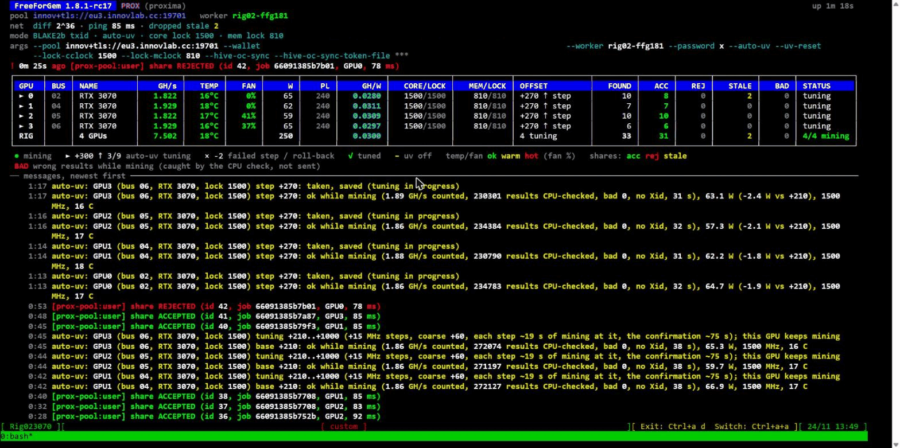

| Coin (RTX 3070) | Tuning from scratch, 4-card rig | What the tuning gives |
|---|---|---|
| NOID | 8.5–9.5 min (1.8.0: about 25 min) | +5…+9 % per watt |
| PROX | 4.5–5 min (1.8.0: about 16 min) | +2…+8 % per watt |
| Ting | 6–8.5 min | +15…+17 % per watt |
| CMFD | about 10–18 min | +17…+20 % per watt |
| NEB | 1.5–2 min | −9…−10 W per card |
| Pearl, 8 cards, lock 1680 | all 8 at once | 0.660 → 0.677 TH/W at the same 601 TH/s (−72 W, −7.8 % for the rig) |

- **Mining during the tuning.** Before 1.8.1 a card stopped mining at every tuning step (Pearl: up to about 14 minutes without
  hashrate, the pool lost the worker). Now the card mines all the time; its hashrate is somewhat lower only while a step is
  checked, and full again afterwards. The Pearl warm-up mines too.
- **All cards at once.** As many cards are tuned at the same time as the rig's free RAM allows, usually all of them. After
  trouble of the whole rig (a card lost from the bus, all cards stalled) the miner gets careful and tunes one card at a time, and
  remembers that for the rig. `--uv-parallel N` sets the number by hand; `--uv-parallel-reset` forgets the caution.
- **A short start.** The search starts close to the expected result instead of 0. `--uv-min N` sets the start by hand.
- **No built-in ceiling.** The offset climbs as long as it saves power; the limit is the range of the card's driver or your own
  `--uv-max N`. The miner's old per-card ceilings are gone; a saved result that stopped at such an old ceiling climbs on at the
  next start.
- **A failure is no reason to start over.** After a failed step or a crash while mining the card goes on 2 steps below the failed
  offset (never above the last confirmed one) and keeps the steps that passed. Progress is saved after every step, so a stop in
  the middle of a tuning loses nothing.
- **Faults are counted per coin.** A card that keeps crashing is left out of mining for a while; the screen shows `OUT 14m` (the
  minutes left), and the card comes back by itself. A card left out on one coin mines another one. A start you make (a miner
  restart, a new flight sheet, a reboot after a clean stop) gives the card a new chance.
- **Guards against an endless tuning and restarts** (every coin): repeated failures on a card switch its auto-uv off for 24 hours
  (the card mines at its last confirmed offset); repeated restarts of the rig during a tuning pause the tuning until `--uv-unpause`
  / `--uv-reset-all` or a new version; an unfinished tuning goes on at the next start. Only real failures count: a fault at the
  edge of a tuning does not. The states show on the screen, the stats line, the API and HiveOS: `[AUTO-UV GPU3 OFF 24h]`,
  `[AUTO-UV PAUSED]`, `[AUTO-UV NOT CALM]`.
- **Turing (RTX 20xx, GTX 16xx, CMP HX), every coin:** a result is confirmed longer on its mining load before it counts, and a
  card that crashes again soon after goes back at once to its stable offset instead of stepping down again and again. A Turing
  profile tuned by an older version gets this longer check once.
- **Pearl, a new miner core only** (the same driver and locks): the saved result gets a short check and the card mines at once.
- **Every result says how long it took** (`RESULT ... tuning took 1 min 58 s, 6 checks`); the RIG row of the table shows the
  saving of the whole rig and the tuning time (`-8.5% in 1m 32s`).

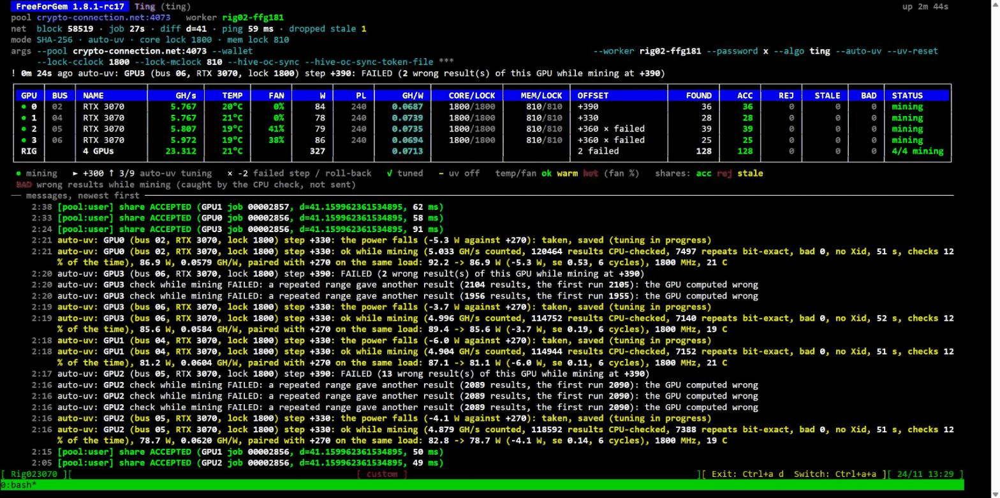

**One-shot flags.** `--uv-reset`, `--uv-reset-all`, `--uv-unpause` (the same as `--uv-parallel-reset`) and `--auto-lock-reset`
act **once, at a start you make**: a miner restart or stop + start, a new flight sheet, a start by hand, a reboot after a clean
stop. A restart after a fault skips them, so a crash cannot wipe the progress. Add these flags for one start and take them out of
the flight sheet afterwards: `--uv-reset` left in the sheet starts the tuning from scratch at every restart you make, and **never
keep `--uv-unpause` in the flight sheet**: it would lift the restart guard at every start.

CMFD: the efficiency is in FW/W.

### 31. The screen: a table of the GPUs, new in 1.8.1

In a terminal (the HiveOS miner screen, a Windows console or Windows Terminal, a Linux shell) the miner shows one table, redrawn
in place, instead of a scrolling log. **The log itself does not change:** the log file, `tee`, HiveOS `miner log` and h-stats.sh
get every line exactly as before.

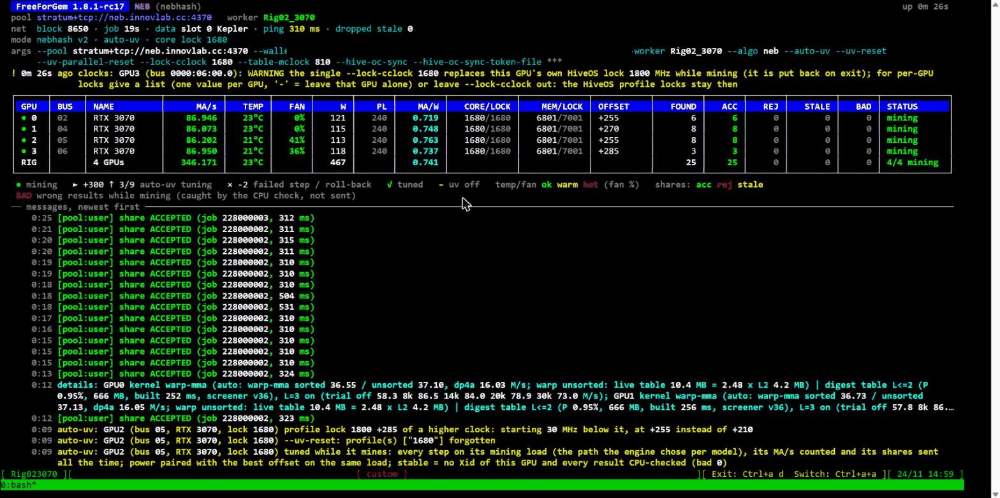

**Modes**

- `--ui auto` (default): the table when someone watches the terminal, else the plain lines.
- `--ui table`: the table even where auto would not draw it; `--ui lines`: the old line-by-line log.
- `--ui ascii` / `--ui unicode` (or `FFG_UI_ASCII=1`): the box in `+ - |` or in Unicode lines. Take `ascii` when the terminal
  shows odd letters instead of lines.
- `--no-color` (or `NO_COLOR=1`): no colours; the states are read from the marks.
- `--ui-demo [COIN] [SECS]`: the table with a made-up rig, no GPU and no pool touched (COIN: pearl, noid, prox, ting, cmfd, neb,
  split): to see the look and the colours.
- `--ui-dump N`: every N-th frame also into `ffg-ui-frames.txt` (to attach to a bug report).

**The header**

| Line | What it shows |
|---|---|
| first | the version (blue bar), the coin (purple) and its algorithm; on the right `up`, how long the miner runs |
| `pool` | the pool and the worker (the worker in green); with `--split` every group's own |
| `net` | as far as the coin has it: block height, the job's id and age (`job 3440026a 8s`), the share difficulty (`share d 1.50G`; yellow when the pool has dropped it far below normal) and the network's in the same unit (`net d 442T`), the data set or model (NEB `data slot 0 Kepler`, the model in its own colour), ping to the pool, dropped stale shares (shares of jobs the pool cancelled; not rejects), blocks found solo |
| `mode` | first the coin's algorithm (`pearlhash`, NOID `Poseidon2b eff` / `Poseidon2b speed`, PROX `BLAKE2b txid`, Ting `SHA-256`, CMFD `ForgeMatrix V4, FreeForgeMiner x.y.z`, NEB `nebhash v2`; with `--split` per group), then the coin's mode, auto-uv, the core and memory locks |
| `args` | your options as given: option names cyan, values white. Secrets are masked `***` (`--password`, HiveOS tokens, pool secrets). A long line wraps by words |
| `!` | important events (warnings, faults, rejects, `clocks:`), up to 5, newest first, each with its own "ago" timer, each in full. They keep a fixed block of lines, so the table does not jump when they come and go |
| `!!` | live alarms, as long as they hold: `REBOOT NEEDED` (Xid 79), `NO TABLE` (NEB), `GPU LOST`, `LOCK NOT HELD`, a memory lock of the HiveOS profile |

**The columns**

| Column | Meaning |
|---|---|
| GPU | the number and the state mark (`●` green: mining, `►`: tuning) |
| BUS | the PCI bus (grey) |
| NAME | the card model |
| COIN | the coin of the card's group (`--split` only) |
| TH/s, MH/s, GH/s, FW/s, MA/s | hashrate in the coin's unit (green) |
| TEMP | core temperature: green, yellow or red |
| FAN | fan speed in %: green, yellow from 60 %, red from 85 % |
| W | power |
| PL | the card's power limit; red when the card runs into it |
| TH/W, MH/W, … | efficiency **per watt** (cyan) |
| CORE/LOCK, MEM/LOCK | real clock / lock (the lock grey). NEB with `--table-mclock 810`: `/810` cyan while that memory lock is in use |
| OFFSET | the V/F offset and the auto-uv state, see below |
| FOUND / ACC / REJ / STALE | shares of the card: found / accepted (green) / rejected by the pool (red) / stale (yellow) |
| BAD | wrong results of the card **while mining**, caught by the miner's check and never sent. Not bad shares: those the pool refused are REJ. Wrong results during an auto-uv step are the guard at work: they show in OFFSET, BAD does not count them. Red when above 0 |
| STATUS | mining / tuning / checking / `OUT 14m` / DEAD |
| RIG row | the rig total: hashrate, watts, per watt, shares, the saving of the tuning and its time (`-8.5% in 1m 32s`), how many cards mine |

The legend under the table explains the marks and colours (and `/810 NEB table mem lock` when that lock is in use). A column the
coin has no data for is hidden. A narrow window hides the less needed columns first; nothing runs past the edge.

**The OFFSET cell**

| Looks like | Means |
|---|---|
| `► +300 ↑ 3/9` orange | tuning: step 3 of 9 at this offset |
| `+450 ✓ confirm` orange | the found offset is being confirmed |
| `+375 ✗ failed` orange | a tuning step at this offset failed |
| `+270 ✗ -2`, `+315 × roll-back` orange | a failed step and the roll-back to 2 steps below it |
| `+390 ✗ 15 wrong` orange | the check caught 15 wrong results on the current step: none went to the pool |
| `+315 ✓ -9.6%` green | tuned; the saving per watt against the base on the same load |
| `+315 ✓ tuned` green | the profile is applied, there is no base for a percentage |
| `-` yellow | auto-uv is off for this card |
| `OUT 14m` | the card is left out after repeated faults, for the minutes shown; it comes back by itself (section 30) |

**Colours of the messages.** **Yellow:** the auto-uv and auto-lock lines and warnings. **Orange:** everything that belongs to the
tuning of a card, a failed step and its roll-back included: that is the tuning doing its job. **Red** only for what needs your
hands: rejected shares, BAD while mining, GPU LOST, REBOOT NEEDED, NO TABLE, auto-uv off or paused, a pool that is down.

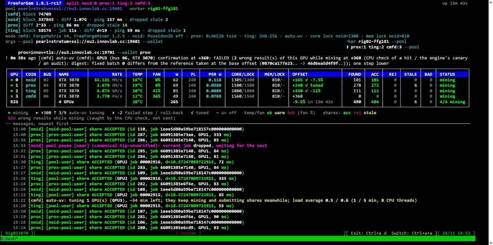

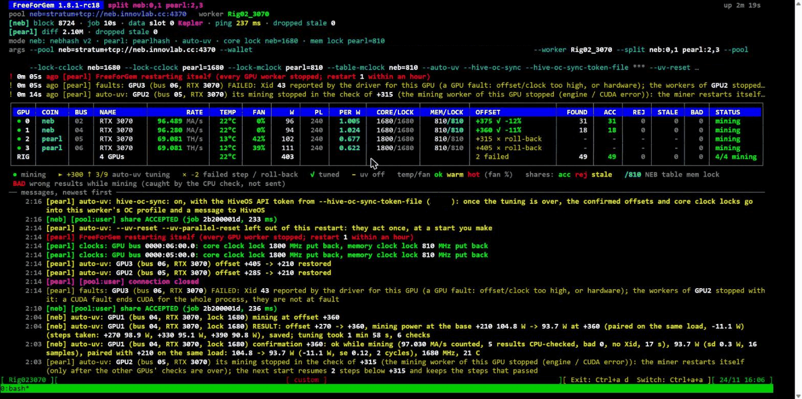

**Under HiveOS** open Hive Shell (or SSH) and type `miner`. `miner log`, the web "Miner log" and the watchdog get the log lines,
not the redrawn screen. GNU screen has 16 colours only: there orange is a dim yellow and the marks ✗ ✓ are × √. The table heals
by itself if a browser terminal loses part of it, and it is drawn anew when `miner` attaches.

### 32. Tuned offsets into the HiveOS OC profile: `--hive-oc-sync`, new in 1.8.1

HiveOS only, with `--auto-uv`. Once the cards are tuned, the miner reports the results to HiveOS, and with an API token it also
writes them into this worker's OC profile: then they stay after a reboot and with another miner.

- **`--hive-oc-sync`**: one **message in the HiveOS panel** (the worker's messages), e.g. `FreeForGem auto-uv (Ting): 4 GPUs
  tuned at 1800 MHz: -44 W (-11.8 %)`. Its details list every card (offset, lock, watts before and after), the total, and the
  lines `Core Clock Offset: …` / `Lock Core Clock: …` (with `--lock-mclock` also `Lock Mem Clock`) ready to paste into the OC form.
  It is sent again only when the results change, not at every start. Nothing is written.
- **With a token** (`--hive-oc-sync-token TOKEN`, or `--hive-oc-sync-token-file PATH`, or `$FFG_HIVE_TOKEN`): the same
  message, and the confirmed **offsets and clock locks** go into the OC profile by themselves: the core lock with `--lock-cclock` /
  `--auto-lock`, the memory lock with `--lock-mclock`. The profile of the flight sheet's algo is used if there is one, else
  *Default Config*. The rest of the profile (power limit, fans, memory offset, other algos) is not touched. HiveOS then applies the
  profile on the rig. The message ends with `applied to the OC profile`, `already in the OC profile`, or says why nothing was written.
- **`--split`:** every group writes only its own cards and sends its own message; the values of the other groups stay.
- **Safety:** a copy of the OC profile is kept before every write. When a card loses its result, your old value goes back into the
  profile. Values you type into the profile yourself stay yours. A card that is still being checked does not hold up the others.
- **`--hive-oc-sync-test`:** sends one test message, prints the answer and exits; with a token it also checks that it arrived.

**Making the token.** HiveOS web → account settings → *Sessions* / API → a **new API token just for this** (a separate token can
be revoked alone). Put it into the flight sheet's *Extra config arguments*:

```
--auto-uv --hive-oc-sync --hive-oc-sync-token YOUR_TOKEN
```

The miner masks the token on its screen and in its log.

**Or keep the token out of the flight sheet:** a token in the flight sheet is seen by everyone with access to the farm, and on the
rig in `ps` and in the rig's config. If you prefer not to have it there, put it in a file that only root can read:

```
nano /root/ffg-hive-token          # paste the token, save
chmod 600 /root/ffg-hive-token
```

and use `--auto-uv --hive-oc-sync --hive-oc-sync-token-file /root/ffg-hive-token` (not in `/hive-config`: the files there are
readable by every user). A rejected token: an orange line, no more OC writes until the next restart, the messages go on.

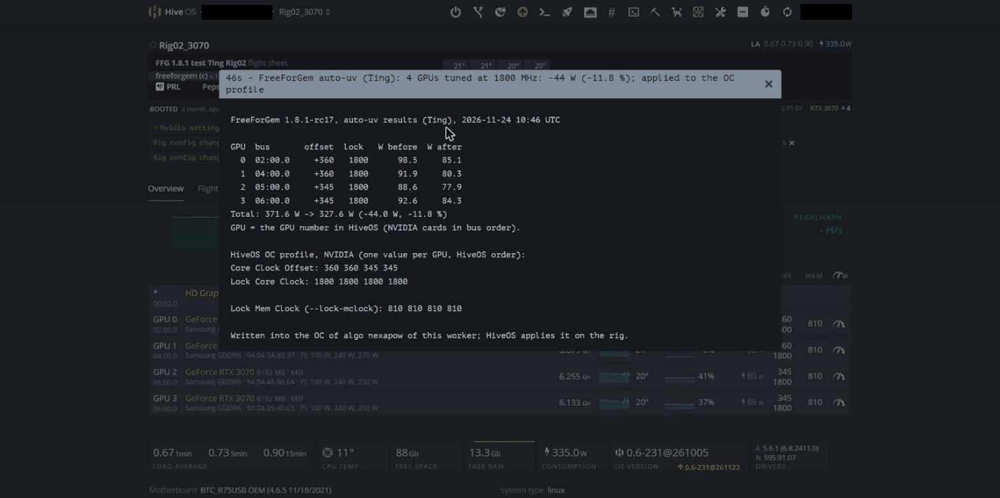

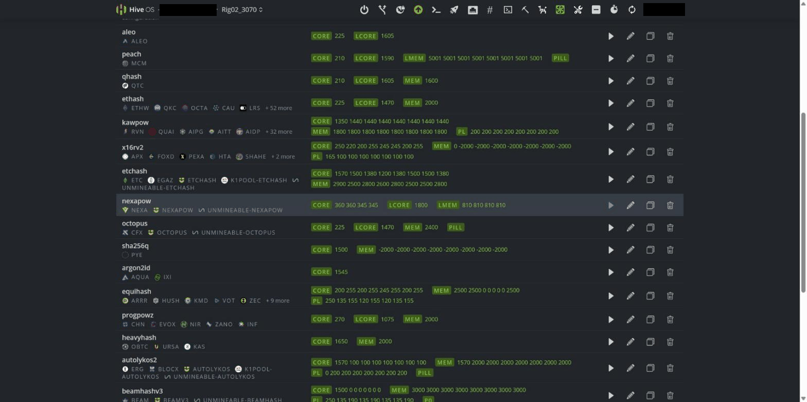

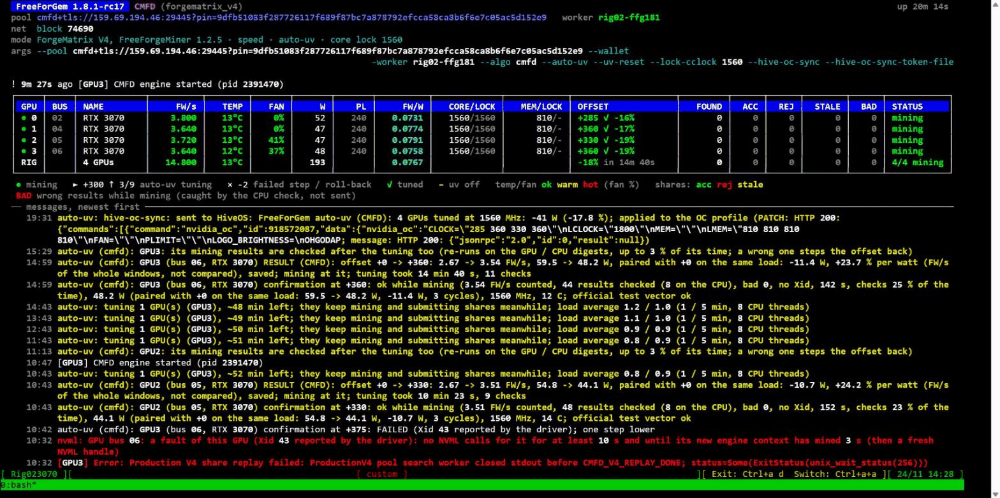

### 33. Other changes in 1.8.1 (HiveOS, NEB, pools)

- **The HiveOS miner window stays open.** After an exit with an error the miner starts again in the same window
  (`freeforgem exited (code N), restarting in 5 s`); the one-shot flags (section 30) are skipped at such a start. `miner stop` /
  `miner restart` (also the HiveOS watchdog's) work as before. After frequent exits the window waits 10 minutes before the next
  start; `miner restart` starts it at once.
- **The HiveOS package name has exactly one dash:** `freeforgem-1.8.3_hiveos.tar.gz` (name-version_hiveos). With a second dash
  HiveOS takes a wrong miner name and the miner silently does not start. HiveOS caches a package by its file name: a new build under
  the same name needs a new folder in the URL, or on the rig `/hive/miners/custom/custom-get <URL> -f`.
- **HiveOS `--split` from a flight sheet of any coin:** the flight sheet's pool and wallet go to the group of the flight sheet's
  coin. A NOID flight sheet without `--algo` works by itself.
- **NEB:** engine nebgpu 0.8.4, faster on Turing. `--table-mclock 810` lowers the memory only where NEB does not need it; for a
  model that needs the full memory clock it stays full, and that is right (at 810 MHz such a model would lose most of its
  hashrate). Such a model no longer raises a false `NO TABLE` alarm.
- **A spoiled pool session is replaced** (NEB, NOID, PROX, Ting, Pearl stratum): when the pool drops the share difficulty or
  answers late with many stale shares, the miner opens a new session: yellow line `pool: reconnecting: <why>`. Your session and
  the dev fee session are watched each on its own.
- **`--api-port N` on every coin** (Pearl, NOID, PROX and CMFD too; off by default, Ting serves 4068 as before).
- **Dev fee unchanged:** 1 % (section 10).

## Русский

### 1. Что это

FreeForGem — GPU-майнер **Pearl (PRL)** (pearlhash, proof-of-useful-work) для видеокарт NVIDIA с **комиссией разработчика 1%**.
С 1.6.0 майнит также Common Foundry (CMFD, раздел 13), с 1.7.0 — **NOID** (Parano1d, раздел 15), с 1.7.8 — **Proxima (PROX)** (раздел 21), с 1.8.0 — **NEB** (nebhash v2, раздел 24) и
**Ting / Daler (DLR)** (раздел 26). С 1.8.0 на одном риге можно майнить и **разные монеты на разных картах** (`--split`,
раздел 27). Коротко о новом в 1.8.0 — раздел 25.

**Название.** С 1.7.0 мульти-монетный майнер (Pearl + CMFD + NOID) называется **FreeForGem** (бинарь `freeforgem`, кастомный
майнер HiveOS `freeforgem`, репозиторий `pepsykolya/FreeForGem`). **FreeForGemPear** остаётся майнером Pearl под своим именем.
Переход с FreeForGemPear: в HiveOS создайте **новый полётный лист** (Miner name `freeforgem` + новая Installation URL);
сохранённые результаты андервольта (`uv.json` из `/hive-config/freeforgempear` или из папки `freeforgempear` рядом с новой)
импортируются автоматически при первом запуске (в логе: `imported the saved undervolt results of FreeForGemPear`).
Собственные настроенные CUDA-ядра. Доказательство каждой шары проверяется на CPU официальным верификатором `zk-pow` до отправки.

| Серия | Статус |
|---|---|
| RTX 30xx (Ampere, sm_86): 3060 / 3060 Ti / 3070 / 3070 Ti / 3080 / 3090 | **основная цель, оптимизировано: ~70 TH/s на RTX 3070 при ~107 Вт** |
| RTX 40xx (Ada, sm_89) | своё ядро с 1.5.4 (RTX 4070 Ti: тот же хэшрейт, на ~10 Вт меньше, чем с ядром RTX 30xx) |
| RTX 50xx (Blackwell, sm_120) | поддержка с 1.5.0, компилированное ядро (без оптимизации); нужен драйвер 570+ |
| CMP 50HX (TU102) | работает: **на драйвере 610.43.03 около 67 TH/s на карту при локе 1300 и около 77 TH/s при 1500** (166–176 Вт на карту, риг 4× CMP 50HX, 1.7.8). На старых драйверах 550.78 и 595.91.07 только ~2,6 TH/s (int8 тензорные ядра урезаны ~в 17 раз): обновите драйвер |
| RTX 20xx / GTX 16xx / CMP 30HX–50HX (Turing, sm_75) | поддержка с 1.5.3, собственное ядро: ~49,9 TH/s на RTX 2060 SUPER @1605 МГц; **память лочить на 5001, не 810** |
| AMD Radeon RX 6000 (RDNA2), Windows | **новое в 1.6.0**, своё ядро OpenCL: 34,4 TH/s на RX 6800 XT (раздел 14) |
| Старые карты, A100 (sm_80), AMD в Linux / HiveOS | не поддерживаются |

### 2. Требования

* Видеокарта NVIDIA: RTX 30 / RTX 40 (свои ядра), RTX 20 / GTX 16 / CMP, RTX 50 (с 1.5.0); драйвер NVIDIA **525 или новее** (RTX 50xx: **570+**).
* Или, **только в Windows**, карта **AMD Radeon RX 6000** (RDNA2) с драйвером AMD Adrenalin (с 1.6.0, раздел 14).
* HiveOS, Linux x86_64 (glibc 2.31+, Ubuntu 20.04+) или Windows 10/11 x64. CUDA toolkit, Python и WSL не нужны.
* Адрес кошелька PRL (`prl1...`) и интернет до stratum-пула Pearl.
* NEB и Ting (1.8.0): NVIDIA GTX 10 или новее (Ting — ещё и AMD через OpenCL); движки и датасет NEB лежат в пакетах
  (разделы 24 и 26).
* Видеопамять: майнеру почти не нужна VRAM.

### 3. Настройка в HiveOS (по шагам)

FreeForGem запускается в HiveOS как **Custom miner**: SSH и ручная установка не нужны.

**Ссылка для установки (1.8.0):**

```
https://github.com/pepsykolya/FreeForGem/releases/download/v1.8.3/freeforgem-1.8.3_hiveos.tar.gz
```

1. **Кошелёк.** В разделе *Wallets* добавьте кошелёк PRL: монета `PRL`, адрес `prl1...`.
2. **Новый полётный лист.**
   * **Coin:** `PRL`.
   * **Wallet:** кошелёк из шага 1.
   * **Pool:** *Configure in miner*.
   * **Miner:** *Custom*, затем *Setup Miner Config*.
3. **Настройки майнера:**

   | Поле | Значение |
   |---|---|
   | Miner name | `freeforgem` (подставится сам после вставки ссылки) |
   | Installation URL | ссылка выше |
   | Hash algorithm | `pearlhash` (или оставить `----`) |
   | Wallet and worker template | `%WAL%.%WORKER_NAME%` |
   | Pool URL | `pearl-eu2.luckypool.io:3360` или Kryptex `prl-eu.kryptex.network:7048` (любой пул из раздела 6) |
   | Pass | пусто |
   | Extra config arguments | по желанию, например `--devices 0,1` |

4. **Применить.** *Apply changes*, *Create flight sheet*, затем применить лист к ригу.

Лог майнера: `/var/log/miner/freeforgem/freeforgem.log` и консоль майнера в HiveOS.
На панели видны хэшрейт по картам и общий, температура, вентиляторы, принятые и отклонённые шары; с 1.7.2 — эффективность рига (TH/Вт для Pearl, MH/Вт для NOID) рядом с версией майнера; с 1.7.5 там же — вышедшая новая версия (`1.7.8 0.652 TH/W, need update!!`: майнер проверяет GitHub через ~1 мин после старта и раз в ~12 ч, сам ничего не устанавливает; `--no-update-check` выключает).
Для обновления смените Installation URL на новую версию. То же подробнее: [HIVEOS.md](HIVEOS.md).
HiveOS кэширует скачанный архив по имени файла: у каждой версии новое имя файла, поэтому всегда вставляйте ссылку нового релиза.
NEB, Ting и риг с разными монетами на разных картах — разделы 24, 26 и 27, а также [HIVEOS.md](HIVEOS.md).

### 4. Linux без HiveOS

```
tar xzf freeforgem-1.8.3-linux-x86_64.tar.gz
cd freeforgem-1.8.1
./freeforgem --self-test        # по желанию: сверка GPU-ядра с CPU-эталоном
./freeforgem --pool pearl-eu2.luckypool.io:3360 --wallet ВАШ_АДРЕС_PRL --worker rig1     # LuckyPool
./freeforgem --pool prl-eu.kryptex.network:7048 --wallet ВАШ_АДРЕС_PRL --worker rig1       # Kryptex
```

| Опция | Значение |
|---|---|
| `--pool HOST:PORT` | stratum-пул (по умолчанию `pearl-eu2.luckypool.io:3360`); префикс `stratum+tcp://` допускается, SSL не поддерживается (нужен обычный TCP-порт) |
| `--wallet ADDRESS` | ваш адрес PRL (обязательно) |
| `--worker NAME` | имя воркера (по умолчанию `worker1`) |
| `--devices 0,1,...` | какие GPU использовать (по умолчанию все видимые; учитывает `CUDA_VISIBLE_DEVICES`) |
| `--minutes N` | остановиться через N минут (по умолчанию работает до Ctrl-C / SIGTERM) |
| `--self-test` | проверить ядро и выйти |

Один процесс ведёт все GPU и сам переподключается к пулу. Для постоянной работы запускайте под `systemd`, `screen` или `tmux`.

### 5. Windows 10/11

Нативная сборка: WSL, установка CUDA и Python не нужны. Нужен только драйвер NVIDIA.

1. Скачайте **`freeforgem-1.8.3-windows-x64.zip`** со страницы релиза:
   `https://github.com/pepsykolya/FreeForGem/releases/download/v1.8.3/freeforgem-1.8.3-windows-x64.zip`
   и сверьте SHA-256 (раздел 9).
2. Распакуйте в папку **без пробелов и русских букв**, например `C:\FreeForGem`.
3. Выберите файл запуска под свой пул — все готовы к работе, поменять нужно только кошелёк:

   | Файл | Пул |
   |---|---|
   | `start.bat`, `start-luckypool-eu.bat` | LuckyPool Европа `pearl-eu2.luckypool.io:3360` |
   | `start-luckypool-ru.bat` / `-us.bat` / `-asia.bat` | LuckyPool Россия / США (восток) / Сингапур |
   | `start-kryptex-eu.bat` | Kryptex Европа `prl-eu.kryptex.network:7048` |
   | `start-kryptex-ru.bat` / `-us.bat` / `-asia.bat` | Kryptex Россия / Северная Америка / Сингапур |

   **Важно:** во всех файлах `WALLET` заранее заполнен **адресом разработчика из примера**. Замените его своим, иначе вы майните
   на разработчика (майнер предупредит об этом при старте). Правой кнопкой по файлу → *Изменить* и задайте:

| Параметр | Значение |
|---|---|
| `WALLET` | ваш адрес PRL (`prl1...`) |
| `POOL` | `HOST:PORT`, по умолчанию `pearl-eu2.luckypool.io:3360` (раздел 6) |
| `WORKER` | имя рига, по умолчанию имя компьютера |
| `DEVICES` | пусто = все GPU NVIDIA, или список вида `0,1` (индексы из `nvidia-smi`) |

4. Запустите выбранный **`.bat`**. Один процесс майнера ведёт все GPU; вывод идёт в окно и в файл
   `logs\miner-<дата>.log` (хранятся последние 10 логов). Если майнер завершился или упал, он перезапускается через 15 с.
   `Ctrl+C` — остановка.

* **Автозапуск:** положите ярлык `start.bat` в `shell:startup` (Win+R, `shell:startup`) или создайте задачу в Планировщике
  «При входе в систему», запускающую `start.bat`.
* **Разгон:** MSI Afterburner (фиксация ядра в редакторе кривой, память вниз) со значениями из раздела 7 **или** встроенное
  управление частотами (следующий пункт). Ноутбуки: подключите зарядку и выберите режим максимальной производительности.
* **Встроенное управление частотами (с 1.4.9):** задайте `LOCK_CCLOCK`, `LOCK_MCLOCK` и/или `MOFFSET` в `.bat`-файле (раздел 12),
  например `set "LOCK_CCLOCK=1560"` и `set "LOCK_MCLOCK=810"`. Майнер фиксирует частоты при старте и возвращает их при выходе.
* **Андервольт (необязательно):** уберите `rem` перед `set "AUTO_UV=1"` в `start.bat` и запускайте его от администратора; см. раздел 12, *Windows: по шагам*.
* **Запуск от администратора для любой настройки GPU.** `AUTO_UV`, `LOCK_CCLOCK`, `LOCK_MCLOCK` и `MOFFSET` меняют GPU через
  драйвер, а для этого нужны права администратора: правой кнопкой по `.bat` → **Запуск от имени администратора** (для
  автозапуска включите *Выполнять с наивысшими правами* в задаче Планировщика). Без этого майнер продолжит работать, но на
  текущих частотах и с предупреждением в логе. Для обычного майнинга (только кошелёк/пул) администратор **не** нужен.
* Defender / SmartScreen может ругаться на новый неподписанный `.exe`: *Подробнее → Выполнить в любом случае* или добавьте папку в исключения.
* Без `start.bat`: `freeforgem.exe --pool pearl-eu2.luckypool.io:3360 --wallet ВАШ_АДРЕС_PRL --worker rig1`

**Продвинутый вариант: свой `.bat` с фиксацией частот и лимитом мощности через `nvidia-smi`.** Если нужен ещё и **лимит
мощности** (встроенное управление частотами его не задаёт) или свой цикл перезапуска и файл лога — сделайте `.bat` как ниже и
запускайте его **от администратора** (`nvidia-smi -lgc/-lmc/-pl` и `--auto-uv` требуют прав администратора):

```bat
@echo off
rem Фиксируем частоты и лимит мощности через драйвер (администратор; сбрасывается при перезагрузке). Значения — раздел 7.
nvidia-smi -lgc 1665
nvidia-smi -lmc 810
nvidia-smi -pl 165
cd /d C:\Mining\freeforgem-1.8.3-windows-x64
:loop
powershell -NoProfile -Command "& { .\freeforgem.exe --pool pearl-eu2.luckypool.io:3360 --wallet ВАШ_АДРЕС_PRL --worker rig1 --auto-uv --uv-min 135 --uv-max 360 | Tee-Object -Append -FilePath C:\Mining\ffgp.log }"
timeout /t 10
goto loop
```

Замените `ВАШ_АДРЕС_PRL` на свой адрес `prl1...` (для объединённого майнинга PRL+NOCK на LuckyPool допишите `+ВАШ_АДРЕС_NOCK`).
`-lgc` фиксирует частоту ядра, `-lmc` — памяти, `-pl` — лимит мощности в ваттах; `timeout /t 10` + `goto loop` перезапускают
майнер через 10 с после любого выхода, а `Tee-Object` пишет лог, не скрывая вывод. Снять фиксацию без перезагрузки:
`nvidia-smi -rgc` и `nvidia-smi -rmc`. (Штатный `start.bat` делает фиксацию частот и цикл перезапуска за вас через `LOCK_CCLOCK` /
`LOCK_MCLOCK` и `MOFFSET`; свой `.bat` нужен только ради `-pl` или собственного лога.)
С 1.5.1 такой файл лежит в Windows-архиве готовым: **`start-nvidia-smi.bat`** (фиксация частот, лимит мощности, диапазон
андервольта, цикл перезапуска и лог `logsfgp.log` в папке майнера; значения в нём — для RTX 3070, поменяйте под свою карту).

### 6. Пулы

По умолчанию **LuckyPool**, `pearl-eu2.luckypool.io:3360` (stratum по TCP). Хосты и порты ниже взяты из конфигурации самого пула
(`https://pearl.luckypool.io/api/stats`, `config.stratum` и `config.ports`); выбирайте ближайший регион:

| Регион | Хост |
|---|---|
| Европа | `pearl-eu2.luckypool.io` (по умолчанию), `pearl-eu1.luckypool.io`, `pearl-pl.luckypool.io` (Польша), `pearl-tr.luckypool.io` (Турция) |
| Россия | `pearl-ru.luckypool.io` |
| США | `pearl-us-east.luckypool.io`, `pearl-us-west.luckypool.io`, `pearl-us-central.luckypool.io`, `pearl-us-ord.luckypool.io` |
| Южная Америка | `pearl-br.luckypool.io` (Бразилия) |
| Канада | `pearl-ca1.luckypool.io`, `pearl-ca2.luckypool.io` |
| Азия | `pearl-sg1.luckypool.io`, `pearl-sg2.luckypool.io` (Сингапур), `pearl-id.luckypool.io` (Индонезия), `pearl-hk.luckypool.io` (Гонконг), `pearl-in.luckypool.io` (Индия), `pearl-jp.luckypool.io` (Япония), `pearl-au.luckypool.io` (Австралия) |

| Порт | Сложность шары (vardiff) |
|---|---|
| `3360` | 2 000 000 (по умолчанию) |
| `3361` | 4 000 000 |
| `3362` | 8 000 000 |

Пример: `--pool pearl-pl.luckypool.io:3360`. В качестве кошелька указывайте обычный адрес `prl1...`, имя воркера передаётся отдельно.
Подойдёт любой другой stratum-пул Pearl с тем же JSON-RPC; комиссия (раздел 10) тогда майнится на этом пуле.

**Merge-майнинг NOCK (только LuckyPool).** LuckyPool за ту же работу Pearl платит ещё и Nockchain (NOCK), без потери хэшрейта:
укажите кошелёк в виде `АДРЕС_PRL+АДРЕС_NOCK`, например `--wallet prl1...+ВАШ_АДРЕС_NOCK`. Статистика NOCK — на
`https://nock.luckypool.io` по вашему адресу NOCK. В батниках Windows впишите тот же `prl1...+NOCK...` в `WALLET`; в HiveOS —
в адрес кошелька PRL. Другие пулы (Kryptex) это не поддерживают: с 1.4.3 майнер сам отбрасывает там часть `+...` (в логе
`merge mining (+NOCK/+NACR) works on LuckyPool, HimPool and AlphaPool only`) и майнит PRL на адрес `prl1...`.

**Merge-майнинг NACRE (NACR) (HimPool, AlphaPool; с 1.7.3).** Эти пулы за ту же работу Pearl платят ещё и NACR: укажите
кошелёк в виде `АДРЕС_PRL+АДРЕС_NACR` (`--wallet prl1...+nacr1p...`; на HimPool `prl1...+nacr1p...+АДРЕС_NOCK` — ещё и NOCK).
Майнер оставляет там части `+` и дописывает воркер после них (`prl1...+nacr1p....rig1`); в логе
`merge mining: PRL to prl1..., +nacr1p... on this pool`. Без адреса NACR доля NACR на HimPool остаётся пулу. Порты:
AlphaPool `eu1.alphapool.tech:5571` (также `us1`, `us2`, `ru1`, `sg1`), HimPool `eu.himpool.com:1480` (также `in`, `ca`).

**Kryptex** (проверено в 1.4.1): `--pool prl-eu.kryptex.network:7048` (также `prl`, `prl-us`, `prl-br`, `prl-sg`, `prl-hk`, `prl-ru`,
`prl-ae` `.kryptex.network`; порт 7048 — обычный TCP). Кошелёк — ваш адрес `prl1...`. Kryptex берёт имя воркера из логина, поэтому с 1.4.3
майнер отправляет туда `prl1....ВОРКЕР` (до 1.4.3 Kryptex показывал любой риг как `worker`).
**Имя пользователя Kryptex** (с 1.7.4): вместо адреса `prl1...` кошельком может быть имя пользователя вашего аккаунта Kryptex
(выплаты в BTC/USDT с автоконвертацией, статистика в личном кабинете Kryptex); майнер входит как `имя/ВОРКЕР`. Windows: имя —
в `WALLET` файла `start-kryptex-*.bat`; HiveOS: имя как кошелёк, шаблон `%WAL%.%WORKER_NAME%` как обычно. До 1.7.4 стартовый
файл Windows его не пропускал («WALLET does not look like a PRL address»).
Крупным ригам на Kryptex (больше ~0.5 PH/s на воркер) с 1.4.5 можно задать свою сложность шары: `--password d=ЗНАЧЕНИЕ`
(HiveOS — Extra config arguments; Windows — `PASSWORD` в `.bat`), `ЗНАЧЕНИЕ = хэшрейт (H/s) × секунд на шару / 4294967296`;
по умолчанию 2097152 (воркер на 100 TH/s находит шару примерно раз в 90 с).

**Сжатие доказательств.** Доказательства отправляются сжатыми gzip (около 5 КБ вместо примерно 270 КБ: меньше трафика, быстрее
отправка, меньше устаревших шар), если пул согласился на это при входе: с 1.4.4 майнер следует протоколу Pearl stratum gzip (отправляет
`"type":"v2"` в `mining.authorize`; Kryptex и LuckyPool отвечают `"type":"v2"`, в логе `pool confirmed gzip proofs`). Пулу, который этого
не подтвердил, доказательства идут несжатыми. `FFGP_PROOF_GZIP=on` / `off` задаёт выбор принудительно.
**На Kryptex версии 1.4.1–1.4.3** отправляли сжатые доказательства без этого согласования: Kryptex отвечал «принято», но шары
не засчитывал. Обновитесь до 1.4.4 или новее.

### 7. Разгон (лок ядра, память, V/F offset)

Майнер почти не нагружает видеопамять, поэтому частоту памяти можно опустить до минимума.
Важны три настройки: **зафиксированная частота ядра**, **низкая частота памяти** и **V/F offset** (андервольт: та же
частота при меньшем напряжении; `--auto-uv` подберёт его сам, раздел 12).

**Замер FreeForGem, RTX 3070:** ядро `1560` МГц (лок), память `810` МГц, лимит мощности `120` Вт →
**~70 TH/s при ~105–107 Вт**; `--auto-uv` затем находит +195..240 (≈ 86–107 Вт).

**Стартовые значения по картам.** Строки *опорные* — опубликованные результаты настройки этих карт; строки *оценка* выведены
по картам того же поколения и не замерены. Все карты разные: свой offset пусть подберёт `--auto-uv`.

| Карта | Лок ядра, МГц | Память | V/F offset, МГц | Источник |
|---|---|---|---|---|
| RTX 3060 Ti, RTX 3070, RTX 3070 Laptop, RTX 3080 Ti | 1560–1650 | лок `810` | +200..255 | опорные (3070 — наш замер) |
| RTX 3060, RTX 3070 Ti, RTX 3080, RTX 3090 | 1560–1650 | лок `810` | +200..255 | оценка |
| CMP 70HX, CMP 90HX (Ampere) | 1650 | offset `-2000` (`--moffset`) | +255..300 | опорные, с FreeForGem не проверялись |
| RTX 4070 Ti, RTX 4090 | 2445 | лок `810` | +315..345 | опорные |
| RTX 4060, 4060 Ti, 4070, 4070 Super, 4070 Ti Super, 4080, 4080 Super | 1900–2445 | лок `810` | +300..345 | оценка |
| RTX 5070 Ti | 2445 | лок `810` | +480 | опорные |
| RTX 5070 | 2400 | лок `810` | проверки проходят до +390, выше — падение | отчёт пользователя, FreeForGemPear 1.5.1, Windows, драйвер 617.14 |
| RTX 5060, 5060 Ti, 5080, 5090 | 1900–2500 | лок `810` | +390..480 | оценка |
| RTX 2060 SUPER, RTX 2070/2080 (вкл. SUPER), GTX 1660/1650 | 1500–1650 | лок `5001` (**не 810**: на 810 Turing теряет ~25%) | +200..260; предел auto-uv +225 по умолчанию (с 1.6.2) | опорное (2060 SUPER: замер) |
| CMP 40HX | 1400 | лок `5001` | +150; предел auto-uv +150 по умолчанию (с 1.6.2) | риги пользователей; CMP 40HX ловила Xid на +255 |
| CMP 50HX (TU102) | — | лок `5001` | +220 и выше; предел auto-uv +330 по умолчанию (`--uv-max 330`) | риги пользователей. Лок **1300–1500** (верх по умолчанию у `--auto-lock` для CMP — 1500). **Pearl на драйвере 610.43.03: ~67 TH/s на карту при 1300, ~77 TH/s при 1500** (166–176 Вт на карту, риг 4× CMP 50HX); на старых драйверах 550.78 / 595.91.07 только ~2,6 TH/s (int8 тензорные ядра урезаны ~в 17 раз) |

RTX 40 и 50 работают на гораздо более высоком локе ядра (**1900–2500 МГц**) и держат больший offset, чем RTX 30.

**Смешанный риг:** достаточно `--auto-uv`. С 1.8.1 у майнера нет своего потолка смещения: каждая карта поднимается, пока каждый
шаг снижает мощность, самое большее до предела, который даёт её драйвер (до 1.8.1 были встроенные пределы по типу карты); при
старте в логе виден диапазон каждой карты (`auto-uv: GPU5 (bus 0b, CMP 40HX): range +60..+1000 (max: the driver's +1000; ...)`).
Ограничить карту самому — по значению на карту в порядке `--devices`: `--uv-max 225,-,150` (`-` = без вашего предела для карты). Turing (RTX 20 / GTX 16 / CMP 30HX–50HX, sm_75) поддерживается с 1.5.3: в отличие от RTX 30 ему нужна память на 5001 (см. таблицу); CMP 170HX / A100 (sm_80) не поддерживаются.

**Карты CMP (CMP 30HX / 40HX / 50HX).** CMP 30HX/40HX майнят Pearl на Turing-ядре (память лочить на 5001, предел auto-uv +150).
**CMP 50HX и Pearl:** на драйвере 610.43.03 карта даёт около 67 TH/s при локе ядра 1300 и около 77 TH/s при 1500
(166–176 Вт на карту; риг 4× CMP 50HX, FreeForGem 1.7.8); на старых драйверах 550.78 и 595.91.07 только ~2,6 TH/s
(там int8 тензорные ядра урезаны ~в 17 раз), поэтому сначала обновите драйвер. **Для Common Foundry (CMFD) CMP 50HX подходит:** ~13 FW/s на карту при ~220 Вт (лимит мощности 225 Вт,
лок ядра 1410 МГц, память без лока; риг 4× CMP 50HX, пул Aria), с `--auto-uv` (подбор под CMFD, +225) — около 13,2 FW/s при
196–203 Вт (+8–11 % FW/W); см. раздел 13. CMFD нужно ~7 ГБ свободной видеопамяти, на картах с 6 ГБ (CMP 30HX) он не
запустится. **Разблокировка CMP не входит в FreeForGem:** драйверов и программ, снимающих ограничения CMP-карт, мы не
предоставляем и не поддерживаем; все цифры здесь — для карт как есть.

* HiveOS: вкладка Overclock → частота ядра (абсолютная), частота памяти (абсолютная), лимит мощности; V/F offset — через `--auto-uv`.
* Linux: `nvidia-smi -lgc 1560,1560`, `nvidia-smi -lmc 810,810`, `nvidia-smi -pl 120` (root) или `--lock-cclock` / `--lock-mclock`.
* Windows: `LOCK_CCLOCK` / `LOCK_MCLOCK` / `MOFFSET` в `start.bat` (от администратора), `start-nvidia-smi.bat` — если нужен
  лимит мощности, или MSI Afterburner. Готовые комбинации по картам — раздел 12, *Windows: готовые комбинации*.

Если пул отклоняет шары или в логе есть `bad`-попадания, снизьте частоту ядра или offset.

### 8. Как читать лог

| Строка | Значение |
|---|---|
| `FreeForGem 1.7.2 \| pool ... \| worker ... \| N GPU(s)` | стартовая строка |
| `[pearlgpu] search kernel: ...` | загружено настроенное ядро. `embedded search kernel could not be loaded (причина)` = майнер останавливается с ошибкой (драйвер старше 525 или неподдерживаемая карта) |
| `new job ... prepared in ...` | готово новое задание пула |
| `[ 120s] GPU0 ... \| total X TH/s \| hits ... \| user sub S acc A rej R \| fee sub ... acc ... rej ...` | каждые 10 с: хэшрейт по картам и общий; отправленные / принятые / отклонённые шары ваши и комиссии; `[DEVFEE]` пока идёт слот комиссии С 1.5.3 у каждой карты также видны потребление и эффективность, например `GPU0 49.906 (151 W, 0.330 TH/W)`, и итог `\| 151 W, 0.330 TH/W` (если доступен NVML) |
| `[DISCONNECTED]` | соединение с пулом потеряно; майнер переподключится сам |
| `devfee: ...` | слоты комиссии (раздел 10) |
| `!! ...` | предупреждение или ошибка (остановился GPU-воркер, hit не отправлен) |
| `auto-uv: GPU3 (...) RESULT: offset +285 at 1815 MHz ...` | конец тюнинга / проверки одной карты (1.7.2) |
| `faults: GPU3 (bus 04, RTX 3070) FAILED: Xid 13 ...` | упавшая карта; майнер понижает её offset и перезапускает себя (раздел 17) |
| жёлтые строки `auto-uv: ...` / `auto-lock: ...`, оранжевые — сбои и откаты | автоподбор (1.8.0, во всех монетах; `--no-color` выключает цвета) |
| `[LOCK NOT HELD: GPU2]` в строке статистики | лок частоты ядра этой карты не держится под нагрузкой; auto-uv и auto-lock эту карту не трогают (раздел 25) |
| `[neb] [  60s] GPU0 ...` | `--split` (раздел 27): строка одной группы, имя группы впереди, голубым |
| `WARNING GPU1 (bus 05): FAULTY: ...` | NEB / Ting: 3 сбоя за 10 мин на безопасном offset — карта отдыхает 10 мин, затем получает новый движок (раздел 29) |
| `WARNING: the pool answers late: ...` | пул отвечает через секунды после отправки (теряются пакеты в сети рига); такие шары возвращаются устаревшими (раздел 29) |

### 9. Проверка загрузки (SHA-256)

Сравните результат с хешем на странице релиза.

* Linux: `sha256sum freeforgem-1.8.3-linux-x86_64.tar.gz freeforgem-1.8.3_hiveos.tar.gz`
* Windows: `certutil -hashfile freeforgem-1.8.3-windows-x64.zip SHA256` или
  `Get-FileHash freeforgem-1.8.3-windows-x64.zip -Algorithm SHA256`

### 10. Комиссия — 1%

Один 60-секундный слот в каждом 100-минутном цикле, в случайный момент цикла, на **том же пуле, который вы указали**, под отдельным
логином (воркер `ffgp-devfee`). В логе: `devfee: next slot in N min`, `devfee: mining 60s for FreeForGem dev (1%)`,
`devfee: back to user`. Первый слот приходится на случайный момент первых 100 минут. Если логин комиссии не обслуживается, слот
пропускается; ваш майнинг не блокируется. На LuckyPool логин комиссии с 1.4.2 майнит заодно и NOCK разработчика
(`prl1...+NOCK`); если пул не примет такой логин, майнер вернётся к обычному кошельку PRL. Время комиссии остаётся 1%. Комиссия — условие лицензии: убирать, уменьшать или перенаправлять её нельзя
(см. [LICENSE](LICENSE), пункт 3). При списке пулов (раздел 22) соединение комиссии следует за вами: на старте слота оно идёт на тот пул, где вы сейчас.

**Все монеты (1.8.0).** Комиссия — 1 % в каждой монете, и у неё всегда своё соединение, внутри вашей сессии она не идёт:
Pearl и NOID — второй логин на вашем пуле (см. выше); PROX — тоже второй логин на вашем пуле, proximamine только запасной (соло, suprnova, отказ fee-логину; раздел 21); CMFD — внутри движка, 36 с в час на карту
(раздел 13); NEB — 60 с из каждых 100 минут на вашем списке пулов, а при соло или работе через шлюз — на публичных пулах NEB
(воркер `ffg`, раздел 24); Ting — 60 с из каждых 100 минут на crypto-connection.net (воркер `ffg`; в соло без этого пула на время
слота блоки ноды идут разработчику, раздел 26). Если соединение комиссии к слоту не готово, слот повторяется до 3 раз с шагом
5 минут в том же цикле. С `--split` каждая группа платит 1 % времени своих карт (раздел 27).

### 11. Проблемы и решения

| Симптом | Решение |
|---|---|
| Проверить, что всё работает | `freeforgem --self-test` (Windows: `freeforgem.exe --self-test`) должен закончиться строкой `== self-test PASSED ==` |
| При старте `embedded search kernel could not be loaded` | обновите драйвер NVIDIA (525+; **для RTX 50xx нужен 570+**) и проверьте, что карта Ampere (RTX 30xx) или новее |
| Высокая загрузка CPU | по умолчанию ожидание GPU спит (заметно меньше 10% ядра на карту). `PEARL_SPIN=1` включает активное ожидание (ядро CPU на карту): убедитесь, что она не задана |
| Ошибки инициализации GPU или нехватка памяти | видеокарту занимает другая программа (игры, локальные нейросети). Закройте её или выберите карты через `--devices` |
| Долго `[DISCONNECTED]` | проверьте хост/порт пула и брандмауэр (исходящий TCP); попробуйте другой регион из раздела 6 |
| Много отклонённых шаров | снизьте частоту ядра (раздел 7), проверьте охлаждение |
| Хэшрейт падает через несколько минут, в Диспетчере задач нагрузка *Video Encode* | демонстрация экрана, запись или стрим (демонстрация экрана в Discord, OBS, NVIDIA App / Instant Replay) работают на той же видеокарте и отнимают её долю; остановите их или выключите в этой программе аппаратное ускорение |
| HiveOS пишет `Already installed` и ничего не меняется | Installation URL должен указывать на новую версию |
| HiveOS перезагружает риг, пока тюнятся несколько карт (`sreboot fast`, load average ≥ max_la, 28 на CPU 4C/8T) | обновитесь до 1.7.2: нагрузка на CPU во время тюнинга намного ниже (load average ~2–3 на 8 картах вместо 24+); сводка тюнинга предупреждает выше 2 × потоков CPU |
| Windows: окно сразу закрывается | запустите `start.bat` из `cmd`, чтобы увидеть сообщение; в пути не должно быть пробелов и русских букв |
| Windows: `.exe` блокирует Defender / SmartScreen | *Подробнее → Выполнить в любом случае* или добавьте папку в исключения; сверьте SHA-256 |
| `WARNING GPU 0: no CUDA context yet (...)` на старте (Pearl) | предыдущий майнер ещё не отпустил карту; с 1.8.0 майнер ждёт (до 60 с), а не завершается |
| Много устаревших шар, `WARNING: the pool answers late` | в сети рига теряются пакеты (сетевая карта, кабель, свитч); майнер это не исправит. NEB: `--debug-timing` пишет время каждой шары (раздел 29) |
| `FAULTY`, `DEAD`, `GPU LOST`, `REBOOT NEEDED` в логе или в HiveOS | раздел 29 |
| `--split`: одна группа раз за разом завершается | строки этой группы начинаются с `[группа]`; она перезапускается сама (через 10 с; после 3 завершений за 10 мин — пауза 10 мин), остальные группы майнят дальше (раздел 27) |
| Список `--lock-cclock` короче числа карт | с 1.8.0 это нормально: оставшиеся карты получают последнее значение (раздел 28) |

Переменные окружения (задаются до запуска майнера): `PEARL_SPIN=1` (активное ожидание вместо сна).
В Windows: `set PEARL_SPIN=1` в окне `cmd`, затем запустите `start.bat` из этого же окна.

### 12. Андервольт / `--auto-uv` (необязательно, новое в 1.4.0)

**Видеоуроки.** Пошаговые видео по настройке андервольта приложены к релизу на GitHub отдельными файлами (страница Releases → нужный релиз → *Assets*): на русском `FreeForGemPear-1.5.2-undervolt-RU.mp4` и на английском `FreeForGemPear-1.5.3-undervolt-EN.mp4`.

**По умолчанию выключено.** С `--auto-uv` майнер один раз для каждой карты подбирает пониженное напряжение ядра
(*V/F offset* видеокарты), при котором карта всё ещё считает без ошибок, использует его при майнинге и возвращает ваши
настройки при выходе. Меньше напряжение — меньше ватт при том же хешрейте: частота остаётся той, что вы зафиксировали (раздел 7).

**Что делает**
1. Читает V/F offset, который стоит сейчас (разгон в HiveOS, ваш скрипт и т. п.), и записывает его в файл восстановления
   *до* любых изменений.
2. Прогревает карту (с 1.8.1 карта майнит и во время прогрева), затем поднимает offset шаг за шагом и проверяет каждый шаг побитно под полной нагрузкой — на GPU и на
   CPU официальным верификатором. У предела бывают неверные результаты без всякой ошибки драйвера, поэтому каждый шаг
   проверяется именно так (с 1.7.6 подбор для Pearl, NOID и CMFD идёт примерно вдвое быстрее, с тем же результатом).
3. Неверный результат, ошибка CUDA, Xid или зависание останавливают подъём. Итог берётся с **запасом** ниже последнего
   успешного шага и подтверждается более длинной проверкой; если подтверждение не прошло, берётся ниже.
   С 1.8.1 встроенного потолка нет: подъём останавливается, когда мощность перестала падать, или на первой непрошедшей
   проверке, самое позднее — на верхней границе диапазона драйвера; `--uv-max N` задаёт ваш предел (до 1.8.1 у майнера были
   встроенные пределы по типу карты, и результат, упёршийся в такой предел, поднимается дальше). Карты RTX 40/50 часто держат +450 и выше.
   Сохранённый результат выше уменьшенного предела не применяется как есть: карта работает на пределе (после быстрой проверки),
   а сохранённый результат остаётся на случай, когда предел снова поднимут; если результат *равен* старому пределу, при
   повышении предела карта подбирается заново.
4. Результат сохраняется в `uv.json` с ключом: UUID карты, версия драйвера, сборка ядра и лок ядра (профиль на каждый лок,
   раздел 17). При следующих запусках он применяется после быстрой проверки (около 30 с). Если изменились драйвер или сборка
   ядра, карта подбирается заново; новый лок подбирается один раз, известный — берёт свой профиль.
   Каждой проверке нужно около 1,8 ГБ ОЗУ: на риге с малым объёмом ОЗУ проверки нескольких карт ждут своей очереди
   (`waits its turn for a check` в логе), а остальные карты при этом майнят (с 1.7.2 майнинг стартует сразу; с 1.7.1 карта,
   ждущая очереди на перепроверку, продолжает майнить).
5. Во время майнинга: каждые 6 часов (`--uv-reval-hours`) настройка перепроверяется (с 1.8.1 карта продолжает майнить,
   около 30 с с пониженным хешрейтом). Если найденный результат не прошёл проверку на CPU или пошла серия отклонённых шар, offset
   снижается на шаг (но не ниже вашего значения) и сохраняется. **Применение разгона (с 1.7.1):** `nvidia-oc` в HiveOS при
   каждом старте майнера и каждой смене OC записывает значение *Core Clock* из профиля разгона, **0, если поле пустое** — до
   1.7.1 это выключало андервольт до следующего перезапуска (риг 4× RTX 3070 ел 604 Вт вместо ~440). Теперь offset, который
   прочитан как 0, как значение профиля HiveOS или как ваш исходный offset, считается применением разгона: auto-uv ставит
   проверенный offset обратно после быстрой проверки (карта продолжает майнить, ~30 с с пониженным хешрейтом; при ошибке — шаг вниз, как при
   перепроверке; не чаще 4 раз в час), в логе `the offset was reset to +0 by an OC apply (...); re-applying the verified +285
   after a quick check`. Проверка, во время которой разгон сбросил offset, повторяется. Любое другое значение — ваш собственный
   выбор: auto-uv отступает на этой карте и не воюет.
6. При выходе (Ctrl+C, SIGTERM, `miner stop` в HiveOS, закрытие окна консоли в Windows, обычное завершение) ваш offset
   возвращается на всех GPU (до 1.6.1 `miner stop` в HiveOS мог вернуть только GPU0). Если майнер был убит (`kill -9`, сбой), то при
   следующем запуске ваш offset сначала восстанавливается из файла `uv-restore.json`. Перезагрузка в любом случае сбрасывает
   offset в драйвере. Остановка во время проверки (`miner stop` / `miner restart` в HiveOS шлёт Ctrl+C, а потом закрывает
   screen-сессию) — не провал (с 1.7.1, также для CMFD и NOID): проверяемый offset не считается точкой сбоя и не ставит
   auto-uv на паузу 24 ч; следующий запуск продолжает как обычно.

Меняется только V/F offset: зафиксированные частоты, лимит мощности и память не затрагиваются. Затрагиваются только карты,
на которых майнер работает. Каждая карта сопоставляется по PCI-адресу (шине) и UUID; в логе у каждого изменения указан
адрес шины.

**Требования.** Драйвер NVIDIA (NVML подгружается во время работы, ставить ничего не нужно) и **root** в Linux / HiveOS
(там майнер запускается от root) или **администратор** в Windows. Без NVML или прав майнер пишет причину в лог и
майнит как обычно. **Время:** с 1.8.1 все карты подбираются сразу, и первый подбор занимает **несколько минут** (4x RTX 3070: NEB 1,5–2 мин, PROX около 5,
Ting 6–8,5, NOID около 9, CMFD 10–18; до 1.8.1 — около 15 минут на карту). Последующие запуски добавляют около 30 с. **С 1.8.1 карта майнит всё время,
на всех монетах:** пока она подбирается, она продолжает майнить, и её шары идут в пул; хешрейт немного ниже, только пока шаг проверяется. До 1.8.1 на каждом шаге майнинг карты
останавливался (на Pearl до ~14 минут без хешрейта, пул не видел воркер). Защита от бесконечного подбора и флаги `--uv-parallel` / `--uv-unpause`: раздел 30.

**Windows: по шагам.** Проверено на Windows 11, GeForce RTX 3070, драйвер 581.80: драйвер даёт майнеру читать и менять
offset (в логе `allowed -1000..1000`), подбор нашёл +240 вместо +225 (98.4 Вт → 86.5 Вт на той же частоте), и защита тоже
сработала (найденный результат не прошёл проверку на CPU → обратно на +225, auto-uv на паузе 24 ч).
1. **Администратор.** Правой кнопкой по `.bat` → *Запуск от имени администратора*. Для автозапуска — задача в Планировщике
   с галкой *Выполнить с наивысшими правами*. Без прав в логе будет сказано, что offset поменять нельзя, и майнер просто майнит.
2. **Зафиксируйте частоту ядра** (раздел 7): `set "LOCK_CCLOCK=1560"` в `start.bat` (одно значение или список через запятую
   по картам) или `nvidia-smi -lgc` в `start-nvidia-smi.bat`. С зафиксированной частотой больший offset = меньшее напряжение
   на той же частоте; без фиксации карта может вместо этого буститься выше, и экономия меньше.
3. **Включите**, любой из вариантов:
   * `start.bat` (или любой `start-luckypool-*` / `start-kryptex-*`): уберите `rem` перед `set "AUTO_UV=1"`. Верхний предел —
     `set "UV_MAX="` (пусто = без вашего предела, с 1.8.1 — диапазон драйвера; RTX 40/50 часто держат +450 и выше, RTX 30
     обычно +200..360). Список через запятую задаёт значение для каждой карты в порядке `DEVICES`, например `set "UV_MAX=225,-,150"`.
   * `start-nvidia-smi.bat`: `AUTO_UV=1`, диапазон в `UV_MIN` / `UV_MAX`, плюс лимит мощности и фиксация частот через `nvidia-smi`.
   * своя командная строка: `freeforgem.exe --pool ... --wallet ... --auto-uv --uv-max 480`.
4. **Точка старта.** Подбор начинает с offset, который сейчас стоит на карте (RTX 3070 / 3060 Ti с 1.7.2 — со значения по локу ядра, раздел 17); старт, не прошедший проверку, понижается сам. Смещение *Core Clock*
   в MSI Afterburner (и похожих программах) — это тот же самый offset: выставленное там значение станет точкой старта и
   вернётся при выходе. Если Afterburner заново применит профиль во время майнинга (offset вернётся к вашему значению или к 0),
   auto-uv после быстрой проверки поставит проверенный offset обратно (с 1.7.1); любое другое значение — и он отступит на этой
   карте. Если offset не задан, подбор стартует с +120, на RTX 40 — с +200, на RTX 50 — с +300, на RTX 3070 / 3060 Ti — по локу, на RTX 3080/3090 — с +180 (или с `--uv-min` / `UV_MIN`).
5. **Подождите.** При первом запуске подбираются сразу все карты, сколько позволяет свободная память, несколько минут (раздел 30); с 1.8.1 все карты при этом
   майнят, в том числе проверяемая. Следующие запуски применяют сохранённое значение после проверки ~30 с.
6. **Файлы** лежат в папке майнера: `uv.json` (результаты) и `uv-restore.json` (ваш исходный offset). Папка должна быть
   доступна на запись, поэтому не кладите майнер в `C:\Program Files`. Подобрать заново: один раз `--uv-reset` (в `EXTRA`
   батника; профиль текущего лока) или `--uv-reset-all` / удалить `uv.json` (все локи). Новый драйвер или новое ядро майнера
   запускают подбор заново сами.
7. **Результат смотрите так:** `findstr auto-uv logs\*.log` (у `start-nvidia-smi.bat` — `logs\ffgp.log`). Пример с той RTX 3070:
```
auto-uv: GPU0 (bus 04, RTX 3070): CUDA device 0 -> NVML index 0, PCI 0000:04:00.0, ..., current offset +225 (allowed -1000..1000)
auto-uv: GPU0 (bus 04, RTX 3070) step +255: ok (...), 94.0 W, 1560 MHz, 58 C
auto-uv: GPU0 (bus 04, RTX 3070) step +270: FAILED (...)
auto-uv: GPU0 (bus 04, RTX 3070) offset +225 -> +240, 98.4 W -> 86.5 W, saved
```
   * `auto-uv paused for this GPU for 24 h` — на найденном offset у карты была ошибка; она майнит на вашем offset, подбор
     повторится через 24 ч (или после `--uv-reset`).
   * `start offset ... leaves no room below the cap` — ваш offset уже равен `UV_MAX` (или пределу карты по умолчанию, он
     указан в скобках) или выше; поднимите `UV_MAX`, если уверены, что карта держит больше.
   * `no safe offset above ... was found` — карта не держит больше вашего значения; ничего не меняется.
8. **Если ПК завис или сбросился драйвер** (чёрный экран, «видеодрайвер перестал отвечать»): перезагрузитесь и запустите
   майнер снова — он сначала вернёт ваш offset из `uv-restore.json`. Если сам майнер упал на шаге подбора (в окне
   `Miner exited (code -1073741819)`), следующий запуск считает этот шаг провальным и больше его не пробует (с 1.5.2;
   раньше подбор снова падал на том же шаге). С 1.5.3 он ещё и не повторяет уже сделанную работу, поэтому заканчивает
   за несколько минут вместо полного подбора. Если карта сбоит снова и снова, уменьшите `UV_MAX` или
   не включайте `AUTO_UV`.

**Windows: готовые комбинации.** Правой кнопкой по `start.bat` → *Изменить*, уберите `rem` перед `set "AUTO_UV=1"`,
заполните поля ниже, сохраните и запускайте **от администратора**. Пустые поля — значения по умолчанию. Значения — стартовые,
из таблицы в разделе 7.
```bat
rem --- RTX 30 (3060 Ti / 3070 / 3080 ...) ---
set "AUTO_UV=1"
set "LOCK_CCLOCK=1560"
set "LOCK_MCLOCK=810"
set "UV_MIN=150"
set "UV_MAX=360"

rem --- RTX 40 (4060 ... 4090) ---
set "AUTO_UV=1"
set "LOCK_CCLOCK=2445"
set "LOCK_MCLOCK=810"
set "UV_MIN=200"
set "UV_MAX=450"

rem --- RTX 50 (5060 ... 5090): старт выше, подбор короче ---
set "AUTO_UV=1"
set "LOCK_CCLOCK=2445"
set "LOCK_MCLOCK=810"
set "UV_MIN=300"
set "UV_MAX="
```
* **Смешанный риг:** `LOCK_CCLOCK` / `LOCK_MCLOCK` принимают по значению на карту в порядке `DEVICES`, например
  `set "LOCK_CCLOCK=1560,2445"`. Для андервольта достаточно `AUTO_UV=1`: с 1.8.1 каждая карта поднимается до предела своего драйвера (встроенного потолка нет;
  RTX 40/50 сами стартуют с +200/+300). Для ручного управления `UV_MIN` / `UV_MAX` / `UV_OFFSET`
  принимают список в том же порядке, например `set "UV_MAX=225,-,150"` (`-` = значение по умолчанию для карты). В списке должно
  быть ровно по одному значению на карту.
* **Быстрее подбор:** `set "UV_STEP=30"` вдвое сокращает число шагов (результат грубее). На RTX 50 больше всего времени
  экономит высокий старт (около +300): карта его всё равно держит, и поиск начинается сразу оттуда (с 1.6.2 это значение по
  умолчанию на RTX 50). Не завышайте: если
  карта не проходит проверку уже на `UV_MIN`, подбора не будет и останется ваш offset (это видно в логе; тогда уменьшите `UV_MIN`).
* **Offset уже известен:** `set "UV_OFFSET=480"` (а `AUTO_UV` не включать) — применится после одной быстрой проверки, без поиска.
* **Нужен ещё лимит мощности:** используйте `start-nvidia-smi.bat` (`CCLOCK` / `MCLOCK` / `PLIMIT`, `UV_MIN` / `UV_MAX` / `UV_STEP`).
* **Подобрать заново после смены диапазона:** на один запуск `set "EXTRA=--uv-reset"`, потом снова очистите.

**Риск.** При слишком агрессивном андервольте возможен сброс драйвера или зависание (подбор идёт только по тем значениям, которые
только что проверены, и с запасом, но кристаллы, температура и драйверы разные). После зависания перезагрузитесь: при следующем
запуске ваш offset будет восстановлен первым делом. Используйте на свой риск, как и любой разгон.

**Включение**
* HiveOS: добавьте `--auto-uv` в *Extra config arguments* полётного листа (подробнее в HIVEOS.md).
* Linux: `sudo ./freeforgem --pool ... --wallet ... --auto-uv`
* Windows: правой кнопкой по `start.bat` → *Изменить*, уберите `rem` перед `set "AUTO_UV=1"`; запускайте `start.bat` **от администратора**.

| Параметр | Назначение |
|---|---|
| `--auto-uv` | подобрать, применить и сопровождать андервольт (как описано выше) |
| `--uv-offset N` | применить фиксированный offset N МГц после быстрой проверки, без подбора (если проверка не прошла, остаётся ваш offset) |
| `--uv-reset` | забыть сохранённый профиль текущего лока (и монеты / режима); с `--auto-uv` этот лок подбирается заново; без кошелька майнер просто завершается |
| `--uv-reset-all` | забыть все сохранённые результаты (все локи, монеты, режимы) |
| `--no-color` | лог без цвета (также `NO_COLOR=1` или `FFG_COLOR=0`; `FFG_COLOR=1` включает его принудительно) |
| `--uv-max N` | наибольший offset, который пробует подбор (по умолчанию с 1.8.1 своего предела у майнера нет — диапазон драйвера; до 1.8.1 — встроенные пределы по типу карты; в Windows: `set "UV_MAX=480"` в `start.bat`) |
| `--uv-min N` | offset, с которого начинается подбор; старт, не прошедший проверку, понижается (по умолчанию: RTX 3070 / 3060 Ti — по локу ядра, RTX 3080/3090 — +180 (раздел 17); иначе offset из HiveOS/драйвера или 120; RTX 40 — не ниже 200, RTX 50 — не ниже 300; Windows: `UV_MIN`) |
| `--uv-step N` | шаг подбора в МГц (по умолчанию 15; крупнее шаг — быстрее подбор, грубее результат; Windows: `UV_STEP`) |
| `--uv-coarse N` | более крупные первые шаги в МГц для быстрого подбора (по умолчанию 30; с 1.7.6 для Pearl, NOID и CMFD); `0` — один размер шага, как до 1.7.6 |
| `--uv-keep-last` | оставить последний удачный шаг без запаса (по умолчанию — с запасом) |
| `--temp-limit C[,C]` / `--temp-stop C2[,C2]` | ограничение температуры, раздел 19 (с 1.7.6) |
| `--uv-reval-hours H` | интервал перепроверки во время майнинга (по умолчанию 6, `0` — не перепроверять) |
| `--uv-dir DIR` | где лежат `uv.json` и `uv-restore.json` (также `FFGP_STATE_DIR`) |
| `--auto-uv-dry-run` | только пишет в лог, какие карты были бы изменены (устройство CUDA → устройство NVML, шина); ничего не меняет |
| `--uv-parallel N\|auto` | сколько карт подбирается одновременно (по умолчанию `auto`; у всех монет с 1.8.1, раздел 30) |
| `--uv-unpause` | забыть осторожность и паузу auto-uv для рига (то же, что `--uv-parallel-reset`; у всех монет с 1.8.1, раздел 30) |

`--uv-max`, `--uv-min` и `--uv-offset` принимают одно значение для всех карт или список через запятую — ровно по одному
значению на карту в порядке `--devices` (без `--devices`: GPU0, GPU1, ... как в логе; в HiveOS это порядок PCI-шины, как в
панели). `-` в списке = значение по умолчанию для этой карты (`--uv-offset`: карта не трогается). Список неверной длины —
ошибка, он не дополняется. Явный `--uv-max` применяется как задан. Пример для 2× RTX 2060 SUPER, 3× RTX 3070 Laptop и CMP 40HX,
где свой предел нужен только картам Turing: `--auto-uv --uv-max 225,225,-,-,-,150`.

**Списки по картам (1.7.8, все монеты):** каждая опция со значением на карту (`--devices`, `--lock-cclock`, `--lock-mclock`, `--moffset`,
`--uv-offset`, `--uv-max`, `--uv-min`, `--temp-limit`, `--temp-stop`) принимает запятые, точки с запятой или пробелы, в том числе вперемешку:
`--lock-cclock 1500,1650`, `1500;1650`, `"1500 1650"`, `1500, 1650 1800` и без кавычек `--lock-cclock 1500 1650 1800` (числа после опции —
её значения до следующей опции; отрицательные тоже: `--uv-offset -100 50`). Так же в *Extra config* HiveOS и в `.bat`-файлах. Пустое поле
между запятыми / точками с запятой (или `-`) — значение по умолчанию для этой карты. С 1.8.0 годится список любой длины (короткий
список отдаёт последнее значение остальным картам, раздел 28); раньше неверное число значений было ошибкой.

**Управление частотами GPU (по желанию, через NVML; нужен root / администратор, работает в Windows — с 1.4.9).** `--lock-cclock N` фиксирует частоту ядра на N МГц (как `nvidia-smi -lgc N,N`), `--lock-mclock N` фиксирует частоту памяти на N МГц (как `-lmc`), `--moffset N` задаёт смещение частоты памяти в МГц, может быть отрицательным (нужен драйвер 555+). Каждая опция принимает одно значение для всех GPU или список через запятую в порядке `--devices` (по одному на карту). Настройки применяются при старте и снимаются при выходе (Ctrl-C / SIGTERM / сбой). **С 1.7.1 прежний лок возвращается, а не снимается:** в HiveOS — лок из профиля разгона (*Lock Core Clock* / *Lock Memory Clock*, читается из `/hive-config/nvidia-oc.conf`; до 1.7.1 тестовый запуск с `--lock-cclock` оставлял риг без лока HiveOS); вне HiveOS NVML не умеет читать лок, поэтому укажите его в `FFG_RESTORE_CCLOCK` / `FFG_RESTORE_MCLOCK` (имена FreeForGemPear `FFGP_RESTORE_*` тоже работают; одно значение или список по картам, 0 = лока не было), иначе частота, как и раньше, сбрасывается по умолчанию. В логе видно, что происходит: `core clock locked to 1500 MHz; lock before: 1470 MHz (HiveOS OC profile), put back on exit`, при выходе `core clock lock 1470 MHz put back`. После сбоя или `kill -9` то же делает следующий запуск. В Windows задайте `LOCK_CCLOCK`, `LOCK_MCLOCK`, `MOFFSET` в `.bat`-файле. Пример: `--lock-cclock 1500 --lock-mclock 810 --moffset -200`. **Подсказка для RTX 30 (1.7.7):** для Pearl на RTX 30 (Ampere) лучшая эффективность на ватт на локе ядра около 1530 МГц (+3,6 % на ватт за -1,9 % скорости против 1560, замер на RTX 3070; 1515 и ниже — плато). Майнер только подсказывает: если RTX 30 работает без лока ядра или выше 1530, в логе при старте одна строка `clocks: hint: ... try --lock-cclock 1530`; сам ничего не ставит. С `--auto-uv` новый лок означает отдельный подбор (профили хранятся по локу ядра). После первой минуты майнинга майнер проверяет фактическую частоту памяти каждой карты с локом под нагрузкой и пишет одно жёлтое предупреждение, если она не равна локу (например `--lock-mclock 405` на RTX 3070: карта считает на 810 МГц, ниже под нагрузкой она не опускается); сам лок майнер не меняет.

Файлы по умолчанию лежат рядом с программой (Windows — в папке майнера), в HiveOS — `/hive-config/freeforgem`
(переживает обновления майнера и перезагрузки). **Сброс:** `freeforgem --uv-reset` (или удалить `uv.json`).

**Строки лога** (все начинаются с `auto-uv:`, так что `grep auto-uv` показывает всю историю):
```
auto-uv: GPU0 (bus 0d, RTX 3070): CUDA device 0 -> NVML index 1, PCI 0000:0D:00.0, GPU-0d06..., current offset +150
auto-uv: GPU0 (bus 0d, RTX 3070): range +150..+1000 (max: the driver's +1000; start: current offset)
auto-uv: GPU0 (bus 0d, RTX 3070) step +195: ok (...), 110.4 W, 1560 MHz, 53 C
auto-uv: GPU0 (bus 0d, RTX 3070) step +225: FAILED (...)
auto-uv: GPU0 (bus 0d, RTX 3070) offset +150 -> +195, 116.6 W -> 106.6 W, saved
auto-uv: GPU0 (bus 0d, RTX 3070) offset +195 -> +150 restored
```

**Ориентиры, RTX 3070, ядро 1560 МГц, память 810 МГц** (~70 TH/s при любом offset, хешрейт не меняется):
около 116 Вт при +150, 113 Вт при +180, 110 Вт при +195 и 107–108 Вт при +210. На нашей тестовой карте встроенная проверка
нашла тихие ошибки вычислений начиная с +225, хотя более короткий ручной тест проходил даже +255, поэтому подбор остановился на
+195…+210. Тихие ошибки не дают ни Xid, ни отклонённых шар, но теряют верные шары: offset, который «выглядит стабильным», может
приносить меньше. Предел у каждого кристалла свой и зависит от температуры: ждите порядка 5–10 Вт на карту по сравнению со
стоковым offset, проверяйте своё значение через `--uv-offset N` и не копируйте чужие числа.

**Ручная настройка (без `--auto-uv`)** — для тех, кто предпочитает вкладку OC в HiveOS или Afterburner:
1. Зафиксируйте частоту ядра и снизьте частоту памяти, как в разделе 7; дайте карте прогреться несколько минут.
2. Поднимите **offset** ядра (V/F offset: вкладка Overclock в HiveOS, Afterburner или `--uv-offset N`) на 15 МГц.
3. Проработайте не менее 30 минут и следите: `bad` должно оставаться 0, `rej` не должно расти, в логе не должно быть `DEAD`, а в
   `dmesg` / сообщениях HiveOS — `Xid` (13, 31, 43, 79 ...). `freeforgem --uv-offset N` применяет N, выполняет ту же
   проверку, что и `--auto-uv`, и майнит с ним — это быстрый способ проверить кандидата.
4. Повторяйте с шага 2 до первой проблемы, затем вернитесь на **два шага (30 МГц)** от значения, где она появилась, и оставьте его.
5. Проверьте заново после обновления драйвера, нового кулера или в жаркую погоду.

### 13. Common Foundry (CMFD), новое в 1.6.0

Тот же бинарник майнит и **Common Foundry (CMFD, ForgeMatrix V4)**. Работу по CMFD делает движок **FreeForgeMiner**
(MIT, <https://github.com/pepsykolya/freeforgeminer>, релиз 1.2.5), он лежит в папке `cmfd/` пакета; сборка для Linux/HiveOS работает на любом
HiveOS (образы на Ubuntu 20.04 и 22.04).
FreeForGem готовит модель, запускает по процессу движка на каждую GPU, применяет ваши настройки частот, печатает свою
обычную строку статистики и перезапускает упавший движок.

**Монета определяется по адресу пула**: адрес `cmfd+tls://` — это CMFD (`--algo cmfd|pearl` задаёт явно). Кошелёк —
ваш адрес CMFD в любой форме: `cmfd1...` (63 символа с контрольной суммой, так его показывает кошелёк
Common Foundry 1.0.16+) или прежние 64 шестнадцатеричных символа — это один и тот же ключ. Адрес `cmfd1...` проверяется
(опечатка отсекается до начала майнинга) и уходит на пул в hex. Адреса тестовой сети `tcmfd1...` не принимаются.

**Требования.** NVIDIA RTX 20xx и новее (оптимизировано под RTX 30/40), около **7 ГБ свободной видеопамяти на карту**
(одна модель — 6,4 ГБ), драйвер NVIDIA R575+ на Linux/HiveOS, 7 ГБ на диске под модель. Linux/HiveOS: glibc 2.30+ (Ubuntu 20.04 и новее, любой образ
HiveOS).

**Модель** (6,4 ГБ) скачивается один раз с официальных серверов Common Foundry проверяемыми частями, дальше при каждом
запуске только проверяется (10–40 с). Где лежит: `--cmfd-model DIR`; по умолчанию `/hive/miners/custom/cmfd-model` в HiveOS
(общая с FreeForgeMiner: риг, где он уже работал, повторно не качает), иначе `cmfd-model` рядом с бинарником.

**Пулы** (адрес вместе с пином сертификата, ровно как ниже; в скобках комиссия пула):

| Пул | Адрес |
|---|---|
| **Aria / AriaBrain** (по умолчанию, pool.ariabrain.com/cmfd.html, 3 %) | `cmfd+tls://159.69.194.46:29445?pin=9dfb51083f287726117f689f87bc7a878792efcca58ca8b6f6e7c05ac5d152e9` |
| **Midas Mining** (midasmining.net, 1 %) | `cmfd+tls://24.107.152.151:29745?pin=2ee4e6a028b07b300753dff3c260b79763c5e748d4e78b86cf3855e97eb2e80e` |
| cmfd-pool.online (3 %) | `cmfd+tls://109.199.124.187:29465?pin=ebe88f5e05f3a222208d551d05b6d39057b64ce8239ba7a708d487e15ac711be` |

Адрес и пин публикует сам пул (Midas: `https://midasmining.net/api/v1/pool`, поле `public_pool_url`). Сменился пин — значит
сменился сертификат: возьмите новую строку у пула, пин не отключайте. Некоторые пулы (cmfd-pool.online) примерно на час
банят **IP-адрес** после потока отклонённых шар или переподключений — не проверяйте на них нестабильный разгон.

**Linux:**
```
./freeforgem --pool 'cmfd+tls://159.69.194.46:29445?pin=9dfb51083f287726117f689f87bc7a878792efcca58ca8b6f6e7c05ac5d152e9' \
    --wallet cmfd1ВАШ_АДРЕС --worker rig1
# Midas Mining:
./freeforgem --pool 'cmfd+tls://24.107.152.151:29745?pin=2ee4e6a028b07b300753dff3c260b79763c5e748d4e78b86cf3855e97eb2e80e' \
    --wallet cmfd1ВАШ_АДРЕС --worker rig1
./freeforgem --algo cmfd --self-test        # проверка GPU без пула; при наличии модели ещё официальный
                                                # тест-вектор Common Foundry 1.0.16
```
В оболочке адрес берите в кавычки (`?` — шаблон). Запускайте от root, если майнер должен сбросить андервольт-смещение (ниже).

**HiveOS** (полётный лист, Miner *Custom*, тот же пакет, что и для Pearl): *Hash algorithm* `forgematrix_v4`, *Wallet and worker
template* `%WAL%.%WORKER_NAME%`, кошелёк — ваш адрес CMFD, *Pool URL* — строка из таблицы, например
`cmfd+tls://159.69.194.46:29445?pin=9dfb51083f287726117f689f87bc7a878792efcca58ca8b6f6e7c05ac5d152e9`
(Midas: `cmfd+tls://24.107.152.151:29745?pin=2ee4e6a028b07b300753dff3c260b79763c5e748d4e78b86cf3855e97eb2e80e`).
*Extra config* по желанию: `--cmfd-mode eco`, `--devices 0,1`, `--per-gpu-workers`, `--lock-cclock 1560`.
HiveOS показывает FW/s по каждой карте; первый запуск на риге качает модель (смотрите лог майнера).
Дайте полётному листу CMFD **отдельный профиль разгона без лока памяти** (см. ниже *Частота памяти*): разгон под Pearl
режет CMFD примерно в 6 раз.

**Windows:** `start-cmfd.bat` — впишите `WALLET`, оставьте `POOL` (Aria) или уберите `rem` у строки Midas (или другой),
по желанию `DEVICES`, `MODE`, локи частот. Если на карте стоит андервольт-смещение — запускайте от имени администратора.

**Параметры:** `--cmfd-mode speed|eco` (speed по умолчанию; eco: RTX 30 примерно −13 % мощности за −2 % хешрейта, у RTX 40/50
одинаково), `--cmfd-batch N` (1–64, по умолчанию по памяти: 64 на 11 ГБ+, иначе 32), `--cmfd-model DIR`, `--cmfd-dir DIR`
(папка движка), `--per-gpu-workers` (`WORKER.gpuN` на пуле вместо одного воркера на риг), `--lock-cclock/--lock-mclock/
--moffset` как в разделе 7, `--devices`, `--minutes`.

**Частоты и андервольт.** CMFD нагружает тензорные ядра гораздо сильнее Pearl. Смещение V/F ядра, нормальное для Pearl
(+200 на RTX 3070, +330 на RTX 4070 Ti), ломает CMFD сразу («illegal memory access», «misaligned address») или даёт
неверные результаты. Поэтому в режиме CMFD майнер **сам сбрасывает положительное смещение ядра в 0** перед стартом движка и
возвращает прежнее значение при выходе (в логе `cmfd offset: GPU0: core offset +345 -> 0 MHz ...`; после аварийного
завершения следующий запуск сначала возвращает его). Нужны права root/администратора; без них в логе будет предупреждение, и
смещение надо убрать самому (HiveOS — профиль разгона полётного листа CMFD). `--uv-offset N` ставит N — **на ваш риск**.
На **AMD Radeon** `--auto-uv` подбирает андервольт для CMFD через amduv (раздел 14, с 1.7.1); на NVIDIA — ниже.
Безопасно: стоковые частоты, лимит мощности или лок ядра (`--lock-cclock`).

**`--auto-uv` для CMFD (NVIDIA).** С `--auto-uv` (HiveOS — *Extra config arguments*; Windows — `AUTO_UV=1` в
`start-cmfd.bat`, запуск от администратора) майнер подбирает андервольт **именно под CMFD**, отдельно от результата Pearl.
После подготовки модели и до старта движка каждая карта подбирается на настоящей модели CMFD: смещение ядра растёт
от `--uv-min` (по умолчанию с 1.8.1 — рядом с ожидаемым результатом; раньше — шаг над 0) до `--uv-max` (по умолчанию с 1.8.1 — диапазон
драйвера, своего предела у майнера нет; раздел 12), каждый шаг проверяется **побитно** против стока вместе с официальным тест-вектором Common Foundry
1.0.16, итог берётся с запасом (`--uv-keep-last` оставляет последний удачный шаг) и подтверждается более длинной
проверкой. Результат сохраняется в `uv.json` (раздел `cmfd`, по UUID карты, с драйвером и версией движка), следующие
запуски применяют его сразу (или после быстрой проверки, если он проверялся больше `--uv-reval-hours` назад). Во время майнинга `INTEGRITY | ERROR`
движка или CUDA-сбой на тюненой карте — шаг назад (с сохранением) и перезапуск движка. Если применение разгона сбросило
подобранное смещение во время майнинга (`nvidia-oc` в HiveOS при старте майнера и после смены OC пишет *Core Clock* профиля,
0 при пустом поле), оно возвращается (с 1.7.1): карта продолжает майнить (с 1.8.1), сохранённое смещение проходит
быструю проверку (при ошибке — шаг назад); не чаще 4 раз в час, любое
другое значение — тюнер отступает на этой карте. Проверка, во время которой разгон сбросил смещение, повторяется. Ваше смещение возвращается при
выходе (после аварии — при следующем запуске), как и без `--auto-uv`. Если проверка не может работать (нет модели, нет
файлов движка, ошибка на стоке) — карта майнит на 0 с предупреждением WARNING. Все карты подбираются сразу, сколько позволяет память (раздел 30).
Лог: `grep "auto-uv (cmfd)"`.
Замеры (Aria, среднее строки статистики): RTX 3070 с лимитом 135 Вт упирается в мощность на ~1050 МГц, где напряжение уже
на дне кривой: результат +195, выигрыша нет (13,84 → 13,97 FW/s при 135 Вт). Та же карта при 220 Вт: сток 19,5 FW/s
при 214 Вт (0,0911 FW/W) → +135: 20,4–20,5 FW/s при 213–216 Вт (0,095–0,096 FW/W, **+4–5 %**). CMP 50HX (лимит
225 Вт, лок ядра 1410 МГц): стабильна до своего предела +225; 13,10 FW/s при 216 Вт → 13,21 при 196 Вт (**+11 %**), 13,01 при
217 Вт → 13,17 при 203 Вт (**+8 %**). **Результат зависит от рабочей точки**: он подбирается заново, если лимит мощности
изменился больше чем на 3 %; с 1.7.2 у каждого лока ядра (`--lock-cclock` или лок профиля разгона, видимый под нагрузкой)
свой профиль CMFD, подбирается один раз (раздел 17).

**Частота памяти: для CMFD без лока памяти.** Pearl память почти не нужна, CMFD — нужна. Обычный разгон под Pearl с низким
локом памяти (в HiveOS *Mem lock* 810, `nvidia-smi -lmc 810`, `--lock-mclock 810`) режет CMFD примерно **в 6 раз**: на риге
HiveOS с 4× RTX 3070 карта с памятью, залоченной на 810 МГц, дала **3,7 FW/s**, со свободной памятью — **21,8 FW/s** (~237 Вт
при лимите 240 Вт). Сделайте для CMFD **отдельный профиль разгона**: без лока памяти, смещение ядра 0, лимит мощности по
вкусу. С 1.6.1 майнер один раз на каждую GPU через 30 с майнинга проверяет это и предупреждает
(`[GPU0] WARNING: memory clock 810 MHz of 7001 MHz while mining CMFD ...`); сам ваш разгон он не меняет.

**С 1.7.6:** CMFD **не применяет** лок памяти из профиля разгона HiveOS (например 810 МГц для Pearl) и пишет об этом в лог (`CMFD: the HiveOS profile's memory lock 810 MHz is not applied`); лок, который `nvidia-oc` уже выставил на карте, он не снимает, поэтому отдельный профиль без лока памяти по-прежнему нужен. Лок ядра из профиля применяется как раньше. Явный `--lock-mclock` действует.

**Лог.** Строки движка идут с префиксом `[GPUn]` (`MINER STATS`, `INTEGRITY | ok`, `SHARE STALE` — безвредно, пока шара
летела, пришёл новый блок; `SHARE REJECTED` — неверный результат, снизьте частоты). Раз в 10 с FreeForGem печатает
`[ 290s] GPU0 37.04 (190 W, 0.1949 FW/W) | total 37.04 FW/s | ... | user sub 84 acc 80 rej 0 | stale 4 | height 25089`
(`[DEVFEE]` во время слота комиссии; `STARTING` — движок грузит модель; `RESTARTING`, `DISABLED`).
Упавший движок перезапускается через 15/30/60/120/300 с; после 5 неудачных запусков подряд (каждый короче 2 минут) эта GPU
оставляется в покое, причина — в логе (никаких бесконечных переподключений, за которые банят IP).

**Комиссия для CMFD: 1 %**, внутри движка: 36 секунд в час на GPU, в случайный момент, на выбранном вами пуле, воркер
`ffm-fee`, строки лога `DEV FEE | ...`. Комиссия Pearl из раздела 10 в режиме CMFD не работает (итого 1 %).

**Хешрейт** (пул Aria, прогоны 5–30 минут, смещение 0, батч авто): RTX 4070 Ti (лимит 190 Вт) 36,8 FW/s при 187 Вт;
RTX 3070 (лимит 135 Вт) 14,1 FW/s при 135 Вт — столько же, сколько FreeForgeMiner 1.2.3 на тех же картах (36,8 / 14,2 FW/s).
Со стоковым лимитом мощности RTX 3070 даёт около 20 FW/s (HiveOS, лимит 240 Вт, память без лока: 21,8 FW/s при ~237 Вт).

**Проблемы:** `out of memory` — закройте программы, занимающие GPU, CMFD нужно ~7 ГБ свободных; `illegal memory access` /
`misaligned address` / `INTEGRITY | ERROR` — уберите смещение ядра, снизьте частоты; `model preparation ... failed` — проверьте
доступ к downloads.commonfoundry.ai и github.com и место на диске; пул не принимает адрес — возьмите актуальную строку (пин) на
сайте пула.


### 14. AMD Radeon (Windows), новое в 1.6.0

Пакет для Windows майнит и на картах **AMD Radeon** — своим ядром OpenCL (`pearlgpu_amd.dll`, закрытое, как и CUDA-ядро).
Тот же бинарник, те же файлы запуска, тот же лог; библиотеку GPU майнер выбирает сам:

* `--backend auto` (по умолчанию): CUDA-библиотека, если она видит карту NVIDIA, иначе AMD. `--backend amd` / `--backend cuda`
  (или `FFGP_BACKEND`) задают выбор явно. В логе видно, что выбрано: `1 GPU(s) [amd]` и
  `[pearlgpu-amd] gfx1030: ...`.
* Используются только **дискретные** карты Radeon; встроенная графика Ryzen «AMD Radeon(TM) Graphics» пропускается.
* Один процесс — один производитель: на ПК с картами NVIDIA и AMD запустите два майнера (`--backend cuda` и `--backend amd`).

| GPU AMD | Статус |
|---|---|
| RX 6000 (RDNA2, напр. RX 6800 XT) | **проверено**: Pearl 34,4 TH/s при ~260 Вт (сток), self-test, шары на пуле; CMFD ~10 FW/s |
| RX 7000 (RDNA3), RX 9000 (RDNA4) | должно работать на том же ядре, **не проверено** |
| RX 5000 (RDNA1), Vega и старше, встроенная графика | не поддерживаются |
| Linux / HiveOS с AMD | **пока нет** (пакеты для Linux и HiveOS — только NVIDIA) |

**Нужно:** Windows 10/11 x64 и драйвер AMD Adrenalin (в нём OpenCL); драйвер NVIDIA не нужен. Запуск — любой `start*.bat`,
как для NVIDIA. Проверка: `freeforgem.exe --self-test` (ядро AMD сверяется с эталоном на CPU, `== self-test PASSED ==`).

**Занятый CPU:** с AMD майнер работает с приоритетом «выше среднего», поэтому CPU-майнер или другая
нагрузка на все ядра не оставляет GPU без работы (33,7–33,9 вместо 32,6 TH/s рядом с CPU-майнером на всех ядрах). Один поток
CPU при этом занят; `PEARL_AMD_SPIN=0` / `FFGP_PROC_PRIO=0` отключают это.

**Ватты** в строке статистики — от драйвера (ADLX, мощность чипа, только чтение). На риге из нескольких карт AMD ватты
отдельных карт могут перепутаться между картами (сумма по ригу верна).

**Андервольт (`--auto-uv`) на AMD** устроен иначе, чем у NVIDIA: майнер запускает лежащую рядом утилиту `amduv.exe`, она один
раз на карту / драйвер / версию AMD-библиотеки (~10–15 мин) подбирает частоту и напряжение карты (каждая точка
проверяется побитно), а при следующих запусках применяет результат. Отдельный сторож **возвращает ваши
настройки частоты / напряжения / лимита мощности**, когда майнер завершается, в том числе после падения или kill. Запуск от
администратора. На нашей RX 6800 XT: около 30–32 TH/s при 160–172 Вт вместо 34 TH/s при ~260 Вт (+40 % TH/Вт).
`$FFGP_AMD_UV_GOAL=max` оставляет больше скорости; `--uv-reset` забывает результат. `--uv-offset`, `--lock-cclock`,
`--lock-mclock` и `--moffset` — только для NVIDIA (с AMD майнер их не принимает).

**CMFD на AMD:** `start-cmfd.bat` / `--pool cmfd+tls://…` работают так же; пакет запускает свой OpenCL-воркер
`cmfd\cmfd-v4-replay-ocl.exe` и клиент пула `cmfd\cmfd-miner-ffgp.exe` (FreeForgeMiner с небольшим патчем, чтобы
работать без nvidia-smi). Нужно ~7 ГБ свободной видеопамяти. RX 6800 XT: ~10 FW/s при ~275 Вт (RTX 3070 —
~20 FW/s): CMFD гораздо выгоднее на тензорных ядрах NVIDIA.

**Андервольт для CMFD на AMD (с 1.7.1):** уберите `rem` перед `set "AUTO_UV=1"` в `start-cmfd.bat` (запуск от администратора)
или добавьте `--auto-uv` в командную строку CMFD. `amduv.exe` хранит **отдельный результат для CMFD**: CMFD считает неверно на
частотах, где Pearl ещё работает (RX 6800 XT на минимальном напряжении: Pearl проходит до 2250 МГц, CMFD ошибается уже с
2200–2250), поэтому точка Pearl для CMFD не используется. Каждая точка проверяется побитно против стока на
настоящей модели. Первый запуск подбирает (~15–20 мин, один раз на карту / драйвер / движок / модель), следующие применяют
сохранённую точку (время от времени — после быстрой проверки). Сторож **возвращает
ваши настройки частоты / напряжения / лимита мощности**, когда майнер завершается, в том числе после падения или kill.
`UV_GOAL` в `start-cmfd.bat` (`$FFGP_AMD_UV_GOAL`) выбирает один из подобранных профилей:

| Профиль | Цель | RX 6800 XT (Вт чипа, ADLX) |
|---|---|---|
| — (сток) | | 10,0 FW/s при 280 Вт (36 FW/кДж) |
| `eff` | больше всего FW на ватт ценой части скорости | 2100 МГц / 881 мВ: 9,1 FW/s при 193 Вт (47 FW/кДж, **+32 %**; −9 % FW/s) |
| `bal` (по умолчанию) | больше всего FW на ватт при ≥ 90 % стоковых FW/s | на этой карте = `eff` |
| `max` | ваша макс. частота сохраняется, напряжение ниже | 2324 МГц / 1075 мВ: 10,1 FW/s при 248 Вт (41 FW/кДж, +14 %; скорость та же) |

На пуле Aria через майнер (по 10–15 мин, среднее по строке статистики): сток 9,9 FW/s при 277 Вт, `bal` 9,1 FW/s при 191 Вт
(+33 % FW/Вт), `max` 10,0 FW/s при 247 Вт (+14 %); отклонённых шар нет, у движка `INTEGRITY | ok`. Предел немного плавает от
прогона к прогону (2200 МГц при 881 мВ прошли дважды и один раз нет), поэтому тюнер всегда оставляет запас.

Бесполезно в Windows: лимит мощности опускается только до −6 % (264 Вт, +4 % FW/Вт); частоту памяти можно только поднять
(2000–2150 МГц: прироста нет, а на 2150 — неверные результаты), быстрые тайминги памяти ничего не меняют. `--uv-reset` забывает
результаты Pearl и CMFD (следующий запуск с `--auto-uv` подберёт заново).

### 15. NOID (Parano1d), новое в 1.7.0

FreeForGem майнит **NOID** (Parano1d: Poseidon2b над GF(2^128), proof of work) на видеокартах NVIDIA своим GPU-кодом
(`libnoidgpu.so` / `noidgpu.dll` в пакете, отдельно от библиотеки Pearl). Комиссия разработчика — **1 %** (один слот 60 с за каждые
100 минут, на вашем пуле), как у Pearl. Каждый кандидат, найденный GPU, перед отправкой перепроверяется на CPU.

**Требования**

* NVIDIA **RTX 30 / RTX 40 / RTX 50** или A100/H100 (compute capability 8.0+). RTX 20 / GTX 16 / CMP (Turing) и AMD для NOID
  **не** поддерживаются.
* Драйвер NVIDIA **580 или новее**. Со старым драйвером майнер останавливается
  с сообщением `NOID needs an NVIDIA driver R580 or newer`. HiveOS: `nvidia-driver-update 580` (или новее).
* Адрес кошелька NOID (`o1...`) и NOID-пул. NOID-пулы работают по `parano1d-stratum-v1` через **TLS**:

| Пул | URL | Примечание |
|---|---|---|
| InnovLab (EU) | `stratum+ssl://eu2.innovlab.cc:19601` | проверен с FreeForGem (шары приняты) |
| Suprnova | `stratum+ssl://noid.suprnova.cc:3340` | TLS-соединение проверено, майнинг не проверялся |

Просто `HOST:PORT` считается TLS; `stratum+tcp://` — обычный TCP; `?insecure` в конце URL разрешает самоподписанный
сертификат пула. Монета выбирается `--algo noid` (или автоматически, если в имени хоста пула есть `noid`, `parano1d` или
`innovlab`). Логин на пуле — `КОШЕЛЁК.ВОРКЕР`.

**Два ядра: `--noid-mode eff` (по умолчанию) и `--noid-mode speed`**

RTX 3070, память 810 МГц, лимит мощности 135 Вт, по 60 с на точку:

| Частота ядра / offset | eff: MH/s @ Вт (MH/Вт) | speed: MH/s @ Вт (MH/Вт) |
|---|---|---|
| 1400 МГц / +220 | **34.70 @ 73.2 (0.474)** | — |
| 1560 МГц / +205 | 38.40 @ 92.2 (0.417) (offset +175) | 43.65 @ 105.3 (0.415) |
| 1650 МГц / +220 | — | **46.16 @ 121.1 (0.381)** |

* **eff** (по умолчанию, лучшие MH на ватт): лок ядра **1300 МГц** и `--auto-uv`.
* **speed** (больше MH/s): лок ядра **1500 МГц** и `--auto-uv`: примерно на 31 % больше MH/s, чем eff 1300, при MH/Вт
  примерно на 4 % ниже; локи выше (1560–1750) дают больше MH/s при меньших MH/Вт.
* RTX 40/50: оба режима поддерживаются; частоту подбирайте сами (начните со стоковой и `--auto-uv`).

**Риг 8x RTX 3070 (HiveOS), память 810 МГц, `--auto-uv`, суммарно по ригу:**

| Режим / лок ядра (МГц) | MH/s | Вт | MH/Вт |
|---|---|---|---|
| eff 1200 | 236.3 | 498 | 0.474 |
| eff 1300 ¹ | **257.0** | 523 | **0.491** |
| eff 1400 | 277.6 | 606 | 0.458 |
| eff 1500 | 295.3 | 682 | 0.433 |
| speed 1500 ¹ | **336.0** | 710 | **0.473** |
| speed 1560 | 349.1 | 756 | 0.462 |
| speed 1650 | 369.5 | 881 | 0.419 |
| speed 1750 | 393.0 | 1014 | 0.388 |

¹ 1.7.2 финал (27.10.2026); остальные строки: eff — 1.7.2-beta2 (26.10), speed — 1.7.2-beta4 (27.10), тот же риг и настройки.
Подбор 1.7.2 доходит до +150..+240 на eff 1300 (раньше +120..+150).

Рекомендуется **eff 1300** — лучшие MH/Вт (0,491). eff 1400 даёт лишь +8 % MH/s за +16 % мощности. **speed 1500** — выбор
ради хешрейта: +31 % MH/s к eff 1300 за +36 % мощности (0,473 MH/Вт, примерно на 4 % менее эффективно).

**Командная строка**

```
./freeforgem --algo noid --pool stratum+ssl://eu2.innovlab.cc:19601 --wallet o1ВАШ_АДРЕС --worker rig1 \
             --noid-mode eff --lock-cclock 1300 --lock-mclock 810 --auto-uv
./freeforgem --algo noid --self-test          # проверка обоих режимов на каждой GPU против CPU
```

**Полётный лист HiveOS:** Coin `NOID` (любое имя), Wallet `o1...`, Pool: Configure in miner; Miner **Custom** → Miner name
`freeforgem`, Installation URL релиза, Hash algorithm `parano1d`, Wallet and worker template `%WAL%.%WORKER_NAME%`, Pool URL
`stratum+ssl://eu2.innovlab.cc:19601`, Extra config `--algo noid --lock-cclock 1300 --auto-uv`. Хэшрейт в панели — в kH/s
(MH/s × 1000).

**Windows:** отредактируйте `start-noid.bat` (WALLET, POOL, MODE, при желании AUTO_UV=1 и LOCK_CCLOCK; для AUTO_UV и частот —
запуск от имени администратора) и запустите его.

**Андервольт для NOID.** NOID нужен свой offset: андервольт Pearl для него обычно слишком глубокий (RTX 3070: Pearl-овский
+250 давал неверные результаты NOID; RTX 4070 Ti: Pearl-овский +300 владельца роняет NOID). Поэтому:

* без `--auto-uv` **положительный offset ядра ставится в 0** на время NOID и возвращается при выходе;
* с `--auto-uv` FreeForGem подбирает NOID-offset для каждой карты **и каждого режима** (почему проверки занимают время —
  раздел 16); `--uv-min` / `--uv-max` / `--uv-step` ограничивают поиск, как у Pearl. Первый запуск — около 10 минут, следующие применяют сохранённый результат (проверка 30 с, если он
  старше `--uv-reval-hours`). Результат хранится в `uv.json` в разделе `noid` (результаты Pearl и CMFD не трогаются) вместе с
  драйвером, ядром и лимитом мощности, отдельный профиль на каждый лок ядра (раздел 17): новый лок подбирается один раз,
  известный берёт свой результат;
* `--uv-offset N` ставит N без проверок (на ваш риск); `--uv-reset` забывает NOID-профиль текущего лока и режима, `--uv-reset-all` — все;
* в майнинге каждый кандидат перепроверяется на CPU, и каждая GPU регулярно проверяется; ошибка откатывает offset этой карты
  (с сохранением), майнинг продолжается;
* применение разгона во время майнинга (`nvidia-oc` в HiveOS при старте майнера и после смены OC пишет *Core Clock* профиля,
  0 при пустом поле; offset от Pearl там даёт тихо неверные результаты NOID) замечается: подобранный NOID-offset возвращается
  после короткой проверки (карта при этом майнит), база 0 (без `--auto-uv`) или значение `--uv-offset` ставится сразу;
  не чаще 4 раз в час, дальше майнер отступает на этой карте (с 1.7.1);
* RTX 3070, наши прогоны: **eff @1400 МГц** — 87.5 Вт на offset 0 → **72.8 Вт на +195** (34.3 MH/s), MH/Вт **+20 %**; на пуле 34.8 MH/s @ 73 Вт (0.476 MH/Вт), 41/41 шар
  принято. **speed @1560 МГц** — 127.8 Вт → **106.2 Вт на +195** (43.3 MH/s), край +225, MH/Вт **+20 %**; на пуле 43.8 MH/s
  @ 107 Вт (0.410), 24/24 принято. RTX 4070 Ti на стоковых частотах и лимите 190 Вт, offset 0: speed 82.6 MH/s, eff ~81 MH/s
  (обе упираются в лимит мощности; тюнинг ещё не делали).

**Лог (NOID)**

```
FreeForGem 1.7.2 | NOID (parano1d) | pool stratum+ssl://eu2.innovlab.cc:19601 | worker rig1 | 1 GPU(s) [0] | mode eff
[noid-pool:user] subscribed: parano1d-stratum-v1, nonce_bits 64, session namespace 24e67d0000000200
new job 46f6...0000 [user] height 239348 (share target 0000003fffffffff.., expires in 262s)
[  60s] GPU0 34.700 (73 W, 0.474 MH/W) | total 34.700 MH/s, 73 W, 0.474 MH/W | hits 412 (bad 0, stale 0) | user sub 3 acc 3 rej 0 (stale 0, skipped 0) | fee sub 0 acc 0 rej 0
```

`hits` — кандидаты, перепроверенные на CPU (их больше, чем отправленных шар); `bad` — кандидаты или
сторожевые запуски, не прошедшие проверку (неверные результаты GPU: offset откатывается); `stale` — шары задания, которое пул
уже заменил (не отправляются); `rej N (stale N, skipped N)` — отклонённые шары, из них stale, и лишние более лёгкие шары, не
отправленные, пока ответы пула отстают (с 1.7.2). `pool pause (canonical-tip-unverified)` — норма: пул снимает задание и сразу присылает новое.

### 16. «Тихий край» андервольта (почему `--auto-uv` проверяет так много)

При увеличении offset ядра GPU получает меньшее напряжение на той же частоте. Далеко от предела всё в порядке. Вблизи предела
карта **не** падает, драйвер **не** сообщает об ошибках (Xid нет), быстрый self-test **проходит** — но часть результатов уже
**неверна**. Наш замер на NOID, RTX 3070 на 1560 МГц: на +250 **168 из 5984** полных запусков вернули неверный набор хитов,
первый — примерно через 12 с нагрузки, без единой ошибки драйвера; 2-минутный self-test при этом прошёл. На шаг ниже (+235) —
тоже ошибки; +220 — чисто.

Чем это грозит: неверные результаты превращаются в **невалидные шары** или в **шары, которые так и не найдены**. В обычном логе
майнера этого не видно — хэшрейт тот же, просто пул платит меньше. Майнер, который следит только за падениями и ошибками Xid,
настраивается прямо в эту зону.

Как это решает FreeForGem (Pearl, CMFD и NOID — по одному правилу):

1. **Каждый шаг проверяется побайтно под полной нагрузкой, долго** — а не одним self-test.
2. **Первый шаг с ошибкой — это край.** Результат берётся **с запасом** ниже него (`--uv-keep-last` убирает запас)
   и **подтверждается** более длинным прогоном перед сохранением.
3. **В майнинге результаты продолжают проверяться:** каждый хит Pearl и каждый кандидат NOID пересчитывается на CPU перед
   отправкой, offset'ы регулярно перепроверяются. Неудачная проверка **автоматически откатывает offset** (с сохранением),
   майнинг продолжается.
4. Offset владельца записывается в файл восстановления до первого изменения и **возвращается при выходе** (а после падения — при
   следующем запуске).

Как это выглядит в логе (ядро speed, RTX 3070, `--lock-cclock 1560 --auto-uv`, наш прогон; две последние строки — из прогона с заведомо слишком глубоким `--uv-offset 280`):

```
auto-uv (noid): GPU0 (bus 0d, RTX 3070) tuning the NOID offset (speed): base +0, limit +1000 (the driver's) ...
auto-uv (noid): GPU0 (bus 0d, RTX 3070) base +0: ok (... 43.29 MH/s, 127.8 W, 0.339 MH/W, 1560 MHz, 56 C)
...
auto-uv (noid): GPU0 (bus 0d, RTX 3070) +210: ok (... 43.30 MH/s, 103.8 W, 0.417 MH/W, 1560 MHz, 55 C)
auto-uv (noid): GPU0 (bus 0d, RTX 3070) +225: FAILED (WRONG RESULTS ... (no Xid, no crash: the silent edge)): edge found
auto-uv (noid): GPU0 (bus 0d, RTX 3070) confirmation +195: ok (... 43.30 MH/s, 106.2 W, 0.408 MH/W, 1560 MHz, 57 C)
auto-uv (noid): GPU0 (bus 0d, RTX 3070) RESULT speed: offset +195 (edge +225); MH/W 0.339 -> 0.408 (+20.3%); saved to .../uv.json
...
GPU0: WATCHDOG: ... gave WRONG results (silent undervolt edge?)
auto-uv (noid): GPU0: wrong GPU results at offset +280 (CPU check of a hit / watchdog): stepped back to +265 and mining on
```

### 17. Профили по локу частоты, майнинг во время тюнинга, падения в майнинге (новое в 1.7.2)

**Зачем.** Край андервольта зависит от частоты ядра: offset, проверенный на 1410 МГц, небезопасен на 1805 МГц. На риге 8x RTX 3070
(HiveOS) другой майнер оставил лок 1400 МГц, auto-uv нашёл там offset'ы +450 и выше, а после возврата лока HiveOS 1805 МГц эти offset'ы были
«применены без стартовой проверки»: illegal memory access, Xid 13/43, цикл перезапусков. В 1.7.2:

**Профиль на каждый лок.** auto-uv хранит отдельный результат для каждой карты, монеты / режима NOID и лока ядра (`uv.json`,
секции `profiles`, `noid`, `cmfd_profiles`; лок памяти входит в ключ, если его ставит майнер, например `1805/mem810`):

* с `--lock-cclock N` лок известен и выбирает свой профиль; переключение 1805 -> 1410 -> 1805 сразу берёт проверенный результат
  каждого лока (без проверки, если проверен в пределах `--uv-reval-hours`, иначе после обычной быстрой проверки); лок без профиля
  тюнится, профили других локов не трогаются;
* без `--lock-cclock` майнер не может прочитать лок (в NVML нет такой функции; его могли сменить HiveOS или другой майнер):
  майнинг стартует на вашем offset, частота под нагрузкой (~20 с) выбирает профиль: `1805`, `~1815` (лок поставлен не майнером)
  или `unlocked` (частота «плавала» при тюнинге); подходящего нет — карта тюнится для этих частот;
* стартовый лог показывает профили каждой карты: `profiles: 1400:+210, 1900:+180; using 1400 for the core clock lock 1400 MHz`;
* `--uv-reset` забывает только профиль частот (и монеты / режима) этого запуска, остальные остаются; `--uv-reset-all` — все;
* результат до 1.7.2 (один на карту, лок не записан) становится профилем частоты, на которой найден (`~1410`), и используется
  только после проверки на частотах запуска (CMFD: лок из идентификатора движка становится ключом); результаты NOID сохраняются,
  только если тюнились с `--lock-cclock`;
* в майнинге рост частоты под нагрузкой при том же offset (лок подняли) возвращает ваш offset, и профиль заново выбирает частота;
  после OC-apply без `--lock-cclock` тоже сначала решает частота.

**Майнинг во время тюнинга.** До 1.7.2 ни одна карта не майнила, пока не дотюнятся все (~25 мин на риге из 8 карт). Теперь майнинг
стартует сразу; проверки и тюнинг каждой карты идут в фоне, пока карты майнят. С 1.8.1 это относится и к проверяемой карте, на всех монетах, с
несколько пониженным хешрейтом (раздел 30); в 1.7.2–1.8.0 на паузе была только она. Очередь
проверок по RAM («waits its turn for a check») не останавливает майнинг ждущей карты.

**Ваш offset.** На HiveOS при выходе возвращается значение *Core Clock* профиля разгона этой карты (`/hive-config/nvidia-oc.conf`),
а не то, что было на карте при старте (было на риге: +325 — остаток другого майнера, чьё восстановление на выходе прервалось, вместо +275 профиля); такой остаток при старте
заменяется значением профиля. Результат, проверенный на этих частотах ниже вашего offset, **используется вместо него** (ваш offset
там за краем); вслепую он никогда не оставляется. Если не проходит сам стартовый offset тюнинга, ищется меньший,
и он сохраняется как профиль. `WARNING`: одно значение `--lock-cclock` на все карты заменяет поканальные локи HiveOS.

**С чего начинается тюнинг (1.7.2).** На RTX 3070 / 3070 Ti / 3060 Ti (и RTX 3080/3090 для NOID) поиск начинается рядом с ожидаемым
краем для лока ядра (`--lock-cclock`, иначе лок профиля HiveOS), поэтому шагов меньше; подъём останавливается на первом провале или
когда шаг больше не снижает мощность. `--uv-min N` задаёт старт вручную.

**Прогресс и цвета.** Пока карта тюнится, строка статистики показывает это после её числа (`GPU3 0.000 [tuning +240 (step 3/10)]`),
сразу и примерно раз в минуту выводится сводка (`auto-uv: tuning 8 GPU(s) (...), ~6 min left; ...`); каждый тюнинг заканчивается
строкой `RESULT`. Лог раскрашен по типу: процесс — голубой, успех / результат / принятые шары — зелёный, понижение / пауза /
предупреждение — жёлтый, сбой / Xid / падение — красный, пауза пула / переподключение — пурпурный; строка статистики — без цвета.
Включено в терминале и на HiveOS (`FFG_COLOR=1` из h-run.sh); `--no-color` или `NO_COLOR=1` выключает.

**Какая карта упала.** Сбой CUDA на одной карте (Xid 13 «Out Of Range Address», Xid 43, «an illegal memory access») завершает CUDA
**всего процесса майнера**: все воркеры останавливаются с той же ошибкой, в том числе на картах без Xid. Теперь майнер:

1. определяет упавшую карту по событиям Xid драйвера (NVML): `faults: GPU3 (bus 04, RTX 3070) FAILED: Xid 13 ...; the workers of
   GPU0, GPU1, ... stopped with it: ... they are not at fault`;
2. запоминает её в `gpu-faults.json` рядом с `uv.json` (падений подряд, Xid, offset в момент падения);
3. перезапускает себя (Linux / HiveOS — в том же процессе, HiveOS не считает перезапуск; не больше 12 раз в час, дальше выходит,
   как раньше; Windows — перезапускает start.ps1);
4. с `--auto-uv`: упавший андервольт-offset считается провальным: карта возвращается к проверенному offset своего лока (или
   к более низкому) после быстрой проверки, без тюнинга с нуля (тюнится только лок без профиля); проверенный offset, не прошедший
   быструю проверку, понижается по шагу; падение на вашем / оставленном offset
   **2 старта подряд** понижает его (`CRASHED while mining at +325 2 starts in a row ...: running it at +275`): сначала до Core Clock
   профиля HiveOS, затем ниже, вплоть до 0; ваш новый offset отменяет понижение;
5. карта, которая падает и дальше, когда понижать некуда (без `--auto-uv` — после 2 стартов подряд с падением), **исключается из
   майнинга на час**, остальные майнят. 30 мин без сбоя обнуляют счёт; `--uv-reset` не очищает `gpu-faults.json` (удалите файл).

### 18. Windows: майнинг только в простое (новое в 1.7.5)

**Режим простоя** (`IDLE=1` в start.bat, `--idle`) — для компьютеров, на которых играют и работают: майнер майнит, только пока
компьютером никто не пользуется, и останавливается меньше чем за секунду, когда им начинают пользоваться. «Занят» — любое из:
- ввод с клавиатуры или мыши (`IDLE_MINUTES`, по умолчанию 5: столько минут без ввода до возобновления майнинга), геймпад;
- полноэкранная программа (игра, видео на весь экран), режим презентации, «не беспокоить»;
- работа других программ: больше `--idle-cpu` % процессора (по умолчанию 25 %, 3 с подряд; сам майнер, его проверки андервольта
  и другие распространённые майнеры не считаются; свои добавьте через `--idle-ignore myminer.exe`), движок видеокарты у другой программы выше `--idle-gpu` % (по умолчанию 10 %) или любое декодирование
  видео (фильм, стрим, видеозвонок); `0` выключает признак;
- запущена программа из `ALWAYS_PAUSE` (`--idle-pause-for cs2.exe,blender.exe`).

Заблокированный экран или заставка сразу считаются простоем. Пока компьютер занят (`ACTIVE`, `--active`):
- `pause` (по умолчанию): видеокарты не получают работу; на карты возвращаются ваши частоты ядра и памяти и V/F offset (лок частоты
  ограничил бы игру), новые проверки андервольта не начинаются (уже идущая заканчивается, ≤1 мин); в простое всё возвращается;
- `light:PCT`: майнинг продолжается PCT % времени (1–99, `light` = 30): в каждые 200 мс видеокарты майнят PCT % из них, на проверенных
  майнинговых частотах и offset (новые проверки не начинаются). Некоторые видеокарты ноутбуков не поднимают частоты под такие короткие нагрузки и дают
  намного меньше PCT % хешрейта.

В логе видно почему: `idle: the PC is in use (chrome.exe uses 20 % GPU): mining paused` / `idle: idle for 5 min: full load`, строка
каждые 10 с заканчивается `[PAUSED: PC in use]` или `[LIGHT 30 %: PC in use]`. Комиссия считается только по времени майнинга (пауза
останавливает её часы). Майнер должен работать в сеансе пользователя: start.bat или задача планировщика «при входе» этого
пользователя — не служба и не задача «выполнять для всех пользователей» (там майнер не запустится в этом режиме). С 1.7.6 режим
работает с Pearl, NOID и CMFD (в 1.7.5 — только Pearl). NOID: `pause` и `light:PCT`, как у Pearl. CMFD: движок — внешняя программа без
лёгкой нагрузки, поэтому `light` тоже ставит на паузу: пока ПК занят, движки останавливаются (модель загружается заново при запуске), ваши
частоты и offset возвращаются на карты, подобранные offset возвращаются вместе с движками; комиссия считается по собственному времени майнинга движка.
В Linux / HiveOS `--idle` игнорируется.

---

### 19. Ограничение температуры `--temp-limit` и что изменилось в `--auto-uv` в 1.7.6

**`--temp-limit C[,C...]` (новое в 1.7.6, перенесено из ffgs).** Нужно в основном **ноутбукам и мобильным GPU**: охлаждение общее с
процессором, вентиляторами не управлять, и долгий майнинг упирается в собственный порог троттлинга GPU (~87 C). Настольные риги держат
температуру вентиляторами (autofan HiveOS) и в этом не нуждаются. Майнер удерживает температуру ядра (NVML, права администратора не нужны)
не выше `C` (40..100; одно значение для всех GPU или список в порядке `--devices`, `-` или `0` — выкл.), работая лишь часть времени,
чтобы температура держалась на 1-2 C ниже `C` (цикл «работа / отдых», как у `light` в разделе 18). Майнинг стартует мягко с 30 %
и наращивается; в лог ничего не пишется, пока GPU не подойдёт к пределу. Показываемый и отправляемый хешрейт — реальный (считаются только
завершённые запуски), строка статуса заканчивается `[temp-limit 72%]`. `--temp-stop C2[,C2]` — жёсткий останов (по умолчанию `C` + 10, не больше 90, не меньше
`C` + 3): при `C2` (3 показания подряд или одно на 5 C выше) GPU перестаёт майнить, пока не остынет до `C` - 6 (или до `C` - 3 через 60 с), затем
снова стартует с 30 %. Pearl, NOID и PROX, NVIDIA; **не для CMFD** (его движок — внешняя программа, её нельзя гонять скважностью: используйте лимит
мощности или `--lock-cclock`). Не поддерживаются: датчики памяти/hotspot, AMD. Такой цикл держит
GPU на буст-частоте во время запусков, поэтому стоит хешрейта и эффективности: где частоты можно задать, лучше охлаждает пониженный `--lock-cclock`.

**Что изменилось в `--auto-uv` в 1.7.6** (один подъём, одно хранилище профилей, Pearl, NOID и CMFD одинаково):
- *Более быстрый подъём* (`--uv-coarse`, раздел 12): примерно вдвое меньше шагов для того же края, теперь и у Pearl, и у CMFD; CMFD теперь тоже
  останавливается, когда шаг больше не снижает мощность.
- *Старт:* на RTX 40 / RTX 50 подбор NOID и CMFD стартует там же, где у Pearl; новый лок ядра, у которого есть проверенный профиль более высокого
  лока, стартует рядом с этим профилем и подбирается быстрее (во всех трёх; не с `--uv-min`, не после падения). Сухой прогон CMFD (`--auto-uv-dry-run`) печатает тот старт, с которого пойдёт подбор.
- *После падения* поиск везде остаётся ниже упавшего offset и не поднимается к нему заново; CMFD откатывается от падения в майнинге так же, как NOID.
- *NOID и CMFD получили то, что было у Pearl:* периодическую перепроверку (`--uv-reval-hours`; у CMFD с 1.8.1 карта при ней продолжает майнить), откат на шаг при всплеске
  отклонённых шаров, обнаружение «хвоста» подобранного offset на карте (запуск оборвали до возврата вашего offset: возвращается offset до подбора,
  а не подобранный), записи падений в `gpu-faults.json` для CMFD.
- *Чей Xid:* Xid, который журнал ядра (`dmesg`, Linux) приписывает другому процессу (другой майнер на том же риге), не засчитывается этому майнеру;
  падение, совпавшее со сменой частот / offset карты другим инструментом (HiveOS `nvidia-oc`), не засчитывается против offset.
- *GPU, которую нельзя открыть* (`busy or unavailable` после сбоя прежнего майнера), — не неудачный offset: проверка ждёт и повторяется через 1, 5, 15 мин,
  затем каждые 15 мин; остальные карты майнят.
- Файлы `uv.json`, `gpu-faults.json` и маркеры восстановления сохраняют формат 1.7.5: файл 1.7.6 читает 1.7.5 и наоборот.

### 20. Карты NVIDIA CMP: разблокированный драйвер, `--cmp-driver` (по желанию, новое в 1.7.7)

Майнинговые карты NVIDIA CMP (CMP 50HX и семейство) под штатным драйвером NVIDIA работают на малой части своей скорости: одна и та же карта,
тот же движок и та же частота давали около 2,4 inf/s на штатном драйвере и около 27 inf/s на разблокированном (штатный драйвер режет
арифметику чипа CMP, майнер не меняется). Разблокировка сделана в драйвере, поэтому она помогает всем алгоритмам майнера на этих
картах. Майнер умеет поставить такой драйвер в HiveOS, **только по вашей просьбе**. **По умолчанию функция выключена.**

- один раз вручную: `sudo ./freeforgem --cmp-driver` в папке майнера; или
- при каждом старте из полётного листа: добавьте слово `cmp-unlock-driver` в *Extra config arguments* (сам майнер его не получает).

Что делает: проверяет, что это HiveOS (`/hive/sbin/nvidia-driver-update`), что запуск от root и что на шине PCI есть карта CMP; если
разблокированная сборка ещё не стоит, скачивает закреплённый файл драйвера (около 540 МБ) на диск, сверяет его SHA-256 с зашитым в майнер (другой файл
удаляется, ничего не ставится), ставит штатным `nvidia-driver-update --force` из HiveOS и **перезагружает риг**; после загрузки HiveOS снова
запускает майнер. Риг, у которого уже стоит разблокированный драйвер, или без карты CMP, или без root, не трогается, майнинг идёт дальше.
Стоит ли разблокированная сборка, определяется по тегу сборки модуля ядра в `/proc/driver/nvidia/version` (у штатного драйвера той же версии
другой тег). Строки лога начинаются с `--cmp-driver:`.

Переменные окружения: `FFG_CMP_DRIVER_DRY_RUN=1` (или `--cmp-driver --dry-run`) выполняет все проверки и пишет, что сделал бы, ничего не меняя (сначала запустите так);
`FFG_CMP_DRIVER_NO_REBOOT=1` ставит без перезагрузки; `FFG_CMP_DRIVER_FORCE=1` ставит заново, даже если драйвер уже стоит или карты CMP не найдено.

Прежде чем использовать: **это заменяет драйвер ядра NVIDIA на всём риге** (им потом пользуются все GPU-программы) и требует **перезагрузки**;
Secure Boot должен быть выключен; сборка — сторонняя модификация драйвера, не NVIDIA, вы используете её на свой риск; если во время установки пропадёт
питание, риг может загрузиться без рабочего драйвера, поэтому ставьте, когда можете добраться до рига. Чтобы вернуться, поставьте другую версию
драйвера через `nvidia-driver-update` и перезагрузитесь.


### 21. Proxima (PROX), новое в 1.7.8

**Подключение и установка.** HiveOS: *Полётный лист* → монета `PROX` (если её нет в списке — добавьте как свою), кошелёк: ваш адрес PROX
(на InnovLab — holder id, 64 hex), пул: *Configure in miner*, майнер: *Custom* → *Setup Miner Config*:


| Поле | proximamine | InnovLab | соло (своя нода) |
|---|---|---|---|
| Miner name | `freeforgem` | `freeforgem` | `freeforgem` |
| Installation URL | `https://github.com/pepsykolya/FreeForGem/releases/download/v1.8.3/freeforgem-1.8.3_hiveos.tar.gz` | то же | то же |
| Hash algorithm | оставить `----` (в списке HiveOS нет `proxima`) | так же | так же |
| Wallet and worker template | `%WAL%.%WORKER_NAME%` | `%WAL%.%WORKER_NAME%` (WAL = holder id) | `%WORKER_NAME%` |
| Pool URL | `stratum+ssl://pool.proximamine.com:3334` | `innov+tls://eu3.innovlab.cc:19701` (или `global.`, `us3.`, `hk.innovlab.cc:19701`) | `http://IP_НОДЫ:ПОРТ` (`mine.seeker.listen` ноды) |
| Pass | secret вашего аккаунта proximamine | `x` | `mine.seeker.token` ноды |
| Extra config arguments | `--auto-uv --lock-cclock 1500` | то же | то же |


**Рекомендуемый Extra config:** `--auto-uv --lock-cclock <МГц>` (одно значение для всех карт или список через запятую по GPU). Лочит
частоту ядра, а auto-uv подбирает для неё пониженное напряжение (каждый шаг проверяется бит в бит; первый запуск — несколько минут на
карту). Строку можно просто удалить: тогда майнер работает на родных частотах карты.

| GPU | `--lock-cclock` | замер (память на минимальной частоте, на каждой точке 0 неверных хешей) |
|---|---|---|
| RTX 3070 | `1500` | 2,66 GH/s, 87 Вт, 0,031 GH/W (финальная сборка 1.7.8, прогон auto-lock с `--uv-offset 120`). Выше лок — хуже эффективность: 1700 3,03 GH/s, 111 Вт, 0,027 GH/W; 1900 3,37 GH/s, 160 Вт, 0,021 GH/W |
| RTX 3070 Laptop | `1500` | +270: 2,23 GH/s, 53 Вт, 0,042 GH/W (1650 +270 0,040, 1800 +270 0,033 GH/W); ватты — то, что отдаёт драйвер ноутбука (только GPU) |
| RTX 3080 Ti | `1500` | +210: 4,40 GH/s, 147 Вт, 0,030 GH/W (на 1500 оффсет мощность не снижает: напряжение уже на минимуме). Для скорости `1800`, +270: 5,28 GH/s, 201 Вт, 0,026 GH/W |
| RTX 4070 Ti | `2450` | +270: 5,47 GH/s, 142 Вт, 0,0385 GH/W: хешрейт на 37 % выше, чем на 1800 (4,00 GH/s, 102 Вт, 0,039 GH/W), при почти той же эффективности. На Ada эффективность почти не зависит от лока (1500 +270 0,038, 1650 0,037, 2200 0,037 GH/W) |
| RTX 4070 Laptop | — | около 3,22 GH/s на стоковых частотах; пока не подбиралась |
| CMP 50HX и остальные карты | — | не замерено (на CMP лок памяти недоступен, «Not Supported») |

Оффсеты — то, что `--auto-uv` ищет сам; фиксированный `--uv-offset` с тем же локом даёт приведённые цифры. Для сравнения, сток:
RTX 3070 при лимите 200 Вт 3,26 GH/s, 199 Вт; RTX 4070 Ti 5,90 GH/s (prefix 369).

Windows: `start-prox.bat` (впишите `WALLET`, `POOL`, `PASSWORD` или `SOLO` + `TOKEN`; `AUTO_UV=1` и `LOCK_CCLOCK=1500` — та же
рекомендация, для них запускайте от администратора). Linux:
`sudo ./freeforgem --algo prox --pool stratum+ssl://pool.proximamine.com:3334 --wallet АДРЕС --worker rig1 --password SECRET --auto-uv --lock-cclock 1500`.

**HiveOS применяет свой разгон.** `nvidia-oc` в HiveOS записывает профиль разгона из веб-интерфейса поверх частот при каждом старте майнера и
при каждой смене разгона: лок ядра / памяти и оффсет, выставленные майнером, сбрасываются. С 1.7.8 майнер сам замечает это на каждой GPU
и возвращает лок и проверенный оффсет (`clocks: GPU bus ...: the core clock lock 1500 MHz was reset by an OC apply ... set again`, для всех
монет). Оффсет, выставленный другим инструментом, майнер не трогает. Не больше 4 возвратов на GPU в час, потом майнер на ней уступает и
пишет об этом в лог.

**Что это.** `--algo prox` майнит Proxima на PoW по хешу транзакции (library upgrade 6, со слота 196000). Только NVIDIA (GTX 10 /
RTX 20/30/40/50, sm_61+). Каждая шара перед отправкой проверяется на CPU. PROX включается без `--algo`, если в хосте пула есть `prox`,
адрес `innov+tls://`, хост InnovLab на порту 19701 или задан `--solo`.

**Пулы.** proximamine (stratum формата suprnova, логин `АДРЕС.ВОРКЕР`, пароль — secret аккаунта), InnovLab (свой протокол,
`innov+tls://ХОСТ:19701` или `innov+tcp://`, логин `HOLDER_ID.ВОРКЕР`, пароль `x`). proxi.suprnova.cc пускает только user agent своего
майнера; FreeForGem называет себя своим именем (`FreeForGem/<версия>`) и чужим майнером не притворяется.
**Соло:** `--solo http://127.0.0.1:8100 --token <mine.seeker.token>` (seeker v2 у `proxi node mine`; `--seeker-name ИМЯ`).

**auto-uv для PROX** (`--auto-uv`, выключен, пока не задан): каждый шаг проверяется бит в бит, при неверном результате майнер сам
отступает назад. Результат сохраняется в `uv.json` (раздел `prox`) по GPU, драйверу, версии майнера и локу ядра; перепроверка раз в 6 ч
(`--uv-reval-hours`), шаг назад при неверном результате в майнинге, исходный оффсет владельца возвращается при выходе. Без лока профиль
привязан к частоте под нагрузкой (как у Pearl), поэтому лок рекомендуется. `--uv-min/--uv-max/--uv-step/--uv-reset/--uv-reset-all/
--uv-keep-last` — как у Pearl; `--uv-offset N` ставит фиксированный оффсет.

**Частоты.** По умолчанию память лочится на самой низкой частоте, при которой ядру доступен весь диапазон частот (PROX скорость памяти
не нужна: на несколько ватт меньше); `--no-mem-lock`, `--lock-mclock` или `--moffset` оставляют это вам. `--lock-cclock`, `--temp-limit`,
`--devices`, `--minutes`, `--no-color` — как у Pearl.

Строка лога: `[ 60s] GPU0 2.657 (87 W, 0.0307 GH/W) | total 2.657 GH/s, 87 W, 0.0307 GH/W | user sub N acc N rej 0 (stale 0, low-diff 0)`.
Проверки: `--self-test --algo prox`, `--algo prox --hash-bench 10 --hash-prefix-len 369`.

**Комиссия 1 %** (60 с раз в 100 мин), как у Pearl/NOID — второй логин на том же пуле, где майните (proximamine, InnovLab, любой другой
stratum-пул); аккаунт разработчика на proximamine используется в соло и на suprnova, а также если fee-логин на вашем пуле отклонён, не
получил задания или его шары отклоняются. В логе указан пул каждого слота комиссии.

### 22. Списки пулов: переход на резервный и возврат на основной, новое в 1.7.8

**Резервные пулы.** В `--pool` можно указать несколько адресов **одной монеты** — через запятую или повторяя `--pool`; первый — **основной**,
остальные — резервные:

    freeforgem --pool pearl-eu2.luckypool.io:3360,prl-eu.kryptex.network:7048 --wallet prl1...
    freeforgem --algo noid --pool stratum+ssl://eu2.innovlab.cc:19601 --pool stratum+ssl://noid.suprnova.cc:3340 --wallet o1...
    freeforgem --algo prox --pool innov+tls://eu3.innovlab.cc:19701,innov+tls://eu2.innovlab.cc:19701 --wallet ...
    freeforgem --pool cmfd+tls://IP1:PORT?pin=HEX1,cmfd+tls://IP2:PORT?pin=HEX2 --wallet cmfd1...

Один список — одна монета и один протокол: Pearl — записи `HOST:PORT`; NOID — `stratum+ssl://` / `stratum+tcp://`; PROX — все stratum или все
InnovLab (кошелёк и пароль одни на все записи); CMFD — `cmfd+tls://`, у каждой свой `?pin=`. Соло (`--solo`) — одна нода, списка нет.
Один `--pool` работает как раньше.

**Переход на резервный (failover).** Пул недоступен, отказал в логине или не прислал задание — майнер за секунды переходит к следующей записи
(в логе `pool 1 of 2 (host:port) is not usable: failing over to pool 2 of 2`); после последней снова пробуется основной, паузы растут до
60 с, как у одиночного пула. Соединение, прожившее больше минуты, сначала переподключается к той же записи.

**Пул замолчал (мёртвая связь).** Пул, который перестал отвечать, не закрыв соединение (выдернут кабель, пропал маршрут, DROP в файрволе), обнаруживается примерно за **60 секунд** (раньше — 180-300 с простоя): майнер переподключается, а если запись не возвращается, переходит на следующую. Пул, который говорит только когда есть задание, никогда не отключается по ошибке. CMFD: своё соединение с пулом держит движок (см. ниже).

**Возврат на основной (failback).** Пока майнер на резервном, основной проверяется раз в `--failback-minutes` (по умолчанию **10**, `0` —
выключить) **отдельным соединением**, которое ничего не отправляет: подключение, login (тот же кошелёк и воркер) и годное задание. После
**2 удачных проверок подряд** (вторая через 60 с после первой — нестабильному пулу не доверяем) майнер возвращается на основной:

    [pool:user] failback: the primary pool (host:port) answers again (check 1 of 2), checking again in 60 s
    [pool:user] the primary pool (host:port) answered 2 checks in a row: switching back to it: now pool 1 of 2 (host:port)

Работа не теряется: GPU продолжают считать, пока соединение переезжает (всего 1-3 с), а на уже отправленные шары старый пул успевает
ответить. Несколько шар, найденных за последние 1-2 с до переезда, относятся к заданию старого пула и не отправляются. Основной пул,
который снова покинули в течение пяти минут после возврата, проверяется реже (×2 до ×16 от `--failback-minutes`; после 2 часов на нём —
как обычно). Неудачная проверка пишется в лог (`the primary pool is still not usable (...)`), майнер остаётся на резервном.

**Комиссия.** Соединение комиссии 1 % идёт **на тот пул, где вы сейчас**: в начале каждого слота оно подключается к вашей текущей записи,
то есть следует за failover и возвращается вместе с failback. (PROX: комиссия на proximamine / InnovLab идёт на запись этого пула; список
с записью suprnova использует аккаунт разработчика на proximamine весь запуск, как и одиночный suprnova.)

**CMFD.** Движок (`cmfd-miner`) знает один пул и бесконечно к нему переподключается, поэтому для CMFD это делает майнер: если ни у одного
движка нет пула 60 секунд (или пул отказал в логине), движки по одному перезапускаются с `--pool` следующей записи; тот же перезапуск
возвращает на основной после проверок failback. Перезапуск заново загружает модель 6.4 ГБ: около минуты без майнинга на каждое
переключение; собственная комиссия движка (36 с в час, тот же пул) начинает расписание заново вместе с движком.

**CMFD: молчащее соединение.** Обрыв связи CMFD без reset (firewall DROP в обе стороны, пропавший маршрут) движок не замечает много
минут: показывает хэшрейт и «connected», а высота блока не меняется. Поэтому майнер следит ещё и за **высотой блока, которую сообщают
движки**: если она не меняется намного дольше обычного времени блока этой монеты (не меньше **8 минут** и не больше 30), соединение
считается мёртвым и движки перезапускаются на **следующей записи `--pool`** (с одним пулом: на той же записи, новое соединение). Строка
лога: `pool: pool 1 of 2 (...) is not usable (the engines report the same block height for 8.0 min: the pool connection is silent): failing over`.
Порог намеренно длинный, чтобы обычные паузы между блоками его не вызывали; время не считается, пока движки загружаются, на паузе (режим
простоя), в слоте комиссии движка или без пула, а реально стоящую цепочку майнер не перезапускает каждые несколько минут.

| Параметр | Значение |
|---|---|
| `--pool A,B,C` / `--pool A --pool B` | список; первая запись — основной |
| `--failback-minutes N` | на резервном проверять основной раз в N минут, вернуться после 2 удачных проверок (по умолчанию 10, 0 — выкл.; дроби допустимы) |
| `--noshare-minutes M` | нет принятой шары M минут (и ожидалось ≥10): переподключение, затем следующий пул (по умолчанию 15, 0 — выкл.) |
| `--reject-minutes K` | одни отказы K минут: то же (по умолчанию 5, 0 — выкл.) |
| `--pool-check` | проверить каждую запись `--pool` (подключение, login, задание), вывести вердикт по каждой, выйти с кодом 0 / 1; GPU не нужен, удобно перед полётным листом |

**Пул, который ничего не засчитывает (watchdog принятых шар).** Пул может принять соединение и логин, слать задания и всё равно не
засчитывать шары. Пока GPU хешируют на вас, майнер переподключается, если **нет принятой вашей шары `--noshare-minutes`** (по умолчанию
**15**, `0` — выкл.) **при ≥10 ожидаемых** за это время по измеренному хешрейту и сложности шары пула (редкие шары большой сложности его
не вызывают), либо **одни отказы `--reject-minutes`** (по умолчанию **5**; не меньше 5 отказов, ни одной принятой). Повторилось на новом
соединении — майнер переходит на **следующую запись** списка (покинутый так основной проверяется для failback реже, как нестабильный
основной); с одним пулом переподключается снова с предупреждением в логе и не завершается. Лог: `[pool:user] watchdog: no
accepted share for 15.0 min while ~60 were expected (12 sent, 0 rejected): reconnecting`. Не срабатывает: в минуту комиссии (у комиссии
своё соединение, её шары никогда не считаются вашими), пока GPU не хешируют на вас (пауза, тюнинг, нет соединения), если GPU **вообще не
нашли шар**, хотя ждали (проблема GPU — ошибки или частоты: только предупреждение, пул не меняется), и в соло. CMFD: движок не сообщает
сложность, поэтому шары ожидаются по уже виденной на этом пуле частоте: без единой шары пул CMFD покидается примерно через час. Проверка
failback шар не отправляет; основной, который после возврата снова ничего не засчитывает, снова покидается и проверяется реже.

Имена и значения по умолчанию — как в ffgs 0.5.4 (`--failback-minutes`, 10 минут, 2 удачные проверки, 60 с между ними). **HiveOS:** поле
*Pool URL* полётного листа принимает несколько URL через пробел или запятую; **Windows:** `POOL` в `start*.bat` принимает список через
запятую (одна монета в списке).

Ограничения: проверка входит с вашим кошельком и именем воркера (пул, не допускающий двух соединений одного воркера, провалил бы проверку;
из поддерживаемых так не делает ни один); watchdog для редких шар опирается на хешрейт и сложность шары (CMFD: оценка).
### 23. Автовыбор лока частоты ядра `--auto-lock` (по желанию, новое в 1.7.8)

Майнер сам выбирает лок частоты ядра каждой карты NVIDIA: майнит на нескольких локах, каждый со своим профилем андервольта (auto-uv,
разделы 12 и 17), меряет хешрейт и мощность и оставляет самый экономичный лок, теряющий не более 10 % от максимального хешрейта.
**Выключено, пока не задано:** без `--auto-lock` ничего не меняется. Опции — те же, что у нашего SASEUL-майнера ffgs 0.5.4.

    sudo ./freeforgem --pool ХОСТ:ПОРТ --wallet АДРЕС --lock-mclock 810 --auto-lock

- **Монеты:** Pearl, NOID, PROX. **Только NVIDIA, root / администратор.** Не для CMFD (его движок — отдельная программа со стартом в
  минуты на каждый процесс; майнер останавливается с сообщением) и не для AMD.
- `--auto-lock` включает `--auto-uv` (с `--uv-offset N` каждый лок меряется на этом фиксированном оффсете). Не сочетается с `--idle` и
  `--auto-uv-dry-run`.
- **Какие локи:** по умолчанию 1800, 1700 ... 1200 МГц, не выше максимальной частоты карты (карта, не достающая 1600, получает 5 локов
  ниже своего максимума). **Майнинговые карты (CMP) начинают ниже: верх по умолчанию 1500 МГц** (1500 ... 1100): более высокие локи на
  них только упирались в лимит мощности; в логе строка `default range ... (safe top 1500 MHz for this card type ...)`. **GeForce RTX 30
  (и RTX A) начинают с 1800 МГц** (1800 ... 1200) по той же причине. Явный `--auto-lock-range` всегда главнее.
  **Шаг, упёршийся в лимит мощности, до конца не меряется:** он заканчивается досрочно как *PL-limited* (`not valid: the clock did not hold the lock ... - PL-limited: 219 W at the 225 W
  power limit, 1650 MHz below the lock`), и перебор идёт к следующему, более низкому локу. Майнер лимит мощности только читает, сам не
  выставляет. `--auto-lock-range 1300-1600:100` (от-до[:шаг], шаг по умолчанию 100, 15..1000) или список
  `--auto-lock-range 1350,1450,1530`.
- Карта со своим значением `--lock-cclock` оставляет этот лок и не перебирается (`--lock-cclock 1400,-` перебирает только вторую карту).
  `--lock-mclock`, `--moffset`, `--temp-limit` работают как раньше; лок памяти входит в ключ сохранения.
- **Перебор — сверху вниз, все карты параллельно.** Майнер по очереди майнит на каждом локе; его лог идёт в ту же консоль / лог, HiveOS
  продолжает показывать хешрейт. На каждом локе auto-uv применяет проверенный профиль этого лока или проверяет / подбирает его (~5-12 мин;
  с 1.8.1 карта за это время продолжает майнить с пониженным хешрейтом), затем карта **майнит** на нём несколько минут замера. **Шары, найденные во время замера, уходят в пул
  как обычно.** Между раундами майнер перезапускается (несколько секунд без хеширования).
- **Ранний останов:** как только лок ниже максимума больше допустимой потери, локи ниже не меряются.
- **Выбор:** `--auto-lock-goal eff` (по умолчанию) — лучший TH/W (NOID: MH/W, PROX: GH/W) среди локов в пределах `--auto-lock-max-loss` %
  (10, 0..90) от максимального хешрейта; `--auto-lock-goal speed` — максимальный хешрейт; `--auto-lock-goal profit` — максимум дохода
  за вычетом электричества в сутки (23.1).
- **Не в зачёт:** частота не удержала лок (лимит мощности / температуры, или лок сбросила другая программа / применение OC) или замер
  прерывался несколько раз (перепроверка auto-uv, лимит температуры, нет задания) -> `not valid`. Лок отвергнут драйвером, карта
  остановилась на нём или нет ровного майнинга за 60 мин -> `FAILED`, следующий лок. Если майнер умер на локе (Xid, зависание, питание),
  следующий старт помечает его `crashed` и больше не пробует. Раунд, завершившийся до майнинга (пул недоступен, ошибка старта),
  повторяется несколько раз; затем перебор ждёт следующего старта (ничего не записывается как сбой). Карта без управления локом
  (`Not Supported`, часть ноутбуков) майнит без лока (сохраняется). Нет прав — перебор останавливается с сообщением.
- **Итог** — таблица в логе (RTX 3070, Pearl, `--auto-lock-range 1500,1400`, укороченные времена теста; на 1500
  другая программа сбросила OC карты во время теста, поэтому эта точка не в зачёт):

    auto-lock: GPU0 (bus 0d, RTX 3070) RESULT (goal eff, max loss 10%, top 63.325 TH/s):
    auto-lock:   lock  offset      TH/s       W      TH/W
    auto-lock:   1500     +90    81.535   199.4    0.4089  not valid: the clock ran above the lock (the lock was reset by another tool / OC apply)
    auto-lock:   1400    +210    63.325    87.2    0.7263  ★ chosen
    auto-lock: GPU0 (bus 0d, RTX 3070) mining at lock 1400 ★ (saved; --auto-lock-reset to sweep again)

- **Сохраняется** по карте, монете (NOID — и режиму), модели, драйверу, локу памяти и ядру майнинга в `autolock.json` рядом с `uv.json`
  (HiveOS: `/hive-config/freeforgem`, переживает обновления майнера). **Следующий старт сразу ставит сохранённый лок** (одна строка
  `lock 1500 ★ (saved ...)`), без перебора. Смена `--auto-lock-goal` / `--auto-lock-max-loss` — перевыбор из сохранённых точек; более
  широкий диапазон или большая потеря — меряются только недостающие локи. `--auto-lock-reset` забывает точки этих карт и перебирает заново
  (профили auto-uv остаются; `--uv-reset` вдобавок один раз переподберёт локи первого раунда). Новый драйвер, другая карта или ядро —
  новый перебор. `--uv-reset-all` не трогает `autolock.json`; собственный перезапуск после сбоя GPU не повторяет `--auto-lock-reset`.
  Остановка во время перебора сохраняет замеренные точки; следующий старт продолжает.
- **Время:** первый перебор — на каждый лок подбор auto-uv нового лока плюс ~3 мин замера в майнинге; с ранним остановом обычно 3-5 локов,
  30-90 мин, все карты сразу. Последующие старты — ничего. `--minutes` считает майнинг после перебора.
- **HiveOS:** `--auto-lock` — в *Extra config arguments* (Pearl, например, `--auto-lock --lock-mclock 810`). Лок ядра из OC-профиля, как и
  раньше, возвращается при выходе. **Windows:** `set "EXTRA=--auto-lock"` в стартовом скрипте, запуск от администратора.

#### 23.1 Цель «прибыль»: `--auto-lock-goal profit` (новое в 1.7.8)

При дешёвом электричестве самый прибыльный лок часто не самый эффективный (более быстрый лок может приносить больше в сутки, хотя
берёт больше мощности). `--auto-lock-goal profit` выбирает по доходу за вычетом электричества:

    sudo ./freeforgem --algo prox --pool innov+tls://eu3.innovlab.cc:19701 --wallet АДРЕС \
        --auto-lock --auto-lock-goal profit --power-price 0.12,0.053@23-07

- **Прибыль лока** = доход − электричество, $ в сутки. Доход считается по измеренному хешрейту, данным сети монеты, цене монеты,
  комиссии майнера (1 %) и комиссии пула; электричество — по ваттам NVML, замеренным на этом локе, и вашему тарифу, усреднённому по
  суткам. Ватты — только платы GPU (без потерь БП, процессора, вентиляторов): если хотите их учесть, заложите запас в `--power-price`.
- **`--power-price X`** — $ за кВт·ч, **обязателен** (без него goal profit останавливается с понятным сообщением). День / ночь:
  `--power-price 0.12,0.053@23-07` = 0,053 с 23:00 до 07:00, 0,12 в остальные часы; можно добавить ещё диапазоны
  (`0.12,0.053@23-07,0.08@13-15`, более поздние перекрывают). Майнер работает круглосуточно, поэтому берётся среднее за 24 часа.
  Валюта — та же, что у цены монеты (доллары, если цена из тикеров).
- **Данные сети:** Pearl — из заданий пула (пул без высоты блока в задании, например Kryptex, — публичный `api/stats` LuckyPool);
  NOID — из заданий пула (публичного API нет: до первого задания — данные, сохранённые прошлым запуском); PROX — из публичного API
  статистики InnovLab, даже если вы майните на другом пуле. CMFD: `--auto-lock` нет, значит и выбора по прибыли нет.
- **Комиссия пула:** известны LuckyPool (Pearl) 1 %, InnovLab (PROX) 0 %, соло 0; другой пул — 0 % со строкой в логе, задайте
  `--pool-fee PCT`.
- **Цена монеты:** медиана нескольких публичных тикеров, один раз при старте (и при каждом перевыборе). Тикер далеко от медианы
  отбрасывается (`OUTLIER`); тикер с очень малым объёмом за сутки — `THIN`, используется только если больше никто не ответил;
  цена по единственному тикеру — с WARNING. Если не ответил никто — последняя сохранённая цена (до 7 суток), иначе выбор по
  эффективности, пока цены нет. **`--coin-price X`** ($) задаёт цену вручную: тогда к биржам не обращается вообще.

  | монета | тикеры (проверено 15.11.2026) |
  |---|---|
  | Pearl (PRL) | SafeTrade, Gate, LBank, BigONE, Coinbase, Kraken (PEARL/USDT, PEARL/USD), CoinGecko `pearl-2`, CoinPaprika `prl-pearl-1` (тонкий), LuckyPool `api/stats` |
  | PROX | только SafeTrade PROX/USDT (предупреждение каждый раз: при сомнении `--coin-price`) |
  | NOID | SafeTrade NOID/USDT, CoinGecko `parano1d`, CoinPaprika `noid-parano1d` (оба повторяют SafeTrade) |
  | CMFD | нет (и auto-lock нет) |

  Часть бирж доступна не из всех стран (SafeTrade иногда отвечает 403 из-за Cloudflare): медиану держат остальные.
- **Какие локи меряются:** у goal profit нет раннего останова (дороже монета или дешевле электричество — сдвигается лучший лок),
  диапазон по умолчанию 2000 … 1200 МГц шаг 100 (не выше максимума карты; CMP 1500 … 1100): до 9 локов, каждый один раз подбирается auto-uv (первый
  перебор — 1-2 ч). Точки, замеренные для goal eff / speed, используются повторно: при смене цели меряются только недостающие.
- **Таблица** в логе дополняется доходом / электричеством / прибылью в сутки:

        auto-lock: GPU0 (bus 0d, RTX 3070) RESULT (goal profit: PROX <цена> $, <монет> PROX per H/s per day, fees 1% miner + 0% pool, power <тариф> $/kWh):
        auto-lock:   lock  offset      GH/s       W      GH/W   income   power   profit $/day

- **Перевыбор во время майнинга:** раз в `--auto-lock-reprice-hours` (6; 0 — никогда) цена (и данные сети, которых нет в заданиях
  пула) запрашивается заново, и каждая карта перевыбирается по уже замеренным точкам, **без новых замеров**. Переключение — только если
  прибыль больше текущего лока на `--auto-lock-hysteresis` % (3); в любом случае одна строка в логе
  (`GPU0: lock 1500 -> 1800: profit ... $/day (+N% > 3%)` / `keeps lock 1500 ...`). Переключение перезапускает майнер на новых локах
  (несколько секунд без хеширования; лог идёт без изменений, HiveOS видит хешрейт). С `--auto-lock-reprice-hours 0` выбор делается при
  каждом старте.
- **Конфиденциальность.** Без goal profit майнер соединяется только с вашим пулом (и, если нет `--no-update-check`, раз в 12 ч с
  github.com для проверки новой версии). С goal profit он дополнительно делает **простые HTTPS GET-запросы** к тикерам выше и к API сети
  (LuckyPool `api/stats` для Pearl, InnovLab `proxima/v1/stats` для PROX): при старте и раз в `--auto-lock-reprice-hours`. Запрос
  содержит только URL публичного тикера, `Host` и `User-Agent: FreeForGem/1.7.8` — ни кошелька, ни воркера, ни пула, ни хешрейта, ничего
  вашего, без cookies; ничего не отправляется методом POST. IP-адрес, конечно, видит любой сервер. `--coin-price X` отключает запросы к
  тикерам; API сети PROX (и Pearl на пуле без высоты) запрашивается всё равно.
- В `autolock.json` кроме точек сохраняются цель и в разделе `money` — последняя цена и данные сети по монете (время, источник).

### 24. NEB (Neural Engine Byte), новое в 1.8.0

NEB (nebhash v2) майнит модуль NEB — это майнер FFGN (FreeForGem NEB), перенесённый внутрь FreeForGem. Командная строка FFGN
работает без изменений с `--algo neb` (или `--coin neb`); все опции NEB показывает `freeforgem --algo neb --help`.

- **Выбор монеты.** Одна монета на карту. Весь риг на NEB: `--algo neb` / `--coin neb` или автоматически по адресу пула
  (`neb.suprnova.cc`, `neb.ariabrain.com`, `work://`, `neb://`), по `--node` (соло через свою ноду NEB) или `--gate`. Явно заданный
  `--algo pearl` (или другая монета) всегда главнее. NEB на части карт, а на остальных другая монета — `--split` (раздел 27).
- **Пул.** `stratum+tcp://neb.suprnova.cc:7804` (резервный `:7805`), кошелёк `neb1...`, воркер через точку. HiveOS: Pool URL
  `stratum+tcp://neb.suprnova.cc:7804`, шаблон `%WAL%.%WORKER_NAME%`, Pass `x`.
- **Соло** через свою ноду NEB: `--node 127.0.0.1:3441` (служба работы ноды, `neb-node --work-port`; блоки получает
  `--miner-lock` ноды). **Несколько ригов на одну ноду:** рядом с нодой запускается шлюз
  (`freeforgem --gate --node 127.0.0.1:3441 --gate-token-file ФАЙЛ --gate-listen 0.0.0.0:3442`), а каждый риг майнит с
  `--pool neb://IP_ШЛЮЗА:3442 --password ТОКЕН` (HiveOS: Pool URL `neb://IP_ШЛЮЗА:3442`, Pass — токен). Шлюз выдаёт каждому
  ригу свой диапазон nonce и заново проверяет каждую шару.
- **Файлы.** `nebgpu.dll` / `libnebgpu.so` (GPU-движок NEB nebgpu **0.8.4** с 1.8.1, закрытый, тот же бинарник, что в FFGN,
  сверяется по SHA-256) и `neb-datasets.bin` (датасет основной сети NEB, 16 087 037 байт, на каждом старте сверяется по BLAKE3)
  лежат в пакетах. `--dataset ФАЙЛ` — другая копия. Риг, который майнит только Pearl, их не читает.
- **Единицы.** MA/s = 10^6 попыток в секунду; эффективность — MA/W. HiveOS показывает khs = MA/s x 1000, algo `nebhash` и
  скорость за последние 15 минут (каждый блок приносит новую модель, поэтому скорость меняется от блока к блоку).
- **Частота памяти.** NEB упирается в память. Если профиль разгона HiveOS лочит память низко (810 МГц под Pearl), на время
  майнинга NEB она поднимается до максимума карты, а при выходе лок профиля возвращается (`--keep-hive-mem` оставляет лок
  профиля; `--table-mclock N` — ниже). Запуск Pearl по-прежнему держит свои 810 МГц: политика памяти — свойство монеты, и всё, что запуск залочил, при
  выходе возвращается.
- **`--table-mclock N`** (например `810`): память лочится на N только пока карта майнит в режиме NEB, которому память почти не
  нужна (RTX 3070: −0,5 % скорости, −10 Вт, +8–10 % MA/W); в остальное время память работает на полной частоте. Список по
  картам, как везде: `--table-mclock 810,810,-,-` (раздел 28).
- **`--tbig auto|on|off`** (движок 0.8.1): дополнительная ускоряющая таблица в свободной видеопамяти. `auto` (по умолчанию)
  включает её только там, где она окупается, а там, где не окупится (+1 % и меньше: медленные карты, Turing), не использует;
  `on` — всегда, на всю свободную видеопамять; `off` — никогда. Результаты в любом случае те же. `--tbig-gb G` ограничивает её
  память (по умолчанию — свободная видеопамять минус запас).
- **Лимит мощности (по желанию):** `--power-limit N` (или `--pl N`) ставит лимит мощности через NVML (одно значение или список
  по картам; `-` — не трогать лимит этой карты, например из HiveOS). **По умолчанию выключено:** FreeForGem ограничивает мощность
  локом ядра и offset. Значение подрезается под диапазон карты; прежний лимит возвращается при выходе (после падения — при
  следующем старте); если разгон HiveOS поменяет его во время майнинга, майнер вернёт своё (не больше 4 раз в час на карту).
  auto-uv меряет с действующим лимитом.
- **Свой процесс движка на каждую карту.** Сбой CUDA на одной карте (Xid 31/43) перезапускает за несколько секунд только её,
  остальные майнят дальше. `--single-process` запускает все карты в процессе майнера (как FFGN до 1.0.11). Pearl, NOID, CMFD и
  PROX в 1.8.0 остаются в одном процессе.
- **Каждый nonce перед отправкой** заново проверяется на CPU; `--self-test` проверяет движок (90 проверок).
- **auto-uv / auto-lock** работают для NEB как в FFGN (подбор во время майнинга). Сохранённые профили NEB из
  FFGN (`/hive-config/ffgn/uv.json` или папка `ffgn*` рядом с этой) подхватываются при первом старте NEB, заново ничего не
  подбирается.
- **Комиссия** 1 %: один слот 60 с из каждых 100 минут, всегда по своему соединению (никогда вторым логином в вашей сессии):
  на вашем списке пулов, если вы майните на пуле, на публичных пулах NEB — в соло и через шлюз; воркер `ffg`. Если соединение к
  слоту не готово, слот повторяется до 3 раз.
- Переключения по прибыли между Pearl и NEB в 1.8.0 нет (`--auto-lock-goal profit` для NEB не принимается).

**Полётный лист HiveOS.** Монета `NEB` (если её нет в списке — добавьте как свою), кошелёк `neb1...`, Pool *Configure in miner*,
Miner *Custom* → *Setup Miner Config*:

| Поле | Suprnova | ваш шлюз |
|---|---|---|
| Miner name | `freeforgem` | `freeforgem` |
| Installation URL | `https://github.com/pepsykolya/FreeForGem/releases/download/v1.8.3/freeforgem-1.8.3_hiveos.tar.gz` | то же |
| Hash algorithm | `nebhash` | `nebhash` |
| Wallet and worker template | `%WAL%.%WORKER_NAME%` | `%WAL%.%WORKER_NAME%` (блоки получает `--miner-lock` ноды) |
| Pool URL | `stratum+tcp://neb.suprnova.cc:7804` (с резервным: `stratum+tcp://neb.suprnova.cc:7804,stratum+tcp://neb.suprnova.cc:7805`) | `neb://IP_ШЛЮЗА:3442` |
| Pass | `x` | токен шлюза |
| Extra config arguments | например `--auto-uv --lock-cclock 1800 --table-mclock 810` | то же |

В профиле разгона можно оставить лок памяти под Pearl (810 МГц): пока майнит NEB, память работает на максимуме, а при остановке
лок профиля возвращается. HiveOS показывает khs (MA/s x 1000), скорость за 15 минут, MA/W рядом с версией и, когда нужно, метки
`LOCK NOT HELD`, `NO TABLE`, `GPU LOST`, `REBOOT NEEDED`.

**Windows:** `start-neb.bat` (впишите `WALLET`, `POOL` или `NODE` для соло; `PASSWORD` — токен шлюза; `DEVICES`, `LOCK_CCLOCK`,
`AUTO_UV=1`, `EXTRA`; для частот и auto-uv запускайте от администратора). **Linux:**
`sudo ./freeforgem --pool stratum+tcp://neb.suprnova.cc:7804 --wallet neb1ВАШ_АДРЕС --worker rig1 --auto-uv --lock-cclock 1800 --table-mclock 810`.

**Строка лога:** `[  60s] GPU0 165.0 (118 W, 1.40 MA/W) | total 165.0 MA/s, 118 W, 1.40 MA/W | found 3 (bad 0) | user sub 3 acc 3 rej 0 (stale 0) | ...`.
Проверки: `--algo neb --self-test`, `--algo neb --hash-bench 30`, `--algo neb --pool-check --pool ...`.

**Замер** (4-минутный тестовый прогон сборки 1.8.0, RTX 3070, Suprnova, лок ядра 1680 МГц, offset +210, `--table-mclock 810`):
около 165 MA/s при 118 Вт, **1,40 MA/W**, принято 27 шар из 27. Скорость NEB меняется с моделью каждого блока, поэтому настройки сравнивайте за часы, а не за минуты.

| Опция NEB | Что делает |
|---|---|
| `--node ХОСТ:ПОРТ` | соло через службу работы своей ноды NEB |
| `--gate`, `--gate-listen АДРЕС`, `--gate-token-file Ф` | шлюз рядом с нодой для нескольких ригов |
| `--dataset ФАЙЛ` | другая копия `neb-datasets.bin` |
| `--table-mclock N` | низкая частота памяти только там, где NEB память почти не нужна (см. выше) |
| `--tbig auto\|on\|off`, `--tbig-gb G` | дополнительная ускоряющая таблица (см. выше) |
| `--keep-hive-mem` | оставить низкий лок памяти из профиля HiveOS (NEB с ним майнит намного медленнее) |
| `--power-limit N` / `--pl N` | лимит мощности по желанию, по умолчанию выключен (см. выше) |
| `--single-process` | все карты в процессе майнера вместо своего процесса движка на карту |
| `--reboot-on-lost-gpu MIN`, `--debug-timing` | раздел 29 |
| `--uv-parallel N`, `--uv-unpause`, `--ramp-ms N`, `--api [ХОСТ:]ПОРТ` | см. `freeforgem --algo neb --help` |

### 25. Что изменилось в 1.8.0 для всех монет

*В 1.8.1 добавлен майнинг во время подбора auto-uv на всех монетах и защита от бесконечного подбора: раздел 30.*

**Новое в 1.8.0 коротко:**

- **Две новые монеты:** NEB (nebhash v2, раздел 24) и Ting / Daler (DLR, раздел 26), каждая своим модулем; у NEB и Ting свой
  процесс движка на каждую карту, поэтому сбой CUDA одной карты перезапускает только её.
- **Разные монеты на разных картах** одного рига: `--split neb:0,1 pearl:rest` (раздел 27).
- **Списки по картам любой длины** во всех монетах: короткий список отдаёт последнее значение остальным картам (раздел 28).
- **Сбои:** после падения auto-uv продолжает с упавшего offset минус 2 шага; после сбоя карты ей сначала ставится безопасное
  состояние, и только потом движок стартует снова; карта, которая ещё открывается, получает FAULTY (пауза 10 минут), а не DEAD;
  `--reboot-on-lost-gpu`; меньше устаревших шар (раздел 29).
- **Улучшения хоста во всех монетах:** жёлтые / оранжевые строки подбора, проверка лока ядра под нагрузкой, auto-uv поднимается,
  пока падает мощность, повторы слота комиссии, политика памяти по монете (ниже).
- **CMFD:** движок — FreeForgeMiner **1.2.5**, теперь его можно скачать со страницы релиза; он знает и отпечаток компактной модели
  основной сети. Сбой во время майнинга откатывает offset CMFD на 2 шага (раньше на 1).

**Подробнее:**

- **auto-uv поднимается, пока падает мощность.** Подъём идёт, пока каждый шаг ещё снижает мощность. Ограничение 1.7.2, которое
  останавливало его раньше времени, убрано: оно отрезало настоящую экономию 0,6–0,9 Вт на шаг. Стабильность по-прежнему решают
  проверки (результаты бит в бит, частота под нагрузкой), а не экономия.
- **После падения: упавший offset минус 2 шага**, не выше последнего проверенного, после быстрой проверки; новое падение — ещё на
  2 шага ниже (Pearl, NOID, CMFD, PROX, NEB).
- **Лок ядра проверяется под нагрузкой.** Лок, который сбросил другой инструмент (применение разгона HiveOS), ставится заново;
  лок, который не держится вовсе, громко отмечается (`WARNING GPUn: the core clock lock ... does not hold`), `[LOCK NOT HELD: GPUn]`
  в строке статистики и в HiveOS, и auto-uv / auto-lock эту карту оставляют.
- **Цвета:** строки auto-uv / auto-lock жёлтые, их сбои и откаты оранжевые (на терминале без 256 цветов — жирный жёлтый);
  `--no-color` / NO_COLOR=1 выключает цвета.
- **Комиссия:** слот, к которому соединение комиссии не было готово, повторяется до 3 раз с шагом 5 минут в том же цикле.
- **Частота памяти по монете.** Pearl и NOID, как и раньше, держат лок памяти из профиля разгона HiveOS (810 МГц); CMFD его
  пропускает (CMFD нужна память); PROX и Ting лочат самую низкую частоту, при которой ядру доступен весь диапазон (их хеш
  видеопамять не использует; лок из профиля, `--lock-mclock` или `--moffset` сохраняются; `--no-mem-lock` оставляет память в
  покое); NEB работает на полной частоте памяти (`--table-mclock`, `--keep-hive-mem`, раздел 24). С `--split` каждая карта
  следует политике своей монеты, и всё, что запуск залочил, при выходе возвращается.
- **Потерянная карта считается нулём** в строке статистики и в HiveOS (а не последней скоростью), поэтому вотчдог HiveOS видит
  настоящий итог.
- **Pearl** на старте ждёт CUDA-контекст карты до 60 с, если другой процесс ещё её не отпустил, а не завершает запуск (раздел 29).

**Новые опции 1.8.0** (служебные опции дочерних процессов не перечислены):

| Опция | Монеты | Что делает | Раздел |
|---|---|---|---|
| `--split МОНЕТА:КАРТЫ ...`, `--split-args МОНЕТА=...` | все | разные монеты на разных картах | 27 |
| `--table-mclock N` | NEB | низкая частота памяти только там, где NEB память почти не нужна | 24 |
| `--tbig auto\|on\|off`, `--tbig-gb G` | NEB | дополнительная ускоряющая таблица | 24 |
| `--power-limit N` / `--pl N` | NEB | лимит мощности по желанию, по умолчанию выключен | 24 |
| `--keep-hive-mem` | NEB | оставить низкий лок памяти из профиля | 24 |
| `--reboot-on-lost-gpu MIN` | NEB | перезагрузить риг, если карта потеряна MIN минут (по желанию) | 29 |
| `--debug-timing` | NEB | время каждой шары (разбор устаревших шар) | 29 |
| `--single-process` | NEB, Ting | все карты в одном процессе | 29 |
| `--no-group`, `--no-mem-lock`, `--api-port N` | Ting | без группировки шаблонов, память не трогать, API состояния | 26 |

### 26. Ting / Daler (DLR), новое в 1.8.0

Майнер Ting FFGT (0.2.2) с 1.8.0 — монета FreeForGem: те же ядра (`tinggpu.dll` / `libtinggpu.so` для CUDA, `tinggpu_cl` для
OpenCL), те же результаты бит в бит. NVIDIA GTX 10 и новее, AMD через OpenCL. Все опции: `freeforgem --algo ting --help`.

- **Выбор монеты.** `--algo ting` (а также `dlr`, `daler`, `ting-sha256`) или автоматически: пул `crypto-connection.net`, адрес
  шлюза `ting://`, `--node-dir` или `--node-token-file`.
- **Кошелёк** — ваш аккаунт Ting, 64 hex (приложение Ting ID или `ting wallet account`); хвост `&net=...` отрезается. Воркер —
  через точку или `--worker`.
- **Пул:** `crypto-connection.net:4073` (обычный TCP), пароль `x`; список — переход на резервный и возврат (раздел 22).
  **Ваш ffgt-gate:** `--pool ting://IP_ШЛЮЗА:ПОРТ --password <пароль рига>` (или `--algo ting --pool ХОСТ:ПОРТ`).
  **Соло на ноде этого рига:** `--node 127.0.0.1:18440 --node-dir <папка данных ноды>` (оттуда берётся её управляющий токен; или
  `--node-token-file ФАЙЛ`); блоки получает `ting miner payout <аккаунт>` ноды. **Запуск шлюза:**
  `freeforgem --algo ting --gate gate.json` (несколько ригов, пароль каждого привязан к ноде / аккаунту выплат).
- **Группировка.** Шаблоны (соло, шлюз) и задания (пул) перебираются вместе: на RTX 30 около +40 % в соло и +25 % на пуле.
  `--no-group` выключает.
- **Частоты.** SHA-256 не использует видеопамять: по умолчанию память лочится на самой низкой частоте, при которой ядру доступен
  весь диапазон (810 МГц на RTX 30, около −10 % мощности); лок памяти из профиля HiveOS, `--lock-mclock` или `--moffset`
  сохраняются как заданы, `--no-mem-lock` оставляет память в покое (у CMP 50HX драйвер не даёт лочить память). Лок ядра на
  RTX 3070: `1500` — лучшие GH/W, `1800` — больше GH/s.
- **auto-uv / auto-lock** — как у остальных монет: профили по карте и локу ядра в `uv.json` (раздел `ting`; профили FFGT
  подхватываются один раз). С 1.8.1 встроенного потолка нет: диапазон драйвера или `--uv-max`. Падение в
  майнинге на подобранном offset — на 2 шага ниже, без подбора с нуля.
- **Свой процесс движка на каждую карту** (CUDA): сбой CUDA или зависший движок на одной карте перезапускает за несколько секунд
  только её, остальные майнят дальше; 3 сбоя за 10 минут на безопасном offset — FAULTY, пауза 10 минут (раздел 29). В HiveOS на
  каждую карту виден ещё один процесс `freeforgem`. `--single-process` (или FFG_SINGLE_PROCESS=1) — старый режим. OpenCL (AMD)
  всегда работает в процессе майнера.
- **Проверки.** Каждый кандидат перед отправкой пересчитывается на CPU. Тесты: `--algo ting --self-test`,
  `--algo ting --hash-bench 30`.
- **Единицы:** GH/s, эффективность GH/W; algo в HiveOS — `ting`. API состояния только на чтение, `/summary /gpus /metrics`, на
  127.0.0.1:4068 (`--api-port N`, `0` — выкл.; `--api-bind АДРЕС:ПОРТ`).
- **Комиссия 1 %:** 60 с из каждых 100 минут на crypto-connection.net, по своему соединению (воркер `ffg`); в соло без этого
  пула на время слота блоки ноды идут разработчику.

**Полётный лист HiveOS.** Монета `DLR` (добавьте как свою), кошелёк — ваш аккаунт Ting (без `&net=...`), Pool *Configure in
miner*, Miner *Custom* `freeforgem` (та же ссылка Installation URL), **Hash algorithm: оставьте `----`** (в списке HiveOS нет
`ting-sha256`), шаблон `%WAL%.%WORKER_NAME%`:

| Поле | crypto-connection.net | ваш ffgt-gate | соло на ноде этого рига |
|---|---|---|---|
| Pool URL | `crypto-connection.net:4073` | `ting://IP_ШЛЮЗА:ПОРТ` | `node://127.0.0.1:18440` |
| Pass | `x` | пароль рига на шлюзе | — (Extra config `--node-dir ПАПКА`) |
| Extra config arguments | `--lock-cclock 1800 --auto-uv` | то же | то же |

**Windows:** `start-ting.bat` (впишите `ACCOUNT`, `POOL`, `PASSWORD` для шлюза, `WORKER`, `DEVICES`, `LOCK_CCLOCK`, `AUTO_UV=1`,
`EXTRA`; для частот и auto-uv — от администратора). **Linux:**
`sudo ./freeforgem --pool crypto-connection.net:4073 --wallet ВАШ_АККАУНТ_TING --worker rig1 --lock-cclock 1800 --auto-uv`.

### 27. Разные монеты на разных картах: `--split`, новое в 1.8.0

Один риг, один FreeForGem, несколько монет: например, на части карт NEB, на остальных Pearl. Без `--split` ничего не меняется:
весь риг майнит одну монету.

    freeforgem --split neb:0,1 pearl:rest \
        --pool neb=stratum+tcp://neb.suprnova.cc:7804 --wallet neb=neb1ВАШ_АДРЕС_NEB \
        --pool pearl=prl-eu.kryptex.network:7048 --wallet pearl=prl1ВАШ_АДРЕС_PRL \
        --worker rig1 --auto-uv --lock-cclock neb=1800 --lock-cclock pearl=1410 --lock-mclock pearl=810

**Группы.** `МОНЕТА:КАРТЫ`, по записи на группу. Номера карт — как в nvidia-smi и на панели HiveOS (по порядку PCI-шины); можно
писать диапазоны вроде `2-5`, а одна группа может взять `rest` (или `*`) — все карты, которых нет в других группах. `;`, `,` и
пробел — равноценные разделители, кавычки не нужны: `neb:0,1;pearl:rest` = `neb:0 1 pearl:rest` = `neb:0,1,pearl:rest`. Монеты:
`pearl`, `cmfd`, `noid`, `prox`, `neb`, `ting` (или их другие имена: `prl`, `nebhash`, `dlr` ...). Одна карта майнит одну монету:
карта в двух группах, две группы `rest` или карта, которой на риге нет, — старт остановится с сообщением. `--devices` вместе с
`--split` не используется (карты задаёт сам split). Вторая группа той же монеты называется `neb2` и тоже получает значения с тегом
этой монеты.

**Опции с тегом и без.**

- Опция **без тега** идёт во все группы: `--worker rig1`, `--auto-uv`, `--no-color`.
- Значение **с тегом монеты** идёт только в группу этой монеты: `--pool neb=URL`, `--wallet pearl=АДРЕС`, `--lock-cclock pearl=1410`
  (можно и `--lock-cclock=pearl=1410`).
- **Значение с тегом заменяет для своей группы значение той же опции без тега:** при `--pool A --split neb:0 pearl:1 --pool pearl=B`
  группа NEB майнит на A, группа Pearl — на B.
- **HiveOS:** если в Extra config есть `--split`, Pool URL, Wallet, Pass (и соло-нода) из полётного листа получают тег монеты листа
  и уходят только в группу этой монеты (пароль шлюза никогда не попадёт на пул другой монеты); Extra config добавляет пул и кошелёк
  другой монеты с тегом. Имя воркера из шаблона уходит во все группы.
- **Общий для рига список по картам нарезается** по картам каждой группы: при `neb:0,1 pearl:2,3` список
  `--lock-cclock 1800,1800,1410,1410` даёт NEB 1800,1800, а Pearl 1410,1410 (за концом короткого списка — его последнее значение,
  раздел 28). **Список с тегом** считает собственные карты группы: `--lock-cclock pearl=1410,1380` — первая и вторая карта Pearl.
  Так нарезаются: `--lock-cclock`, `--lock-mclock`, `--moffset`, `--table-mclock`, `--uv-offset`, `--uv-max`, `--uv-min`,
  `--temp-limit`, `--temp-stop`, `--power-limit` / `--pl` (те из них, что есть только у NEB, попадают только в группы NEB, см. ниже).
- **Флаги одной группы:** `--split-args МОНЕТА=--флаг`, например `--split-args neb=--auto-uv` (auto-uv только на картах NEB). В
  командной строке `--split-args neb="--table-mclock 810 --auto-uv"` берёт несколько слов; **HiveOS режет Extra config по
  пробелам**, поэтому там пишите по одному слову на каждый `--split-args` (`--split-args neb=--auto-uv --split-args neb=--keep-hive-mem`),
  а опции со значением — тегом (`--table-mclock neb=810`).
- `--coin-price neb=X,pearl=Y` — не тег: уходит во все группы как есть.
- **Опции одной монеты сами уходят только в группы этой монеты**, даже без тега: у NEB — `--table-mclock`, `--tbig`, `--tbig-gb`,
  `--power-limit` / `--pl`, `--reboot-on-lost-gpu`, `--debug-timing`, `--keep-hive-mem`, `--dataset`, `--api`; у Ting — `--no-group`,
  `--node-dir`, `--api-bind`; у NEB и Ting — `--node`, `--gate`, `--api-port`; у CMFD — `--cmfd-*`, `--per-gpu-workers`; у NOID —
  `--noid-mode`; у PROX — `--solo`, `--token`, `--seeker-name`. Супервизор пишет по строке на группу о том, что ей не передано
  (`split: group pearl: --table-mclock not given to it (options of other coins; ...)`). Значение с тегом (`--table-mclock neb=810`)
  нужно, чтобы указать явно или дать двум группам разные значения.

**Как это работает.** Процесс, который вы запускаете, — супервизор: он запускает по процессу майнера (та же программа) на каждую
группу (`--algo МОНЕТА --devices ЕЁ_КАРТЫ` плюс опции этой группы). У каждой группы свои сессия пула, комиссия (1 % времени её
карт, по своему соединению), частоты, политика памяти своей монеты (NEB — полная частота памяти, Pearl — лок 810 МГц из профиля),
тюнеры, сохранённые профили и перезапуски после падений; внутри групп NEB и Ting по-прежнему свой процесс движка на каждую карту.
- Завершившаяся группа запускается снова через 10 с; после 3 завершений за 10 минут — пауза 10 минут. **Остальные группы майнят
  дальше.**
- Ctrl-C, SIGINT или `miner stop` в HiveOS останавливают все группы, и каждая возвращает свои частоты и offset (группу, которая
  через 120 с ещё работает, майнер убивает; её частоты вернутся при её следующем старте).
- Убитый супервизор не оставляет за собой майнеров (Linux: группы получают SIGINT; Windows: job object).
- Карты, перешедшие в другую группу, до старта нового split получают обратно частоты и offset своей прежней группы.
- Порт API состояния сдвигается по месту группы (`--api 4050`: 4050, 4051, ...); вторая группа Ting получает 4069.

**Лог.** Каждая строка группы начинается с имени группы голубым цветом, собственные строки супервизора — со `split:`:

    split: group neb: GPU0 -> neb (MA/s)
    split: group pearl: GPU1 -> pearl (TH/s)
    [neb] [  60s] GPU0 165.0 (118 W, 1.40 MA/W) | total 165.0 MA/s, 118 W, 1.40 MA/W | ...
    [pearl] [  60s] GPU1 63.8 (105 W, 0.61 TH/W) | total 63.8 TH/s, 105 W, 0.61 TH/W | ...
    split: group pearl ended (...); the other groups mine on; it starts again in 10 s

(4-минутный тест на двух RTX 3070: NEB на Suprnova, лок 1680, +210, `--table-mclock 810`; Pearl на Kryptex, лок 1410, память 810,
без андервольта.) `--no-color` / NO_COLOR=1 выключает цвета.

**HiveOS.** Один полётный лист на риг: основная монета задаётся в листе как обычно, вторая — в Extra config. Пример: GPU0 и GPU1
майнят NEB на Suprnova, GPU2 и GPU3 — Pearl на Kryptex:

| Поле | Значение |
|---|---|
| Coin, Wallet | `NEB`, ваш кошелёк `neb1...` |
| Miner | *Custom* `freeforgem`, ссылка Installation URL версии 1.8.0 |
| Hash algorithm | `nebhash` |
| Wallet and worker template | `%WAL%.%WORKER_NAME%` |
| Pool URL | `stratum+tcp://neb.suprnova.cc:7804` |
| Pass | `x` |
| Extra config arguments | `--split neb:0,1 pearl:2,3 --pool pearl=prl-eu.kryptex.network:7048 --wallet pearl=prl1ВАШ_АДРЕС_PRL --lock-cclock neb=1800 --lock-cclock pearl=1410 --table-mclock neb=810 --auto-uv` |

Профиль разгона может лочить память всех четырёх карт на 810: карты NEB на время майнинга получат полную частоту памяти (и 810
обратно при выходе), карты Pearl её сохранят. Обе группы берут имя воркера из шаблона (логин Kryptex — `prl1....ВОРКЕР`).

Что показывает панель HiveOS: algo и общий хешрейт группы, в которой больше карт (из групп с одинаковым числом карт — первой в
`--split`); у
каждой карты — её собственная скорость; если у монет разные единицы, каждая карта отдаётся в своих «штуках в секунду» (NEB —
попытки/с, Pearl — хеши/с), так что сравнивать эти числа между монетами нельзя; принятые и отклонённые шары — сумма по всем
группам; в колонке версии — каждая группа со своей эффективностью, например `1.8.1 split: neb 1.40 MA/W + pearl 0.61 TH/W`. В HiveOS
виден свой процесс `freeforgem` на каждую группу (а у NEB / Ting — ещё и на каждую карту). Проверено на HiveOS-риге из 4 карт
(2 NEB + 2 Pearl): когда одна карта NEB зависла на шаге auto-uv, перезапустился только движок этой карты, остальные три майнили
дальше. По шагам: [HIVEOS.md](HIVEOS.md).

Чего нет в 1.8.0: `--split auto` по семейству карт и переключения по прибыли внутри группы (следующий релиз).

### 28. Списки по картам любой длины, новое в 1.8.0

Каждая опция, которая принимает значение на карту (в порядке `--devices`; без `--devices` — GPU0, GPU1, ...), во всех монетах
принимает список любой длины — как списки разгона в HiveOS:

- одно значение — для всех карт;
- короткий список отдаёт своё **последнее значение** картам, которых в нём нет;
- значения после последней майнящей карты игнорируются;
- `-`, пустое поле или `0` там, где ноль недопустим (лок частоты, лимит мощности), — майнер эту карту не трогает (остаётся её
  собственная настройка или настройка HiveOS);
- поэтому `-` в конце оставляет в покое все оставшиеся карты.

На риге из 8 карт (— = майнер не ставит):

| Опция | GPU0 | GPU1 | GPU2 | GPU3 | GPU4..7 |
|---|---|---|---|---|---|
| `--lock-cclock 1500` | 1500 | 1500 | 1500 | 1500 | 1500 |
| `--lock-cclock 1500,1650` | 1500 | 1650 | 1650 | 1650 | 1650 |
| `--lock-cclock 1500,-,1410` | 1500 | — | 1410 | 1410 | 1410 |
| `--table-mclock 810,810,-,-` | 810 | 810 | — | — | — |
| `--table-mclock 810,810,0,0` | 810 | 810 | — | — | — |

Опции: `--lock-cclock`, `--lock-mclock`, `--moffset`, `--uv-offset`, `--uv-max`, `--uv-min`, `--temp-limit`, `--temp-stop`, а у
NEB — `--table-mclock` и `--power-limit`. Для `--moffset` и `--uv-offset` 0 — настоящее значение (без смещения). До 1.8.0 в списке
должно было быть ровно по значению на карту, и риг из 8 карт останавливался на листе, общем с 4-карточными ригами
(`--table-mclock 810,810,-,-`: «4 values for 8 device(s)»). С `--split` общий список рига нарезается по группам (раздел 27).

### 29. Сбои: безопасное состояние до перезапуска, FAULTY и DEAD, новое в 1.8.0

**auto-uv после падения: упавший offset минус 2 шага** (все монеты): не выше последнего проверенного и не ниже вашего
собственного, после быстрой проверки; новое падение — ещё на 2 шага ниже. CMFD: сбой во время майнинга (Xid, INTEGRITY ERROR) тоже
откатывает на 2 шага. NEB: карта, падавшая за последние 24 ч, продолжает с последнего offset, на котором час майнила без сбоев, и
поднимается оттуда.

**После сбоя карты ей сначала ставится безопасное состояние, и только потом движок стартует снова.** Раньше новый движок мог
стартовать, пока упавший offset ещё стоял, упасть снова, и исправная карта объявлялась потерянной. С 1.8.0 майнер сначала
ждёт, пока драйвер снова ответит, заново ставит частоты, политику памяти монеты, лимит мощности и безопасный offset (упавший
минус 2 шага, не выше последнего подтверждённого) и только потом запускает новый движок; на упавшем offset он не стартует
никогда. NEB и Ting делают это для процесса движка каждой карты; Pearl, NOID и PROX — когда майнер перезапускает себя после
сбоя карты (`... the miner restarted itself after a fault of this GPU (offset +X at the crash): its safe state first ...`).

**FAULTY и DEAD.** Сбой во время подбора или на подобранном offset — это результат подбора (offset идёт вниз), а не минус карте.
Считаются только сбои на безопасном offset: после 3 за 10 минут карта становится **FAULTY** — отдыхает 10 минут и получает новый
движок (`WARNING GPU1 (bus 05): FAULTY: ... (the device itself opens: not lost, no reboot needed): this GPU pauses 10 min, then a
new engine; check its clocks / power / riser`). **DEAD / LOST** — только устройство, которое больше не открывается, Xid 79 (карта
отвалилась от шины) или карта, которую больше не видит NVML: такой карте нужна перезагрузка рига (проверьте её райзер и кабель
питания). Потерянная карта считается нулём в строке статистики и в HiveOS; рядом с версией HiveOS показывает `GPU LOST`,
`REBOOT NEEDED` и `REBOOTING`. NEB: если все карты 5 минут не майнят, хотя работа есть, майнер выходит с кодом 3, чтобы HiveOS,
systemd или стартовый скрипт запустили его снова.

**`--reboot-on-lost-gpu MIN`** (NEB; по желанию, по умолчанию выключено; root / администратор): карта, потерянная MIN минут,
перезагружает риг (HiveOS `sreboot`, иначе `systemctl reboot`; Windows `shutdown /r /t 60`). Никогда в первые 10 минут работы
майнера, не чаще раза в 60 минут (время хранится между перезагрузками в `reboot-on-lost-gpu.json`), и сначала идёт строка
WARNING с картой, её шиной и командой. С FFG_NO_REBOOT=1 или `--single-process` — только запись в лог. Для ригов советуем `10`.

**Свой процесс движка на каждую карту** (NEB, Ting): сбой CUDA на одной карте (Xid 31 / 43, недопустимый доступ к памяти)
перезапускает за несколько секунд только движок этой карты, остальные майнят дальше. Pearl, NOID и PROX в 1.8.0 остаются одним
процессом на все карты; у CMFD движки работают как раньше.

**Pearl: CUDA-контекст на старте.** Сразу после того, как другая программа освободила карту, драйвер может несколько секунд не
давать новый контекст (`cudaSetDevice: out of memory`). С 1.8.0 Pearl ждёт его (каждые 5 с, до 60 с, одна строка WARNING), а не
завершает запуск.

**Устаревшие шары** (NEB, NOID, PROX, Ting и пул-клиент Pearl): если пул отвечает «job not found», это задание гасится и его
следующие шары отбрасываются до отправки (считаются отброшенными устаревшими, а не отклонёнными); если пул выкинул своё самое
новое задание и за 20 с не прислал нового, майнер открывает новое соединение. Шары уходят быстрее. Если ответы пула запаздывают (3 ответа позже 2 с после отправки за 5 минут), лог говорит об этом не чаще раза в
10 минут: `WARNING: the pool answers late: ... this is lost packets on this rig's network (NIC / cable / switch ...)`. Сеть майнер
не починит: проверьте сетевую карту, кабель и свитч рига. NEB: `--debug-timing` пишет для каждой шары время «скан -> проверка на
CPU -> отправка в сокет» (мс), а для каждого задания — «сокет -> выдача картам».

### 30. Что изменилось в 1.8.1: auto-uv во время майнинга на всех монетах, новое в 1.8.1

**Коротко.** С `--auto-uv` каждая карта теперь **продолжает майнить, пока подбирается её напряжение**, на всех монетах: Pearl,
NOID, PROX, Ting, CMFD и NEB. Шары идут в пул весь подбор, пул всё время видит воркер. Подбор в разы короче, чем в 1.8.0,
все карты подбираются сразу, и каждый шаг по-прежнему проверяется побитно; ошибочный результат — откат. Числа ниже замерены на
наших ригах (RTX 3070): читайте их как «около».


| Монета (RTX 3070) | Подбор с нуля, риг из 4 карт | Что даёт подбор |
|---|---|---|
| NOID | 8,5–9,5 мин (1.8.0: около 25 мин) | +5…+9 % на ватт |
| PROX | 4,5–5 мин (1.8.0: около 16 мин) | +2…+8 % на ватт |
| Ting | 6–8,5 мин | +15…+17 % на ватт |
| CMFD | около 10–18 мин | +17…+20 % на ватт |
| NEB | 1,5–2 мин | −9…−10 Вт на карту |
| Pearl, 8 карт, лок 1680 | все 8 сразу | 0,660 → 0,677 TH/W при тех же 601 TH/s (−72 Вт, −7,8 % на риг) |

- **Майнинг во время подбора.** До 1.8.1 на каждом шаге подбора карта переставала майнить (Pearl: до ~14 минут без хешрейта,
  пул терял воркер). Теперь карта майнит всё время; хешрейт немного ниже только пока шаг проверяется, потом снова полный.
  Прогрев Pearl тоже майнит.
- **Все карты сразу.** Одновременно подбирается столько карт, сколько позволяет свободная память рига, обычно все. После
  неприятностей всего рига (карта отвалилась от шины, встали все карты) майнер осторожничает и подбирает по одной карте, и риг это
  запоминает. `--uv-parallel N` задаёт число вручную; `--uv-parallel-reset` забывает осторожность.
- **Короткий старт.** Поиск начинается рядом с ожидаемым результатом, а не с 0. `--uv-min N` задаёт старт вручную.
- **Без встроенного потолка.** Смещение растёт, пока это экономит мощность; предел — диапазон драйвера карты или ваш `--uv-max N`.
  Старых потолков майнера по типу карты больше нет; сохранённый результат, упёршийся в такой потолок, при следующем старте
  поднимается дальше.
- **Сбой — не повод начинать заново.** После непрошедшего шага или падения в майнинге карта продолжает на 2 шага ниже сбойного
  смещения (но не выше последнего подтверждённого) и сохраняет пройденные шаги. Прогресс сохраняется после каждого шага,
  остановка посреди подбора ничего не теряет.
- **Сбои считаются по монете.** Карта, которая падает снова и снова, на время исключается из майнинга; на экране `OUT 14m`
  (сколько минут осталось), и карта возвращается сама. Карта, исключённая на одной монете, майнит другую. Ваш старт (рестарт
  майнера, новый полётный лист, перезагрузка после чистой остановки) даёт карте новый шанс.
- **Защита от бесконечного подбора и перезапусков** (все монеты): повторные сбои на карте выключают её auto-uv на 24 часа (карта
  майнит на последнем подтверждённом смещении); повторные перезапуски рига во время подбора ставят подбор на паузу до
  `--uv-unpause` / `--uv-reset-all` или новой версии; недоделанный подбор продолжается при следующем старте. Считаются только
  настоящие сбои: сбой на краю подбора — нет. Состояния видны на экране, в строке статистики, API и HiveOS:
  `[AUTO-UV GPU3 OFF 24h]`, `[AUTO-UV PAUSED]`, `[AUTO-UV NOT CALM]`.
- **Turing (RTX 20xx, GTX 16xx, CMP HX), все монеты:** результат дольше подтверждается на нагрузке майнинга, прежде чем
  засчитаться, а карта, которая вскоре снова падает, сразу возвращается на своё стабильное смещение, без многократных откатов.
  Профиль Turing, подобранный старой версией, один раз получает эту долгую проверку.
- **Pearl, смена только ядра майнера** (тот же драйвер и локи): сохранённый результат проверяется коротко, и карта сразу майнит.
- **Каждый результат говорит, сколько занял** (`RESULT ... tuning took 1 min 58 s, 6 checks`); строка RIG таблицы показывает
  экономию всего рига и время подбора (`-8.5% in 1m 32s`).


**Разовые флаги.** `--uv-reset`, `--uv-reset-all`, `--uv-unpause` (то же, что `--uv-parallel-reset`) и `--auto-lock-reset`
действуют **один раз, при вашем старте**: рестарт майнера или стоп + старт, новый полётный лист, запуск вручную, перезагрузка
после чистой остановки. Перезапуск после сбоя их пропускает, поэтому падение не сотрёт прогресс. Добавляйте эти флаги на один
старт и потом убирайте из листа: `--uv-reset`, оставленный в листе, начинает подбор с нуля при каждом вашем рестарте, а
**`--uv-unpause` никогда не держите в листе**: он снимал бы защиту от перезапусков на каждом старте.

CMFD: эффективность — в FW/W.

### 31. Экран: таблица карт, новое в 1.8.1

В терминале (экран майнера HiveOS, консоль Windows или Windows Terminal, оболочка Linux) майнер показывает одну таблицу,
которая перерисовывается на месте, вместо бегущего лога. **Сам лог не меняется:** лог-файл, `tee`, `miner log` в HiveOS и
h-stats.sh получают все строки ровно как раньше.


**Режимы**

- `--ui auto` (по умолчанию): таблица, если на терминал кто-то смотрит, иначе обычные строки.
- `--ui table`: таблица и там, где auto её не рисует; `--ui lines`: прежний построчный лог.
- `--ui ascii` / `--ui unicode` (или `FFG_UI_ASCII=1`): рамка из `+ - |` или из линий Unicode. `ascii` — если терминал показывает
  странные буквы вместо линий.
- `--no-color` (или `NO_COLOR=1`): без цвета; состояния читаются по значкам.
- `--ui-demo [МОНЕТА] [СЕК]`: таблица с выдуманным ригом, карты и пул не трогаются (МОНЕТА: pearl, noid, prox, ting, cmfd, neb,
  split): посмотреть вид и цвета.
- `--ui-dump N`: каждый N-й кадр ещё и в `ffg-ui-frames.txt` (приложить к сообщению об ошибке).

**Шапка**

| Строка | Что показывает |
|---|---|
| первая | версия (синяя полоса), монета (пурпурная) и её алгоритм; справа `up` — сколько майнер работает |
| `pool` | пул и воркер (воркер зелёным); с `--split` у каждой группы свои |
| `net` | что есть у монеты: высота блока, id и возраст задания (`job 3440026a 8s`), сложность шары (`share d 1.50G`; жёлтым, если пул сильно уронил её против обычного) и сложность сети в той же единице (`net d 442T`), набор данных или модель (NEB `data slot 0 Kepler`, модель своим цветом), пинг до пула, отброшенные stale (шары заданий, которые пул отменил; это не отказы), блоки в соло |
| `mode` | сначала алгоритм монеты (`pearlhash`, NOID `Poseidon2b eff` / `Poseidon2b speed`, PROX `BLAKE2b txid`, Ting `SHA-256`, CMFD `ForgeMatrix V4, FreeForgeMiner x.y.z`, NEB `nebhash v2`; с `--split` по группам), потом режим монеты, auto-uv, локи ядра и памяти |
| `args` | ваши параметры как заданы: имена опций бирюзовым, значения белым. Секреты скрыты `***` (`--password`, токены HiveOS, секреты пулов). Длинная строка переносится по словам |
| `!` | важные события (предупреждения, сбои, отказы, `clocks:`), до 5, новые сверху, у каждого свой таймер «ago», каждое целиком. Они занимают постоянный блок строк, поэтому таблица не прыгает |
| `!!` | живые тревоги, пока они актуальны: `REBOOT NEEDED` (Xid 79), `NO TABLE` (NEB), `GPU LOST`, `LOCK NOT HELD`, лок памяти из профиля HiveOS |

**Колонки**

| Колонка | Смысл |
|---|---|
| GPU | номер и значок состояния (`●` зелёный: майнит, `►`: подбор) |
| BUS | шина PCI (серым) |
| NAME | модель карты |
| COIN | монета группы карты (только `--split`) |
| TH/s, MH/s, GH/s, FW/s, MA/s | хешрейт в единицах монеты (зелёным) |
| TEMP | температура ядра: зелёный, жёлтый или красный |
| FAN | обороты вентилятора в %: зелёный, с 60 % жёлтый, с 85 % красный |
| W | мощность |
| PL | лимит мощности карты; красный, если карта в него упирается |
| TH/W, MH/W, … | эффективность **на ватт** (бирюзовым) |
| CORE/LOCK, MEM/LOCK | фактическая частота / лок (лок серым). NEB с `--table-mclock 810`: `/810` бирюзовым, пока этот лок памяти действует |
| OFFSET | смещение V/F и состояние auto-uv, см. ниже |
| FOUND / ACC / REJ / STALE | шары карты: найдено / принято (зелёным) / отклонено пулом (красным) / устаревшие (жёлтым) |
| BAD | неверные результаты карты **при майнинге**, пойманные проверкой майнера и в пул не отправленные. Это не плохие шары: отклонённые пулом — в REJ. Неверные результаты на шаге auto-uv — работа защиты: их показывает OFFSET, в BAD они не идут. Красный, если больше 0 |
| STATUS | mining / tuning / checking / `OUT 14m` / DEAD |
| строка RIG | итог рига: хешрейт, ватты, на ватт, шары, экономия подбора и его время (`-8.5% in 1m 32s`), сколько карт майнит |

Легенда под таблицей объясняет значки и цвета (и `/810 NEB table mem lock`, когда этот лок действует). Колонка, для которой у
монеты нет данных, скрывается. В узком окне сначала скрываются менее нужные колонки; за край ничего не выходит.

**Ячейка OFFSET**

| Вид | Значение |
|---|---|
| `► +300 ↑ 3/9` оранжевый | идёт подбор: шаг 3 из 9 на этом смещении |
| `+450 ✓ confirm` оранжевый | найденное смещение подтверждается |
| `+375 ✗ failed` оранжевый | шаг подбора на этом смещении не прошёл |
| `+270 ✗ -2`, `+315 × roll-back` оранжевый | сбой шага и откат на 2 шага ниже |
| `+390 ✗ 15 wrong` оранжевый | проверка поймала 15 неверных результатов на идущем шаге: в пул ничего не ушло |
| `+315 ✓ -9.6%` зелёный | подобрано; экономия на ватт против базы на той же нагрузке |
| `+315 ✓ tuned` зелёный | профиль применён, базы для процента нет |
| `-` жёлтый | auto-uv для этой карты выключен |
| `OUT 14m` | карта исключена после повторных сбоев на показанное число минут; вернётся сама (раздел 30) |

**Цвета сообщений.** **Жёлтым:** строки auto-uv и auto-lock и предупреждения. **Оранжевым:** всё, что относится к подбору карты,
включая непрошедший шаг и откат: это подбор делает свою работу. **Красным** — только то, что требует ваших рук: отклонённые шары,
BAD при майнинге, GPU LOST, REBOOT NEEDED, NO TABLE, auto-uv выключен или на паузе, пул недоступен.


**В HiveOS** откройте Hive Shell (или SSH) и наберите `miner`. `miner log`, «Miner log» в веб-интерфейсе и watchdog получают
строки лога, а не перерисовку экрана. В GNU screen только 16 цветов: оранжевый там — тусклый жёлтый, а значки ✗ ✓ — × √. Если
браузерный терминал потерял часть таблицы, она восстанавливается сама, а при подключении `miner` рисуется заново.

### 32. Подобранные смещения в профиль разгона HiveOS: `--hive-oc-sync`, новое в 1.8.1

Только HiveOS, вместе с `--auto-uv`. Когда карты подобраны, майнер сообщает результаты в HiveOS, а с API-токеном ещё и
записывает их в профиль разгона этого воркера: тогда они сохраняются после перезагрузки и с другим майнером.

- **`--hive-oc-sync`**: одно **сообщение в панели HiveOS** (сообщения воркера), например `FreeForGem auto-uv (Ting): 4 GPUs
  tuned at 1800 MHz: -44 W (-11.8 %)`. В подробностях — каждая карта (смещение, лок, ватты до и после), итог и строки
  `Core Clock Offset: …` / `Lock Core Clock: …` (с `--lock-mclock` ещё `Lock Mem Clock`), готовые для вставки в форму разгона.
  Повторно шлётся, только когда результаты изменились, а не на каждом старте. Ничего не записывается.
- **С токеном** (`--hive-oc-sync-token ТОКЕН`, или `--hive-oc-sync-token-file ПУТЬ`, или `$FFG_HIVE_TOKEN`): то же
  сообщение, а подтверждённые **смещения и локи частот** сами записываются в профиль разгона: лок ядра — при `--lock-cclock` /
  `--auto-lock`, лок памяти — при `--lock-mclock`. Берётся профиль алгоритма полётного листа, если он есть, иначе *Default Config*.
  Остальное в профиле (лимит мощности, вентиляторы, смещение памяти, другие алгоритмы) не трогается. Затем HiveOS применяет
  профиль на риге. Сообщение заканчивается словами `applied to the OC profile`, `already in the OC profile` или объясняет, почему
  ничего не записано.
- **`--split`:** каждая группа пишет только свои карты и шлёт своё сообщение; значения других групп остаются.
- **Безопасность:** перед каждой записью сохраняется копия профиля. Если карта теряет результат, в профиль возвращается ваше
  прежнее значение. Значения, которые вы вписали в профиль сами, остаются вашими. Карта, которая ещё проверяется, не задерживает
  остальные.
- **`--hive-oc-sync-test`:** шлёт одно тестовое сообщение, печатает ответ и выходит; с токеном ещё проверяет, что оно дошло.

**Как сделать токен.** Веб HiveOS → настройки аккаунта → *Sessions* / API → **новый API-токен только для этого** (отдельный токен
можно отозвать отдельно). Впишите его в *Extra config arguments* полётного листа:

```
--auto-uv --hive-oc-sync --hive-oc-sync-token ВАШ_ТОКЕН
```

Майнер маскирует токен на экране и в логе.

**Или без токена в листе:** токен в полётном листе видят все, у кого есть доступ к ферме, а на риге он виден в `ps` и в конфиге
рига. Если не хотите держать его в листе, положите его в файл, который читает только root:

```
nano /root/ffg-hive-token          # вставить токен, сохранить
chmod 600 /root/ffg-hive-token
```

и используйте `--auto-uv --hive-oc-sync --hive-oc-sync-token-file /root/ffg-hive-token` (не в `/hive-config`: файлы там читает
любой пользователь). Отклонённый токен: оранжевая строка, до следующего рестарта в профиль больше не пишется, сообщения идут дальше.


### 33. Другие изменения 1.8.1 (HiveOS, NEB, пулы)

- **Окно майнера HiveOS не закрывается.** После выхода с ошибкой майнер стартует снова в том же окне
  (`freeforgem exited (code N), restarting in 5 s`); разовые флаги (раздел 30) на таком старте пропускаются. `miner stop` /
  `miner restart` (и watchdog HiveOS) работают как раньше. После частых выходов окно ждёт 10 минут перед следующим стартом;
  `miner restart` запускает сразу.
- **В имени пакета HiveOS ровно один дефис:** `freeforgem-1.8.3_hiveos.tar.gz` (имя-версия_hiveos). Со вторым дефисом HiveOS
  берёт неверное имя майнера, и майнер молча не стартует. HiveOS кэширует пакет по имени файла: новую сборку под тем же именем
  кладите в новую папку URL или на риге выполните `/hive/miners/custom/custom-get <URL> -f`.
- **`--split` в HiveOS с листом любой монеты:** пул и кошелёк листа уходят в группу монеты листа. Лист NOID без `--algo`
  работает сам.
- **NEB:** движок nebgpu 0.8.4, быстрее на Turing. `--table-mclock 810` опускает память только там, где NEB она не нужна; для
  модели, которой нужна полная частота памяти, она остаётся полной, и это правильно (на 810 МГц такая модель потеряла бы большую
  часть хешрейта). Ложной тревоги `NO TABLE` для такой модели больше нет.
- **Испорченная сессия пула заменяется** (NEB, NOID, PROX, Ting, stratum Pearl): если пул уронил сложность шары или отвечает
  поздно при большом числе stale, майнер открывает новую сессию: жёлтая строка `pool: reconnecting: <причина>`. Ваша сессия и
  сессия комиссии отслеживаются каждая отдельно.
- **`--api-port N` на всех монетах** (теперь и Pearl, NOID, PROX, CMFD; по умолчанию выключен, Ting по-прежнему отдаёт 4068).
- **Комиссия без изменений:** 1 % (раздел 10).

## 中文

### 1. 这是什么

FreeForGem 是面向 NVIDIA 显卡的 **Pearl (PRL)**（pearlhash，有用工作量证明）GPU 矿工，开发者抽水 **1%**。
自 1.6.0 起也可挖 Common Foundry（CMFD，第 13 节），自 1.7.0 起可挖 **NOID**（Parano1d，第 15 节），自 1.7.8 起可挖 **Proxima (PROX)**（第 21 节），自 1.8.0 起可挖 **NEB**（nebhash v2，第 24 节）和
**Ting / Daler (DLR)**（第 26 节）。自 1.8.0 起，同一台矿机还可以**在不同显卡上挖不同的币**（`--split`，第 27 节）。
1.8.0 新功能概览：第 25 节。

**名称。** 自 1.7.0 起，多币种矿工（Pearl + CMFD + NOID）更名为 **FreeForGem**（程序 `freeforgem`，HiveOS 自定义矿工
`freeforgem`，代码仓库 `pepsykolya/FreeForGem`）。**FreeForGemPear** 作为 Pearl 矿工以原名继续存在。从 FreeForGemPear 迁移：
在 HiveOS 中创建**新的飞行表**（Miner name `freeforgem` + 新的 Installation URL）；已保存的降压结果（`/hive-config/freeforgempear`
或新文件夹旁边的 `freeforgempear` 文件夹中的 `uv.json`）会在首次启动时自动导入（日志显示
`imported the saved undervolt results of FreeForGemPear`）。
它使用自研并调优的 CUDA 内核。提交之前，每个份额的证明都会在 CPU 上用官方 `zk-pow` 验证器检查。

| 显卡系列 | 状态 |
|---|---|
| RTX 30xx（Ampere，sm_86）：3060 / 3060 Ti / 3070 / 3070 Ti / 3080 / 3090 | **主要目标，已调优：RTX 3070 约 70 TH/s，约 107 W** |
| RTX 40xx（Ada，sm_89） | 自 1.5.4 起使用专用内核（RTX 4070 Ti：算力相同，功耗比 RTX 30xx 内核低约 10 W） |
| RTX 50xx（Blackwell，sm_120） | 自 1.5.0 起支持，使用编译内核（未调优）；需要驱动 570+ |
| CMP 50HX（TU102） | 可以运行：**驱动 610.43.03 下，锁频 1300 时每卡约 67 TH/s，锁频 1500 时约 77 TH/s**（每卡 166–176 W，4× CMP 50HX 矿机，1.7.8）。旧驱动 550.78 与 595.91.07 下仅约 2.6 TH/s（int8 张量核心被削减约 17 倍）：请更新驱动 |
| RTX 20xx / GTX 16xx / CMP 30HX–50HX（Turing，sm_75） | 自 1.5.3 起支持，专用内核：RTX 2060 SUPER @1605 MHz 约 49.9 TH/s；**显存必须锁定 5001，不是 810** |
| AMD Radeon RX 6000（RDNA2），Windows | **1.6.0 新增**，自有 OpenCL 内核：RX 6800 XT 上 34.4 TH/s（第 14 节） |
| 更老的显卡、A100（sm_80）、Linux / HiveOS 上的 AMD | 不支持 |

### 2. 系统要求

* NVIDIA 显卡：RTX 30 / RTX 40（专用内核）、RTX 20 / GTX 16 / CMP、RTX 50（自 1.5.0 起）；NVIDIA 驱动 **525 或更新**（RTX 50xx：**570+**）。
* 或者（**仅限 Windows**）使用 **AMD Radeon RX 6000**（RDNA2）显卡及 AMD Adrenalin 驱动（自 1.6.0 起，见第 14 节）。
* HiveOS、Linux x86_64（glibc 2.31+，Ubuntu 20.04+）或 Windows 10/11 x64。不需要 CUDA toolkit、Python 或 WSL。
* PRL 钱包地址（`prl1...`）以及到 Pearl stratum 矿池的网络连接。
* NEB 和 Ting（1.8.0）：NVIDIA GTX 10 或更新（Ting 还支持通过 OpenCL 的 AMD）；引擎和 NEB 数据集已包含在软件包中（第 24、26 节）。
* 显存：矿工几乎不占用显存。

### 3. HiveOS 设置（分步说明）

FreeForGem 在 HiveOS 中作为 **Custom miner** 运行：无需 SSH，无需手动安装。

**安装链接 (1.8.0)：**

```
https://github.com/pepsykolya/FreeForGem/releases/download/v1.8.3/freeforgem-1.8.3_hiveos.tar.gz
```

1. **钱包。** 在 *Wallets* 中添加 PRL 钱包：币种 `PRL`，你的 `prl1...` 地址。
2. **新建 Flight sheet。**
   * **Coin：** `PRL`。
   * **Wallet：** 第 1 步的钱包。
   * **Pool：** *Configure in miner*。
   * **Miner：** *Custom*，然后点击 *Setup Miner Config*。
3. **矿工配置：**

   | 字段 | 值 |
   |---|---|
   | Miner name | `freeforgem`（粘贴链接后自动填入） |
   | Installation URL | 上面的链接 |
   | Hash algorithm | `pearlhash`（或保持 `----`） |
   | Wallet and worker template | `%WAL%.%WORKER_NAME%` |
   | Pool URL | `pearl-eu2.luckypool.io:3360`，或 Kryptex `prl-eu.kryptex.network:7048`（第 6 节中的任一矿池） |
   | Pass | 留空 |
   | Extra config arguments | 可选，例如 `--devices 0,1` |

4. **应用。** *Apply changes*，*Create flight sheet*，然后应用到矿机。

矿工日志位于 `/var/log/miner/freeforgem/freeforgem.log`，也可在 HiveOS 矿工控制台查看。
仪表盘显示每块显卡和总算力、温度、风扇，以及已接受和被拒绝的份额；自 1.7.2 起在矿工版本旁显示整机能效（Pearl 为 TH/W，NOID 为 MH/W）；自 1.7.5 起还显示已发布的新版本（`1.7.8 0.652 TH/W, need update!!`：矿工在启动约 1 分钟后及每约 12 小时检查 GitHub，不会自动安装；`--no-update-check` 关闭）。更新时把 Installation URL 改成新版本即可。
更详细的同一指南：[HIVEOS.md](HIVEOS.md)。
HiveOS 按文件名缓存下载的压缩包：每个版本的文件名都不同，因此请始终粘贴新版本的链接。
NEB、Ting 以及在不同显卡上挖不同币的矿机：见第 24、26、27 节和 [HIVEOS.md](HIVEOS.md)。

### 4. 不使用 HiveOS 的 Linux

```
tar xzf freeforgem-1.8.3-linux-x86_64.tar.gz
cd freeforgem-1.8.1
./freeforgem --self-test        # 可选：将 GPU 内核与 CPU 参考实现比对
./freeforgem --pool pearl-eu2.luckypool.io:3360 --wallet 你的PRL地址 --worker rig1     # LuckyPool
./freeforgem --pool prl-eu.kryptex.network:7048 --wallet 你的PRL地址 --worker rig1       # Kryptex
```

| 选项 | 含义 |
|---|---|
| `--pool HOST:PORT` | stratum 矿池（默认 `pearl-eu2.luckypool.io:3360`）；可带 `stratum+tcp://` 前缀，不支持 SSL（请使用普通 TCP 端口） |
| `--wallet ADDRESS` | 你的 PRL 地址（必填） |
| `--worker NAME` | 矿工名（默认 `worker1`） |
| `--devices 0,1,...` | 使用的显卡（默认所有可见显卡；遵循 `CUDA_VISIBLE_DEVICES`） |
| `--minutes N` | N 分钟后停止（默认一直运行到 Ctrl-C / SIGTERM） |
| `--self-test` | 验证内核后退出 |

一个进程驱动所有显卡，并自动重连矿池。长期运行请放在 `systemd`、`screen` 或 `tmux` 下。

### 5. Windows 10/11

原生 Windows 版本：无需 WSL、无需安装 CUDA、无需 Python。只需要 NVIDIA 驱动。

1. 从发布页面下载 **`freeforgem-1.8.3-windows-x64.zip`**：
   `https://github.com/pepsykolya/FreeForGem/releases/download/v1.8.3/freeforgem-1.8.3-windows-x64.zip`
   并核对 SHA-256（第 9 节）。
2. 解压到**不含空格和非英文字符**的文件夹，例如 `C:\FreeForGem`。
3. 选择对应矿池的启动文件——每个都可直接运行，只需修改钱包：

   | 文件 | 矿池 |
   |---|---|
   | `start.bat`、`start-luckypool-eu.bat` | LuckyPool 欧洲 `pearl-eu2.luckypool.io:3360` |
   | `start-luckypool-ru.bat` / `-us.bat` / `-asia.bat` | LuckyPool 俄罗斯 / 美国东部 / 新加坡 |
   | `start-kryptex-eu.bat` | Kryptex 欧洲 `prl-eu.kryptex.network:7048` |
   | `start-kryptex-ru.bat` / `-us.bat` / `-asia.bat` | Kryptex 俄罗斯 / 北美 / 新加坡 |

   **重要：**所有文件中的 `WALLET` 预填的是**开发者的示例地址**。请替换为你自己的地址，否则你是在为开发者挖矿（启动时矿工会提示）。
   右键点击文件 → *编辑*，并设置：

| 设置项 | 值 |
|---|---|
| `WALLET` | 你的 PRL 地址（`prl1...`） |
| `POOL` | `HOST:PORT`，默认 `pearl-eu2.luckypool.io:3360`（第 6 节） |
| `WORKER` | 矿机名称，默认 = 计算机名 |
| `DEVICES` | 留空 = 所有 NVIDIA 显卡，或类似 `0,1` 的列表（编号来自 `nvidia-smi`） |

4. 双击所选的 **`.bat`** 文件。一个矿工进程驱动所有显卡；输出显示在窗口中并保存到
   `logs\miner-<日期>.log`（保留最近 10 个日志）。矿工退出或崩溃后会在 15 秒后自动重启。`Ctrl+C` 停止。

* **开机自启：** 把 `start.bat` 的快捷方式放进 `shell:startup`（Win+R，输入 `shell:startup`），或在任务计划程序中创建"登录时"运行 `start.bat` 的任务。
* **超频：** 使用 MSI Afterburner（在曲线编辑器中锁定核心频率，降低显存频率），数值见第 7 节，**或**使用矿工内置的频率控制（下一条）。笔记本：接上充电器并选择最高性能模式。
* **内置频率控制（1.4.9 新增）：** 在 `.bat` 文件中设置 `LOCK_CCLOCK`、`LOCK_MCLOCK` 和/或 `MOFFSET`（第 12 节），例如 `set "LOCK_CCLOCK=1560"` 和 `set "LOCK_MCLOCK=810"`。矿工在启动时锁定频率，退出时恢复。
* **降压（可选）：**删除 `start.bat` 中 `set "AUTO_UV=1"` 前面的 `rem`，并以管理员身份运行；见第 12 节 *Windows 分步说明*。
* **任何 GPU 调节都需以管理员身份运行。** `AUTO_UV`、`LOCK_CCLOCK`、`LOCK_MCLOCK` 和 `MOFFSET` 通过驱动修改 GPU，需要管理员权限：右键 `.bat` →**以管理员身份运行**（开机自启时，在计划任务中勾选*使用最高权限运行*）。否则矿工仍会运行，但使用当前频率并在日志中给出警告。纯挖矿（仅钱包/矿池）**不**需要管理员。
* Defender / SmartScreen 可能拦截新的未签名 `.exe`：点击"更多信息 → 仍要运行"，或将该文件夹加入排除项。
* 不使用 `start.bat`：`freeforgem.exe --pool pearl-eu2.luckypool.io:3360 --wallet 你的PRL地址 --worker rig1`

**进阶：使用 `nvidia-smi` 锁频 + 功耗限制的自定义 `.bat`。** 如果你还需要**功耗限制**（内置频率控制不设置功耗限制），或想要自己的重启循环和日志文件，可以写一个如下的 `.bat`，并**以管理员身份**运行（`nvidia-smi -lgc/-lmc/-pl` 和 `--auto-uv` 都需要管理员权限）：

```bat
@echo off
rem 通过驱动锁定频率和功耗限制（需管理员；重启后失效）。数值见第 7 节。
nvidia-smi -lgc 1665
nvidia-smi -lmc 810
nvidia-smi -pl 165
cd /d C:\Mining\freeforgem-1.8.3-windows-x64
:loop
powershell -NoProfile -Command "& { .\freeforgem.exe --pool pearl-eu2.luckypool.io:3360 --wallet 你的PRL地址 --worker rig1 --auto-uv --uv-min 135 --uv-max 360 | Tee-Object -Append -FilePath C:\Mining\ffgp.log }"
timeout /t 10
goto loop
```

把 `你的PRL地址` 换成你的 `prl1...` 地址（在 LuckyPool 上进行 PRL+NOCK 合并挖矿时追加 `+你的NOCK地址`）。`-lgc` 锁定核心频率，`-lmc` 锁定显存频率，`-pl` 设置功耗限制（瓦）；`timeout /t 10` + `goto loop` 在任何退出后 10 秒重启矿工，`Tee-Object` 在显示输出的同时写入日志。不重启即可解除锁定：`nvidia-smi -rgc` 和 `nvidia-smi -rmc`。（自带的 `start.bat` 已通过 `LOCK_CCLOCK` / `LOCK_MCLOCK` 和 `MOFFSET` 为你完成锁频和重启循环；仅当你需要 `-pl` 或自定义日志时才用这种自定义 `.bat`。）
自 1.5.1 起 Windows 压缩包自带此文件，可直接编辑：**`start-nvidia-smi.bat`**（锁频、功耗限制、降压范围、重启循环，日志写入矿工目录下的 `logsfgp.log`；其中的数值针对 RTX 3070，请按你的显卡修改）。

### 6. 矿池

默认 **LuckyPool**，`pearl-eu2.luckypool.io:3360`（TCP stratum）。下面的主机和端口来自矿池自身配置
（`https://pearl.luckypool.io/api/stats` 中的 `config.stratum` 和 `config.ports`）；请选择离你最近的区域：

| 区域 | 主机 |
|---|---|
| 欧洲 | `pearl-eu2.luckypool.io`（默认）、`pearl-eu1.luckypool.io`、`pearl-pl.luckypool.io`（波兰）、`pearl-tr.luckypool.io`（土耳其） |
| 俄罗斯 | `pearl-ru.luckypool.io` |
| 美国 | `pearl-us-east.luckypool.io`、`pearl-us-west.luckypool.io`、`pearl-us-central.luckypool.io`、`pearl-us-ord.luckypool.io` |
| 南美 | `pearl-br.luckypool.io`（巴西） |
| 加拿大 | `pearl-ca1.luckypool.io`、`pearl-ca2.luckypool.io` |
| 亚洲 | `pearl-sg1.luckypool.io`、`pearl-sg2.luckypool.io`（新加坡）、`pearl-id.luckypool.io`（印尼）、`pearl-hk.luckypool.io`（香港）、`pearl-in.luckypool.io`（印度）、`pearl-jp.luckypool.io`（日本）、`pearl-au.luckypool.io`（澳大利亚） |

| 端口 | 份额难度（vardiff） |
|---|---|
| `3360` | 2 000 000（默认） |
| `3361` | 4 000 000 |
| `3362` | 8 000 000 |

示例：`--pool pearl-pl.luckypool.io:3360`。钱包填写普通的 `prl1...` 地址，矿工名单独发送。
也可使用其他使用相同 JSON-RPC stratum 的 Pearl 矿池；此时开发者抽水（第 10 节）在该矿池上进行。

**NOCK 合并挖矿（仅 LuckyPool）。** LuckyPool 会为同一份 Pearl 算力额外支付 Nockchain（NOCK），不损失算力：钱包写成
`PRL地址+NOCK地址`，例如 `--wallet prl1...+你的NOCK地址`。NOCK 统计见 `https://nock.luckypool.io`（按你的 NOCK 地址查询）。
Windows `.bat` 中把同样的 `prl1...+NOCK...` 填入 `WALLET`；HiveOS 中填入 PRL 钱包地址。其他矿池（Kryptex）不支持：自 1.4.3 起矿工会在这些矿池上自动去掉 `+...` 部分（日志：`merge mining (+NOCK/+NACR) works on LuckyPool, HimPool and AlphaPool only`），只向 `prl1...` 挖 PRL。

**NACRE（NACR）合并挖矿（HimPool、AlphaPool；自 1.7.3）。** 这些矿池为同一份 Pearl 算力额外支付 NACR：钱包写成
`PRL地址+NACR地址`（`--wallet prl1...+nacr1p...`；在 HimPool 上 `prl1...+nacr1p...+NOCK地址` 还可同时挖 NOCK）。矿工在这些矿池上保留 `+`
部分，并把矿工名接在最后（`prl1...+nacr1p....rig1`）；日志：`merge mining: PRL to prl1..., +nacr1p... on this pool`。未填 NACR 地址时，
HimPool 的 NACR 收益归矿池。端口：AlphaPool `eu1.alphapool.tech:5571`（另有 `us1`、`us2`、`ru1`、`sg1`），HimPool `eu.himpool.com:1480`（另有 `in`、`ca`）。

**Kryptex**（1.4.1 已验证）：`--pool prl-eu.kryptex.network:7048`（另有 `prl`、`prl-us`、`prl-br`、`prl-sg`、`prl-hk`、`prl-ru`、
`prl-ae` `.kryptex.network`；7048 端口为普通 TCP）。钱包填写你的 `prl1...` 地址。Kryptex 从登录名中读取矿工名，因此自 1.4.3 起矿工在该矿池发送 `prl1....矿工名`（1.4.3 之前 Kryptex 把所有矿机显示为 `worker`）。
**Kryptex 用户名**（自 1.7.4 起）：钱包也可以填写你的 Kryptex 账户用户名代替 `prl1...` 地址（以 BTC/USDT 支付并自动兑换，统计在 Kryptex 个人面板中查看）；矿工以 `用户名/矿工名` 登录。Windows：把用户名填入 `start-kryptex-*.bat` 的 `WALLET`；HiveOS：钱包填用户名，模板照常 `%WAL%.%WORKER_NAME%`。1.7.4 之前 Windows 启动文件会拒绝它（"WALLET does not look like a PRL address"）。
大型矿机在 Kryptex 上（每个矿工超过约 0.5 PH/s）自 1.4.5 起可设置自定义份额难度：`--password d=数值`（HiveOS：Extra config arguments；Windows：`.bat` 中的 `PASSWORD`），`数值 = 算力 (H/s) × 每个份额秒数 / 4294967296`；默认 2097152（100 TH/s 的矿工约每 90 秒一个份额）。

**证明压缩。** 当矿池在登录时同意后，证明以 gzip 压缩发送（约 5 KB，而不是约 270 KB：流量更少、提交更快、过期份额更少）：自 1.4.4 起矿工遵循
Pearl stratum gzip 协议（在 `mining.authorize` 中发送 `"type":"v2"`；Kryptex 和 LuckyPool 回复 `"type":"v2"`，日志 `pool confirmed gzip proofs`）。
未确认的矿池收到未压缩的证明。`FFGP_PROOF_GZIP=on` / `off` 可强制指定。
**在 Kryptex 上使用 1.4.1–1.4.3 的用户：**这些版本未经该协商就发送压缩证明，Kryptex 回复"已接受"但不计入份额。请更新到 1.4.4 或更高版本。

### 7. 超频（锁定核心、显存、V/F 偏移）

矿工几乎不需要显存带宽，因此显存频率可以降到最低。
关键的三项设置：**锁定的核心频率**、**较低的显存频率**和 **V/F 偏移**（降压：同频率下更低的电压；`--auto-uv` 会自动找到，见第 12 节）。

**FreeForGem 实测，RTX 3070：**核心锁定 `1560` MHz，显存 `810` MHz，功耗限制 `120` W →
**约 70 TH/s，约 105–107 W**；随后 `--auto-uv` 找到 +195..240（约 86–107 W）。

**各显卡起始值。***参考*行是这些显卡已公开的调校结果；*估计*行根据同代显卡推算，未经实测。每块卡都不同：让 `--auto-uv` 找出你自己的偏移。

| 显卡 | 核心锁定，MHz | 显存 | V/F 偏移，MHz | 来源 |
|---|---|---|---|---|
| RTX 3060 Ti、RTX 3070、RTX 3070 Laptop、RTX 3080 Ti | 1560–1650 | 锁定 `810` | +200..255 | 参考（3070 为实测） |
| RTX 3060、RTX 3070 Ti、RTX 3080、RTX 3090 | 1560–1650 | 锁定 `810` | +200..255 | 估计 |
| CMP 70HX、CMP 90HX（Ampere） | 1650 | 偏移 `-2000`（`--moffset`） | +255..300 | 参考，未用 FreeForGem 验证 |
| RTX 4070 Ti、RTX 4090 | 2445 | 锁定 `810` | +315..345 | 参考 |
| RTX 4060、4060 Ti、4070、4070 Super、4070 Ti Super、4080、4080 Super | 1900–2445 | 锁定 `810` | +300..345 | 估计 |
| RTX 5070 Ti | 2445 | 锁定 `810` | +480 | 参考 |
| RTX 5070 | 2400 | 锁定 `810` | 检查通过至 +390，更高则崩溃 | 用户报告，FreeForGemPear 1.5.1，Windows，驱动 617.14 |
| RTX 5060、5060 Ti、5080、5090 | 1900–2500 | 锁定 `810` | +390..480 | 估计 |
| RTX 2060 SUPER、RTX 2070/2080（含 SUPER）、GTX 1660/1650 | 1500–1650 | 锁定 `5001`（**不是 810**：Turing 在 810 下损失约 25%） | +200..260；自 1.6.2 起 auto-uv 默认上限 +225 | 参考（2060 SUPER：实测） |
| CMP 40HX | 1400 | 锁定 `5001` | +150；自 1.6.2 起 auto-uv 默认上限 +150 | 用户矿机；CMP 40HX 在 +255 出现 Xid |
| CMP 50HX（TU102） | — | 锁定 `5001` | +220 及以上；auto-uv 默认上限 +330（`--uv-max 330`） | 用户矿机。锁频 **1300–1500**（`--auto-lock` 对 CMP 卡的默认上限为 1500）。**驱动 610.43.03 下的 Pearl：1300 时每卡约 67 TH/s，1500 时约 77 TH/s**（每卡 166–176 W，4× CMP 50HX 矿机）；旧驱动 550.78 / 595.91.07 下仅约 2.6 TH/s（int8 张量核心被削减约 17 倍） |

RTX 40 和 50 的锁定核心频率高得多（**1900–2500 MHz**），能承受的偏移也比 RTX 30 更高。

**混合矿机：**只需 `--auto-uv`。自 1.8.1 起矿工不再有自己的偏移上限：只要每一步都在降低功耗，每块显卡就继续爬升，最多到其驱动允许的范围
（1.8.1 之前按显卡类型有内置上限）；启动时日志会显示每块显卡的范围（`auto-uv: GPU5 (bus 0b, CMP 40HX): range +60..+1000 (max: the driver's +1000; ...)`）。
如需自己限制，按 `--devices` 顺序每卡一个值：`--uv-max 225,-,150`（`-` = 该卡不设你的上限）。
Turing（RTX 20 / GTX 16 / CMP 30HX–50HX，sm_75）自 1.5.3 起支持：与 RTX 30 不同，它需要将显存锁定在 5001（见表）；CMP 170HX / A100（sm_80）不受支持。

**CMP 显卡（CMP 30HX / 40HX / 50HX）。** CMP 30HX/40HX 使用 Turing 内核挖 Pearl（显存锁定 5001，auto-uv 上限 +150）。**CMP 50HX
与 Pearl：** 驱动 610.43.03 下，锁频 1300 时每卡约 67 TH/s，锁频 1500 时约 77 TH/s（每卡 166–176 W；4× CMP 50HX 矿机，FreeForGem 1.7.8）；
旧驱动 550.78 与 595.91.07 下仅约 2.6 TH/s（int8 张量核心被削减约 17 倍），请先更新驱动。**CMP 50HX 挖 Common Foundry
（CMFD）表现良好：** 每卡约 13 FW/s、约 220 W（功耗限制 225 W，核心锁定 1410 MHz，显存不锁定；4× CMP 50HX 矿机，Aria 矿池），
使用 `--auto-uv`（CMFD 调校，+225）约 13.2 FW/s、196–203 W（FW/W +8–11 %）；见第 13 节。CMFD 需要约 7 GB 空闲显存，6 GB 显卡
（CMP 30HX）无法运行。**FreeForGem 不提供 CMP 解锁：** 我们不提供也不支持解除 CMP 显卡限制的驱动或工具；这里的所有数据均为显卡原状下的结果。

* HiveOS：Overclock 选项卡 → 核心频率（绝对值）、显存频率（绝对值）、功耗限制；V/F 偏移用 `--auto-uv`。
* Linux：`nvidia-smi -lgc 1560,1560`、`nvidia-smi -lmc 810,810`、`nvidia-smi -pl 120`（root），或 `--lock-cclock` / `--lock-mclock`。
* Windows：在 `start.bat` 中设置 `LOCK_CCLOCK` / `LOCK_MCLOCK` / `MOFFSET`（以管理员身份），需要功耗限制时用 `start-nvidia-smi.bat`，
  或 MSI Afterburner。各显卡的现成组合见第 12 节 *Windows 现成组合*。

如果份额被拒绝或日志出现 `bad` 命中，请降低核心频率或偏移。

### 8. 如何阅读日志

| 行 | 含义 |
|---|---|
| `FreeForGem 1.7.2 \| pool ... \| worker ... \| N GPU(s)` | 启动横幅 |
| `[pearlgpu] search kernel: ...` | 已加载调优内核。`embedded search kernel could not be loaded (原因)` = 矿工报错退出（驱动低于 525 或显卡不受支持） |
| `new job ... prepared in ...` | 新的矿池任务已就绪 |
| `[ 120s] GPU0 ... \| total X TH/s \| hits ... \| user sub S acc A rej R \| fee sub ... acc ... rej ...` | 每 10 秒：每块显卡和总算力；你和抽水的已提交 / 已接受 / 已拒绝份额；抽水时段显示 `[DEVFEE]` 自 1.5.3 起每块显卡还显示功耗和能效，例如 `GPU0 49.906 (151 W, 0.330 TH/W)`，以及总计 `\| 151 W, 0.330 TH/W`（需要 NVML） |
| `[DISCONNECTED]` | 与矿池断开；矿工会自动重连 |
| `devfee: ...` | 抽水时段（第 10 节） |
| `!! ...` | 警告或错误（GPU 工作线程停止、某个 hit 未提交） |
| `auto-uv: GPU3 (...) RESULT: offset +285 at 1815 MHz ...` | 单张显卡调校 / 检查结束（1.7.2） |
| `faults: GPU3 (bus 04, RTX 3070) FAILED: Xid 13 ...` | 崩溃的显卡；矿工下调其偏移并自行重启（第 17 节） |
| 黄色的 `auto-uv: ...` / `auto-lock: ...` 行，橙色为失败和回退 | 自动调优（1.8.0，所有币种；`--no-color` 关闭颜色） |
| 状态行中的 `[LOCK NOT HELD: GPU2]` | 该卡的核心锁频在负载下保持不住；auto-uv 和 auto-lock 不再动这张卡（第 25 节） |
| `[neb] [  60s] GPU0 ...` | `--split`（第 27 节）：某一组的行，组名在最前面，浅蓝色 |
| `WARNING GPU1 (bus 05): FAULTY: ...` | NEB / Ting：10 分钟内在安全偏移下出错 3 次：该卡暂停 10 分钟，然后换一个新引擎（第 29 节） |
| `WARNING: the pool answers late: ...` | 矿池在提交后数秒才应答（矿机网络丢包）；这类份额会以过期份额返回（第 29 节） |

### 9. 校验下载（SHA-256）

将结果与发布页面上的哈希比对。

* Linux：`sha256sum freeforgem-1.8.3-linux-x86_64.tar.gz freeforgem-1.8.3_hiveos.tar.gz`
* Windows：`certutil -hashfile freeforgem-1.8.3-windows-x64.zip SHA256` 或
  `Get-FileHash freeforgem-1.8.3-windows-x64.zip -Algorithm SHA256`

### 10. 开发者抽水 — 1%

每 100 分钟一个 60 秒时段，位于周期内的随机时刻，在**你配置的同一个矿池**上，使用单独的登录（矿工名 `ffgp-devfee`）。
日志显示 `devfee: next slot in N min`、`devfee: mining 60s for FreeForGem dev (1%)` 和 `devfee: back to user`。
第一个时段出现在最初 100 分钟内的随机时刻。如果抽水登录无法服务，该时段会被跳过；你的挖矿不会被阻塞。
自 1.4.2 起，在 LuckyPool 上抽水登录同时为开发者合并挖 NOCK（`prl1...+NOCK`）；若矿池拒绝该登录，矿工会退回普通的 PRL 抽水钱包。抽水时间仍为 1%。
使用矿池列表（第 22 节）时，抽水连接会跟随你：时段开始时总是连到你当前所在的矿池。
抽水是许可证的条件：不得移除、降低或重定向（见 [LICENSE](LICENSE) 第 3 条）。

**所有币种（1.8.0）。** 每个币种的抽水都是 1 %，并且总是使用自己的连接，从不在你的会话里进行：Pearl 和 NOID：在你的矿池上的第二个
登录（见上文）；PROX：同样是你矿池上的第二个登录，proximamine 仅作后备（单机、suprnova、抽水登录被拒等；第 21 节）；CMFD：在引擎内部，每张卡每小时 36 秒（第 13 节）；NEB：每 100 分钟 60 秒，
在你的矿池列表上，单机挖矿或通过网关挖矿时在公共 NEB 矿池上（矿工名 `ffg`，第 24 节）；Ting：每 100 分钟 60 秒，在
crypto-connection.net 上（矿工名 `ffg`；不接该矿池的单机挖矿时，时段内节点出的块归开发者，第 26 节）。抽水连接在时段到来时尚未就绪，
则在同一周期内每隔 5 分钟重试，最多 3 次。使用 `--split` 时，每一组按自己显卡的时间支付 1 %（第 27 节）。

### 11. 故障排除

| 症状 | 解决办法 |
|---|---|
| 检查一切是否正常 | `freeforgem --self-test`（Windows：`freeforgem.exe --self-test`）应以 `== self-test PASSED ==` 结束 |
| 启动时出现 `embedded search kernel could not be loaded` | 更新 NVIDIA 驱动（525+；**RTX 50xx 需要 570+**），并确认显卡为 Ampere（RTX 30xx）或更新 |
| CPU 占用高 | 默认 GPU 等待为休眠（每块显卡远低于一个核心的 10%）。`PEARL_SPIN=1` 会改为忙等（每块显卡占满一个核心）：确认没有设置 |
| GPU 初始化错误或显存不足错误 | 其他程序占用了显卡（游戏、本地 AI 模型）。关闭它，或用 `--devices` 选择显卡 |
| 长时间 `[DISCONNECTED]` | 检查矿池主机/端口和防火墙（出站 TCP）；试试第 6 节的其他区域 |
| 大量被拒绝的份额 | 降低核心频率（第 7 节），检查散热 |
| 几分钟后算力下降，任务管理器显示 *Video Encode* 负载 | 屏幕共享、录屏或直播（Discord 屏幕共享、OBS、NVIDIA App / 即时重放）在同一块 GPU 上运行并占用算力；请停止它，或在该程序中关闭硬件加速 |
| HiveOS 提示 `Already installed` 且没有变化 | Installation URL 必须指向新版本 |
| 多张显卡同时调校时 HiveOS 重启矿机（`sreboot fast`，负载平均值 ≥ max_la，4C/8T CPU 上为 28） | 升级到 1.7.2：调校期间 CPU 负载大幅降低（8 卡负载平均值约 2–3，此前 24+）；调校汇总在超过 2 × CPU 线程数时发出警告 |
| Windows：窗口一闪而过 | 在 `cmd` 中运行 `start.bat` 查看信息；路径不得含空格和非英文字符 |
| Windows：`.exe` 被 Defender / SmartScreen 拦截 | 点击"更多信息 → 仍要运行"，或将文件夹加入排除项；核对 SHA-256 |
| 启动时出现 `WARNING GPU 0: no CUDA context yet (...)`（Pearl） | 上一个矿工还没有完全释放这张卡；自 1.8.0 起矿工会等待（最多 60 秒），而不是退出 |
| 过期份额很多，出现 `WARNING: the pool answers late` | 矿机的网络丢包（网卡、网线、交换机）；矿工无法修复。NEB：`--debug-timing` 记录每个份额的时间（第 29 节） |
| 日志或 HiveOS 中出现 `FAULTY`、`DEAD`、`GPU LOST`、`REBOOT NEEDED` | 第 29 节 |
| `--split`：某一组反复退出 | 该组的行以 `[组名]` 开头；它会自行重启（10 秒后；10 分钟内退出 3 次则暂停 10 分钟），其他组继续挖矿（第 27 节） |
| `--lock-cclock` 列表比显卡数量短 | 自 1.8.0 起没有问题：其余显卡使用最后一个值（第 28 节） |

环境变量（启动矿工前设置）：`PEARL_SPIN=1`（忙等代替休眠）。
Windows：在 `cmd` 窗口中 `set PEARL_SPIN=1`，然后在同一窗口中运行 `start.bat`。

### 12. 降压 / `--auto-uv`（可选，1.4.0 新增）

**视频教程。** 降压设置的分步视频作为单独文件附在 GitHub 发布页中（Releases → 对应版本 → *Assets*）：英文 `FreeForGemPear-1.5.3-undervolt-EN.mp4`，俄文 `FreeForGemPear-1.5.2-undervolt-RU.mp4`。

**默认关闭。** 启用 `--auto-uv` 后，矿工会为每块显卡找出一个更低的核心电压设置（显卡的 *V/F 偏移*），在该设置下显卡
仍能全部计算正确；挖矿时使用它，退出时恢复你自己的设置。电压更低意味着在相同算力下功耗更少：频率仍保持你锁定的值（第 7 节）。

**它做什么**
1. 读取显卡当前的 V/F 偏移（HiveOS 超频、你自己的脚本等），并在做任何改动*之前*把它写入恢复文件。
2. 先让显卡预热（自 1.8.1 起预热期间显卡也在挖矿），然后逐步提高偏移，并在满负载下对每一步做逐位检查——在 GPU 上，并由官方验证器在 CPU 上验证。接近极限时会出现
   驱动不报任何错误的错误结果，因此每一步都这样检查（1.7.6 起，Pearl、NOID、CMFD 的调校时间约减半，结果相同）。
3. 出现错误结果、CUDA 错误、Xid 错误或卡死就结束爬升。结果在最后一个正常步之下留出**安全余量**，并用更长的
   检查确认；确认失败则再降低。自 1.8.1 起没有内置的最高值：功耗不再下降或首次检查失败时停止爬升，最迟停在驱动范围的上限；`--uv-max N` 设置你自己的上限
   （1.8.1 之前矿工按显卡类型有内置上限，停在这种上限的已保存结果会继续爬升）。RTX 40/50 显卡常能稳定在 +450 以上。已保存的结果若高于降低后的上限，不会原样使用：显卡在上限处运行
   （先快速检查），已保存的结果保留，待上限再次提高时使用；若已保存的结果*正好*等于旧上限，上限提高后会重新调校。
4. 结果保存在 `uv.json` 中，以 GPU UUID、驱动版本、内核版本和核心锁频为键（每个锁频一个配置，第 17 节）。之后启动时，经过快速检查（约 30 秒）后直接应用。
   如果驱动或内核版本发生变化，则重新调校；新的锁频调校一次，已知锁频直接复用其配置。
   每次检查约需 1.8 GB 内存：内存较小的矿机上，多块显卡的检查会排队等待（日志中的 `waits its turn for a check`），
   其他显卡同时继续挖矿（自 1.7.2 起挖矿立即开始；自 1.7.1 起，排队等待复查的显卡会继续挖矿）。
5. 挖矿期间：每 6 小时（`--uv-reval-hours`）重新检查一次（自 1.8.1 起检查期间该显卡继续挖矿，约 30 秒内算力较低）。如果找到的结果未通过 CPU 验证，
   或出现一批被拒绝的份额，偏移下调一步（不会低于你自己的值）并保存。**超频重新应用（自 1.7.1 起）：** HiveOS 的 `nvidia-oc`
   在每次矿工启动和每次修改超频时写入超频配置中的 *Core Clock* 值，**该字段为空时写入 0**——1.7.1 之前这会让降压失效直到下次重启
   （一台 4× RTX 3070 矿机功耗 604 W 而不是约 440 W）。现在，读回的偏移若为 0、HiveOS 配置值或你自己的起始偏移，就视为超频重新应用：
   auto-uv 在快速检查后重新设置已验证的偏移（该显卡继续挖矿，约 30 秒内算力较低；失败则与复查一样降一步；每小时最多 4 次），日志
   `the offset was reset to +0 by an OC apply (...); re-applying the verified +285 after a quick check`。检查期间偏移被超频重置时，
   该检查会重做。其他任何值都视为你自己的选择：auto-uv 会在该显卡上退让，不会与之对抗。
6. 退出时（Ctrl+C、SIGTERM、HiveOS `miner stop`、关闭 Windows 控制台窗口、正常结束）在所有 GPU 上恢复你的偏移
   （1.6.1 之前 HiveOS 的 `miner stop` 可能只恢复 GPU0）。如果矿工被强制终止（`kill -9`、崩溃），下次启动会先根据恢复文件
   `uv-restore.json` 恢复你的偏移。重启本身也会重置驱动中的偏移。检查进行中被停止（HiveOS 的 `miner stop` / `miner restart`
   先发送 Ctrl+C，再关闭 screen 会话）不算失败（自 1.7.1 起，CMFD 和 NOID 同样）：正在检查的偏移不会被当作崩溃点，也不会暂停
   auto-uv 24 小时；下次启动照常进行。

只修改 V/F 偏移：锁定频率、功耗上限和显存都不会被改动。只会改动矿工正在挖矿的显卡。每块显卡都通过 PCI 总线地址（和 UUID）匹配；日志中每次改动都会显示总线地址。

**要求。** NVIDIA 驱动（NVML 在运行时加载，无需安装任何东西），Linux / HiveOS 上需要 **root**（那里矿工以 root 运行），
Windows 上需要**管理员权限**。没有 NVML 或权限时，矿工会在日志中说明原因并照常挖矿。**耗时：**自 1.8.1 起所有显卡同时调校，首次调校只需**几分钟**（4x RTX 3070：NEB 1.5–2 分钟，PROX 约 5，Ting 6–8.5，NOID 约 9，CMFD 10–18；1.8.1 之前每块显卡约 15 分钟）。之后每次启动增加约 30 秒。**自 1.8.1 起，所有币种的显卡在调校期间始终在挖矿：**
调校时显卡继续挖矿，份额照常提交到矿池；只有在检查某一步时算力略低。1.8.1 之前，每一步都会停止该卡的挖矿
（Pearl 最长约 14 分钟没有算力，矿池看不到该矿工）。防止无休止调校的保护机制和参数 `--uv-parallel` / `--uv-unpause`：见第 30 节。

**Windows 分步说明。** 已在 Windows 11、GeForce RTX 3070、驱动 581.80 上验证：驱动允许矿工读取并修改偏移（日志显示
`allowed -1000..1000`），调校找到 +240（原为 +225，同频下 98.4 W → 86.5 W），保护机制也生效了（一个找到的结果未通过 CPU
校验 → 退回 +225，该卡 auto-uv 暂停 24 小时）。
1. **管理员。** 右键 `.bat` →*以管理员身份运行*。开机自启时，在计划任务中勾选*使用最高权限运行*。没有权限时日志会说明
   无法修改偏移，矿工照常挖矿。
2. **锁定核心频率**（第 7 节）：在 `start.bat` 中 `set "LOCK_CCLOCK=1560"`（一个值，或按显卡用逗号分隔），或在
   `start-nvidia-smi.bat` 中用 `nvidia-smi -lgc`。锁频后，更高的偏移意味着同频下更低的电压；不锁频时显卡可能改为提升频率，节省更少。
3. **开启**，任选其一：
   * `start.bat`（或任一 `start-luckypool-*` / `start-kryptex-*`）：删除 `set "AUTO_UV=1"` 前面的 `rem`。上限为
     `set "UV_MAX="`（留空 = 不设你的上限，自 1.8.1 起即驱动范围；RTX 40/50 常能稳定在 +450 以上，RTX 30 通常
     +200..360）。逗号分隔的列表按 `DEVICES` 顺序为每卡设置一个值，例如 `set "UV_MAX=225,-,150"`。
   * `start-nvidia-smi.bat`：`AUTO_UV=1`，范围在 `UV_MIN` / `UV_MAX`，并通过 `nvidia-smi` 设置功耗限制和锁频。
   * 自己的命令行：`freeforgem.exe --pool ... --wallet ... --auto-uv --uv-max 480`。
4. **起点。** 调校从显卡当前的偏移开始（RTX 3070 / 3060 Ti 自 1.7.2 起按核心锁频取默认起点，第 17 节）；起点检查失败时会自动下调。MSI Afterburner（或类似工具）中的 *Core Clock* 偏移就是同一个偏移：
   你在那里设置的值就是起点，退出时会恢复。如果挖矿期间 Afterburner 重新应用配置文件（偏移回到你的值或 0），auto-uv 会在快速检查后
   恢复已验证的偏移（自 1.7.1 起）；其他值则会让它在该卡上退让。未设置偏移时，调校从 +120 开始，RTX 40 从 +200、RTX 50 从 +300 开始，RTX 3070 / 3060 Ti 按锁频，RTX 3080/3090 从 +180（或 `--uv-min` / `UV_MIN`）。
5. **等待。** 首次启动时同时调校所有显卡（按空闲内存允许的数量），只需几分钟（见第 30 节），自 1.8.1 起期间所有显卡都在挖矿，包括正在检查的那块。之后的启动在约 30 秒检查后应用已保存的值。
6. **文件**在矿工目录中：`uv.json`（结果）和 `uv-restore.json`（你原来的偏移）。该目录必须可写，所以不要把矿工放在
   `C:\Program Files`。重新调校：运行一次 `--uv-reset`（在 `.bat` 的 `EXTRA` 中；清除当前锁频的配置），或 `--uv-reset-all` / 删除 `uv.json`（全部锁频）。
   新驱动或新的矿工内核会自动触发重新调校。
7. **查看结果：**`findstr auto-uv logs\*.log`（`start-nvidia-smi.bat` 为 `logs\ffgp.log`）。那块 RTX 3070 的示例：
```
auto-uv: GPU0 (bus 04, RTX 3070): CUDA device 0 -> NVML index 0, PCI 0000:04:00.0, ..., current offset +225 (allowed -1000..1000)
auto-uv: GPU0 (bus 04, RTX 3070) step +255: ok (...), 94.0 W, 1560 MHz, 58 C
auto-uv: GPU0 (bus 04, RTX 3070) step +270: FAILED (...)
auto-uv: GPU0 (bus 04, RTX 3070) offset +225 -> +240, 98.4 W -> 86.5 W, saved
```
   * `auto-uv paused for this GPU for 24 h`：显卡在找到的偏移上出错；它以你自己的偏移挖矿，24 小时后（或 `--uv-reset` 后）再次调校。
   * `start offset ... leaves no room below the cap`：你的偏移已等于或高于 `UV_MAX`（或括号中显示的显卡默认上限）；如确定显卡能承受更多，请提高 `UV_MAX`。
   * `no safe offset above ... was found`：显卡承受不了比你的值更高的偏移；不做任何修改。
8. **如果电脑卡死或驱动重置**（黑屏、“显示驱动程序已停止响应”）：重启后再次启动矿工——它会先从 `uv-restore.json`
   恢复你的偏移。如果矿工本身在调校某一步时崩溃（窗口显示 `Miner exited (code -1073741819)`），下次启动会把这一步视为失败，不再尝试它（自 1.5.2 起；之前会在同一步再次崩溃）。自 1.5.3 起还不会重复已完成的工作，几分钟即可完成，而不是完整调校。如果某块卡反复出错，请降低 `UV_MAX` 或不要开启 `AUTO_UV`。

**Windows 现成组合。** 右键 `start.bat` →*编辑*，删除 `set "AUTO_UV=1"` 前面的 `rem`，填写下面的字段，保存，并**以管理员身份**运行。
留空的字段使用默认值。数值为起始值，取自第 7 节的表格。
```bat
rem --- RTX 30 (3060 Ti / 3070 / 3080 ...) ---
set "AUTO_UV=1"
set "LOCK_CCLOCK=1560"
set "LOCK_MCLOCK=810"
set "UV_MIN=150"
set "UV_MAX=360"

rem --- RTX 40 (4060 ... 4090) ---
set "AUTO_UV=1"
set "LOCK_CCLOCK=2445"
set "LOCK_MCLOCK=810"
set "UV_MIN=200"
set "UV_MAX=450"

rem --- RTX 50 (5060 ... 5090): start higher, the search is shorter ---
set "AUTO_UV=1"
set "LOCK_CCLOCK=2445"
set "LOCK_MCLOCK=810"
set "UV_MIN=300"
set "UV_MAX="
```
* **混合矿机：**`LOCK_CCLOCK` / `LOCK_MCLOCK` 按 `DEVICES` 顺序每卡一个值，例如 `set "LOCK_CCLOCK=1560,2445"`。
  降压只需 `AUTO_UV=1`：自 1.8.1 起每块显卡爬升到其驱动范围（没有内置上限；RTX 40/50 自动从 +200/+300 开始）。
  如需手动控制，`UV_MIN` / `UV_MAX` / `UV_OFFSET` 接受同样顺序的列表，例如 `set "UV_MAX=225,-,150"`（`-` = 该卡默认值）。列表必须每卡恰好一个值。
* **更快调校：**`set "UV_STEP=30"` 使步数减半（结果更粗）。在 RTX 50 上，较高的起点（约 +300）最省时间：显卡反正能承受，搜索直接从那里开始（自 1.6.2 起这是 RTX 50 的默认值）。不要设得过高：如果显卡在 `UV_MIN` 处就未通过检查，则不会调校，保持你自己的偏移（日志会说明；此时请降低 `UV_MIN`）。
* **已知道偏移：**`set "UV_OFFSET=480"`（不开启 `AUTO_UV`）——一次快速检查后直接应用，不搜索。
* **还需要功耗限制：**使用 `start-nvidia-smi.bat`（`CCLOCK` / `MCLOCK` / `PLIMIT`，`UV_MIN` / `UV_MAX` / `UV_STEP`）。
* **更改范围后重新调校：**在一次启动中设置 `set "EXTRA=--uv-reset"`，之后再清空。

**风险。** 降压超过显卡的承受能力可能导致驱动重置或卡死（调校只会走到刚刚检查通过的值并留有余量，但芯片、温度和驱动各不相同）。
卡死后请重启：下次启动会首先恢复你的偏移。风险自负，与任何超频一样。

**启用**
* HiveOS：在飞行表的 *Extra config arguments* 中加入 `--auto-uv`（详见 HIVEOS.md）。
* Linux：`sudo ./freeforgem --pool ... --wallet ... --auto-uv`
* Windows：右键 `start.bat` → *编辑*，删除 `set "AUTO_UV=1"` 前面的 `rem`；**以管理员身份**运行 `start.bat`。

| 选项 | 含义 |
|---|---|
| `--auto-uv` | 查找、应用并监控降压（如上所述） |
| `--uv-offset N` | 快速检查后应用固定偏移 N MHz，不做调校（检查失败则保持你的偏移） |
| `--uv-reset` | 忘记当前锁频（及币种 / 模式）的已保存配置；与 `--auto-uv` 一起使用时重新调校该锁频；没有钱包地址时矿工直接退出 |
| `--uv-reset-all` | 忘记所有已保存的结果（全部锁频、币种、模式） |
| `--no-color` | 日志不着色（也可 `NO_COLOR=1` 或 `FFG_COLOR=0`；`FFG_COLOR=1` 强制着色） |
| `--uv-max N` | 调校尝试的最高偏移（自 1.8.1 起默认：矿工没有自己的上限，即驱动范围；1.8.1 之前按显卡类型有内置上限；Windows：在 `start.bat` 中 `set "UV_MAX=480"`） |
| `--uv-min N` | 调校的起始偏移；起点检查失败时向下调整（默认：RTX 3070 / 3060 Ti 按核心锁频，RTX 3080/3090 为 +180（第 17 节）；否则为 HiveOS/驱动中的偏移或 120；RTX 40 至少 200，RTX 50 至少 300；Windows：`UV_MIN`） |
| `--uv-step N` | 调校步长（MHz，默认 15；步长越大调校越快，结果越粗；Windows：`UV_STEP`） |
| `--uv-coarse N` | 用于加快调校的较大初始步长（MHz，默认 30；1.7.6 起适用于 Pearl、NOID、CMFD）；`0` = 只用一种步长，与 1.7.6 之前相同 |
| `--uv-keep-last` | 保留最后一个通过的步，不留安全余量（默认：留余量） |
| `--temp-limit C[,C]` / `--temp-stop C2[,C2]` | 温度限制，第 19 节（1.7.6 起） |
| `--uv-reval-hours H` | 挖矿期间的复查间隔（默认 6，`0` 表示不复查） |
| `--uv-dir DIR` | `uv.json` 和 `uv-restore.json` 的存放位置（也可用 `FFGP_STATE_DIR`） |
| `--auto-uv-dry-run` | 只在日志中说明会改动哪些显卡（CUDA 设备 → NVML 设备、总线地址），不做任何改动 |
| `--uv-parallel N\|auto` | 同时调校的显卡数量（默认 `auto`；自 1.8.1 起所有币种适用，第 30 节） |
| `--uv-unpause` | 忘掉矿机上 auto-uv 的谨慎状态和暂停（同 `--uv-parallel-reset`；自 1.8.1 起所有币种适用，第 30 节） |

`--uv-max`、`--uv-min` 和 `--uv-offset` 可以为所有显卡给一个值，或给逗号分隔的列表——按 `--devices` 顺序每卡恰好一个值
（没有 `--devices` 时：按日志中的 GPU0、GPU1……；HiveOS 上即面板中的 PCI 总线顺序）。列表中的 `-` = 该卡的默认值
（`--uv-offset`：不改动该卡）。长度不对的列表会报错，不会自动补齐。显式指定的 `--uv-max` 按原值使用。2× RTX 2060 SUPER、
3× RTX 3070 Laptop 加一块 CMP 40HX、只给 Turing 显卡设上限的示例：`--auto-uv --uv-max 225,225,-,-,-,150`。

**GPU 频率控制（可选，基于 NVML；需要 root / 管理员权限，Windows 上可用 — 1.4.9 新增）。** `--lock-cclock N` 将核心频率锁定为 N MHz（类似 `nvidia-smi -lgc N,N`），`--lock-mclock N` 将显存频率锁定为 N MHz（类似 `-lmc`），`--moffset N` 设置显存频率偏移（MHz），可以为负数（需要驱动 555+）。每个选项可对所有 GPU 使用同一个值，也可按 `--devices` 顺序给出逗号分隔的列表（每个设备一个值）。设置在启动时应用，退出时（Ctrl-C / SIGTERM / 崩溃）自动撤销。**自 1.7.1 起，原有的锁频会被恢复而不是移除：** 在 HiveOS 上恢复超频配置中的锁频（*Lock Core Clock* / *Lock Memory Clock*，从 `/hive-config/nvidia-oc.conf` 读取）；其他系统上 NVML 无法读回锁频，可在 `FFG_RESTORE_CCLOCK` / `FFG_RESTORE_MCLOCK` 中指定（FreeForGemPear 的变量名 `FFGP_RESTORE_*` 同样有效；一个值或按显卡的列表，0 = 无锁频），否则与以前一样恢复为默认。日志：`core clock locked to 1500 MHz; lock before: 1470 MHz (HiveOS OC profile), put back on exit`，退出时 `core clock lock 1470 MHz put back`。崩溃或 `kill -9` 后，下次启动会做同样的恢复。Windows 上请在 `.bat` 文件中设置 `LOCK_CCLOCK`、`LOCK_MCLOCK`、`MOFFSET`。示例：`--lock-cclock 1500 --lock-mclock 810 --moffset -200`。 **RTX 30 提示（1.7.7）：** Pearl 在 RTX 30（Ampere）上，核心锁频约 1530 MHz 时每瓦效率最佳（相对 1560：速度 -1.9%，每瓦 +3.6%，RTX 3070 实测；1515 及以下为平台）。矿工只给出提示：RTX 30 未锁核心或高于 1530 时，启动日志有一行 `clocks: hint: ... try --lock-cclock 1530`，不会自动设置。使用 `--auto-uv` 时，新的锁频意味着单独调校（档案按核心锁频保存）。 挖矿一分钟后，矿工会在负载下检查每张已锁定显存频率的显卡的实际显存频率；若与锁定值不符，则输出一条黄色警告（例如 RTX 3070 上 `--lock-mclock 405`：显卡实际以 810 MHz 运行，这是负载下的最低值）；锁定本身不会被改动。

文件默认位置：程序旁边（Windows：矿工文件夹）；HiveOS 上为 `/hive-config/freeforgem`（矿工更新和重启后仍保留）。
**重置：** `freeforgem --uv-reset`（或删除 `uv.json`）。

**日志行**（都以 `auto-uv:` 开头，`grep auto-uv` 即可看到全过程）：
```
auto-uv: GPU0 (bus 0d, RTX 3070): CUDA device 0 -> NVML index 1, PCI 0000:0D:00.0, GPU-0d06..., current offset +150
auto-uv: GPU0 (bus 0d, RTX 3070): range +150..+1000 (max: the driver's +1000; start: current offset)
auto-uv: GPU0 (bus 0d, RTX 3070) step +195: ok (...), 110.4 W, 1560 MHz, 53 C
auto-uv: GPU0 (bus 0d, RTX 3070) step +225: FAILED (...)
auto-uv: GPU0 (bus 0d, RTX 3070) offset +150 -> +195, 116.6 W -> 106.6 W, saved
auto-uv: GPU0 (bus 0d, RTX 3070) offset +195 -> +150 restored
```

**参考值，RTX 3070 锁定 1560 MHz、显存 810 MHz**（任何偏移下都约 70 TH/s，算力不变）：+150 时约 116 W，+180 时约 113 W，
+195 时约 110 W，+210 时约 107–108 W。在我们的测试卡上，内置检查从 +225 起发现了静默计算错误（较短的手动测试甚至在 +255 也通过），
因此调校结果为 +195…+210。静默错误不会产生 Xid 或拒绝份额，但会丢失有效份额：看似“稳定”的更高偏移反而可能收益更低。
每颗芯片的极限不同，也随温度变化：相比默认偏移，预计每块显卡节省约 5–10 W；请用 `--uv-offset N` 验证自己的数值，不要照搬别人的数值。

**手动调校（不使用 `--auto-uv`）**，适合喜欢用 HiveOS 超频页或 Afterburner 的用户：
1. 按第 7 节锁定核心频率并降低显存频率，让显卡预热几分钟。
2. 将核心频率**偏移**（V/F 偏移：HiveOS Overclock 标签、Afterburner 或 `--uv-offset N`）提高 15 MHz。
3. 至少运行 30 分钟并观察：`bad` 必须保持为 0，`rej` 不应增长，日志中不应出现 `DEAD`，`dmesg` / HiveOS 消息中不应出现 `Xid`
   （13、31、43、79 ...）。`freeforgem --uv-offset N` 会应用 N，运行与 `--auto-uv` 相同的检查并用它挖矿，是测试候选值的快捷方式。
4. 从第 2 步重复，直到第一次出现问题，然后从出现问题的偏移回退**两步（30 MHz）**并保留该值。
5. 驱动更新、更换散热器或天气炎热后重新测试。

### 13. Common Foundry (CMFD)，1.6.0 新增

同一个程序也可以挖 **Common Foundry（CMFD，ForgeMatrix V4）**。CMFD 的计算由 **FreeForgeMiner** 引擎完成
（MIT 许可，<https://github.com/pepsykolya/freeforgeminer>，1.2.5 版），放在软件包的 `cmfd/` 文件夹中；Linux/HiveOS 版本可在所有 HiveOS（Ubuntu 20.04 和 22.04 镜像）上运行。
FreeForGem 负责准备模型、为每块 GPU 启动一个引擎进程、应用您的频率设置、打印常规统计行，并在引擎退出时重新启动。

**币种由矿池地址决定**：`cmfd+tls://` 地址即为 CMFD（`--algo cmfd|pearl` 可强制指定）。钱包为您的 CMFD 地址，两种形式均可：`cmfd1...`（63 个字符，带校验和，Common Foundry 1.0.16+ 钱包显示的格式）
或旧的 64 位十六进制——它们是同一个密钥。`cmfd1...` 地址会被校验（输错会在开始挖矿前被拒绝），并以十六进制发送给矿池。
测试网 `tcmfd1...` 地址不被接受。

**系统要求。** NVIDIA RTX 20xx 或更新（针对 RTX 30/40 优化），**每张卡约 7 GB 空闲显存**（仅模型就有 6.4 GB），
Linux/HiveOS 上 NVIDIA 驱动 R575+，磁盘需 7 GB 存放模型。Linux/HiveOS 需要 glibc 2.30+（Ubuntu 20.04 或更新，所有 HiveOS 镜像）。

**模型**（6.4 GB）首次从 Common Foundry 官方服务器分块下载并校验，之后每次启动只做校验（10–40 秒）。位置：`--cmfd-model DIR`；
HiveOS 上默认 `/hive/miners/custom/cmfd-model`（与 FreeForgeMiner 共用，已运行过它的矿机不会重复下载），否则为程序旁的 `cmfd-model`。

**矿池**（地址连同证书 pin，须与下表完全一致；括号内为矿池费率）：

| 矿池 | 地址 |
|---|---|
| **Aria / AriaBrain**（默认，pool.ariabrain.com/cmfd.html，3 %） | `cmfd+tls://159.69.194.46:29445?pin=9dfb51083f287726117f689f87bc7a878792efcca58ca8b6f6e7c05ac5d152e9` |
| **Midas Mining**（midasmining.net，1 %） | `cmfd+tls://24.107.152.151:29745?pin=2ee4e6a028b07b300753dff3c260b79763c5e748d4e78b86cf3855e97eb2e80e` |
| cmfd-pool.online（3 %） | `cmfd+tls://109.199.124.187:29465?pin=ebe88f5e05f3a222208d551d05b6d39057b64ce8239ba7a708d487e15ac711be` |

地址和 pin 由矿池自己公布（Midas：`https://midasmining.net/api/v1/pool` 的 `public_pool_url` 字段）。pin 变了说明证书变了：
请从矿池获取新地址，切勿关闭 pin。部分矿池（cmfd-pool.online）在大量被拒份额或频繁重连后会封禁 **IP 地址**约一小时，
不要在这些矿池上测试不稳定的超频。

**Linux：**
```
./freeforgem --pool 'cmfd+tls://159.69.194.46:29445?pin=9dfb51083f287726117f689f87bc7a878792efcca58ca8b6f6e7c05ac5d152e9' \
    --wallet cmfd1您的地址 --worker rig1
# Midas Mining：
./freeforgem --pool 'cmfd+tls://24.107.152.151:29745?pin=2ee4e6a028b07b300753dff3c260b79763c5e748d4e78b86cf3855e97eb2e80e' \
    --wallet cmfd1您的地址 --worker rig1
./freeforgem --algo cmfd --self-test        # GPU 自检（无需矿池）；若已有模型，
                                                # 还会运行 Common Foundry 1.0.16 官方测试向量
```
在 shell 中请给地址加引号（`?` 是通配符）。如需由矿工自动清除降压偏移（见下文），请以 root 运行。

**HiveOS**（飞行表，Miner 选 *Custom*，与 Pearl 相同的软件包）：*Hash algorithm* `forgematrix_v4`，*Wallet and worker template*
`%WAL%.%WORKER_NAME%`，钱包填您的 CMFD 地址，*Pool URL* 填表中一行，例如
`cmfd+tls://159.69.194.46:29445?pin=9dfb51083f287726117f689f87bc7a878792efcca58ca8b6f6e7c05ac5d152e9`
（Midas：`cmfd+tls://24.107.152.151:29745?pin=2ee4e6a028b07b300753dff3c260b79763c5e748d4e78b86cf3855e97eb2e80e`）。
*Extra config*（可选）：`--cmfd-mode eco`、`--devices 0,1`、`--per-gpu-workers`、`--lock-cclock 1560`。
HiveOS 按卡显示 FW/s；矿机首次启动会下载模型（请查看矿工日志）。
请为 CMFD 飞行表使用**单独的、不锁定显存频率的超频配置**（见下文"显存频率"）：Pearl 的超频会让 CMFD 慢约 6 倍。

**Windows：** `start-cmfd.bat` —— 填写 `WALLET`，保留 `POOL`（Aria）或去掉 Midas（或其他）那一行前的 `rem`，
可选 `DEVICES`、`MODE`、频率锁定。若显卡设置了降压偏移，请以管理员身份运行。

**参数：** `--cmfd-mode speed|eco`（默认 speed；eco：RTX 30 约省 13 % 功耗、算力降 2 %，RTX 40/50 两者相同），
`--cmfd-batch N`（1–64，默认按显存：11 GB 以上 64，否则 32），`--cmfd-model DIR`，`--cmfd-dir DIR`（引擎文件夹），
`--per-gpu-workers`（矿池上为每卡 `WORKER.gpuN`，而非整机一个 worker），`--lock-cclock/--lock-mclock/--moffset`
同第 7 节，`--devices`，`--minutes`。

**频率与降压。** CMFD 对张量核心的负载远高于 Pearl。对 Pearl 没问题的核心 V/F **偏移**（RTX 3070 +200，RTX 4070 Ti +330）
会让 CMFD 立即出错（"illegal memory access"、"misaligned address"）或给出错误结果。因此在 CMFD 模式下，矿工会在引擎启动前
**把正的核心偏移设为 0**，退出时恢复原值（日志：`cmfd offset: GPU0: core offset +345 -> 0 MHz ...`；异常退出后，下次启动会先恢复）。
这需要 root/管理员权限；没有权限时日志会提示，需要您自己去掉偏移（HiveOS：CMFD 飞行表的超频配置）。
`--uv-offset N` 则设置为 N —— **风险自负**。在 **AMD Radeon** 上 `--auto-uv` 通过 amduv 为 CMFD 调校降压（第 14 节，自 1.7.1 起）；NVIDIA 见下文。安全的做法：默认频率、功耗限制或锁定核心频率（`--lock-cclock`）。

**CMFD 的 `--auto-uv`（NVIDIA）。** 使用 `--auto-uv`（HiveOS：*Extra config arguments*；Windows：`start-cmfd.bat` 中
`AUTO_UV=1`，以管理员身份运行）时，矿工会**专门为 CMFD** 寻找降压偏移，与 Pearl 的结果分开保存。模型准备好之后、引擎启动之前，
每张卡都在真实的 CMFD 模型上调校：核心偏移从 `--uv-min`（自 1.8.1 起默认接近预期结果；以前为 0 之上一步）升到 `--uv-max`（自 1.8.1 起默认为驱动范围，
矿工没有自己的上限；第 12 节），每一步都与默认设置**逐位**比对，并运行 Common Foundry 1.0.16 官方测试向量；
结果留出安全余量（`--uv-keep-last` 保留最后成功的一步），并用更长的检查确认。结果保存在 `uv.json`（`cmfd` 部分，按显卡 UUID，
含驱动与引擎版本），之后的启动直接应用（若上次验证早于 `--uv-reval-hours`，先做快速检查）。挖矿期间，已调优显卡上出现引擎
`INTEGRITY | ERROR` 或 CUDA 故障时，偏移退一步（并保存）并重启引擎。挖矿期间超频重新应用（HiveOS `nvidia-oc` 在矿工启动和
修改超频时写入配置的 *Core Clock* 值，字段为空时为 0）重置了已调优的偏移时，会将其恢复（自 1.7.1 起）：该卡继续挖矿（自 1.8.1 起），保存的
偏移先做快速检查（失败则退一步）；每小时最多 4 次，其他值则调整器在该卡上退让。
检查期间被超频重置偏移的检查会重做。退出时恢复您原来的偏移（崩溃后在下次启动时恢复）。
若无法检查（没有模型、缺少引擎文件、默认设置下失败），该卡以 0 偏移挖矿并给出 WARNING。所有显卡同时调校，数量以内存允许为限（第 30 节）。日志：`grep "auto-uv (cmfd)"`。
实测（Aria，统计行平均）：功耗限制 135 W 的 RTX 3070 在约 1050 MHz 处受功耗限制，电压已在曲线底部：结果 +195，
没有收益（135 W 下 13.84 → 13.97 FW/s）。同一张卡在 220 W：默认 19.5 FW/s、214 W（0.0911 FW/W）→ +135：
20.4–20.5 FW/s、213–216 W（0.095–0.096 FW/W，**+4–5 %**）。CMP 50HX（功耗限制 225 W，核心锁定 1410 MHz）：到 +225 上限都未出错；
13.10 FW/s、216 W → 13.21、196 W（**+11 %**），13.01、217 W → 13.17、203 W（**+8 %**）。**结果取决于工作点**：功耗限制变化
超过 3 % 时会重新调优；自 1.7.2 起每个核心锁频（`--lock-cclock`，或负载下看到的超频配置锁频）有自己的 CMFD 配置，只调校一次（第 17 节）。

**显存频率：CMFD 不要锁定显存。** Pearl 几乎不需要显存带宽，CMFD 则需要。常见的 Pearl 超频把显存频率锁得很低（HiveOS 超频
*Mem lock* 810、`nvidia-smi -lmc 810`、`--lock-mclock 810`），会让 CMFD 慢约 **6 倍**：在一台 4× RTX 3070 的 HiveOS 矿机上，
显存锁定在 810 MHz 时单卡 **3.7 FW/s**，不锁显存时 **21.8 FW/s**（约 237 W，功耗限制 240 W）。请为 CMFD 使用**单独的超频配置**：
不锁显存，核心偏移 0，功耗限制随意。自 1.6.1 起，矿工在每块 GPU 挖矿 30 秒后检查一次并给出警告
（`[GPU0] WARNING: memory clock 810 MHz of 7001 MHz while mining CMFD ...`）；它不会自行修改您的超频。


**自 1.7.6 起：** CMFD **不再应用** HiveOS 超频配置中的显存锁定（例如 Pearl 用的 810 MHz），日志会写明（`CMFD: the HiveOS profile's memory lock 810 MHz is not applied`）；显卡上已由 `nvidia-oc` 设置的锁定不会被取消，因此仍应为 CMFD 使用不锁显存的配置。核心锁定仍取自该配置。明确给出的 `--lock-mclock` 照常生效。
**日志。** 引擎输出带 `[GPUn]` 前缀（`MINER STATS`、`INTEGRITY | ok`、`SHARE STALE` = 份额传输途中出了新区块，无害；
`SHARE REJECTED` = 结果错误，请降低频率）。FreeForGem 每 10 秒打印一行
`[ 290s] GPU0 37.04 (190 W, 0.1949 FW/W) | total 37.04 FW/s | ... | user sub 84 acc 80 rej 0 | stale 4 | height 25089`
（抽水期间显示 `[DEVFEE]`；`STARTING` 表示引擎正在加载模型；另有 `RESTARTING`、`DISABLED`）。
引擎退出后分别在 15/30/60/120/300 秒后重启；连续 5 次启动失败（每次不到 2 分钟）后不再重启该 GPU，原因写在日志中
（避免无休止重连导致 IP 被封）。

**CMFD 开发者抽水：1 %**，在引擎内部：每块 GPU 每小时 36 秒，随机时刻，在您选择的矿池上，worker 为 `ffm-fee`，日志行
`DEV FEE | ...`。CMFD 模式下不运行第 10 节的 Pearl 抽水（合计 1 %）。

**算力**（Aria 矿池，5–30 分钟运行，偏移 0，自动批量）：RTX 4070 Ti（功耗限制 190 W）36.8 FW/s @ 187 W；
RTX 3070（功耗限制 135 W）14.1 FW/s @ 135 W —— 与同卡上的 FreeForgeMiner 1.2.3 相同（36.8 / 14.2 FW/s）。
默认功耗限制下 RTX 3070 约 20 FW/s（HiveOS，功耗限制 240 W，显存不锁定：21.8 FW/s @ 约 237 W）。

**故障排除：** `out of memory` —— 关闭占用 GPU 的程序，CMFD 需约 7 GB 空闲显存；`illegal memory access` /
`misaligned address` / `INTEGRITY | ERROR` —— 去掉核心偏移、降低频率；`model preparation ... failed` —— 检查能否访问
downloads.commonfoundry.ai 和 github.com 以及磁盘空间；矿池不接受地址 —— 从矿池网站获取当前地址（pin）。

### 14. AMD Radeon（Windows），1.6.0 新增

Windows 软件包也可以在 **AMD Radeon** 显卡上挖矿，使用自有的 OpenCL 内核（`pearlgpu_amd.dll`，与 CUDA 内核一样闭源）。
同一个程序、同样的启动文件、同样的日志；矿工自动选择 GPU 库：

* `--backend auto`（默认）：如果 CUDA 库能看到 NVIDIA 显卡就用 CUDA，否则用 AMD 库。`--backend amd` / `--backend cuda`
  （或 `FFGP_BACKEND`）可强制指定。日志中显示所选结果：`1 GPU(s) [amd]` 和 `[pearlgpu-amd] gfx1030: ...`。
* 只使用**独立** Radeon 显卡；Ryzen 处理器的集成显卡 “AMD Radeon(TM) Graphics” 会被跳过。
* 一个进程只驱动一种厂商的显卡：同时有 NVIDIA 和 AMD 显卡的电脑请运行两个矿工（`--backend cuda` 和 `--backend amd`）。

| AMD GPU | 状态 |
|---|---|
| RX 6000（RDNA2，例如 RX 6800 XT） | **已测试**：Pearl 34.4 TH/s，约 260 W（默认设置），自检、矿池份额正常；CMFD 约 10 FW/s |
| RX 7000（RDNA3）、RX 9000（RDNA4） | 应可运行同一内核，**未测试** |
| RX 5000（RDNA1）、Vega 及更早、集成显卡 | 不支持 |
| Linux / HiveOS 上的 AMD | **暂不提供**（Linux 和 HiveOS 软件包仅支持 NVIDIA） |

**需要：** Windows 10/11 x64 和 AMD Adrenalin 驱动（自带 OpenCL）；不需要 NVIDIA 驱动。与 NVIDIA 一样运行任意 `start*.bat`。
自检：`freeforgem.exe --self-test`（将 AMD 内核与 CPU 参考实现比对，`== self-test PASSED ==`）。

**CPU 繁忙时：** 使用 AMD 时矿工以“高于正常”优先级运行，因此 CPU 矿工等占满所有核心的负载不会让 GPU 断供
（与占满所有核心的 CPU 矿工同时运行时 33.7–33.9 TH/s，而不是 32.6）。这会占用一个 CPU 线程；`PEARL_AMD_SPIN=0` / `FFGP_PROC_PRIO=0` 可关闭。

统计行中的**功耗**来自驱动（ADLX，芯片功耗，只读）。在多块 AMD 显卡的矿机上，单卡功耗可能在显卡之间对调（整机总和正确）。

**AMD 上的降压（`--auto-uv`）** 与 NVIDIA 不同：矿工启动同目录下的 `amduv.exe` 工具，它为显卡调校频率和电压
（每个点都逐位校验），每块卡 / 驱动 / AMD 库版本只做一次（约 10–15 分钟），之后每次启动直接应用结果。独立的守护进程
在矿工退出时（包括崩溃或被强制结束）**恢复您自己的频率 / 电压 / 功耗限制设置**。请以管理员身份运行。我们的 RX 6800 XT：约
30–32 TH/s @ 160–172 W，而默认为 34 TH/s @ ~260 W（TH/W 提高约 40 %）。`$FFGP_AMD_UV_GOAL=max` 保留更多速度；`--uv-reset`
清除结果。`--uv-offset`、`--lock-cclock`、`--lock-mclock` 和 `--moffset` 仅适用于 NVIDIA（AMD 下矿工会拒绝）。

**AMD 上的 CMFD：** `start-cmfd.bat` / `--pool cmfd+tls://…` 用法相同；软件包运行自带的 OpenCL 工作进程
`cmfd\cmfd-v4-replay-ocl.exe` 和矿池客户端 `cmfd\cmfd-miner-ffgp.exe`（带一个小补丁的
FreeForgeMiner，无需 nvidia-smi）。需要约 7 GB 空闲显存。RX 6800 XT：约 10 FW/s @ ~275 W（RTX 3070 约 20 FW/s）：CMFD 在
NVIDIA 张量核心上效率高得多。

**AMD 上 CMFD 的降压（自 1.7.1 起）：**删除 `start-cmfd.bat` 中 `set "AUTO_UV=1"` 前面的 `rem`（以管理员身份运行），或在 CMFD
命令行中加入 `--auto-uv`。`amduv.exe` 为 CMFD 保存**单独的结果**：在 Pearl 仍正常的频率下 CMFD 就会算错（RX 6800 XT 最低电压下：
Pearl 到 2250 MHz 都通过，CMFD 从 2200–2250 起出错），因此 CMFD 从不使用 Pearl 的点。每个点都在真实模型上与默认设置逐位比对。
首次启动进行调校（约 15–20 分钟，每块卡 / 驱动 / 引擎 / 模型只做一次），之后启动直接应用保存的点（不时先做快速检查）。
守护进程在矿工退出时（包括崩溃或被强制结束）**恢复您自己的频率 / 电压 / 功耗限制设置**。`start-cmfd.bat` 中的 `UV_GOAL`
（`$FFGP_AMD_UV_GOAL`）选择调校出的配置之一：

| 配置 | 目标 | RX 6800 XT（芯片功耗，ADLX） |
|---|---|---|
| —（默认设置） | | 10.0 FW/s @ 280 W（36 FW/kJ） |
| `eff` | 每瓦 FW 最高，牺牲部分速度 | 2100 MHz / 881 mV：9.1 FW/s @ 193 W（47 FW/kJ，**+32 %**；FW/s −9 %） |
| `bal`（默认） | 在保留 ≥ 90 % 默认 FW/s 的前提下每瓦 FW 最高 | 在这块卡上 = `eff` |
| `max` | 保持您的最高频率，降低电压 | 2324 MHz / 1075 mV：10.1 FW/s @ 248 W（41 FW/kJ，+14 %；速度不变） |

通过矿工在 Aria 矿池上（各 10–15 分钟，统计行平均值）：默认 9.9 FW/s @ 277 W，`bal` 9.1 FW/s @ 191 W（FW/W +33 %），
`max` 10.0 FW/s @ 247 W（+14 %）；没有被拒份额，引擎 `INTEGRITY | ok`。极限每次运行略有浮动（881 mV 下 2200 MHz 两次通过、一次失败），
因此调校器总是留出安全余量。

在 Windows 上无用：功耗限制最多只能降到 −6 %（264 W，FW/W +4 %）；显存频率只能提高（2000–2150 MHz：没有提升，且 2150 时结果错误），
快速显存时序没有变化。`--uv-reset` 清除 Pearl 和 CMFD 的结果（下次 `--auto-uv` 启动重新调校）。

### 15. NOID（Parano1d），1.7.0 新增

FreeForGem 使用自有 GPU 代码在 NVIDIA 显卡上挖 **NOID**（Parano1d：GF(2^128) 上的 Poseidon2b 工作量证明）（发布包中的
`libnoidgpu.so` / `noidgpu.dll`，与 Pearl 库分开）。开发者抽水为 **1%**（每 100 分钟一个 60 秒时段，在您的矿池上），与 Pearl
相同。GPU 报告的每个候选结果在提交前都会在 CPU 上再次检查。

**系统要求**

* NVIDIA **RTX 30 / RTX 40 / RTX 50** 或 A100/H100（计算能力 8.0+）。RTX 20 / GTX 16 / CMP（Turing）和 AMD **不**支持 NOID。
* NVIDIA 驱动 **580 或更新**。驱动过旧时矿工会以
  `NOID needs an NVIDIA driver R580 or newer` 停止。HiveOS：`nvidia-driver-update 580`（或更新）。
* NOID 钱包地址（`o1...`）和 NOID 矿池。NOID 矿池使用基于 **TLS** 的 `parano1d-stratum-v1`：

| 矿池 | URL | 说明 |
|---|---|---|
| InnovLab（欧洲） | `stratum+ssl://eu2.innovlab.cc:19601` | 已用 FreeForGem 测试（份额被接受） |
| Suprnova | `stratum+ssl://noid.suprnova.cc:3340` | 已检查 TLS 握手，未实际挖矿 |

单独的 `HOST:PORT` 按 TLS 处理；`stratum+tcp://` 为普通 TCP；URL 末尾加 `?insecure` 可接受矿池的自签名证书。币种由
`--algo noid` 选择（矿池主机名含 `noid`、`parano1d` 或 `innovlab` 时自动选择）。矿池登录名为 `钱包.矿工名`。

**两个内核：`--noid-mode eff`（默认）和 `--noid-mode speed`**

RTX 3070，显存 810 MHz，功耗上限 135 W，每个点 60 秒：

| 核心频率 / 偏移 | eff：MH/s @ W（MH/W） | speed：MH/s @ W（MH/W） |
|---|---|---|
| 1400 MHz / +220 | **34.70 @ 73.2（0.474）** | — |
| 1560 MHz / +205 | 38.40 @ 92.2（0.417）（偏移 +175） | 43.65 @ 105.3（0.415） |
| 1650 MHz / +220 | — | **46.16 @ 121.1（0.381）** |

* **eff**（默认，每瓦 MH 最高）：核心锁定 **1300 MHz** 并使用 `--auto-uv`。
* **speed**（更高 MH/s）：核心锁定 **1500 MHz** 并使用 `--auto-uv`：MH/s 比 eff 1300 高约 31 %，MH/W 低约 4 %；
  更高的锁频（1560–1750）MH/s 更高，但 MH/W 更低。
* RTX 40/50：两种模式均支持；频率请自行调整（从默认频率加 `--auto-uv` 开始）。

**8x RTX 3070 矿机（HiveOS），显存 810 MHz，`--auto-uv`，整机合计：**

| 模式 / 核心锁频（MHz） | MH/s | W | MH/W |
|---|---|---|---|
| eff 1200 | 236.3 | 498 | 0.474 |
| eff 1300 ¹ | **257.0** | 523 | **0.491** |
| eff 1400 | 277.6 | 606 | 0.458 |
| eff 1500 | 295.3 | 682 | 0.433 |
| speed 1500 ¹ | **336.0** | 710 | **0.473** |
| speed 1560 | 349.1 | 756 | 0.462 |
| speed 1650 | 369.5 | 881 | 0.419 |
| speed 1750 | 393.0 | 1014 | 0.388 |

¹ 1.7.2 正式版（2026-10-27）；其余各行：eff 为 1.7.2-beta2（10-26），speed 为 1.7.2-beta4（10-27），同一矿机、同样设置。
1.7.2 的调优在 eff 1300 达到 +150..+240（之前为 +120..+150）。

推荐 **eff 1300** 以获得最佳 MH/W（0.491）。eff 1400 仅多 +8 % MH/s，功耗却多 +16 %。**speed 1500** 用于更高算力：比 eff 1300
多 +31 % MH/s，功耗多 +36 %（0.473 MH/W，效率约低 4 %）。

**命令行**

```
./freeforgem --algo noid --pool stratum+ssl://eu2.innovlab.cc:19601 --wallet o1您的地址 --worker rig1 \
             --noid-mode eff --lock-cclock 1300 --lock-mclock 810 --auto-uv
./freeforgem --algo noid --self-test          # 在每张 GPU 上对照 CPU 检查两种模式
```

**HiveOS 飞行表：** Coin `NOID`（任意名称），Wallet `o1...`，Pool：Configure in miner；Miner **Custom** → Miner name
`freeforgem`，发布版的 Installation URL，Hash algorithm `parano1d`，Wallet and worker template `%WAL%.%WORKER_NAME%`，
Pool URL `stratum+ssl://eu2.innovlab.cc:19601`，Extra config `--algo noid --lock-cclock 1300 --auto-uv`。面板中的算力单位
为 kH/s（MH/s × 1000）。

**Windows：** 编辑 `start-noid.bat`（WALLET、POOL、MODE，可选 AUTO_UV=1 和 LOCK_CCLOCK；使用 AUTO_UV/频率设置时以管理员
身份运行），然后双击运行。

**NOID 的降压。** NOID 需要自己的偏移：Pearl 的降压对它通常太深（RTX 3070：Pearl 的 +250 会让 NOID 结果出错；
RTX 4070 Ti：机主为 Pearl 设置的 +300 会让 NOID 崩溃）。因此：

* 不使用 `--auto-uv` 时，NOID 运行期间**正的核心偏移会被设为 0**，退出时恢复；
* 使用 `--auto-uv` 时，FreeForGem 为每张卡**和每种模式**单独调整 NOID 偏移（检查为何需要时间见第 16 节）；
  `--uv-min` / `--uv-max` / `--uv-step` 与 Pearl 一样限定搜索范围。首次启动约 10 分钟；之后的启动直接应用已保存
  的结果（若早于 `--uv-reval-hours` 则先检查 30 秒）。结果保存在 `uv.json` 的 `noid` 部分（Pearl 与 CMFD 的结果保持不变），
  并记录驱动、内核和功耗上限，每个核心锁频一个配置（第 17 节）：新锁频调校一次，已知锁频复用其结果；
* `--uv-offset N` 直接设置 N，不做检查（风险自负）；`--uv-reset` 清除当前锁频与模式的 NOID 配置，`--uv-reset-all` 清除全部；
* 挖矿时每个候选结果都在 CPU 上复核，每张 GPU 也会定期检查；检查失败会让该卡的偏移回退（并保存），挖矿继续；
* 挖矿期间的超频重新应用（HiveOS `nvidia-oc` 在矿工启动和修改超频时写入配置的 *Core Clock* 值，字段为空时为 0；Pearl 的偏移
  会让 NOID 静默算错）会被发现：已调优的 NOID 偏移在做简短检查后恢复（该卡期间继续挖矿），基准 0（未用 `--auto-uv`）或
  `--uv-offset` 的值立即重新设置；每小时最多 4 次，之后矿工在该卡上退让（自 1.7.1 起）；
* RTX 3070 实测：**eff @1400 MHz** — 偏移 0 时 87.5 W → **+195 时 72.8 W**（34.3 MH/s），MH/W **+20%**；矿池上 34.8 MH/s @ 73 W（0.476 MH/W），41/41 份额被接受。**speed @1560 MHz** —
  127.8 W → **+195 时 106.2 W**（43.3 MH/s），边缘 +225，MH/W **+20%**；矿池上 43.8 MH/s @ 107 W（0.410），24/24 被接受。
  RTX 4070 Ti 默认频率、功耗上限 190 W、偏移 0：speed 82.6 MH/s，eff 约 81 MH/s（均受功耗上限限制；尚未调整）。

**日志（NOID）**

```
FreeForGem 1.7.2 | NOID (parano1d) | pool stratum+ssl://eu2.innovlab.cc:19601 | worker rig1 | 1 GPU(s) [0] | mode eff
[noid-pool:user] subscribed: parano1d-stratum-v1, nonce_bits 64, session namespace 24e67d0000000200
new job 46f6...0000 [user] height 239348 (share target 0000003fffffffff.., expires in 262s)
[  60s] GPU0 34.700 (73 W, 0.474 MH/W) | total 34.700 MH/s, 73 W, 0.474 MH/W | hits 412 (bad 0, stale 0) | user sub 3 acc 3 rej 0 (stale 0, skipped 0) | fee sub 0 acc 0 rej 0
```

`hits` = 在 CPU 上复核的候选结果（多于发送的份额）；`bad` = 未通过检查的候选或看门狗启动
（GPU 结果错误：偏移会回退）；`stale` = 矿池已替换的任务的份额（不发送）；`rej N (stale N, skipped N)` = 被拒绝的份额、其中的 stale，以及矿池回复滞后时
未发送的较易的多余份额（自 1.7.2 起）。`pool pause (canonical-tip-unverified)` 属于正常
现象：矿池丢弃当前任务并立即发送下一个。

### 16. 降压的“静默边缘”（为什么 `--auto-uv` 要检查这么多）

提高核心偏移时，GPU 在相同频率下获得更低的电压。离极限很远时一切正常。接近极限时，显卡**不会**崩溃，驱动**不**报告任何
错误（没有 Xid），快速自检也**能通过**——但部分结果已经**是错误的**。我们在 NOID 上的实测（RTX 3070，1560 MHz）：在 +250 时，
**5984 次**完整启动中有 **168 次**返回了错误的命中集合，第一次出现在负载约 12 秒后，期间没有任何驱动错误；2 分钟的自检照样
通过。低一步（+235）仍然出错；+220 完全正确。

后果：错误结果会变成**无效份额**或**永远找不到的份额**。这些在普通的矿工日志中都看不到——算力看起来一样，只是矿池付款变少。
只监视崩溃和 Xid 错误的矿工会直接把参数调进这个区域。

FreeForGem 的做法（Pearl、CMFD 和 NOID 遵循同一原则）：

1. **每一步都在满负载下长时间逐位检查**——而不是只做一次自检。
2. **第一个失败的步骤标记边缘。** 结果在其下方保留**安全余量**（`--uv-keep-last` 去掉余量），并在保存前用更长的运行
   **确认**。
3. **挖矿期间持续检查结果：** 每个 Pearl 命中和每个 NOID 候选在提交前都在 CPU 上重新计算，偏移也会定期重新验证。检查失败时
   **自动将偏移回退**（并保存），挖矿继续。
4. 机主的偏移在第一次修改前写入恢复文件，并在**退出时恢复**（崩溃后则在下次启动时恢复）。

日志中的样子（speed 内核，RTX 3070，`--lock-cclock 1560 --auto-uv`，我们的实际运行；最后两行来自故意设置过深的 `--uv-offset 280` 的运行）：

```
auto-uv (noid): GPU0 (bus 0d, RTX 3070) tuning the NOID offset (speed): base +0, limit +1000 (the driver's) ...
auto-uv (noid): GPU0 (bus 0d, RTX 3070) base +0: ok (... 43.29 MH/s, 127.8 W, 0.339 MH/W, 1560 MHz, 56 C)
...
auto-uv (noid): GPU0 (bus 0d, RTX 3070) +210: ok (... 43.30 MH/s, 103.8 W, 0.417 MH/W, 1560 MHz, 55 C)
auto-uv (noid): GPU0 (bus 0d, RTX 3070) +225: FAILED (WRONG RESULTS ... (no Xid, no crash: the silent edge)): edge found
auto-uv (noid): GPU0 (bus 0d, RTX 3070) confirmation +195: ok (... 43.30 MH/s, 106.2 W, 0.408 MH/W, 1560 MHz, 57 C)
auto-uv (noid): GPU0 (bus 0d, RTX 3070) RESULT speed: offset +195 (edge +225); MH/W 0.339 -> 0.408 (+20.3%); saved to .../uv.json
...
GPU0: WATCHDOG: ... gave WRONG results (silent undervolt edge?)
auto-uv (noid): GPU0: wrong GPU results at offset +280 (CPU check of a hit / watchdog): stepped back to +265 and mining on
```

### 17. 按锁频保存的配置、调优期间继续挖矿、挖矿中的崩溃（1.7.2 新增）

**原因。** 降压边缘随核心频率移动：在 1410 MHz 验证的偏移在 1805 MHz 下并不安全。在一台 8x RTX 3070 的 HiveOS 矿机上，另一个挖矿
程序留下了 1400 MHz 锁频，auto-uv 在此找到 +450 及以上的偏移；HiveOS 的 1805 MHz 锁频恢复后，这些偏移被"不经启动检查直接应用"，导致
illegal memory access、Xid 13/43 与重启循环。1.7.2 的改动：

**每个锁频一个配置。** auto-uv 按显卡、币种 / NOID 模式与核心锁频分别保存结果（`uv.json` 的 `profiles`、`noid`、`cmfd_profiles`；
矿工设置显存锁频时其也属于键，如 `1805/mem810`）：

* 使用 `--lock-cclock N` 时锁频已知并选择对应配置；1805 -> 1410 -> 1805 切换时立即复用各锁频已验证的结果（`--uv-reval-hours`
  内验证过则直接应用，否则先做常规快速检查）；没有配置的锁频进行调优，其他锁频的配置保持不变；
* 不使用 `--lock-cclock` 时矿工无法读取锁频：先以您的偏移开始挖矿，用约 20 秒的挖矿负载频率选择配置（`1805`、`~1815` 或
  `unlocked`）；没有合适的配置则针对当前频率调优；
* 启动日志列出每张卡的配置：`profiles: 1400:+210, 1900:+180; using 1400 ...`；
* `--uv-reset` 只清除本次运行频率（及币种 / 模式）的配置；`--uv-reset-all` 清除全部；
* 1.7.2 之前的结果（每卡一个，未记录锁频）成为其负载频率（`~1410`）的配置，仅在当前频率下检查通过后使用；NOID 旧结果仅保留
  使用 `--lock-cclock` 调优的；
* 挖矿中同一偏移下负载频率上升（锁频被提高）时恢复您的偏移并重新按频率选择配置。

**调优期间继续挖矿。** 1.7.2 之前所有显卡都要等最慢的调优结束才开始挖矿。现在挖矿立即开始；每张卡的检查与调优在后台进行，显卡照常挖矿。自 1.8.1 起，所有币种中正在检查或调校的那块卡也继续挖矿，
只是算力略低（第 30 节）；1.7.2–1.8.0 中只有该卡暂停。检查的内存队列（"waits its turn for a check"）期间，等待的显卡继续挖矿。

**您的偏移。** 在 HiveOS 上，退出时恢复的是该卡 OC 配置的 *Core Clock* 值（`/hive-config/nvidia-oc.conf`），而不是启动时卡上残留
的值（曾在矿机上出现：另一个挖矿程序退出时恢复被中断而留下 +325，而配置为 +275）；启动时此类残留会被替换为配置值。在当前频率下验证过且低于您的偏移的结果会**代替您的偏移使用**，绝不在未检查的情况下保留。若调优的起始偏移本身失败，会寻找
能通过的更低偏移并保存为配置。若对所有显卡使用单一 `--lock-cclock` 值替换 HiveOS 的逐卡锁频，日志会给出 `WARNING`。

**调优起点（1.7.2）。** RTX 3070 / 3070 Ti / 3060 Ti（NOID 还包括 RTX 3080/3090）按核心锁频（`--lock-cclock`，否则取 HiveOS 配置的锁频）从预期边缘附近开始搜索，
因此步数更少；首次失败或某一步不再降低功耗时停止上升。`--uv-min N` 覆盖起点。

**进度与颜色。** 调优中的卡在统计行数字后显示状态（`GPU3 0.000 [tuning +240 (step 3/10)]`），并立即及约每分钟输出汇总行（`auto-uv: tuning 8 GPU(s) (...), ~6 min left; ...`）；每次调优以
`RESULT` 行结束。日志按类型着色（统计行除外）。颜色：进度青色，通过 / 结果 / 接受的份额绿色，降档 / 暂停 / 警告黄色，失败 / Xid / 故障红色，矿池暂停 / 重连品红；终端与 HiveOS（h-run.sh 设置 `FFG_COLOR=1`）默认开启；`--no-color` 或 `NO_COLOR=1` 关闭。

**哪张卡出错。** 一张卡上的 CUDA 故障会结束**整个矿工进程**的 CUDA。矿工现在：通过驱动 Xid 事件确定出错的卡并记录在
`gpu-faults.json`；自行重启（Linux / HiveOS 同一进程内，HiveOS 不计为重启，每小时最多 12 次，之后照旧退出；Windows 由 start.ps1 重启）；使用 `--auto-uv` 时崩溃的降压偏移视为失败，该卡在快速检查后回到其锁频的已验证偏移（或更低的偏移），已验证的偏移若未通过快速检查则从它逐步下调，
不从头调优，在您自己的偏移上连续 2 次启动崩溃则降低它（先降到 HiveOS 配置的 Core Clock 值，再继续降低直到 0；您设置新的偏移会取消降低）；无可再降仍
崩溃的卡（不使用 `--auto-uv` 时：连续 2 次启动崩溃后）暂停挖矿一小时，其他卡继续。无故障 30 分钟清零计数；`--uv-reset` 不清除 `gpu-faults.json`（删除该文件即可）。

### 18. Windows：仅在电脑空闲时挖矿（1.7.5 新增）

**空闲模式**（start.bat 中 `IDLE=1`，`--idle`）适用于用来玩游戏和工作的电脑：仅在无人使用电脑时挖矿，有人使用时一秒内停止。以下任一情况视为“使用中”：
- 键盘或鼠标输入（`IDLE_MINUTES`，默认 5：无输入这么多分钟后恢复挖矿）、游戏手柄；
- 全屏程序（游戏、全屏视频）、演示模式、“勿扰”；
- 其他程序在工作：占用超过 `--idle-cpu` % 的 CPU（默认 25 %，持续 3 秒；矿工本身、其降压检查以及其他常见挖矿程序不计入，其他的可用 `--idle-ignore myminer.exe` 添加），其他程序的 GPU 引擎超过
  `--idle-gpu` %（默认 10 %），或任何视频解码（电影、直播、视频通话）；`0` 关闭该信号；
- `ALWAYS_PAUSE` 中的程序正在运行（`--idle-pause-for cs2.exe,blender.exe`）。

锁屏或屏幕保护立即视为空闲。电脑使用中时（`ACTIVE`，`--active`）：
- `pause`（默认）：显卡不再获得工作；恢复您原来的核心/显存频率和 V/F 偏移（锁频会限制游戏），不开始新的降压检查（正在进行的会完成，≤1 分钟）；空闲时全部恢复；
- `light:PCT`：以 PCT % 的时间继续挖矿（1-99，`light` = 30）：每 200 毫秒中显卡挖 PCT %，使用已验证的挖矿频率和偏移（不开始新的检查）。部分笔记本显卡在这种短负载下不提升频率，算力远低于 PCT %。

日志会说明原因：`idle: the PC is in use (chrome.exe uses 20 % GPU): mining paused` / `idle: idle for 5 min: full load`，每 10 秒的行以
`[PAUSED: PC in use]` 或 `[LIGHT 30 %: PC in use]` 结尾。开发者抽水只按挖矿时间计算（暂停时停止计时）。矿工必须在用户自己的会话中运行：start.bat 或该用户“登录时”的计划任务，
不能是服务或“不管用户是否登录都运行”的任务（在那里该模式会拒绝启动）。1.7.6 起支持 Pearl、NOID 和 CMFD（1.7.5 仅支持 Pearl）。NOID：`pause` 和 `light:PCT` 与 Pearl 相同。CMFD：引擎是没有轻负载的外部程序，所以 `light` 同样暂停：电脑被使用时引擎停止（重新启动时重新加载模型），您的频率和偏移回到显卡上，调校出的偏移随引擎一起恢复；其开发者抽水按引擎自己的挖矿时间计算。在 Linux / HiveOS 上 `--idle` 被忽略。

---

### 19. 温度限制 `--temp-limit` 以及 1.7.6 中 `--auto-uv` 的变化

**`--temp-limit C[,C...]`（1.7.6 新增，移植自 ffgs）。** 主要面向**笔记本和移动 GPU**：散热与 CPU 共用，风扇无法设置，长时间运行会停在 GPU 自身的降频点（约 87 C）。
台式矿机用风扇（HiveOS autofan）控制温度，不需要它。矿工通过只工作一部分时间，使核心温度（NVML，无需管理员权限）不高于 `C`（40..100；所有 GPU 一个值，或按 `--devices` 顺序的列表，
`-` 或 `0` = 关闭），使温度保持在 `C` 以下 1-2 C（与第 18 节 `light` 类似的占空比）。
挖矿从 30 % 平滑启动并逐步提高；GPU 未接近上限时不输出日志。显示和上报的算力是真实值（只计已完成的计算），状态行以 `[temp-limit 72%]` 结尾。
`--temp-stop C2[,C2]` 为硬停止（默认 `C` + 10，不超过 90，至少 `C` + 3）：达到 `C2`（连续 3 次读数，或一次高出 5 C）时 GPU 停止挖矿，直到冷却到 `C` - 6（60 秒后降到 `C` - 3），然后从 30 % 重新开始。
适用于 Pearl、NOID 和 PROX（NVIDIA）；**不适用于 CMFD**（其引擎是无法按占空比控制的外部程序：请用功率限制或 `--lock-cclock`）。不支持：显存/热点传感器、AMD。
占空比使 GPU 在计算期间保持加速频率，会损失算力和效率：在可以设置频率的机器上，降低 `--lock-cclock` 是更好的降温办法。

**1.7.6 中 `--auto-uv` 的变化**（统一的爬升、统一的配置存储，Pearl、NOID、CMFD 一致）：
- *更快的爬升*（`--uv-coarse`，第 12 节）：相同边缘下步数约减半，现在 Pearl 和 CMFD 也适用；CMFD 现在也会在某一步不再降低功耗时停止。
- *起点：* RTX 40 / RTX 50 上 NOID 和 CMFD 的调校起点与 Pearl 相同；新的核心锁频如果有更高锁频的已验证配置，则从该配置附近开始，调校更快（三者皆然；不适用于 `--uv-min`，崩溃后也不适用）。CMFD 试运行（`--auto-uv-dry-run`）会打印调校实际采用的起点。
- *崩溃之后*，搜索在所有模式中都保持在崩溃偏移以下，不再爬回该偏移；CMFD 对挖矿中的崩溃与 NOID 一样回退。
- *NOID 和 CMFD 获得了 Pearl 原有的功能：* 定期重新验证（`--uv-reval-hours`；CMFD 自 1.8.1 起期间继续挖矿）、被拒份额激增时回退一步、检测显卡上遗留的调校偏移（运行在恢复您的偏移前被中断：恢复的是调校之前的偏移，而不是调校出的偏移）、CMFD 的崩溃记录写入 `gpu-faults.json`。
- *Xid 属于谁：* 内核日志（Linux 的 `dmesg`）指明属于其他进程（同一矿机上的其他矿工）的 Xid 不计入本矿工；与其他工具改动显卡频率/偏移（HiveOS `nvidia-oc`）同时发生的崩溃，不会算作该偏移的失败。
- *无法打开的 GPU*（前一个矿工故障后的 `busy or unavailable`）不算偏移失败：检查会等待并在 1、5、15 分钟后重试，之后每 15 分钟一次；其他 GPU 照常挖矿。
- `uv.json`、`gpu-faults.json` 和恢复标记保持 1.7.5 的格式：1.7.6 的文件可被 1.7.5 读取，反之亦然。

### 20. NVIDIA CMP 显卡：解锁驱动 `--cmp-driver`（可选，1.7.7 新增）

NVIDIA CMP 挖矿卡（CMP 50HX 等）在官方驱动下只能发挥很小一部分速度：同一张卡、同一引擎、同一频率，官方驱动约 2.4 inf/s，解锁驱动约 27 inf/s。
解锁在驱动层面完成，因此对矿工的所有算法都有效。矿工可在 HiveOS 上安装这种驱动，**仅在您明确要求时**。**该功能默认关闭。**

- 手动一次：在矿工目录运行 `sudo ./freeforgem --cmp-driver`；或
- 每次启动时由飞行表触发：在 *Extra config arguments* 中加入单词 `cmp-unlock-driver`（矿工本身不会收到它）。

流程：检查是 HiveOS、以 root 运行、PCI 总线上有 CMP 显卡；若尚未安装解锁版本，则下载固定的驱动文件（约 540 MB），核对其 SHA-256（不符则删除，不安装），
用 HiveOS 自带的 `nvidia-driver-update --force` 安装并**重启矿机**；重启后 HiveOS 自动再次启动矿工。已装解锁驱动、没有 CMP 显卡或非 root 时不做任何改动，继续挖矿。
环境变量：`FFG_CMP_DRIVER_DRY_RUN=1`（或 `--cmp-driver --dry-run`）只检查并说明会做什么；`FFG_CMP_DRIVER_NO_REBOOT=1` 安装但不重启；`FFG_CMP_DRIVER_FORCE=1` 强制重装。

使用前请注意：**这会替换整台矿机的 NVIDIA 内核驱动**并需要**重启**；必须关闭 Secure Boot；该版本是第三方修改的驱动，非 NVIDIA 官方，风险自负；安装中断电可能导致无可用驱动，请在能接触到矿机时操作。
回退：用 `nvidia-driver-update` 安装其他版本并重启。

### 21. Proxima (PROX)，1.7.8 新增

**连接与安装。** HiveOS：*Flight sheet（飞行表）* → 币种 `PROX`（列表中没有就添加为自定义币种），钱包：您的 PROX 地址
（InnovLab 上填 holder id，64 位十六进制），矿池：*Configure in miner*，矿工：*Custom* → *Setup Miner Config*：


| 字段 | proximamine | InnovLab | 单机（自己的节点） |
|---|---|---|---|
| Miner name | `freeforgem` | `freeforgem` | `freeforgem` |
| Installation URL | `https://github.com/pepsykolya/FreeForGem/releases/download/v1.8.3/freeforgem-1.8.3_hiveos.tar.gz` | 同左 | 同左 |
| Hash algorithm | 保持 `----`（HiveOS 列表中没有 `proxima`） | 同左 | 同左 |
| Wallet and worker template | `%WAL%.%WORKER_NAME%` | `%WAL%.%WORKER_NAME%`（WAL = holder id） | `%WORKER_NAME%` |
| Pool URL | `stratum+ssl://pool.proximamine.com:3334` | `innov+tls://eu3.innovlab.cc:19701`（或 `global.`、`us3.`、`hk.innovlab.cc:19701`） | `http://节点IP:端口`（节点的 `mine.seeker.listen`） |
| Pass | 您的 proximamine 账户 secret | `x` | 节点的 `mine.seeker.token` |
| Extra config arguments | `--auto-uv --lock-cclock 1500` | 同左 | 同左 |


**推荐的 Extra config：** `--auto-uv --lock-cclock <MHz>`（所有显卡用同一个值，或按 GPU 用逗号分隔的列表）。它锁定核心频率，
并让 auto-uv 为该频率找到更低的电压（每一步都逐位核对；首次运行每张卡需要几分钟）。也可以直接删掉这一行：矿工将按显卡自身的频率运行。

| GPU | `--lock-cclock` | 实测（显存为最低频率，每个测试点 0 个错误哈希） |
|---|---|---|
| RTX 3070 | `1500` | 2.66 GH/s，87 W，0.031 GH/W（1.7.8 最终版，auto-lock 运行，`--uv-offset 120`）。锁频越高效率越低：1700 为 3.03 GH/s、111 W、0.027 GH/W；1900 为 3.37 GH/s、160 W、0.021 GH/W |
| RTX 3070 Laptop | `1500` | +270：2.23 GH/s，53 W，0.042 GH/W（1650 +270 为 0.040，1800 +270 为 0.033 GH/W）；功耗为笔记本驱动报告的值（仅 GPU） |
| RTX 3080 Ti | `1500` | +210：4.40 GH/s，147 W，0.030 GH/W（在 1500 时偏移不会降低功耗：电压已处于最低）。追求速度可用 `1800`、+270：5.28 GH/s，201 W，0.026 GH/W |
| RTX 4070 Ti | `2450` | +270：5.47 GH/s，142 W，0.0385 GH/W：算力比 1800 高 37 %（4.00 GH/s，102 W，0.039 GH/W），效率几乎相同。在 Ada 上效率几乎与锁频无关（1500 +270 为 0.038，1650 为 0.037，2200 为 0.037 GH/W） |
| RTX 4070 Laptop | — | 默认频率下约 3.22 GH/s；尚未调优 |
| CMP 50HX 及其他显卡 | — | 尚未测量（CMP 无法锁定显存频率，显示 “Not Supported”） |

偏移值是 `--auto-uv` 自己寻找的结果；用相同锁频加固定的 `--uv-offset` 可得到上表数据。作为对比，默认频率：RTX 3070 在 200 W 功耗限制下
3.26 GH/s、199 W；RTX 4070 Ti 为 5.90 GH/s（前缀 369）。

Windows：`start-prox.bat`（填写 `WALLET`、`POOL`、`PASSWORD`，或 `SOLO` + `TOKEN`；`AUTO_UV=1` 和 `LOCK_CCLOCK=1500` 即上述推荐设置，
需要以管理员身份运行）。Linux：
`sudo ./freeforgem --algo prox --pool stratum+ssl://pool.proximamine.com:3334 --wallet 地址 --worker rig1 --password SECRET --auto-uv --lock-cclock 1500`。

**HiveOS 会应用自己的超频。** HiveOS 的 `nvidia-oc` 在每次矿工启动以及每次在网页中更改超频时，都会把网页中的超频配置写到频率上：
矿工设置的核心 / 显存锁频和偏移会被重置。自 1.7.8 起矿工会在每张 GPU 上自行发现这一情况，并恢复锁频和已验证的偏移
（`clocks: GPU bus ...: the core clock lock 1500 MHz was reset by an OC apply ... set again`，所有币种）。别的工具设置的偏移，矿工不去动。
每张 GPU 每小时最多恢复 4 次，之后矿工在该卡上让步，并在日志中说明。

**这是什么。** `--algo prox` 使用交易哈希工作量证明挖 Proxima（library upgrade 6，自 slot 196000 起）。仅支持 NVIDIA（GTX 10 /
RTX 20/30/40/50，sm_61+）。每个份额在发送前都会在 CPU 上核对。
矿池主机名含 `prox`、`innov+tls://` URL、端口 19701 的 InnovLab 主机或 `--solo` 都会自动选择 PROX，无需 `--algo`。

**矿池。** proximamine（suprnova 格式的 stratum，登录名 `地址.矿工名`，密码为您账户的 secret），InnovLab（自有协议，
`innov+tls://主机:19701` 或 `innov+tcp://`，登录名 `HOLDER_ID.矿工名`，密码 `x`）。proxi.suprnova.cc 只接受其自家矿工的 user agent；
FreeForGem 使用自己的名称（`FreeForGem/<版本>`），不会冒充其他矿工。
**单机（solo）：** `--solo http://127.0.0.1:8100 --token <mine.seeker.token>`（`proxi node mine` 的 seeker 协议 v2；`--seeker-name 名称`）。

**PROX 的 auto-uv**（`--auto-uv`，不指定则关闭）：每一步都逐位核对，结果出错时自动退回。结果按 GPU、驱动、矿工版本和核心锁频保存到
`uv.json`（`prox` 部分）；每 6 小时复查一次（`--uv-reval-hours`），挖矿中出现错误结果则退一步，退出时恢复您原来的偏移。
没有锁频时，配置按负载下的频率保存（与 Pearl 相同），因此建议使用锁频。`--uv-min/--uv-max/--uv-step/--uv-reset/--uv-reset-all/
--uv-keep-last` 与 Pearl 相同；`--uv-offset N` 设置固定偏移。

**频率。** 默认把显存锁在仍允许完整核心频率范围的最低频率（PROX 不需要显存速度：可省几瓦）；`--no-mem-lock`、`--lock-mclock` 或
`--moffset` 则交由您自己决定。`--lock-cclock`、`--temp-limit`、`--devices`、`--minutes`、`--no-color` 与 Pearl 相同。

日志行：`[ 60s] GPU0 2.657 (87 W, 0.0307 GH/W) | total 2.657 GH/s, 87 W, 0.0307 GH/W | user sub N acc N rej 0 (stale 0, low-diff 0)`。
自检：`--self-test --algo prox`，`--algo prox --hash-bench 10 --hash-prefix-len 369`。

**开发者抽水 1%**（每 100 分钟 60 秒），与 Pearl/NOID 相同，是在您挖矿的矿池上的第二个登录（proximamine、InnovLab 或任何其他 stratum
矿池）；单机挖矿、在 suprnova 上挖矿，以及您矿池上的抽水登录被拒绝、收不到任务或其份额被拒绝时，会使用开发者在 proximamine 的账户。
日志会写出每个抽水时段所用的矿池。

### 22. 矿池列表：故障切换与自动回切，1.7.8 新增

**备用矿池。** `--pool` 可填写**同一币种**的多个地址——用逗号分隔，或重复写 `--pool`；第一个为**主矿池**，其余为备用：

    freeforgem --pool pearl-eu2.luckypool.io:3360,prl-eu.kryptex.network:7048 --wallet prl1...
    freeforgem --algo noid --pool stratum+ssl://eu2.innovlab.cc:19601 --pool stratum+ssl://noid.suprnova.cc:3340 --wallet o1...
    freeforgem --algo prox --pool innov+tls://eu3.innovlab.cc:19701,innov+tls://eu2.innovlab.cc:19701 --wallet ...
    freeforgem --pool cmfd+tls://IP1:PORT?pin=HEX1,cmfd+tls://IP2:PORT?pin=HEX2 --wallet cmfd1...

一个列表只能是一种币和一种协议：Pearl 为 `HOST:PORT`；NOID 为 `stratum+ssl://` / `stratum+tcp://`；PROX 要么全是 stratum、要么全是 InnovLab
（各条目钱包与密码相同）；CMFD 为 `cmfd+tls://`，每条各带自己的 `?pin=`。单人挖矿（`--solo`）只有一个节点，不支持列表。只写一个 `--pool` 时行为与以前完全相同。

**故障切换。** 矿池无法连接、拒绝登录或不发任务时，矿工在数秒内切换到下一条（日志：`pool 1 of 2 (host:port) is not usable: failing over to pool 2 of 2`）；
最后一条之后重新尝试主矿池，等待时间与单个矿池一样逐步增加到 60 秒。已稳定连接超过一分钟的连接断开后，先在同一条目上重连。

**矿池沉默（链路已死）。** 矿池停止应答但没有关闭连接（拔了网线、路由丢失、防火墙 DROP）时，矿工会在**约 60 秒**内发现（此前需要 180-300 秒，期间不干活）：随后重新连接，若该条目没有恢复，则切换到下一条。只有在有任务时才说话的矿池绝不会被误断。CMFD：矿池连接由引擎自己保持（见下文）。

**自动回切（failback）。** 在备用矿池上时，每隔 `--failback-minutes`（默认 **10** 分钟，`0` = 关闭）用**单独的连接**检查主矿池，该连接不提交任何份额：
连接、登录（同样的钱包和矿工名）并收到可用任务。**连续 2 次检查成功**（第二次在第一次之后 60 秒，不信任忽好忽坏的矿池）后，矿工回到主矿池：

    [pool:user] failback: the primary pool (host:port) answers again (check 1 of 2), checking again in 60 s
    [pool:user] the primary pool (host:port) answered 2 checks in a row: switching back to it: now pool 1 of 2 (host:port)

挖矿不会因此丢失：连接切换期间（总共 1–3 秒）GPU 继续计算，已发送的份额会收到旧矿池的应答。连接切换前最后一两秒内找到的少量份额属于旧矿池的任务，不再发送。回切后五分钟内又离开主矿池，
则之后的检查间隔变长（×2，最多 ×16 的 `--failback-minutes`；在其上稳定 2 小时后恢复）。检查失败会写入日志（`the primary pool is still not usable (...)`），矿工留在备用矿池。

**开发者费用。** 1% 费用连接发往**您当前所在的矿池**：每个费用时段开始时连接到您当前的条目，因此费用随故障切换而转移、随回切而返回。
（PROX：proximamine / InnovLab 上的费用使用该矿池条目；含 suprnova 条目的列表整个运行期间使用开发者在 proximamine 的账户，与单个 suprnova 矿池相同。）

**CMFD。** 引擎（`cmfd-miner`）只认识一个矿池并无限重试，因此 CMFD 由矿工来处理：若所有引擎 60 秒都没有矿池（或矿池拒绝登录），引擎逐个以下一条目的
`--pool` 重启；回切检查通过后同样的重启返回主矿池。重启会重新加载 6.4 GB 模型：每次切换约一分钟不挖矿；引擎自带的开发者费用（每小时 36 秒，同一矿池）随引擎重新计时。

**CMFD：连接静默。** CMFD 无复位的断链（双向防火墙 DROP、路由丢失）引擎会很多分钟都发现不了：它仍显示算力和“已连接”，但区块高度不再变化。因此矿工还会监视**引擎上报的区块高度**：若高度在远长于该币正常出块时间的时间内没有变化（不少于 **8 分钟**，不超过 30 分钟），则认为连接已死，引擎在**下一个 `--pool` 条目**上重启（只有一个矿池时：在同一条目上重新连接）。日志：`pool: pool 1 of 2 (...) is not usable (the engines report the same block height for 8.0 min: the pool connection is silent): failing over`。阈值故意取得较长，正常的出块间隔不会触发；引擎加载、暂停（空闲模式）、处于引擎的开发者费用时段或没有矿池时不计时，确实停滞的链也不会每隔几分钟被重启一次。

| 选项 | 含义 |
|---|---|
| `--pool A,B,C` / `--pool A --pool B` | 列表；第一个为主矿池 |
| `--failback-minutes N` | 在备用矿池上每 N 分钟检查主矿池，连续 2 次成功后回切（默认 10，0 = 关闭，可用小数） |
| `--noshare-minutes M` | M 分钟内没有已接受份额（且本应至少 10 个）：重连，再次发生则换下一个矿池（默认 15，0 = 关闭） |
| `--reject-minutes K` | K 分钟内全部被拒：同上（默认 5，0 = 关闭） |
| `--pool-check` | 检查每个 `--pool` 条目（连接、登录、任务），逐条输出结论，退出码 0 / 1；无需 GPU，适合在配置飞行表前使用 |

**不记账的矿池（已接受份额看门狗）。** 矿池可能接受连接和登录、下发任务，却不记录份额。在 GPU 为你计算期间，若**在 `--noshare-minutes`
（默认 **15** 分钟，`0` = 关闭）内没有你的已接受份额**，**且按实测算力和矿池份额难度本应至少有 10 个份额**（因此高难度的稀有份额不会触发），
或者**在 `--reject-minutes`（默认 **5** 分钟；至少 5 次被拒、无一接受）内全部被拒**，矿工会重连。在新连接上再次发生则切换到列表中的**下一个条目**
（以这种方式离开的主矿池，回切检查间隔会加长）；只有一个矿池时再次重连并在日志中警告，矿工不会退出。日志：
`[pool:user] watchdog: no accepted share for 15.0 min while ~60 were expected (12 sent, 0 rejected): reconnecting`。以下情况不触发：
开发者费用时段（费用用单独连接，其份额从不算作你的）、GPU 未为你计算（暂停、调优、断线）、GPU **完全没有找到份额**
而本应有份额（GPU 问题：硬件错误或频率，仅警告，保留矿池）、单人挖矿。CMFD：引擎不告知份额难度，因此按该矿池已见到的速率预期份额：一个份额都没有时约一小时后离开该 CMFD 矿池。回切检查不提交份额；回切后又不记账的主矿池会再次被离开，并且检查更稀疏。

名称与默认值与 ffgs 0.5.4 一致（`--failback-minutes`、10 分钟、连续 2 次成功、间隔 60 秒）。**HiveOS：** 飞行表的 *Pool URL* 字段可填写多个以空格或逗号分隔的 URL；
**Windows：** `start*.bat` 中的 `POOL` 可填逗号分隔的列表（同一币种）。

限制：检查使用您自己的钱包和矿工名登录（若矿池拒绝同一矿工的两个连接，检查会失败，目前支持的矿池都不会）；看门狗判断稀有份额依赖算力和份额难度（CMFD 为估计值）。
### 23. 自动选择核心锁频 `--auto-lock`（可选，1.7.8 新增）

矿工为每张 NVIDIA 显卡自动选择核心锁频：在多个锁频下挖矿，每个锁频使用自己的降压配置（auto-uv，第 12、17 节），测量算力和功耗，
保留在最高算力的 10 % 损失以内效率最好的锁频。**默认关闭**：不加 `--auto-lock` 时行为不变。选项与我们的 SASEUL 矿工 ffgs 0.5.4 相同。

- 适用于 Pearl、NOID、PROX；仅 NVIDIA，需 root / 管理员。不适用于 CMFD（引擎为独立程序，每次启动需数分钟；矿工会提示并停止）和 AMD。
  `--auto-lock` 会自动开启 `--auto-uv`（若给出 `--uv-offset N`，则所有锁频都在该固定偏移下测量）；不能与 `--idle`、`--auto-uv-dry-run` 同用。
- 锁频：默认 1800、1700 … 1200 MHz，不超过显卡最高频率；**矿卡（CMP）起点更低：默认上限 1500 MHz**（1500 … 1100）——更高的锁频在这类卡上只会撞上功耗限制；日志会显示 `default range ... (safe top 1500 MHz for this card type ...)`。**GeForce RTX 30（及 RTX A）默认上限 1800 MHz**（1800 … 1200），原因相同。显式给出的 `--auto-lock-range` 始终优先。**撞上功耗限制的步骤不会测到最后：** 该步骤提前以 *PL-limited* 结束（`... - PL-limited: 219 W at the 225 W power limit, 1650 MHz below the lock`），并继续测下一个更低的锁频。矿工只读取功耗限制，不会设置。`--auto-lock-range 1300-1600:100` 或列表 `1350,1450,1530`。给出自己
  `--lock-cclock` 值的显卡保持该锁频、不参与测量（`--lock-cclock 1400,-` 只测第二张卡）。显存锁频是保存键的一部分。
- 从高到低、所有显卡并行。矿工依次在每个锁频下挖矿，日志照常输出，HiveOS 照常显示算力。
  每个锁频先由 auto-uv 应用 / 检查 / 调校该锁频的配置（约 5-12 分钟；自 1.8.1 起该卡期间继续挖矿，算力较低），然后该卡**正常挖矿**并测量几分钟，份额照常提交。两轮之间矿工会重启几秒。
- 选择：`--auto-lock-goal eff`（默认）= 在最高算力 `--auto-lock-max-loss`（10 %）范围内 TH/W（NOID: MH/W，PROX: GH/W）最好的锁频；
  `speed` = 最高算力。低于该阈值后不再测更低的锁频。频率未保持（功耗/温度限制，或锁频被其他工具重置）、测量被多次打断的点无效；驱动拒绝、显卡停止、60 分钟内无稳定挖矿记为 FAILED；
  测量中矿工死机的锁频下次启动记为 crashed，不再尝试。
- 结果按显卡、币种（NOID 含模式）、型号、驱动、显存锁频和内核保存在 `uv.json` 旁的 `autolock.json`（HiveOS：`/hive-config/freeforgem`），
  下次启动直接应用；`--auto-lock-reset` 重新测量（auto-uv 配置保留）。首次测量通常 3-5 个锁频、30-90 分钟。
- HiveOS：在 *Extra config arguments* 中加入 `--auto-lock`；Windows：启动脚本中 `set "EXTRA=--auto-lock"`，以管理员运行。

#### 23.1 按收益选择：`--auto-lock-goal profit`（1.7.8 新增）

电价便宜时，收益最高的锁频往往不是能效最高的锁频（更快的锁频虽然耗电更多，每天可能赚得更多）。`--auto-lock-goal profit` 按收入减电费选择：

    sudo ./freeforgem --algo prox --pool innov+tls://eu3.innovlab.cc:19701 --wallet 地址 \
        --auto-lock --auto-lock-goal profit --power-price 0.12,0.053@23-07

- **锁频的收益** = 收入 − 电费（美元/天）：收入按实测算力、该币的网络数据、币价、矿工抽成（1 %）和矿池费计算；电费按该锁频测得的
  NVML 功耗和全天平均电价计算。功耗只是显卡本身（不含电源损耗、CPU、风扇），需要的话在 `--power-price` 中加余量。
- **`--power-price X`**（美元/kWh）**必填**，缺少时 goal profit 报错退出。峰谷电价：`--power-price 0.12,0.053@23-07`（23:00-07:00 为
  0.053，其余 0.12；可再加时段，后写的优先）。按 24 小时平均计算。货币须与币价一致。
- **网络数据：** Pearl 来自矿池任务（任务中没有区块高度的矿池，如 Kryptex，使用 LuckyPool 公共 `api/stats`）；NOID 来自矿池任务
  （无公共 API：首个任务之前使用上次保存的数据）；PROX 来自 InnovLab 公共统计 API。CMFD：没有 `--auto-lock`，因此也没有按收益选择。
- **矿池费：** 已知 LuckyPool (Pearl) 1 %、InnovLab (PROX) 0 %、solo 0；其他矿池按 0 % 并在日志提示，用 `--pool-fee PCT` 设置。
- **币价：** 启动时（以及每次重新选择时）取多个公共行情的中位数；明显偏离中位数的剔除（OUTLIER），24 小时成交额很低的标为
  THIN，仅在没有其他行情时使用；只有一个来源时给出 WARNING。都无响应时使用 7 天内保存的价格，否则暂按能效选择。
  **`--coin-price X`**（美元）手动设置，此时完全不访问交易所。来源（2026-11-15 核实）：Pearl — SafeTrade、Gate、LBank、BigONE、Coinbase、
  Kraken、CoinGecko、CoinPaprika（THIN）、LuckyPool；PROX — 仅 SafeTrade；NOID — SafeTrade、CoinGecko、CoinPaprika；CMFD — 无。
- **测量的锁频：** profit 不提前停止，默认 2000 … 1200 MHz（步长 100，不超过显卡最高频率；CMP 卡为 1500 … 1100），首次测量约 1-2 小时；eff / speed 测过的点可复用。
- **日志表格** 增加每天的收入 / 电费 / 收益列（`income  power  profit $/day`）。
- **挖矿中重新选择：** 每 `--auto-lock-reprice-hours`（6，0 = 不）重新获取币价（及矿池任务未提供的网络数据），按已测点重新选择，不再测量；
  只有收益提高超过 `--auto-lock-hysteresis`（3 %）才切换，日志写明数字。切换时矿工在新锁频下重启（几秒无算力，日志原样输出）。
- **隐私：** 不用 goal profit 时，矿工只连接你的矿池（以及除非 `--no-update-check`，每 12 小时访问一次 github.com 检查新版本）。
  使用 goal profit 时，矿工在启动时和每 `--auto-lock-reprice-hours` 向上述行情及网络 API（Pearl: LuckyPool `api/stats`，PROX: InnovLab
  `proxima/v1/stats`）发送**普通 HTTPS GET 请求**，只包含公共行情 URL、`Host` 和 `User-Agent: FreeForGem/1.7.8`，不含钱包、矿工名、矿池、
  算力等任何你的数据，无 cookie，无 POST。服务器当然能看到你的 IP。`--coin-price X` 关闭行情请求；PROX 的网络 API 仍会访问。

### 24. NEB (Neural Engine Byte)，1.8.0 新增

NEB（nebhash v2）由 FreeForGem 的 NEB 模块挖掘，该模块就是并入 FreeForGem 的 FFGN（FreeForGem NEB）矿工。FFGN 的命令行加上
`--algo neb`（或 `--coin neb`）即可原样使用；全部 NEB 选项见 `freeforgem --algo neb --help`。

- **选择币种。** 每张显卡挖一种币。整台矿机挖 NEB：`--algo neb` / `--coin neb`，或根据矿池 URL 自动选择（`neb.suprnova.cc`、
  `neb.ariabrain.com`、`work://`、`neb://`），以及 `--node`（通过你自己的 NEB 节点单机挖矿）或 `--gate`。显式给出的
  `--algo pearl`（或其他币种）始终优先。部分显卡挖 NEB、其余显卡挖别的币：`--split`（第 27 节）。
- **矿池。** `stratum+tcp://neb.suprnova.cc:7804`（备用 `:7805`），钱包 `neb1...`，矿工名写在点号后面。HiveOS：Pool URL
  `stratum+tcp://neb.suprnova.cc:7804`，模板 `%WAL%.%WORKER_NAME%`，Pass `x`。
- **单机挖矿**（通过你自己的 NEB 节点）：`--node 127.0.0.1:3441`（节点的工作服务，`neb-node --work-port`；区块奖励归节点的
  `--miner-lock`）。**多台矿机共用一个节点：** 在节点旁运行网关
  （`freeforgem --gate --node 127.0.0.1:3441 --gate-token-file 文件 --gate-listen 0.0.0.0:3442`）；每台矿机用
  `--pool neb://网关IP:3442 --password 令牌` 挖矿（HiveOS：Pool URL `neb://网关IP:3442`，Pass = 令牌）。网关为每台矿机分配
  独立的 nonce 范围，并重新核对每个份额。
- **文件。** `nebgpu.dll` / `libnebgpu.so`（NEB GPU 引擎 nebgpu **0.8.4**，自 1.8.1 起，闭源，与 FFGN 中的二进制相同，按 SHA-256 校验）和
  `neb-datasets.bin`（NEB 主网数据集，16,087,037 字节，每次启动按 BLAKE3 校验）都在软件包中。`--dataset 文件` 指定另一份副本。
  只挖 Pearl 的矿机不会读取它们。
- **单位。** MA/s = 每秒 10^6 次尝试；能效单位 MA/W。HiveOS 显示 khs = MA/s x 1000，算法 `nebhash`，以及最近 15 分钟的速率
  （每个区块带来一个新模型，所以速率随区块变化）。
- **显存频率。** NEB 受显存限制。若 HiveOS 超频配置把显存锁得很低（Pearl 用的 810 MHz），NEB 挖矿期间显存升到显卡最高频率，
  退出时恢复配置中的锁频（`--keep-hive-mem` 保留配置的锁频；`--table-mclock N`：见下）。Pearl 运行仍保持其 810 MHz 锁频：
  显存策略属于币种，运行中设置的锁频在结束时都会恢复。
- **`--table-mclock N`**（例如 `810`）：只有当显卡在几乎不用显存的 NEB 模式下挖矿时才把显存锁到 N（RTX 3070：速率 −0.5 %，−10 W，MA/W +8–10 %）；其余时间显存以完整频率运行。与其他选项一样支持按卡列表：`--table-mclock 810,810,-,-`（第 28 节）。
- **`--tbig auto|on|off`**（引擎 0.8.1）：使用空闲显存的额外加速表。`auto`（默认）只在划算的地方使用，在不划算的地方（净收益 +1 % 或更少：慢卡、Turing）不使用；`on` = 始终使用，占用全部空闲显存；`off` = 不使用。无论哪种设置，结果都完全相同。`--tbig-gb G` 限制其显存（默认：空闲显存减去保留部分）。
- **功耗限制（可选）：** `--power-limit N`（别名 `--pl N`）通过 NVML 设置功耗限制（一个值，或按卡列表；`-` = 不动该卡的限制，
  例如 HiveOS 设置的）。**默认关闭：** FreeForGem 用核心锁频和偏移来控制功耗。数值会被限制在显卡允许的范围内；退出时恢复原来的
  限制（崩溃后在下次启动时恢复）；挖矿中被超频应用改掉会被改回（每张卡每小时最多 4 次）。auto-uv 在该限制生效的情况下测量。
- **每张显卡一个引擎进程。** 一张卡上的 CUDA 故障（Xid 31/43）只会在几秒内重启这张卡，其他卡继续挖矿。`--single-process`
  让所有显卡在矿工进程内运行（与 1.0.11 之前的 FFGN 相同）。Pearl、NOID、CMFD 和 PROX 在 1.8.0 中仍为单进程。
- **每个 nonce** 发送前都会在 CPU 上重新核对；`--self-test` 检查引擎（90 项检查）。
- **auto-uv / auto-lock** 在 NEB 上与 FFGN 相同（挖矿中调优）。FFGN 保存的 NEB 配置（`/hive-config/ffgn/uv.json`，
  或本目录旁的 `ffgn*` 文件夹）在第一次启动 NEB 时被接管，不会重新调优。
- **开发者抽水** 1 %：每 100 分钟一个 60 秒时段，总是使用自己的连接（从不在你的会话中做第二个登录）：在矿池挖矿时用你的矿池列表，
  单机或通过网关挖矿时用公共 NEB 矿池；矿工名 `ffg`。连接在时段到来时尚未就绪则最多重试 3 次。
- 1.8.0 没有 Pearl 与 NEB 之间的按收益切换（NEB 不接受 `--auto-lock-goal profit`）。

**HiveOS 飞行表。** 币种 `NEB`（列表中没有就添加为自定义币种），钱包 `neb1...`，矿池 *Configure in miner*，矿工 *Custom* →
*Setup Miner Config*：

| 字段 | Suprnova | 你的网关 |
|---|---|---|
| Miner name | `freeforgem` | `freeforgem` |
| Installation URL | `https://github.com/pepsykolya/FreeForGem/releases/download/v1.8.3/freeforgem-1.8.3_hiveos.tar.gz` | 同左 |
| Hash algorithm | `nebhash` | `nebhash` |
| Wallet and worker template | `%WAL%.%WORKER_NAME%` | `%WAL%.%WORKER_NAME%`（区块奖励归节点的 `--miner-lock`） |
| Pool URL | `stratum+tcp://neb.suprnova.cc:7804`（带备用：`stratum+tcp://neb.suprnova.cc:7804,stratum+tcp://neb.suprnova.cc:7805`） | `neb://网关IP:3442` |
| Pass | `x` | 网关令牌 |
| Extra config arguments | 例如 `--auto-uv --lock-cclock 1800 --table-mclock 810` | 同左 |

超频配置可以保留 Pearl 的显存锁频（810 MHz）：NEB 挖矿时显存以最高频率运行，停止时恢复配置中的锁频。HiveOS 显示 khs
（MA/s x 1000）、15 分钟速率、版本旁的 MA/W，以及需要时的标记 `LOCK NOT HELD`、`NO TABLE`、`GPU LOST`、`REBOOT NEEDED`。

**Windows：** `start-neb.bat`（填写 `WALLET`、`POOL`，单机挖矿则填 `NODE`；`PASSWORD` = 网关令牌；`DEVICES`、`LOCK_CCLOCK`、
`AUTO_UV=1`、`EXTRA`；设置频率和 auto-uv 需以管理员身份运行）。**Linux：**
`sudo ./freeforgem --pool stratum+tcp://neb.suprnova.cc:7804 --wallet neb1你的地址 --worker rig1 --auto-uv --lock-cclock 1800 --table-mclock 810`。

**日志行：** `[  60s] GPU0 165.0 (118 W, 1.40 MA/W) | total 165.0 MA/s, 118 W, 1.40 MA/W | found 3 (bad 0) | user sub 3 acc 3 rej 0 (stale 0) | ...`。
自检：`--algo neb --self-test`，`--algo neb --hash-bench 30`，`--algo neb --pool-check --pool ...`。

**一次实测**（1.8.0 测试版运行 4 分钟，RTX 3070，Suprnova，核心锁频 1680 MHz，偏移 +210，`--table-mclock 810`）：约 165 MA/s，
118 W，**1.40 MA/W**，27 个份额全部被接受。NEB 速率随每个区块的模型变化，因此比较设置时要看几个小时，
而不是几分钟。

| NEB 选项 | 含义 |
|---|---|
| `--node 主机:端口` | 通过你自己的 NEB 节点的工作服务单机挖矿 |
| `--gate`、`--gate-listen 地址`、`--gate-token-file 文件` | 在节点旁为多台矿机运行网关 |
| `--dataset 文件` | 另一份 `neb-datasets.bin` |
| `--table-mclock N` | 仅在 NEB 几乎不用显存时使用低显存频率（见上） |
| `--tbig auto\|on\|off`、`--tbig-gb G` | 额外的加速表（见上） |
| `--keep-hive-mem` | 保留 HiveOS 超频配置中的低显存锁频（NEB 会慢很多） |
| `--power-limit N` / `--pl N` | 可选的功耗限制，默认关闭（见上） |
| `--single-process` | 所有显卡在矿工进程内运行，而不是每卡一个引擎进程 |
| `--reboot-on-lost-gpu MIN`、`--debug-timing` | 第 29 节 |
| `--uv-parallel N`、`--uv-unpause`、`--ramp-ms N`、`--api [主机:]端口` | 见 `freeforgem --algo neb --help` |

### 25. 1.8.0 对所有币种的改动

*1.8.1 为所有币种加入了 auto-uv 调校期间的挖矿，以及防止无休止调校的保护机制：第 30 节。*

**1.8.0 新功能概览：**

- **两种新币：** NEB（nebhash v2，第 24 节）和 Ting / Daler（DLR，第 26 节），各自为独立模块；NEB 和 Ting 每张显卡一个引擎进程，
  一张卡的 CUDA 故障只重启这张卡。
- **同一台矿机的不同显卡挖不同的币：** `--split neb:0,1 pearl:rest`（第 27 节）。
- **任意长度的按卡列表**（所有币种）：较短的列表把最后一个值给其余显卡（第 28 节）。
- **故障处理：** 崩溃后 auto-uv 从崩溃偏移减 2 步继续；显卡出错后先进入安全状态，再重新启动引擎；仍能打开的显卡标记为 FAULTY
  （暂停 10 分钟）而不是 DEAD；`--reboot-on-lost-gpu`；更少的过期份额（第 29 节）。
- **所有币种的主机改进：** 黄色 / 橙色的调优日志行、在负载下检查核心锁频、auto-uv 在功耗持续下降时继续上调、抽水时段重试、
  按币种的显存策略（见下）。
- **CMFD：** 引擎为 FreeForgeMiner **1.2.5**，现在可以从其发布页面下载；它也认识主网紧凑模型的指纹。挖矿中出错时 CMFD 偏移
  回退 2 步（以前为 1 步）。

**详细说明：**

- **auto-uv 在功耗下降时继续上调。** 只要每一步仍能降低功耗就继续上调。1.7.2 中过早停止上调的限制已取消：它挡掉了每步 0.6–0.9 W 的真实节省。稳定性仍由检查判断（结果逐位一致、负载下的频率），而不是由节省多少判断。
- **崩溃后：崩溃偏移减 2 步**，不高于最后一次验证通过的偏移，经快速检查后使用；再次崩溃再降 2 步（Pearl、NOID、CMFD、PROX、NEB）。
- **在负载下检查核心锁频。** 被其他工具（HiveOS 应用超频）重置的锁频会被重新设置；始终保持不住的锁频会被醒目地报告
  （`WARNING GPUn: the core clock lock ... does not hold`），状态行和 HiveOS 中显示 `[LOCK NOT HELD: GPUn]`，auto-uv / auto-lock
  不再动这张卡。
- **颜色：** auto-uv / auto-lock 行为黄色，其失败和回退为橙色（不支持 256 色的终端上为粗体黄色）；`--no-color` / NO_COLOR=1 关闭颜色。
- **开发者抽水：** 抽水连接在时段到来时尚未就绪，则在同一周期内每隔 5 分钟重试，最多 3 次。
- **按币种的显存频率。** Pearl 和 NOID 与以前一样保留 HiveOS 超频配置中的显存锁频（810 MHz）；CMFD 跳过它（CMFD 需要显存）；
  PROX 和 Ting 锁在仍允许完整核心频率范围的最低频率（它们的哈希不使用显存；配置中的锁频、`--lock-mclock` 或 `--moffset` 保持不变；
  `--no-mem-lock` 不动显存）；NEB 以完整显存频率运行（`--table-mclock`、`--keep-hive-mem`，第 24 节）。使用 `--split` 时每张卡遵循
  自己币种的策略，运行中设置的锁频在结束时都会恢复。
- **丢失的显卡计为 0**（状态行和 HiveOS 中，而不是它最后的速率），因此 HiveOS 看门狗看到的是真实总算力。
- **Pearl** 启动时若另一个进程还没有释放显卡，会等待该卡的 CUDA 上下文最多 60 秒，而不是结束运行（第 29 节）。

**1.8.0 新选项**（子进程的内部选项未列出）：

| 选项 | 币种 | 含义 | 章节 |
|---|---|---|---|
| `--split 币种:显卡 ...`、`--split-args 币种=...` | 全部 | 不同显卡挖不同的币 | 27 |
| `--table-mclock N` | NEB | 仅在 NEB 几乎不用显存时使用低显存频率 | 24 |
| `--tbig auto\|on\|off`、`--tbig-gb G` | NEB | 额外的加速表 | 24 |
| `--power-limit N` / `--pl N` | NEB | 可选的功耗限制，默认关闭 | 24 |
| `--keep-hive-mem` | NEB | 保留配置中的低显存锁频 | 24 |
| `--reboot-on-lost-gpu MIN` | NEB | 显卡丢失 MIN 分钟后重启矿机（可选） | 29 |
| `--debug-timing` | NEB | 每个份额的耗时（诊断过期份额） | 29 |
| `--single-process` | NEB、Ting | 所有显卡在一个进程中 | 29 |
| `--no-group`、`--no-mem-lock`、`--api-port N` | Ting | 关闭模板分组、不动显存、状态 API | 26 |

### 26. Ting / Daler (DLR)，1.8.0 新增

自 1.8.0 起，Ting 矿工 FFGT（0.2.2）成为 FreeForGem 的一个币种：内核相同（CUDA 用 `tinggpu.dll` / `libtinggpu.so`，OpenCL 用
`tinggpu_cl`），结果逐位相同。支持 NVIDIA GTX 10 及更新显卡，以及通过 OpenCL 的 AMD。全部选项：`freeforgem --algo ting --help`。

- **选择币种。** `--algo ting`（也可写 `dlr`、`daler`、`ting-sha256`），或自动选择：`crypto-connection.net` 矿池、`ting://`
  网关 URL、`--node-dir` 或 `--node-token-file`。
- **钱包** = 你的 Ting 账户，64 位十六进制（Ting ID 应用或 `ting wallet account`）；`&net=...` 尾部会被去掉。矿工名写在点号后面或用 `--worker`。
- **矿池：** `crypto-connection.net:4073`（普通 TCP），密码 `x`；列表 = 故障切换与回切（第 22 节）。**你的 ffgt-gate：**
  `--pool ting://网关IP:端口 --password <矿机密码>`（或 `--algo ting --pool 主机:端口`）。**在本矿机的节点上单机挖矿：**
  `--node 127.0.0.1:18440 --node-dir <节点数据目录>`（从中读取其控制令牌；或 `--node-token-file 文件`）；区块奖励归节点的
  `ting miner payout <账户>`。**运行网关：** `freeforgem --algo ting --gate gate.json`（多台矿机，每台矿机的密码对应一个节点 / 收款账户）。
- **分组。** 模板（单机、网关）和任务（矿池）一起搜索：在 RTX 30 上单机约 +40 %，矿池约 +25 %。`--no-group` 关闭。
- **频率。** SHA-256 不使用显存：默认把显存锁在仍允许完整核心频率范围的最低频率（RTX 30 上为 810 MHz，功耗约 −10 %）；HiveOS
  超频配置中的显存锁频、`--lock-mclock` 或 `--moffset` 按原样保留，`--no-mem-lock` 不动显存（CMP 50HX：驱动不支持显存锁频）。
  RTX 3070 的核心锁频：`1500` = 最佳 GH/W，`1800` = 更高的 GH/s。
- **auto-uv / auto-lock** 与其他币种相同：按显卡和核心锁频保存在 `uv.json`（`ting` 部分；FFGT 的配置导入一次）。自 1.8.1 起没有内置上限：
  驱动范围或 `--uv-max`。在已调好的偏移上挖矿时崩溃会降到其下 2 步，不会从头调优。
- **每张显卡一个引擎进程**（CUDA）：一张卡上的 CUDA 故障或引擎卡死只会在几秒内重启这张卡，其他卡继续挖矿；10 分钟内在安全偏移下
  出错 3 次 = FAULTY，暂停 10 分钟（第 29 节）。HiveOS 中每张卡会多出一个 `freeforgem` 进程。`--single-process`（或
  FFG_SINGLE_PROCESS=1）= 旧模式。OpenCL（AMD）总是在矿工进程内运行。
- **核对。** 每个候选结果发送前都在 CPU 上重新计算哈希。自检：`--algo ting --self-test`，`--algo ting --hash-bench 30`。
- **单位：** GH/s，能效 GH/W；HiveOS 算法 `ting`。只读状态 API `/summary /gpus /metrics`，地址 127.0.0.1:4068（`--api-port N`，
  `0` = 关闭；`--api-bind 地址:端口`）。
- **开发者抽水 1 %：** 每 100 分钟 60 秒，在 crypto-connection.net 上，使用自己的连接（矿工名 `ffg`）；不接该矿池的单机挖矿时，
  时段内节点出的块归开发者。

**HiveOS 飞行表。** 币种 `DLR`（添加为自定义币种），钱包 = 你的 Ting 账户（不带 `&net=...`），矿池 *Configure in miner*，矿工
*Custom* `freeforgem`（同一个 Installation URL），**Hash algorithm：保持 `----`**（HiveOS 列表中没有 `ting-sha256`），模板
`%WAL%.%WORKER_NAME%`：

| 字段 | crypto-connection.net | 你的 ffgt-gate | 本矿机节点上的单机挖矿 |
|---|---|---|---|
| Pool URL | `crypto-connection.net:4073` | `ting://网关IP:端口` | `node://127.0.0.1:18440` |
| Pass | `x` | 该矿机在网关上的密码 | -（Extra config `--node-dir 目录`） |
| Extra config arguments | `--lock-cclock 1800 --auto-uv` | 同左 | 同左 |

**Windows：** `start-ting.bat`（填写 `ACCOUNT`、`POOL`，网关则填 `PASSWORD`，以及 `WORKER`、`DEVICES`、`LOCK_CCLOCK`、`AUTO_UV=1`、
`EXTRA`；设置频率和 auto-uv 需以管理员身份运行）。**Linux：**
`sudo ./freeforgem --pool crypto-connection.net:4073 --wallet 你的TING账户 --worker rig1 --lock-cclock 1800 --auto-uv`。

### 27. 不同显卡挖不同的币：`--split`，1.8.0 新增

一台矿机、一个 FreeForGem、多种币：例如一部分显卡挖 NEB，其余挖 Pearl。不加 `--split` 时一切照旧：整台矿机挖一种币。

    freeforgem --split neb:0,1 pearl:rest \
        --pool neb=stratum+tcp://neb.suprnova.cc:7804 --wallet neb=neb1你的NEB地址 \
        --pool pearl=prl-eu.kryptex.network:7048 --wallet pearl=prl1你的PRL地址 \
        --worker rig1 --auto-uv --lock-cclock neb=1800 --lock-cclock pearl=1410 --lock-mclock pearl=810

**分组。** `币种:显卡`，每组一项。显卡编号与 nvidia-smi 和 HiveOS 面板相同（按 PCI 总线顺序）；可以写 `2-5` 这样的范围，并且
可以有一个组取 `rest`（或 `*`）：其他组没有列出的所有显卡。`;`、`,` 和空格都是同等的分隔符，不需要引号：`neb:0,1;pearl:rest`
= `neb:0 1 pearl:rest` = `neb:0,1,pearl:rest`。币种：`pearl`、`cmfd`、`noid`、`prox`、`neb`、`ting`（或其别名：`prl`、`nebhash`、
`dlr` ……）。一张卡只挖一种币：同一张卡出现在两个组、两个 `rest` 组或矿机上不存在的显卡，都会使启动报错停止。`--split` 不能与
`--devices` 同时使用（显卡由 split 指定）。同一币种的第二个组名为 `neb2`，同样获得该币种带标签的值。

**带标签和不带标签的选项。**

- **不带标签**的选项发给所有组：`--worker rig1`、`--auto-uv`、`--no-color`。
- **带币种标签**的值只发给该币种的组：`--pool neb=URL`、`--wallet pearl=地址`、`--lock-cclock pearl=1410`（也可写成
  `--lock-cclock=pearl=1410`）。
- **带标签的值会替换该组中同一选项的不带标签的值：** `--pool A --split neb:0 pearl:1 --pool pearl=B` 时，NEB 组在 A 上挖，
  Pearl 组在 B 上挖。
- **HiveOS：** Extra config 中有 `--split` 时，飞行表的 Pool URL、Wallet、Pass（以及单机节点）会带上飞行表币种的标签，只发给该币种的组
  （网关密码绝不会发到另一个币种的矿池）；Extra config 加上另一个币种带标签的矿池和钱包。模板中的矿工名发给所有组。
- **整台矿机的按卡列表会按各组的显卡切分：** `neb:0,1 pearl:2,3` 时，`--lock-cclock 1800,1800,1410,1410` 让 NEB 得到 1800,1800，
  Pearl 得到 1410,1410（超出较短列表末尾的显卡使用其最后一个值，第 28 节）。**带标签的列表**按组内自己的显卡计数：
  `--lock-cclock pearl=1410,1380` = Pearl 的第一张和第二张卡。按此方式切分的选项：`--lock-cclock`、`--lock-mclock`、`--moffset`、
  `--table-mclock`、`--uv-offset`、`--uv-max`、`--uv-min`、`--temp-limit`、`--temp-stop`、`--power-limit` / `--pl`（其中只有 NEB 才有的选项只发给 NEB 组，见下）。
- **单个组的开关：** `--split-args 币种=--开关`，例如 `--split-args neb=--auto-uv`（只在 NEB 显卡上运行 auto-uv）。在命令行中
  `--split-args neb="--table-mclock 810 --auto-uv"` 可以带多个词；**HiveOS 会在空格处拆分 Extra config**，因此在那里每个
  `--split-args` 只写一个词（`--split-args neb=--auto-uv --split-args neb=--keep-hive-mem`），带值的选项用标签写
  （`--table-mclock neb=810`）。
- `--coin-price neb=X,pearl=Y` 不是标签：按原样发给所有组。
- **某个币种专有的选项即使不带标签，也只会发给该币种的组**：NEB 的 `--table-mclock`、`--tbig`、`--tbig-gb`、`--power-limit` / `--pl`、
  `--reboot-on-lost-gpu`、`--debug-timing`、`--keep-hive-mem`、`--dataset`、`--api`；Ting 的 `--no-group`、`--node-dir`、`--api-bind`；
  NEB 与 Ting：`--node`、`--gate`、`--api-port`；CMFD：`--cmfd-*`、`--per-gpu-workers`；NOID：`--noid-mode`；PROX：`--solo`、`--token`、
  `--seeker-name`。监管进程为每个组记录一行，说明没有交给它的选项（`split: group pearl: --table-mclock not given to it (options of other
  coins; ...)`）。想写得明确、或给两个组不同的值时，给值加标签（`--table-mclock neb=810`）。

**运行方式。** 你启动的进程是一个监管进程：它为每个组启动一个同一程序的矿工进程（`--algo 币种 --devices 该组显卡` 加上该组的
选项）。每个组都有自己的矿池会话、开发者抽水（该组显卡时间的 1 %，使用自己的连接）、频率、本币种的显存策略（NEB：完整显存频率；
Pearl：配置中的 810 MHz 锁频）、调优器、已保存的配置和崩溃重启；NEB 和 Ting 组内部仍然每卡一个引擎进程。
- 退出的组 10 秒后重新启动；10 分钟内退出 3 次则暂停 10 分钟。**其他组继续挖矿。**
- Ctrl-C、SIGINT 或 HiveOS 的 `miner stop` 停止所有组，每个组恢复自己的频率和偏移（120 秒后仍在运行的组会被强制结束；其频率在
  该组下次启动时恢复）。
- 监管进程被杀掉时不会留下矿工进程（Linux：各组收到 SIGINT；Windows：job object）。
- 换到别的组的显卡，会在新的 split 启动前恢复其原来所在组的频率和偏移。
- 状态 API 端口按组的位置顺延（`--api 4050`：4050、4051 ……）；第二个 Ting 组使用 4069。

**日志。** 每个组的每一行都以浅蓝色的组名开头，监管进程自己的行以 `split:` 开头：

    split: group neb: GPU0 -> neb (MA/s)
    split: group pearl: GPU1 -> pearl (TH/s)
    [neb] [  60s] GPU0 165.0 (118 W, 1.40 MA/W) | total 165.0 MA/s, 118 W, 1.40 MA/W | ...
    [pearl] [  60s] GPU1 63.8 (105 W, 0.61 TH/W) | total 63.8 TH/s, 105 W, 0.61 TH/W | ...
    split: group pearl ended (...); the other groups mine on; it starts again in 10 s

（两张 RTX 3070 的 4 分钟测试：NEB 在 Suprnova 上，锁频 1680，+210，`--table-mclock 810`；Pearl 在 Kryptex 上，锁频 1410，显存 810，
不降压。）`--no-color` / NO_COLOR=1 关闭颜色。

**HiveOS。** 整台矿机一个飞行表：主币种照常在飞行表中设置，另一个币种写在 Extra config 中。示例：GPU0 和 GPU1 在 Suprnova 上挖
NEB，GPU2 和 GPU3 在 Kryptex 上挖 Pearl：

| 字段 | 值 |
|---|---|
| Coin、Wallet | `NEB`，你的 `neb1...` 钱包 |
| Miner | *Custom* `freeforgem`，1.8.0 的 Installation URL |
| Hash algorithm | `nebhash` |
| Wallet and worker template | `%WAL%.%WORKER_NAME%` |
| Pool URL | `stratum+tcp://neb.suprnova.cc:7804` |
| Pass | `x` |
| Extra config arguments | `--split neb:0,1 pearl:2,3 --pool pearl=prl-eu.kryptex.network:7048 --wallet pearl=prl1你的PRL地址 --lock-cclock neb=1800 --lock-cclock pearl=1410 --table-mclock neb=810 --auto-uv` |

超频配置可以把四张卡的显存都锁在 810：NEB 显卡挖矿时使用完整显存频率（退出时恢复 810），Pearl 显卡保持 810。两个组都使用模板中的
矿工名（Kryptex 登录名为 `prl1....矿工名`）。

HiveOS 面板显示：显卡最多的组的算法和总算力（显卡数相同的组中取 `--split` 里的第一个）；每张卡显示自己的速率；若各币种单位不同，每张卡以其“每秒次数”
给出（NEB 为尝试次数/秒，Pearl 为哈希/秒），因此不要在不同币种之间比较这些数字；已接受和已拒绝的份额为所有组之和；版本列列出每个组
及其能效，例如 `1.8.1 split: neb 1.40 MA/W + pearl 0.61 TH/W`。HiveOS 中每个组一个 `freeforgem` 进程（NEB / Ting 还会每卡一个）。
已在一台 4 卡 HiveOS 矿机上测试（2 张 NEB + 2 张 Pearl）：一张 NEB 卡在 auto-uv 某一步卡住时，只有这张卡的引擎重启，其他三张卡继续挖矿。
分步说明：[HIVEOS.md](HIVEOS.md)。

1.8.0 尚未包含：按显卡系列的 `--split auto` 以及组内按收益切换（下一个版本）。

### 28. 任意长度的按卡列表，1.8.0 新增

每个按显卡取值的选项（按 `--devices` 顺序；没有 `--devices` 时为 GPU0、GPU1 ……）在所有币种中都接受任意长度的列表，与 HiveOS 的超频
列表相同：

- 一个值 = 所有显卡；
- 较短的列表把**最后一个值**给没有列出的显卡；
- 超出最后一张挖矿显卡的值会被忽略；
- `-`、空字段，或在 0 无效的地方（锁频、功耗限制）写 `0` = 矿工不动这张卡（保留它自己的或 HiveOS 的设置）；
- 因此末尾的 `-` 让其余所有显卡保持不动。

8 卡矿机上的例子（— = 矿工不设置）：

| 选项 | GPU0 | GPU1 | GPU2 | GPU3 | GPU4..7 |
|---|---|---|---|---|---|
| `--lock-cclock 1500` | 1500 | 1500 | 1500 | 1500 | 1500 |
| `--lock-cclock 1500,1650` | 1500 | 1650 | 1650 | 1650 | 1650 |
| `--lock-cclock 1500,-,1410` | 1500 | — | 1410 | 1410 | 1410 |
| `--table-mclock 810,810,-,-` | 810 | 810 | — | — | — |
| `--table-mclock 810,810,0,0` | 810 | 810 | — | — | — |

适用选项：`--lock-cclock`、`--lock-mclock`、`--moffset`、`--uv-offset`、`--uv-max`、`--uv-min`、`--temp-limit`、`--temp-stop`，以及
NEB 的 `--table-mclock` 和 `--power-limit`。对 `--moffset` 和 `--uv-offset` 来说 0 是真实的值（无偏移）。1.8.0 之前列表必须每张卡
正好一个值，一台 8 卡矿机曾因与 4 卡矿机共用的飞行表（`--table-mclock 810,810,-,-`：“4 values for 8 device(s)”）而停止。
使用 `--split` 时，整台矿机的列表按组切分（第 27 节）。

### 29. 故障：重启前的安全状态、FAULTY 与 DEAD，1.8.0 新增

**崩溃后的 auto-uv：崩溃偏移减 2 步**（所有币种）：不高于最后一次验证通过的偏移，也不低于你自己的偏移，经快速检查后使用；再次崩溃
再降 2 步。CMFD：挖矿中出错（Xid、INTEGRITY ERROR）同样回退 2 步。NEB：最近 24 小时内崩溃过的显卡从最后一个无故障挖满一小时的
偏移继续，再从那里往上调。

**显卡出错后，先让它进入安全状态，再重新启动引擎。** 以前新引擎可能在崩溃偏移仍然生效时启动，再次崩溃，一张完好的卡被报告为丢失。自 1.8.0 起，矿工先等待驱动重新应答，重新设置频率、本币种的显存策略、功耗限制和安全偏移（崩溃偏移减 2 步，不高于最后确认的偏移），之后才启动新引擎；它绝不会在崩溃偏移上启动。NEB 和 Ting 对每张卡的引擎进程都这样处理；Pearl、NOID 和 PROX 则在显卡出错后矿工自行重启时这样处理（`... the miner restarted itself after a fault of this GPU (offset +X at the crash): its safe state first ...`）。

**FAULTY 与 DEAD。** 调优期间或在已调好的偏移上出错属于调优结果（偏移下调），不记在显卡头上。只有在安全偏移上出错才计数：10 分钟内
3 次即为 **FAULTY**：暂停 10 分钟，然后换一个新引擎（`WARNING GPU1 (bus 05): FAULTY: ... (the device itself opens: not lost, no
reboot needed): this GPU pauses 10 min, then a new engine; check its clocks / power / riser`）。**DEAD / LOST** 仅指无法再打开的设备、
Xid 79（显卡从总线上掉了）或 NVML 再也看不到的显卡：这样的卡需要重启矿机（检查它的转接卡和供电线）。丢失的显卡在状态行和 HiveOS
中计为 0；HiveOS 在版本旁显示 `GPU LOST`、`REBOOT NEEDED` 和 `REBOOTING`。NEB：如果有任务但所有显卡 5 分钟都不挖矿，矿工以退出码 3
退出，由 HiveOS、systemd 或启动脚本重新启动。

**`--reboot-on-lost-gpu MIN`**（NEB；可选，默认关闭；需 root / 管理员）：显卡丢失 MIN 分钟后重启矿机（HiveOS `sreboot`，否则
`systemctl reboot`；Windows `shutdown /r /t 60`）。矿工启动后最初 10 分钟内绝不重启，最多每 60 分钟一次（时间保存在
`reboot-on-lost-gpu.json` 中，重启后仍然有效），并先输出一行包含显卡、总线和命令的 WARNING。设置 FFG_NO_REBOOT=1 或使用
`--single-process` 时只记录日志。矿机上推荐 `10`。

**每张显卡一个引擎进程**（NEB、Ting）：一张卡上的 CUDA 故障（Xid 31 / 43，非法显存访问）只会在几秒内重启这张卡的引擎，其他卡继续
挖矿。Pearl、NOID 和 PROX 在 1.8.0 中仍为所有显卡一个进程；CMFD 的引擎保持原样。

**Pearl：启动时的 CUDA 上下文。** 另一个程序刚释放显卡后，驱动可能在几秒内拒绝创建新上下文（`cudaSetDevice: out of memory`）。
自 1.8.0 起 Pearl 会等待（每 5 秒一次，最多 60 秒，一行 WARNING），而不是结束运行。

**过期份额**（NEB、NOID、PROX、Ting 以及 Pearl 的矿池客户端）：矿池回答 “job not found” 时，该任务作废，其后续份额在发送前丢弃
（计为丢弃的过期份额，而不是拒绝）；若矿池丢弃了最新任务且 20 秒内没有发来新任务，矿工会建立新连接。份额发送更快。矿池应答迟到时（5 分钟内有 3 个应答在提交 2 秒以后才到），日志最多每 10 分钟提示一次：`WARNING: the pool answers late:
... this is lost packets on this rig's network (NIC / cable / switch ...)`。矿工无法修复网络：请检查矿机的网卡、网线和交换机。NEB：
`--debug-timing` 为每个份额记录“扫描 -> CPU 核对 -> 发送到套接字”的耗时（毫秒），为每个任务记录“套接字 -> 下发”的耗时。

### 30. 1.8.1 的变化：所有币种在 auto-uv 期间继续挖矿，1.8.1 新增

**概要。** 使用 `--auto-uv` 时，每块显卡现在**在调校电压的同时继续挖矿**，所有币种均适用：Pearl、NOID、PROX、Ting、CMFD 和 NEB。
整个调校期间份额都会提交到矿池，矿池始终能看到该矿工。调校时间比 1.8.0 缩短数倍，所有显卡同时调校，每一步仍然逐位检查；结果错误则回退。
以下数字在我们的矿机（RTX 3070）上实测，请理解为“约”。


| 币种（RTX 3070） | 4 卡矿机从头调校 | 调校带来的收益 |
|---|---|---|
| NOID | 8.5–9.5 分钟（1.8.0：约 25 分钟） | 每瓦 +5…+9 % |
| PROX | 4.5–5 分钟（1.8.0：约 16 分钟） | 每瓦 +2…+8 % |
| Ting | 6–8.5 分钟 | 每瓦 +15…+17 % |
| CMFD | 约 10–18 分钟 | 每瓦 +17…+20 % |
| NEB | 1.5–2 分钟 | 每卡 −9…−10 W |
| Pearl，8 卡，锁频 1680 | 8 块同时 | 同样 601 TH/s 下 0.660 → 0.677 TH/W（整机 −72 W，−7.8 %） |

- **调校期间继续挖矿。** 1.8.1 之前，每个调校步骤都会停止该卡的挖矿（Pearl 最长约 14 分钟没有算力，矿池看不到该矿工）。现在显卡一直在挖矿；
  只有在检查某一步时算力略低，之后恢复满速。Pearl 的预热也在挖矿。
- **所有显卡同时调校。** 同时调校的显卡数量以矿机空闲内存为限，通常是全部。整台矿机出问题后（显卡掉出总线、所有显卡停顿），矿工会变得谨慎，
  一次只调一块，并为该矿机记住。`--uv-parallel N` 手动设置数量；`--uv-parallel-reset` 清除这种谨慎。
- **起点更近。** 搜索从接近预期结果的位置开始，而不是从 0 开始。`--uv-min N` 可手动设置起点。
- **没有内置上限。** 只要能节省功耗，偏移就继续爬升；上限是显卡驱动的范围或你自己的 `--uv-max N`。矿工旧的按卡上限已取消；停在旧上限的已保存
  结果会在下次启动时继续爬升。
- **失败不必从头再来。** 某一步失败或挖矿中崩溃后，显卡从失败偏移再降 2 步继续（不高于最后确认的偏移），并保留已通过的步骤。每一步后都保存进度，
  调校中途停止不会丢失任何东西。
- **故障按币种计数。** 反复崩溃的显卡会暂时退出挖矿；屏幕显示 `OUT 14m`（剩余分钟数），显卡会自行恢复。在一个币种上被排除的显卡仍可挖另一个币种。
  你主动进行的启动（重启矿工、新的飞行表、正常停止后重启机器）会给显卡新的机会。
- **防止无休止调校和反复重启**（所有币种）：一块卡反复失败会关闭其 auto-uv 24 小时（该卡以最后确认的偏移挖矿）；调校期间矿机反复重启会暂停调校，
  直到 `--uv-unpause` / `--uv-reset-all` 或新版本；未完成的调校在下次启动时继续。只计真正的失败：调校边缘的故障不计。这些状态显示在屏幕、
  统计行、API 和 HiveOS 中：`[AUTO-UV GPU3 OFF 24h]`、`[AUTO-UV PAUSED]`、`[AUTO-UV NOT CALM]`。
- **Turing（RTX 20xx、GTX 16xx、CMP HX），所有币种：**结果在挖矿负载上确认更长时间才算数；不久后再次崩溃的显卡会立即回到其稳定偏移，
  不再一次次降低。旧版本调校的 Turing 配置会进行一次这种较长的检查。
- **Pearl，仅更换矿工内核**（驱动和锁频不变）：已保存的结果只做简短检查，显卡立即开始挖矿。
- **每个结果都会说明耗时**（`RESULT ... tuning took 1 min 58 s, 6 checks`）；表格的 RIG 行显示整台矿机的节省和调校时间（`-8.5% in 1m 32s`）。


**一次性参数。** `--uv-reset`、`--uv-reset-all`、`--uv-unpause`（同 `--uv-parallel-reset`）和 `--auto-lock-reset` **只在你主动启动时生效一次**：
重启矿工或停止 + 启动、新的飞行表、手动启动、正常停止后重启机器。故障后的重启会跳过它们，因此崩溃不会抹掉进度。只为一次启动加上这些参数，
之后从飞行表中删掉：留在飞行表中的 `--uv-reset` 会在你每次重启时从头调校，**`--uv-unpause` 绝不要留在飞行表中**：它会在每次启动时解除重启保护。

CMFD：效率以 FW/W 表示。

### 31. 屏幕：显卡表格，1.8.1 新增

在终端中（HiveOS 矿工屏幕、Windows 控制台或 Windows Terminal、Linux shell），矿工不再滚动日志，而是显示一张原地刷新的表格。
**日志本身不变：**日志文件、`tee`、HiveOS 的 `miner log` 和 h-stats.sh 仍然得到与以前完全相同的每一行。


**模式**

- `--ui auto`（默认）：有人在看终端时显示表格，否则显示普通日志行。
- `--ui table`：即使 auto 不画表格也显示表格；`--ui lines`：旧的逐行日志。
- `--ui ascii` / `--ui unicode`（或 `FFG_UI_ASCII=1`）：用 `+ - |` 或 Unicode 线条画框。终端显示奇怪字母而不是线条时用 `ascii`。
- `--no-color`（或 `NO_COLOR=1`）：不着色；状态通过标记识别。
- `--ui-demo [COIN] [SECS]`：用虚构矿机显示表格，不触碰显卡和矿池（COIN：pearl、noid、prox、ting、cmfd、neb、split），用于查看样式和颜色。
- `--ui-dump N`：每第 N 帧同时写入 `ffg-ui-frames.txt`（附在错误报告中）。

**表头**

| 行 | 显示内容 |
|---|---|
| 第一行 | 版本（蓝色条）、币种（紫色）及其算法；右侧 `up` 为矿工运行时间 |
| `pool` | 矿池和矿工名（矿工名为绿色）；使用 `--split` 时每组各自显示 |
| `net` | 视币种而定：区块高度、任务 id 和存在时间（`job 3440026a 8s`）、份额难度（`share d 1.50G`；矿池把它降得远低于正常值时为黄色）以及同一单位的全网难度（`net d 442T`）、数据集或模型（NEB `data slot 0 Kepler`，模型有自己的颜色）、到矿池的 ping、丢弃的过期份额（矿池已取消任务的份额；不是拒绝）、单独挖矿找到的区块 |
| `mode` | 先是币种的算法（`pearlhash`、NOID `Poseidon2b eff` / `Poseidon2b speed`、PROX `BLAKE2b txid`、Ting `SHA-256`、CMFD `ForgeMatrix V4, FreeForgeMiner x.y.z`、NEB `nebhash v2`；`--split` 时按组），然后是币种模式、auto-uv、核心和显存锁频 |
| `args` | 你给出的参数：选项名青色，值白色。机密以 `***` 隐藏（`--password`、HiveOS 令牌、矿池机密）。长行按词换行 |
| `!` | 重要事件（警告、故障、拒绝、`clocks:`），最多 5 条，最新的在上面，每条有自己的“ago”计时，完整显示。它们占据固定的行区域，因此表格不会跳动 |
| `!!` | 实时警报，持续到情况解除：`REBOOT NEEDED`（Xid 79）、`NO TABLE`（NEB）、`GPU LOST`、`LOCK NOT HELD`、HiveOS 配置的显存锁 |

**列**

| 列 | 含义 |
|---|---|
| GPU | 编号和状态标记（`●` 绿色：挖矿，`►`：调校） |
| BUS | PCI 总线（灰色） |
| NAME | 显卡型号 |
| COIN | 显卡所在组的币种（仅 `--split`） |
| TH/s、MH/s、GH/s、FW/s、MA/s | 以币种单位表示的算力（绿色） |
| TEMP | 核心温度：绿色、黄色或红色 |
| FAN | 风扇转速 %：绿色，60 % 起黄色，85 % 起红色 |
| W | 功耗 |
| PL | 显卡功耗上限；显卡触及上限时为红色 |
| TH/W、MH/W…… | **每瓦**效率（青色） |
| CORE/LOCK、MEM/LOCK | 实际频率 / 锁频（锁频为灰色）。NEB 使用 `--table-mclock 810` 时，该显存锁生效期间 `/810` 为青色 |
| OFFSET | V/F 偏移和 auto-uv 状态，见下文 |
| FOUND / ACC / REJ / STALE | 该卡的份额：找到 / 接受（绿色）/ 被矿池拒绝（红色）/ 过期（黄色） |
| BAD | 该卡**挖矿时**被矿工检查发现、从未发送的错误结果。不是坏份额：被矿池拒绝的在 REJ。auto-uv 某一步中的错误结果是保护机制在工作：显示在 OFFSET 中，不计入 BAD。大于 0 时为红色 |
| STATUS | mining / tuning / checking / `OUT 14m` / DEAD |
| RIG 行 | 矿机合计：算力、功耗、每瓦效率、份额、调校的节省及耗时（`-8.5% in 1m 32s`）、在挖矿的显卡数 |

表格下方的图例说明标记和颜色（该锁生效时还有 `/810 NEB table mem lock`）。币种没有数据的列会被隐藏。窗口较窄时先隐藏不太需要的列；
任何内容都不会超出边缘。

**OFFSET 单元格**

| 样子 | 含义 |
|---|---|
| `► +300 ↑ 3/9` 橙色 | 正在调校：在此偏移上的第 3 / 9 步 |
| `+450 ✓ confirm` 橙色 | 正在确认找到的偏移 |
| `+375 ✗ failed` 橙色 | 在此偏移上的调校步骤失败 |
| `+270 ✗ -2`、`+315 × roll-back` 橙色 | 某一步失败并回退 2 步 |
| `+390 ✗ 15 wrong` 橙色 | 检查在当前步骤中发现 15 个错误结果：没有任何结果发往矿池 |
| `+315 ✓ -9.6%` 绿色 | 已调好；在相同负载下相对基准的每瓦节省 |
| `+315 ✓ tuned` 绿色 | 配置已应用，没有可计算百分比的基准 |
| `-` 黄色 | 该卡的 auto-uv 已关闭 |
| `OUT 14m` | 该卡因反复故障被排除所示分钟数；会自行恢复（第 30 节） |

**消息颜色。** **黄色：**auto-uv 和 auto-lock 的行以及警告。**橙色：**属于显卡调校的一切，包括失败的步骤及其回退：这是调校在正常工作。
**红色**只用于需要你处理的情况：被拒绝的份额、挖矿时的 BAD、GPU LOST、REBOOT NEEDED、NO TABLE、auto-uv 关闭或暂停、矿池不可用。


**在 HiveOS 中**打开 Hive Shell（或 SSH）并输入 `miner`。`miner log`、网页的 “Miner log” 和看门狗得到的是日志行，而不是重绘的屏幕。
GNU screen 只有 16 种颜色：那里的橙色是暗黄色，标记 ✗ ✓ 显示为 × √。浏览器终端丢失表格的一部分时会自行恢复，`miner` 连接时表格会重新绘制。

### 32. 把调校结果写入 HiveOS 超频配置：`--hive-oc-sync`，1.8.1 新增

仅限 HiveOS，需配合 `--auto-uv`。显卡调好后，矿工把结果报告给 HiveOS；有 API 令牌时还会写入该矿机的超频配置：这样重启后、换用其他矿工时结果仍然保留。

- **`--hive-oc-sync`**：在 **HiveOS 面板中发送一条消息**（该矿机的消息），例如 `FreeForGem auto-uv (Ting): 4 GPUs tuned at 1800 MHz:
  -44 W (-11.8 %)`。详情列出每块卡（偏移、锁频、前后功耗）、合计，以及可直接粘贴到超频表单的 `Core Clock Offset: …` / `Lock Core Clock: …`
  （使用 `--lock-mclock` 时还有 `Lock Mem Clock`）。只有结果变化时才再次发送，而不是每次启动都发。不写入任何内容。
- **有令牌时**（`--hive-oc-sync-token 令牌`，或 `--hive-oc-sync-token-file 路径`，或 `$FFG_HIVE_TOKEN`）：发送同样的消息，并把已确认的
  **偏移和锁频**自动写入超频配置：使用 `--lock-cclock` / `--auto-lock` 时写核心锁频，使用 `--lock-mclock` 时写显存锁频。若有飞行表算法的配置则用它，
  否则用 *Default Config*。配置的其他部分（功耗上限、风扇、显存偏移、其他算法）不会改动。随后 HiveOS 在矿机上应用该配置。消息以
  `applied to the OC profile`、`already in the OC profile` 结尾，或说明为什么没有写入。
- **`--split`：**每组只写入自己的显卡并发送自己的消息；其他组的值保持不变。
- **安全：**每次写入前都会保存配置副本。显卡失去其结果时，你原来的值会写回配置。你自己在配置中输入的值仍归你所有。仍在检查中的显卡不会拖住其他显卡。
- **`--hive-oc-sync-test`：**发送一条测试消息，打印回答后退出；有令牌时还会检查消息是否送达。

**如何创建令牌。** HiveOS 网页 → 账户设置 → *Sessions* / API → **专门为此新建一个 API 令牌**（单独的令牌可以单独撤销）。
把它写进飞行表的 *Extra config arguments*：

```
--auto-uv --hive-oc-sync --hive-oc-sync-token 你的令牌
```

矿工在屏幕和日志中会隐藏令牌。

**或者不把令牌放在飞行表中：**飞行表中的令牌，所有能访问该矿场的人都能看到，在矿机上它也出现在 `ps` 和矿机配置中。
如果不想把它放在飞行表里，可以把它保存在只有 root 能读的文件中：

```
nano /root/ffg-hive-token          # 粘贴令牌，保存
chmod 600 /root/ffg-hive-token
```

并使用 `--auto-uv --hive-oc-sync --hive-oc-sync-token-file /root/ffg-hive-token`（不要放在 `/hive-config`：那里的文件所有用户都能读取）。
令牌被拒绝：一行橙色提示，到下次重启前不再写入超频配置，消息照常发送。


### 33. 1.8.1 的其他改动（HiveOS、NEB、矿池）

- **HiveOS 矿工窗口保持打开。** 出错退出后，矿工在同一窗口中重新启动（`freeforgem exited (code N), restarting in 5 s`）；这种启动会跳过一次性参数
  （第 30 节）。`miner stop` / `miner restart`（包括 HiveOS 看门狗发出的）照常工作。频繁退出后，窗口会等待 10 分钟再启动；`miner restart` 立即启动。
- **HiveOS 软件包名只能有一个连字符：**`freeforgem-1.8.3_hiveos.tar.gz`（名称-版本_hiveos）。有第二个连字符时，HiveOS 会取错矿工名，矿工会静默不启动。
  HiveOS 按文件名缓存软件包：同名的新构建需要放在 URL 的新目录中，或在矿机上运行 `/hive/miners/custom/custom-get <URL> -f`。
- **HiveOS 中任意币种飞行表的 `--split`：**飞行表的矿池和钱包归入飞行表币种的组。不带 `--algo` 的 NOID 飞行表可直接使用。
- **NEB：**引擎 nebgpu 0.8.4，在 Turing 上更快。`--table-mclock 810` 只在 NEB 不需要显存的地方降低显存；需要完整显存频率的模型会保持全频，这是正确的
  （在 810 MHz 下这种模型会损失大部分算力）。这种模型不再误报 `NO TABLE`。
- **被弄坏的矿池会话会被替换**（NEB、NOID、PROX、Ting、Pearl stratum）：矿池降低了份额难度，或回答很晚且过期份额很多时，矿工会打开新会话：
  黄色行 `pool: reconnecting: <原因>`。你的会话和开发者抽水的会话分别监视。
- **所有币种都支持 `--api-port N`**（Pearl、NOID、PROX 和 CMFD 也支持；默认关闭，Ting 仍默认使用 4068）。
- **开发者抽水不变：**1 %（第 10 节）。
